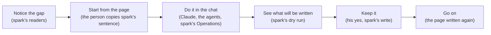
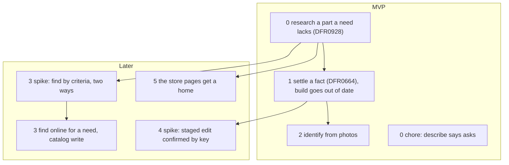

# Story map
<!-- Proposed, not applied: this map stays here until the decider confirms it; nothing changes the product's own
map file. -->
**Status:** proposed, not applied <!-- REQUIRED:map-status -->

The map comes from the architect's synthesis (`council/synthesis.md` part 5). Every slice is a proposal until the
decider confirms it. A slice marked MVP moves a basic project closer to a breadboard with working firmware (AGENTS.md).

## Backbone
<!-- The activities, left to right, as the user does them. e.g. `Assign → Notice → Act → Close` -->
Notice the gap → Start the job from the page → Do it in the chat → See what will be written, and where → Keep it → Go on <!-- REQUIRED:backbone -->

## Slices
<!-- Walking skeleton first: the thinnest slice that runs end to end. One row per story. job: a job in
jobs-and-journeys.md. tag: as in the brief. proof: something the decider can read. -->
| slice | activity | story | job | tag | proof |
| --- | --- | --- | --- | --- | --- |
| 0 walking skeleton <!-- REQUIRED:slices --> | Notice, Start | A need with no fitting pick shows "Ask Claude: research a part you name", with a sentence spark fills from its records. He pastes it, `/spark:research` writes the record in the project, `/spark:page`, and the part is a pick. MVP | b, e | E ★C10, ★C2, ★C13 · H the architect | a walk row on the DFR0928 (in the drawer, count 1, no record), `flow.py show --json` listing the offer's key and its sentence, then a build |
| 0, beside it | Start | `--describe` prints the word for an Operation that asks, lists `research-part`, and a test keeps such an Operation off the page's allow-list. MVP chore | e | E C19 | `parts.py --describe --json` shows the word, and the test fails when one enters the allow-list |
| 1 | Notice, See, Keep | A picked part with unchecked facts shows "Ask Claude: go through its unchecked facts". Claude asks what he saw or measured, `fact-set` shows its lines and where they land, and his yes writes. MVP | a | E ★C3, ★C8, ★C16 | `parts.py --unverified dfr0664-tft-2in` prints 9 before and fewer after, each new fact with a source that names who, when and how |
| 1 | Go on | The build record stamps each part and board record it read, and the build reads out of date after one changes. MVP | a | E ★C4 | change one fact with `--fact-set`, and `flow.py show` names the build as out of date |
| 2 | Start, Do | The same "Not here?" tile offers "It is in my hand". The page says how to shoot (both sides, flat, a ruler). It hands over to the chat, where Claude shows what it read before any search. MVP, small | c | E jobs-and-journeys.md job c, USER-14 | a walk row on one module with no known marking, whose record passes `--validate` on the first try |
| 3 | Do | Spike: one real need run two ways (part-finder on a module, parts-researcher asked to compare), with the candidates and the tokens counted. Later | d | E ★C11, ★C9 | a finding with each way's candidates, their fits and lacks lines, and `run_cost.py`'s count |
| 3 | Start, Do, Keep | "Ask Claude: find online" for a need, with the criteria read from the need. Two candidates show before any record. A catalog write Operation keeps the ones not chosen. Later | d | E ★C14, ★C12 | a walk row, and `parts.py --catalog` listing the one not chosen, written by the Operation |
| 4 | See, Keep | Spike: a staged edit that the page confirms by its key, refused when the record changed since the page was read. Later, after the decider's Q2 answer and P1152 | a | E ★C1, ★C6 | an experiment in a scratch folder: a stale page's confirm is refused, and P1122's test still passes |
| 5 | Notice, Start | The store pages get a home: StorePart's "Not known yet" state, a drawer entry's edit, research with no project. Later, after the decider's Q4 answer | b, a | E ★C13 | a walk row from the Store row of the DFR0928 |
| paused | — | Board record edits (after P230), pins on a picture (P276), a numeric filter over records, a source-kind field per fact, a photo upload | a, c, d | H the architect | — |

## Overlaps, per slice

| slice | absorbs | touches | leaves |
| --- | --- | --- | --- |
| 0 | the research half of P992 #1445 | P1082 #1587 (the page's allow-list) | P734 #1005, P276 #312 (the picture) |
| 1 | P1002 #1461 (offer each bench finding to the store) | P998 #1457 (the person's word), P1003 #1462 (a bench trial), P340 #434 (what is still open). It builds change 6 of the P1160 #1696 finding (Done) | P997 #1454 |
| 2 | the identify half of P992 #1445 | P1164 #1700 (both take a photo in, for different jobs) | P1162 #1698 (drag and drop) |
| 3 | — | P340, P997 | P884 #1252 (prices and buying stay out) |
| 4 | — | P998, P1152 #1688 (kept steps) | — |
| 5 | — | P1124 #1654, P735 #1010 (shares the research run and the records) | P735's batch of every DFRobot part, and its pictures |

## Delta to the product's map <!-- REQUIRED:spark-process:map-delta -->
<!-- The rows to add or change in the repository's own story map file, in that file's table shape, with its journey
step numbers; proposed, not applied. "n/a — no map file" is allowed. -->
Proposed, not applied, for `scrum/STORY_MAP.md`'s table "The journey, and what spark offers at each step":

| # | step | spark today | gap |
| --- | --- | --- | --- |
| 2 | Know what you own | (unchanged) | add: a fact of a record is settled only by a file Claude writes; the page offers no job for an unchecked fact (P1161 slice 1) |
| 3 | Choose parts | (unchanged) | add: a need with no fitting part has no way out on the page; research, identify and find start only from a typed command (P1161 slices 0, 2, 3) |

The journey picture in `tools/journey.py` and the README's "What works today" change only in a PR that changes a
step's status (AGENTS.md, "Keep the journey current").
