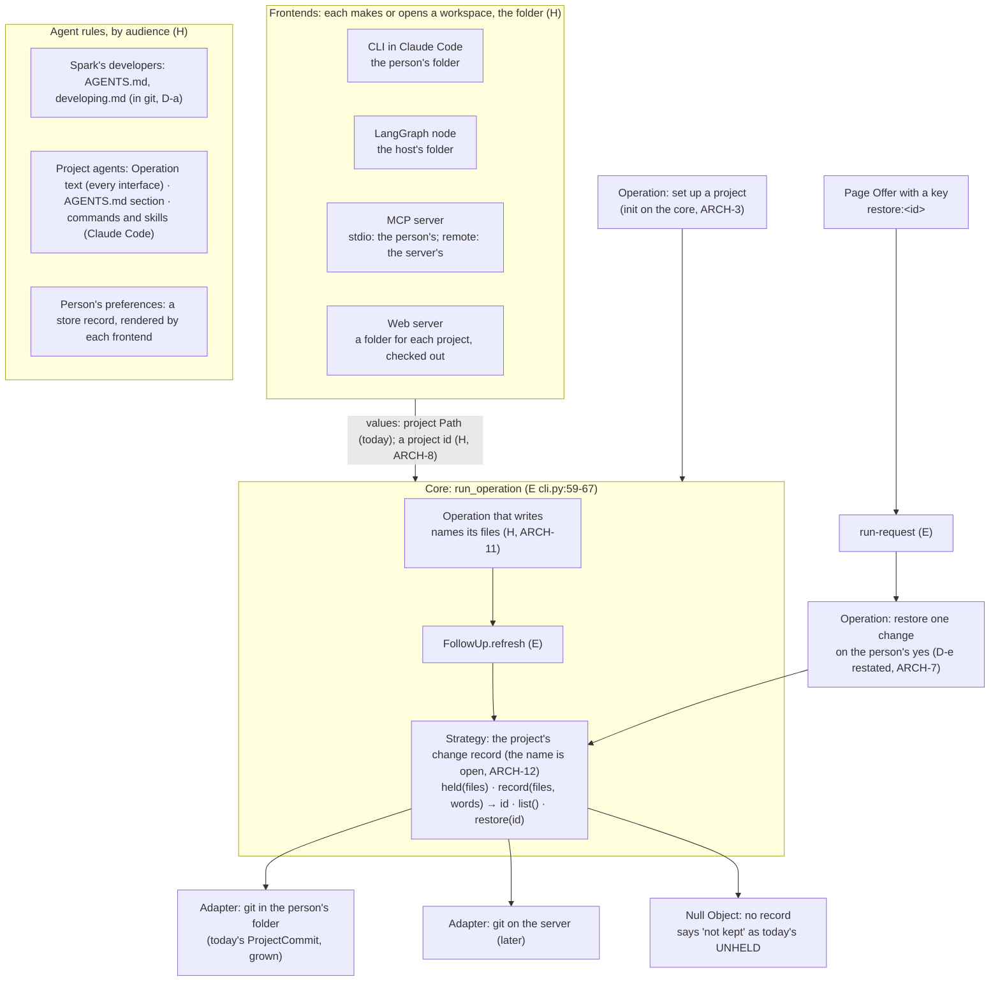

# Architecture lens: spark and git across the interfaces

The architecture lens (Opus), 2026-11-25, read at 142656a9 in the worktree `spark-git-discovery`. Read only. No web.
Tags: E with a pointer, H with its source, D with who and when. A dash means unknown.

## Findings

- **ARCH-1** · "A project is a folder on a POSIX disk" is already a core fact. "A project is a git repository" is not:
  git is one Adapter with one caller. Every Operation's `--project` is a `Path` (`scripts/spark/core/operation.py:37`).
  The project's files are read as plain reads, "about 14 calls in 9 modules" on the look path alone, and "a read seam is
  a rewrite, not a seam" (P788 #1094 body, still open). The only code that runs git is `ProjectCommit`
  (`scripts/spark/records/project_commit.py:27-29`), and its only caller is `write_brief`
  (`scripts/spark/build/project_setup.py:421`). · E · supports: a neutral history seam costs one caller now. A
  workspace that is not a folder (an object store) is P788's rewrite. Until P788, every interface, the website's server
  too, needs a real folder for each run.
- **ARCH-2** · The git Adapter is built inside the area's function, so no interface can replace it.
  `ProjectCommit(path.parent.parent)` is built inside `write_brief` (`project_setup.py:421`), and `OutsideWorld` has no
  slot for it (`scripts/spark/core/outside.py:42`, `SLOTS` at `:71`). A LangGraph node, a server or a test cannot give
  its own history or "none". The catalogue's rule already says how to add one: "a dependency comes from the frontend
  through `outside`, or as a constructor keyword with a harmless default" (`scripts/spark/operation_catalogue.py:7-9`).
  · E · supports: the smallest seam is a Strategy for the project's history, injected, with a Null Object (no history)
  as its default and the git Adapter as one implementation.
- **ARCH-3** · init is not on the core, so on any interface but the CLI nobody can call it.
  `scripts/init_project.py:44-133` parses with argparse and prints. The catalogue holds 50 ops and no init or brief op
  (run 2026-11-25: `CATALOGUE` listed 50 ops; those whose names hold init, brief, project or needs are `needs`,
  `needs-drop`, `needs-set` and `register-project`). The brief's answers go through a file in the system's temp folder,
  written with Claude Code's Write tool (`commands/init.md:58-60`). The core's `payload` Argument would hand an MCP
  client the object instead (`operation.py:23-24`). · E · supports: D-q4 has no answer on MCP, LangGraph or the
  website until init and the brief write are Operations in `build_operations` (a #94 move).
- **ARCH-4** · Nothing in spark makes the folder or the repository. And P1027's own rules mean a fresh repository never
  gets the brief's first commit. `why_project_refused` refuses a missing folder (`project_setup.py:523-524`). The
  folder is "picked with the person" (`commands/idea.md:26`). No `git init` is in `scripts/` (`git grep`). Spark
  "never stages with `git add`" (`project_commit.py:5`), and `held_as_is` answers UNHELD for a file that is not in HEAD
  (`project_commit.py:71-73`). So the first write of `project.json` gets no commit even inside a new repository.
  · E · supports: the brief's outcome ("its own repository and its brief commit … with no step by hand", brief.md:17)
  needs two changes. Someone makes the repository, and a first commit adds the new files. The second changes P1027's
  standing rule, which is the PO's to decide (D).
- **ARCH-5** · Spark has three ways back, with nothing in common. (a) A git commit of the brief (P1027,
  `project_commit.py`). (b) One previous copy of a replaced file, `.spark/previous/<name>.txt` (P874,
  `scripts/spark/build/build_record.py:154-160`, with callers in `kept_files.py:157` and `design/entry_origin.py:175`).
  (c) Spike P1117 #1646, still open: "the page has no real way back to an earlier build, because spark keeps one build".
  The word "commit" also means two things: `PreviousVersionFiles.commit` (`build_record.py:158`) and a git commit.
  That breaks names rule 1 (`docs/guide/patterns-and-names.md:216`). · E · supports: answer D-q3 and P1117 as one seam,
  or a website undo needs three back ends.
- **ARCH-6** · The areas' sentences name git and a shell. `COMMITTED` says "To go back, run in this project: git revert
  --no-edit %s" (`project_setup.py:383`). `MUST_ASK_MESSAGE` and `BRIEF_WHY` name git too
  (`scripts/spark/flow/flow_codes.py:376-383`), and so does `ANSWERS_HELP` (`init_project.py:35-41`). The undo's
  procedure exists only in a Claude Code command (`commands/idea.md:78-87`). This goes against S1, "an area's sentence
  says the job, and each interface adds its own how", an acceptance line on #1105 piece 6
  (`docs/discovery/2026-11-23-p1039-rd-direction/direction.md:131`). It also goes against names rule 2, "only the
  adapter that wraps a tool carries the tool's name" (`patterns-and-names.md:217`). · E · supports: on MCP, LangGraph or
  the website these lines send the person to a shell they do not have. Seam: the area says the job and returns the
  change's id as data. Each interface says how to go back.
- **ARCH-7** · D-e closes the website's undo as it is worded. "Spark's own code never runs it"
  (`commands/idea.md:79`), and the Adapter "never runs `revert`, `reset`" (`project_commit.py:5`). On the website the
  buttons go through the server (the PO, message 6), and no Claude is there to run `git revert` after a yes. So server
  code has to run the restore. The page's design already counts "the page's confirm, after the effect line" as the
  person's yes for a pick and a build, and says that "a way back is an offer with a key" (the architect's page actions
  note, `~/.local/share/spark/councils/p1113/architect-page-actions.md` §3, §5). · E for the conflict, D (the PO) to
  settle · supports: keep "only on the person's yes" on every interface. Drop "spark's code never runs it" only for a
  restore Operation that is reached as an Offer through `run-request` and declares its effect.
- **ARCH-8** · A project is known by its local path, so a server checkout or a LangGraph sandbox would look like a new
  project each time. `KnownBoardStore` names its file by "16 hex of sha256 of the resolved folder, so a moved project
  asks once more" (`scripts/spark/bench/known_board.py:417-419`). The projects list is keyed by the folder
  (`scripts/spark/sourcing/record_home.py:116-121`). The page's fingerprint "hashes no project id" (the architect's note,
  "Not checked"). "A sandbox is another folder" (`patterns-and-names.md:64`). · E for the keys. H (this lens's reading)
  for the effect: a server that checks a project out into a fresh folder per run gets a new identity each time. ·
  supports: a project id kept in `.spark/` as the store's key is the seam that keeps the server open.
- **ARCH-9** · One rules file serves three audiences, and only Claude Code can read it. `rules.md` begins "Rules for
  every spark project" and then the team's cards, lanes and hook (`~/.local/share/spark/rules.md:1-14`). init links it
  into every project as `CLAUDE.local.md`, a link to an absolute store path (`scripts/spark/build/ai_files.py:85-97`).
  The spark repository's own `CLAUDE.local.md` links the same file (`ls -la`: `CLAUDE.local.md -> ~/.local/share/spark/rules.md`).
  · E · supports: D-q1 needs three homes, one per audience. (1) Spark's developers: `AGENTS.md` and
  `docs/guide/developing.md` in git, which is D-a. (2) Agents on a project: shipped with spark. (3) The person's
  preferences: a record in the store, which each interface renders in its own way. A link in a file reaches no agent on
  a server.
- **ARCH-10** · Only the Operation's own text reaches every interface. The `summary`, `details`, `input_schema` and the
  codes' fix lines become MCP tool descriptions (`operation.py:79-82`, `114`). Commands and skills reach Claude Code
  only. The `AGENTS.md` section that init writes is tool-neutral, but it links the guide on GitHub's `main`
  (`data/agents-section.md:3-4`), not the installed version (`.claude-plugin/plugin.json`: 0.9.0). · E · supports: a
  rule that must hold on every interface goes into the Operation's text or is enforced by effect in a script, as in P1039
  D3 Q12 (`docs/discovery/2026-11-23-p1039-rd-direction/brief.md:107`). The version skew is H: no run read both guides.
- **ARCH-11** · Commits are made per file in one area, not per run in the core. 24 of the 50 ops declare `writes` (the
  same run). Only 3 name the project they write (`written_project`: `deploy_image.py:501`, `build_board.py`,
  `pick_parts.py:68`), and it gives a folder, not files. The core already has a step after an ok write, `FollowUp.refresh`,
  called from `run_operation` (`scripts/spark/core/follow_up.py:12-28`, `cli.py:59-67`). · E · supports: D-q3 "through
  which layer". A history Strategy in `RunOptions`, called as the follow-up is called, records one change per run.
  Each Operation would need to name the files it wrote (`--only` already takes named files).
- **ARCH-12** · The words are taken. "History" is the person's event log, `history.jsonl` (`docs/guide/how-it-works.md:224`).
  "Port" is a Value, the serial port (`patterns-and-names.md:20`). "Revision" means a board's hardware revision
  (`scripts/spark/core/replies.py:34`, `scripts/spark/checks/physics_check.py:404`). "Commit" is taken (ARCH-5). · E ·
  supports: the seam's name needs the names table before any plan. "A project is git", "a version port" and "history"
  each collide today.
- **ARCH-13** · LangGraph keeps its own history of a graph's state (its checkpointer), beside the files' history. ·
  H (model knowledge, not read) · supports: P820's rule, "The project's files are the truth"
  (`docs/discovery/2026-11-15-p820-artifact-interface/mvp-plan.md:89`), carried over. Graph state holds the ids of the
  file changes, never the files. Spark's `Storage` follows LangGraph's `BaseStore` for the store
  (`scripts/spark/records/storage.py:5-8`), not for the project.
- **ARCH-14** · Two more places know git, and their job is privacy. `store.inside_git` refuses a private place inside
  a work tree (`scripts/spark/records/store.py:145-146`, `202-208`, `386-390`). `AiFiles.excluded` writes
  `.git/info/exclude` itself (`ai_files.py:99-112`). The commit needs the person's own git identity
  (`user.useConfigOnly`, `project_commit.py:85`). · E · supports: the guards stay git-specific, because they prevent a
  `git add .`. A server has no person's git config, so the identity becomes the Adapter's value (H).

## Interfaces

| interface | owns the workspace | makes it | runs git | history and undo mean | agent rules live |
| --- | --- | --- | --- | --- | --- |
| CLI in Claude Code (today) | the person: a folder on their disk (E `operation.py:37`) | the person or Claude, "picked with the person" (E `commands/idea.md:26`). Spark refuses a missing folder (E `project_setup.py:523`). Nobody runs `git init` (E) | spark commits the brief alone (E `project_setup.py:421`). Claude runs `git revert` on the person's yes (E `commands/idea.md:78-79`). The person runs everything else | `git log`, and one revert per brief write, newest first. `.spark/previous/` holds one copy of a replaced file (E ARCH-5). "Your history" is the store's event log, another thing (E ARCH-12) | developers: `AGENTS.md`, `developing.md`, `rules.md` and memory. Project agents: commands, skills, the project's `AGENTS.md` section, the Operation's text. Preferences: `rules.md` through `CLAUDE.local.md` (E ARCH-9) |
| code: a LangGraph graph | the graph's host. A folder, because the project's reads are plain reads (E P788). "A sandbox is another folder" (E `patterns-and-names.md:64`) | the host's code. No Operation makes or sets up a project (E ARCH-3) | — today: only the brief commit, with the git Adapter built in (E ARCH-2). Proposed: an injected history Strategy (H) | proposed: the files' changes through the history Strategy, the graph state's own checkpoints apart (H ARCH-13). Undo: a restore Operation (H) | the Operation's text and the graph's system prompt. Commands and skills do not reach it (E ARCH-10). Preferences from a store record (H) |
| MCP, local (stdio) | the person, a folder on their disk (H: the server runs as the person) | the client's agent, or the person. A set-up Operation needs init on the core (E ARCH-3) | the MCP server process, as spark: the commit, and the restore Operation only on a yes (H) | as the CLI, but the "run git revert" lines do not fit (E ARCH-6). Undo as a tool (H) | tool descriptions from `summary` and `details` (E `operation.py:79-82`). An MCP prompt could carry what a command carries (H). `AGENTS.md`, if the client reads it (H) |
| MCP, remote (SSE or HTTP) | the server's operator, a folder on the server (H, ARCH-1) | the server, on a "new project" call (H) | the server only (H) | the server's history Adapter. No person's shell, no person's git identity (H ARCH-14) | tool descriptions only. Preferences from the person's account on the server (H) |
| hosted website (the PO's message 6) | the server, a folder for each project, from a repository or an object store it checks out (H. An object store directly is P788's rewrite, E) | the server, on the page's "new project" (H) | the server only. Buttons go through the server (D the PO, message 6) | the page lists the changes spark made, in spark's words. Undo is an Offer with a key through `run-request`, confirmed on the page (E the architect's note §3, §5; the P1117 card). D-e as worded forbids it (E ARCH-7) | no agent reads files unless the server runs one. Rules are enforced by effect in the scripts (E P1039 D3 Q12). Any model the server calls gets the Operation's text (H) |

## Proposed seams (H)

All of it is a proposal (H). The smallest now, if the PO wants one: inject the history Strategy where `write_brief`
builds `ProjectCommit` (ARCH-2), and move the git words out of the area's sentences (ARCH-6). The rest rides on the
cards that already hold it: init on the core (#94), P788, P1117, and S1 and S7 on #1105.

## What I could not check

- How LangGraph's checkpointer and MCP's roots behave: no web, so ARCH-13 and the MCP rows stay H.
- Whether `git commit --only -- <untracked>` fails, or only `held_as_is` stops it first: not run. ARCH-4 rests on
  `held_as_is` alone (`project_commit.py:71-73`).
- The site count for a set-up Operation and for a project id as the store's key: not counted.
- How many of the 24 ops that declare `writes` write to the project and how many to the store or a board: not
  sorted.
- Whether the guide on `main` and the 0.9.0 guide differ in any rule an agent reads (ARCH-10): not compared.
- The PO's 23 folders (8 with a repository) were not read again. That count is the brief's.

## Questions for the decider

- Is "a project is a git repository" a rule of the core, or the CLI's default Adapter behind a neutral seam? · decides
  D-q2 and D-q3 for every interface, and whether the server may keep history without git.
- Does spark make the repository and its first commit, which means `git add` of the files spark wrote and so a change to
  P1027's "never stages"? · decides D-q2 and D-q4, and whether the brief's outcome can be met (ARCH-4).
- On the website, may server code run a restore after the page's confirm, with D-e restated as "only on the person's
  yes"? · decides whether the website can have undo at all (ARCH-7).
- One way back or three: do D-q3 and P1117 become one seam, with `.spark/previous/` behind it? · decides the undo's
  back end and the word "commit" (ARCH-5).
- Is a change recorded per Operation in the core, or per file in each area as today? · decides D-q3's layer and whether
  each Operation names its files (ARCH-11).
- Does init move onto the core now, before any second interface? · decides who can call init outside the CLI (ARCH-3).
- Where do the person's preferences live: the store as a record, or a file linked into each project? And does
  `rules.md` split into the team's rules and the person's? · decides D-q1's third home (ARCH-9).
- Does a project get an id that the store keys on, instead of its path? · decides whether a server checkout or a sandbox
  is the same project (ARCH-8).
- What is the seam's word: "history", "revision" and "commit" are taken? · decides the names table entry (ARCH-12).

## Searches

None.
