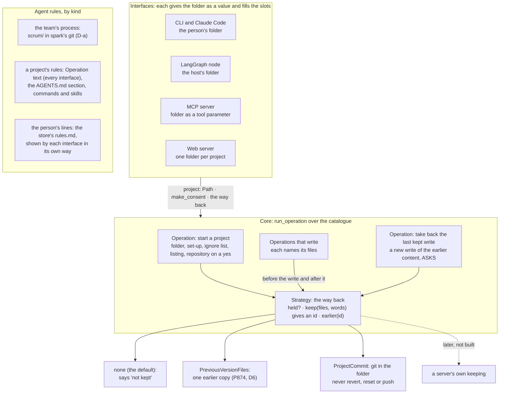

# Synthesis: spark and git (whose rules, which repository, which folder)

The architect, on Fable 5.2, 2026-11-25 (Europe/Prague), read-only at 142656a9 in the discovery's worktree. Read: the
brief, the six council reports, the code they cite, the PO's architecture words and his rule "The core is important".
Nothing here is decided: every option, direction, pass line and item is a proposal for the PO. Tags: **E** evidence
with a pointer, **H** a belief with its source, **D** a decision with who and when. ★ marks a claim that a decision or
an option rests on. Home paths are written `~/...`.

> **Short version.** The lenses agree on the facts: one rules file serves three audiences, nothing in spark makes a
> folder or a repository, the brief's commit never fires on a new project, init is not on the core, and spark writes no
> ignore list. They split on how much git spark should own. The proposed direction (my opinion): split the rules by
> audience with no code; write an ignore list at init; put "start a project" on the core; keep git behind one injected
> seam with "no way back" as its default; and make undo a new write of the earlier content, only on the person's yes.
> None of it is on the path to a breadboard, so the cheap and protective steps go first and the rest waits for a walk.

## 1. Where the lenses agree and where they split

### Agree

| # | What all lenses that looked agree on | Who |
| --- | --- | --- |
| G1 | The readers of the rules are three, not two: the agents that develop spark, the agents on the PO's own projects that run the team process (lanes, PRs, issues), and the agents on a stranger's project | PO-3, UX-12, ARCH-9, USER-11 |
| G2 | One file, the store's `rules.md`, reaches all three today, and most of its lines are the team's | PO-1, PO-2, USER-11, TL-7, UX-1, ARCH-9 |
| G3 | No spark step makes the project's folder or its repository; init refuses a folder that is not there | PO-6, PO-11, USER-1, TL-3, ARCH-4, UX-10 |
| G4 | The brief's commit (P1027 slice 2) never fires on a new project without a git step by hand, and it has never fired in the field | USER-2, USER-3, TL-4, ARCH-4, UX-2, PO-9 |
| G5 | init, the brief write, the commit and the undo are no Operations, so only the CLI can start a project | PO-12, TL-2, ARCH-3, UX-8 |
| G6 | spark writes no ignore list; the ignore list must exist before a repository does | PO-19, TL-6, USER-12, USER-4 |
| G7 | D-e as worded ("spark's own code never runs it") leaves every interface but Claude Code without an undo | PO-13, TL-10, ARCH-7, UX-7 |
| G8 | The core already has the channel for a person's yes (the ASKS effect and `make_consent`, filled by each frontend) | TL-10, ARCH-7, UX sketches |
| G9 | The words are taken: history, commit, revision, Port, versions, rules, init | TL-12, ARCH-12, UX-5 |
| G10 | Nobody is blocked today, and none of this is on the path to a breadboard with working firmware | PO-24, the tech lead's "against the one bar" |

### Split (each becomes a question in part 6, or a design-stage choice)

| # | The split | Sides | Goes to |
| --- | --- | --- | --- |
| S1 | Where the person's own preferences live | a store file linked into each project, with the team's rules moved out so that the links keep working (tech lead) · a store record that each interface renders (architecture) · Anthropic's user scope, `~/.claude/rules/` (research) | Q2 |
| S2 | Who makes the repository | init always · init after a yes (UX) · the person, as other tools leave it (research RES-24, RES-26) · the ignore list first in any case (PO assistant) | Q5 |
| S3 | A project inside another repository | commit into the outer one, as the adapter does today (tech lead, user) · a repository of its own · refuse (PO assistant's Q-e) | Q7 |
| S4 | Which writes are committed | the brief only, as today · the records the person decided (tech lead's question) · every write, which churns `page.html` (UX-13) | Q8 |
| S5 | The layer of the seam | an `OutsideWorld` slot (tech lead) · a Strategy in `RunOptions`, called as the follow-up is (architecture) · a constructor keyword with a harmless default (the catalogue's rule) | design stage, the architecture lens; not the PO's |
| S6 | Whether spark gets an undo at all | an undo Operation after D-e is restated (tech lead, architecture, UX) · pause history and undo as tooling until a walk shows the need (tech lead's order; PO assistant's pre-mortem 6, "spark grew into a git client") | Q9, Q10 |
| S7 | What an undo covers | the project's files only · also the store's side of a write, the holds (UX-3) · D6's one previous version against "revert and all these things" (USER-6) | Q9 |
| S8 | The words a maker reads | git's own (today) · spark's words with git underneath, as hosted tools do (UX, research RES-22, RES-23) | Q11 |
| S9 | Staging | `git add -N` for a file spark made (tech lead, architecture) against P1027's "never stages" | Q6 |
| S10 | The folder | a default home and a projects command (UX-10) · the folder is a parameter that the caller picks (research RES-12, RES-13, RES-21) | Q3, Q4 |
| S11 | How far to prepare the website now | a project id as the store's key and a store per person (architecture, tech lead) · the vision's non-goal, nothing designed before a design needs it (PO assistant A7) | Q12 |
| S12 | The project counts | "8 of 23" (brief) · "9 and 14 of 23" (tech lead, UX) · "37, 15, 22, 9, 13" (PO assistant) | settled in part 2, C1 and C2 |
| S13 | Where the open home of "init onto the core" is | the tech lead names #94 | a fact: #94 is closed, the open epic is P793 #1105 (C36) |

## 2. Reconciled facts the options rest on

"Re-run" means the architect ran it again on 2026-11-25, read-only or in a scratch folder that was removed.

### The project counts

- [★C1] 37 folders under `~/Development/*` and `~/Development/spark-walks/*` hold `.spark/project.json`. 15 are
  worktrees of one repository. Of the other 22, 9 are the top of their own repository and 13 have none. One of the 9
  has no commit, so 8 have history · E PO-7; re-run: a read-only `git rev-parse --show-toplevel` and `--git-common-dir`
  loop gave `13 none, 9 own, 15 worktree` · caveat: the PO's folders, n = 1.
- [C2] The three counts read three sets. The store's projects list has 28 entries, 23 of whose folders exist (9 with a
  repository, 14 without); 5 are gone, all under a temp folder · E TL-8, UX-10; re-run: 28, 23, 5. The brief's "8 of
  23" is the 22 folders of C1 plus one folder with a `.spark/` and no `project.json`, with the repository that has no
  commit counted as none · E PO-7. The two sets of 23 are not the same set · H that the listed 23rd folder is that same
  one (not checked). The brief's "some inside another" is the 15 worktrees and their main checkout, 16 folders on one
  repository · E USER-5.
- [★C3] 29 `CLAUDE.local.md` links point at the store's `rules.md`: 22 project folders, one more folder, spark and 5
  spark worktrees. The 15 game worktrees have none · E PO-1, USER-11; re-run: `find ~/Development -maxdepth 3 -name
  CLAUDE.local.md -type l` gave 29 · the missing links in worktrees fit RES-4 (a gitignored local file exists only in
  the worktree where it was made).
- [★C4] No repository holds a `spark:` commit. A replay of the adapter's check says 6 of the 9 would commit the brief
  and 3 would not (an untracked brief, no commit yet, a `.gitignore` that ignores `.spark/`) · E PO-9, USER-3, TL-8 ·
  caveat: the commit code is two days old, so this shows no rejection.

### Rules

- [★C5] `rules.md` is titled "Rules for every spark project", and init links it into every project. By its text: the
  Words, the session start, "What every PR needs", the core rule, Miro and the day close are the team's; "What waits on
  him", "Talking to him", Never, the shell line and the shops line are about the person · E PO-2, the user lens's
  table; `scripts/spark/build/ai_files.py:36, 84-97`; the core rule at `~/.local/share/spark/rules.md:39-42` · caveat: a
  sort by the text; the PO says where each line belongs.
- [★C6] The PO's own projects run the team process (a second lane in `rules.md:11-12`, PR merges and issue numbers in
  two project repositories) · E PO-3, UX-12 · what a stranger's agent needs is H: no outsider has installed spark
  (PO-20 A1).
- [★C7] A `CLAUDE.local.md` stops Claude Code's default reading of `AGENTS.md`, and a `CLAUDE.md` that holds
  `@AGENTS.md` is the documented bridge. init writes exactly that · E RES-1, RES-2;
  `scripts/spark/build/ai_files.py:6, 26-27, 66-82` · this retires the H in PO-5.
- [★C8] An import from outside the project asks for approval once per project, and a decline is permanent. User-scope
  files need none but reach every project on the machine. No tool-neutral home exists for a person's own rules · E
  RES-4, RES-16 to RES-18; it matches the reason in `ai_files.py:8-9`.
- [★C9] The section spark writes into a project's `AGENTS.md` has 8 lines and three rules. It says nothing about git,
  the folder, a way back or the person's yes, and it links the guide on `main` · E `data/agents-section.md:1-8`.
- [★C10] Only an Operation's own text (`summary`, `details`, `input_schema`, the codes' fix lines) reaches every
  interface. Commands and skills reach Claude Code only. A plugin cannot ship an instruction file that always loads · E
  ARCH-10, RES-5; `scripts/spark/core/operation.py:113-127` · no Anthropic page read says how a plugin should write
  instruction files into a project (RES-7, unknown).
- [★C11] The store refuses to sit inside a git work tree. So "in git" (D-a) and "in the store" exclude each other for
  one file · E `scripts/spark/records/store.py:145-146, 202-208, 386-390`.
- [C12] A `CLAUDE.local.md` that links anywhere else stops init's link step. Moving the linked file means a step by
  hand in each of the 29 places · E `ai_files.py:86-90`, TL-15.

### A project's repository

- [★C13] No spark code makes a folder or runs `git init`. init refuses a missing folder, and `/spark:idea` says "Pick
  the project's folder with the person: their project's folder, or a new one" with no command for it · E
  `scripts/spark/build/project_setup.py:520-524`; `commands/idea.md:25`.
- [★C14] On a new repository the brief's commit cannot fire. `held_as_is` answers UNHELD for a file that is not in
  HEAD, `git commit --only` refuses an untracked file, and the adapter never stages. With `git add -N` first, `commit
  --only` commits that file alone and leaves the person's staged file staged · E
  `scripts/spark/records/project_commit.py:5, 71-73`; TL-4; re-run in scratch: `error: pathspec './new.json' did not
  match any file(s) known to git`, then exit 0 with `A  mine.txt` left staged.
- [★C15] spark writes no `.gitignore`. Two of the 9 repositories track flash images or simulation runs. No secret file
  is tracked in any of them. P1004 #1463 is open · E PO-19, TL-6, USER-12; `gh issue view 1463` · caveat: names were
  counted, no file was opened.
- [★C16] init writes the exclude line for `CLAUDE.local.md` only when a repository exists at init time, and into the
  first `.git` it finds walking up. A `git init` after init, then `git add -A`, commits the link, whose content is the
  store's absolute path · E USER-4 (experiment F), `ai_files.py:99-112` · re-run: none of the 9 repositories tracks
  `CLAUDE.local.md` today, so this is an open door, not a present leak.
- [★C17] A project inside another repository commits into that repository, and the line names no repository. 16 of the
  37 folders share one repository · E USER-5, TL-13, `project_commit.py:27-29`.
- [C18] A repository made inside another one and left with no commit makes the outer repository's `git add -A` fail
  ("does not have a commit checked out") · E re-run in scratch · with a commit it becomes an embedded repository: H,
  git's documented behaviour, not run.
- [C19] The commit refuses a missing git identity · E `project_commit.py:82-85`; re-run with no global config: "Author
  identity unknown".
- [C20] Claude already makes the repositories and the commits in the PO's projects, by hand, case by case · E PO-10 ·
  an account, n = 1.

### What spark does with git

- [★C21] `ProjectCommit` is the only code that runs git. It is built inside `write_brief`, starts git with its own
  `Popen`, and no interface can swap it · E `project_commit.py:27-28, 41`;
  `scripts/spark/build/project_setup.py:421`; ARCH-2, TL-2.
- [★C22] spark has three ways back with nothing in common: the brief's commit, one previous copy in
  `.spark/previous/<name>.txt` (P874), and the open spike P1117 #1646. A person meets five, counting the chat and a
  hand edit · E ARCH-5, UX-4; `scripts/spark/build/build_record.py:153-160`.
- [★C23] The catalogue holds 50 Operations, and none is init, a brief write, a commit, a list of changes or an undo ·
  E re-run: 50 · 24 declare `writes` and 3 name the project they write (TL-5, ARCH-11; not re-run).
  `written_project` gives a folder, not files · E `operation.py:108-112`.
- [★C24] The core parts an answer can reuse exist: the ASKS effect and `make_consent` as a frontend's slot
  (`scripts/spark/core/outside.py:42-43, 71`), the follow-up after an ok write (`scripts/spark/core/follow_up.py:12-28`,
  `cli.py` `_followed`), the `payload` Argument that hands an MCP client an object in place of a temp file
  (`operation.py:23-24`), the page's allow-list of three Operations (`scripts/spark/flow/run_request.py:42-44`) and
  the rule for a new dependency (`scripts/spark/operation_catalogue.py:7-9`) · E.
- [★C25] D-e: "offer to run `git revert --no-edit <sha>` … run it only after their yes. Spark's own code never runs
  it", and "Claude's permission prompt for git revert is expected; do not widen allowed-tools" · D P1027 ·
  `commands/idea.md:78-79, 87`.
- [★C26] Two statements of the PO pull apart. D6 of P867: "spark also keeps one previous version to return to …; a
  full undo history is not wanted" · D the PO 2026-11-17 ·
  `docs/discovery/2026-11-17-p867-journey-redefined/brief.md:136`. And: "make Spark be able to work with Git and revert
  and all these things" · the PO 2026-11-25, a wish in the request, not yet a decision.
- [C27] git can take back only the project's half of a pick; the store's hold stays · E UX-3.
- [C28] `/rewind` does not cover a file that only Bash changed, so it does not cover spark's writes · E RES-8.
- [C29] An allow rule or auto mode removes the permission prompt that D-e leans on; the classifier still blocks
  commands that discard work and allows a push · E RES-9, UX-7.
- [C30] The areas' sentences name git and Claude: `COMMITTED` says "git revert --no-edit", and 29 lines in
  `scripts/spark` say "Ask Claude" · E `project_setup.py:383-386`; re-run: `git grep "Ask Claude" -- scripts/spark`
  gave 29 · names rule 2 keeps a tool's name on its adapter (`docs/guide/patterns-and-names.md:217`).
- [C31] "history" is the store's event log, "commit" is also `PreviousVersionFiles.commit`, "revision" is a board's,
  and "change" has `ChangeList` at the bench (`scripts/spark/breadboard/bench_changes.py:293`). "The way back" is
  already the docs' and the code's phrase for this job (`project_setup.py:382`, P1117's title) · E TL-12, ARCH-12; the
  last two by the architect's grep.
- [C32] A tracked `page.html` is written again after every write, so a commit per write churns it or leaves the tree
  dirty · E for the facts (UX-13, not re-read) · H for the consequence.

### The interfaces

- [★C33] A project is a `Path` on a disk, and its files are read as plain reads. A workspace that is no folder is
  P788 #1094's rewrite, still open · E ARCH-1; `operation.py:37`; `docs/guide/patterns-and-names.md:64`.
- [★C34] MCP revision 2026-07-28 deprecates Roots and suggests the folder as a tool parameter or a server setting. The
  reference filesystem server takes its folders as arguments · E RES-13, RES-15.
- [C35] LangGraph keeps a graph's state in a checkpointer, apart from any files; its file frameworks take a root folder
  from the caller · E RES-20, RES-21.
- [C36] #94 is closed; the open epic for "every interface from one core" is P793 #1105 · E `gh issue view`.
- [C37] Hosted tools show history in their own words: one puts git underneath (RES-22), one keeps its own versions and
  offers git as a sync into the person's account (RES-23, RES-24) · E.
- [C38] A project is known by its resolved local path, and the store's place comes from the process environment · E
  TL-9, ARCH-8 (not re-read) · that a server needs a project id and a store per person is H.
- [C39] D-d: each MVP card takes the small seam that keeps other hosts open, never the other host · D the PO
  2026-11-16 and 11-23.

## 3. Options per decision

"Fit" answers the PO's four questions of 2026-11-25: an Operation in the catalogue, thin interfaces, reuse, nothing
repeated.

### D-q1: rules per audience, and where each set lives

| Option | Cost | Would prove | Fit with the core | Opinion, tag, caveat |
| --- | --- | --- | --- | --- |
| R-a · Three homes by kind of rule. The team's process moves to spark's `scrum/`, in git, by PR (D-a). What a project's agent must know ships with spark: the `AGENTS.md` section and the Operations' text. The person's own lines stay in the store's `rules.md`, which keeps its path and loses the team's lines | a docs move and a prune, no code; a few lines in `data/agents-section.md` | that a gadget session reads no card, lane or hook rule, and that the 29 links still resolve | reuses `AiFiles` as it is; a rule for every interface goes into an Operation's text (C10); nothing repeated if each line gets one home | the architect's and the tech lead's · H ★C5 ★C7 ★C12 · caveat: the PO's lane projects need one line of their own that names the team's process; the personal part stays out of git (C11) |
| R-b · One file as today, pruned and titled by section ("for spark's developers", "for every project") | the prune only | whether a prune alone removes the confusion | no change | the facilitator's fallback · H ★C5 · caveat: a stranger's project still has none of it, and a gadget session still loads the team's sections |
| R-c · The person's rules move to Anthropic's user scope (`~/.claude/rules/`); init writes no link | docs, and removing a method | that no link, no exclude line and no worktree gap is needed | removes code, but Claude-only: the PO's message 2 asks for "general, not only for Claude" | research's reading · H ★C8 · caveat: the rules then reach every project on the machine, spark's or not |

### D-q2: a project's repository

| Option | Cost | Would prove | Fit with the core | Opinion, tag, caveat |
| --- | --- | --- | --- | --- |
| P-a · spark never makes one. init always writes the ignore list, and the line after a write says in plain words what is missing and the one next step | small: a marked section in the project's `.gitignore`, clearer codes | that a later `git init` by anyone is safe (C16), and how often a person then makes one | a small class beside `AiFiles`, reusing its marker pattern and `is_secret_file`'s rule | the PO assistant's order (the ignore list first) · E ★C15 ★C16 · caveat: the brief's outcome ("no step by hand") is not met |
| P-b · spark offers one at the project's start and makes it on the person's yes: the ignore list, `git init`, one first commit of the files spark itself wrote. In a repository that existed before, P1027's rule stays whole: spark commits a file only when git already holds it | medium: one step in the start Operation, the adapter grown to a first commit of named files | the brief's outcome: N of N brief writes committed on a new project | one Operation, the yes through ASKS (C24), the adapter reused (C21) | the architect's, UX's "init after a yes" · H ★C14 · caveat: needs the PO's word on staging spark's own files (Q6); a person with no git or no identity gets a refusal that must read well (C19) |
| P-c · spark always makes one, silently | as P-b without the question | the same | the same | UX's first option · H · caveat: a `git init` inside another repository nests (C18), and it acts before a yes |

For a project inside another repository: use the outer one and name it (today's behaviour, C17) · refuse the
repository step and work with no way back · make a nested one (C18 speaks against it).

### D-q3: what spark does with git

| Option | Cost | Would prove | Fit with the core | Opinion, tag, caveat |
| --- | --- | --- | --- | --- |
| G-a · As today: the brief's commit only; Claude runs every other git step; D-e as worded | none | nothing new | the adapter stays built inside the area (C21): no other interface has it | the tech lead's "pause b and c" · E ★C4 · caveat: MCP, LangGraph and a server have no way back (G7) |
| G-b · One seam, "the way back": a Strategy the frontend hands in, with three fillings: none (the default, says "not kept"), the previous copy (`PreviousVersionFiles`, D6 as it stands) and git (`ProjectCommit`, grown). The core records one kept write after an Operation that names its files. A take-back is an Operation that writes the earlier content as a new write, on the person's yes, and never runs `revert`, `reset` or `push` | large, in four testable steps (part 4); the first is one caller | that one seam serves P1027, P874 and P1117 (C22), and that an undo exists on every interface | the logic in one small class behind Operations; interfaces only fill the slot and ask the yes; reuses ASKS, the follow-up and the allow-list (C24) | the architect's, from ARCH-2, ARCH-5, ARCH-7, TL-10 · H ★C21 ★C22 ★C25 · caveat: D-e must be restated by the PO; the take-back as a new write is untested (part 5, A2); the store's side of a pick is not covered (C27) |
| G-c · spark exports facts only: each writing Operation names the files it wrote, and each interface commits and reverts in its own way | small in the core, repeated per interface | whether the list of written files alone is enough for Claude | "nothing repeated" fails: every interface writes its own commit and undo | the PO assistant's pre-mortem 6 read as an option · H · caveat: fits "one tool per job" on the CLI, where Claude already commits (C20) |

The tension in C26, as three readings: D6 stands and spark's undo takes back the last kept write only, with older
history left to git itself · D6 is replaced and spark lists and restores any kept write · D6 stands and spark has no
undo of its own.

### D-q4: who makes the folder and calls init

| Option | Cost | Would prove | Fit with the core | Opinion, tag, caveat |
| --- | --- | --- | --- | --- |
| F-a · The person makes it; the README and `/spark:idea` say where and how | docs | whether a clear line is enough | none needed | the facilitator's floor · E ★C13 · caveat: holds on no other interface |
| F-b · Claude makes it: `mkdir` in the command's allowed-tools and steps in the command's text | small | the Claude Code walk only | the logic sits in a prompt, which AGENTS.md forbids ("an agent prompt never repeats its logic") | today's practice written down · E ★C13 · caveat: a spark agent would repeat the same text |
| F-c · A core Operation, "start a project": it takes the folder as a value, makes it when it is missing, writes init's files and the ignore list, lists the project only after the folder exists, and offers the repository (P-b). Claude, a spark agent, an MCP tool and a server all call it. init and the brief write move onto the core first | medium to large: the move under P793 #1105, then the Operation | that a project can start with no step by hand, and from any interface | an Operation in the catalogue, `--json`, the `payload` Argument in place of the temp file (C24); `main()` only parses and prints | every lens that named an answer (TL, ARCH-3, PO-12) · H ★C23 · caveat: the word "init" also means `git init` (UX-5); the name goes through the names table |

### D-q5: how each answer holds per interface

| Option | Cost | Would prove | Fit with the core | Opinion, tag, caveat |
| --- | --- | --- | --- | --- |
| I-a · Seams only (D-d). Four rules, checked by the architecture lens on each card and never built as a host: the folder is a value that the caller gives (MCP: a tool parameter, C34); the yes goes through ASKS; the way back is the frontend's filling; an area's sentence names neither git nor Claude and returns the id as data | none beyond the cards above | by a Fake in the tests: the brief write runs with a fake way back and with none | this is the core's contract, applied | the architect's, the tech lead's ("checked in each card and never built") · H ★C33 ★C34 ★C39 · caveat: no host exists, so each row for LangGraph, MCP and a server stays H |
| I-b · I-a, and now also a project id kept in `.spark/` as the store's key, and a store per caller in place of the process environment | medium, across the store | that a server checkout is the same project each time | a change to the records' keys with no reader today | the architecture lens (ARCH-8), the tech lead (TL-9) · H C38 · caveat: the vision's non-goal on designing ahead (PO-20 A7); the PO is "not sure" about the site |
| I-c · A workspace that is no folder (P788's `Project` Adapter) before any second interface | large, a rewrite of about 14 read sites (ARCH-1) | that a server could run with no disk | the right shape, at the wrong time | nobody's recommendation · E ★C33 · caveat: a server can give each run a real folder until then |

Proposed no-gos and rabbit holes (until the PO confirms): no git host or remote and no push by spark; no history
browser in spark; no commit of build outputs or `page.html` before P1117's answer; no nested repository; no work on a
host that does not exist.

## 4. A proposed direction (the architect's opinion, H throughout)

One design across the five decisions. It is the smallest set that works end to end, then steps that each test alone.

1. **Rules (R-a).** Three homes by kind of rule: the team's process in spark's `scrum/` in git; a project's rules
   shipped by spark, in the `AGENTS.md` section and in the Operations' own text; the person's lines in the store's
   `rules.md` at the same path, so the 29 links keep working. No code.
2. **Ignore list first (P-a's half of P1004).** init writes a marked section into the project's own `.gitignore`,
   with or without a repository: the rules link, the secret files by `is_secret_file`'s rule, the flash image,
   `sim/runs/`, the page's request file. A file in the project folder works at the top of a repository, in a subfolder
   of one and before one exists, which `.git/info/exclude` does not (C16, C17).
3. **Start a project on the core (F-c).** init and the brief write become Operations under P793 #1105. A new
   Operation makes the folder that the caller names, runs the set-up, then lists the project.
4. **A repository on a yes (P-b).** The start Operation offers it. In a repository spark made, the first commit holds
   the files spark wrote. In one that existed, own or outer, P1027's rule stays as it is.
5. **One way back (G-b), in four steps.** (i) The Strategy is handed in where `write_brief` builds `ProjectCommit`
   today, with "none" as its default, and the area's line returns the kept write's id as data. (ii) A writing
   Operation names its files before it runs, as `written_project` names its folder, so the core can ask "held as it
   is?" before the write and record after it. Only the records the person decided are kept: the brief, the needs, the
   requirements, the board's selection. (iii) A read-only Operation lists spark's kept writes. (iv) A take-back
   Operation writes the earlier content as a new write, on the person's yes through ASKS, and is itself kept. D6
   stands: spark offers the last kept write; anything older is git's own, with Claude or by hand.
6. **Interfaces (I-a).** Nothing is built for LangGraph, MCP or a server. Each card above passes the four seam rules.

Steps 1 and 2 are cheap and close a present risk. Step 3 is P793's work in any case. Steps 4 and 5 are tooling by the
one bar (G10): they wait until a walk shows the need, except 5 (i), which costs one caller.

| Interface | Workspace | Who makes it | History and undo | Where agent instructions live |
| --- | --- | --- | --- | --- |
| CLI and Claude Code (exists) | the person's folder on their disk | the start Operation, called by Claude on the person's word; the person names the folder | git in that folder when a repository is there, else the one earlier copy, else none; the yes in the chat or the terminal | the project's `AGENTS.md` section, `CLAUDE.md` with `@AGENTS.md`, `CLAUDE.local.md` linked to the person's `rules.md`, commands and skills |
| In code, a LangGraph graph (H) | a folder that the host gives as the `project` value | the host's code, by the same Operation | the filling that the graph hands in; the graph's checkpoints hold ids, never files (C35); the yes by the host's own pause | the Operations' text and the graph's own prompt |
| MCP (H) | a folder given as a tool parameter, inside the folders the server was started with (C34) | the start Operation as a tool | git in the person's folder for a local server; the yes by the client's own asking (not checked) | tool descriptions made from `summary` and `details`; the project's `AGENTS.md` if the client reads it |
| Hosted server (H, the PO's message 6) | one folder per project on the server | the server, when the page asks for a new project | the server's filling, shown in spark's words; the take-back is an offer through `run-request`, and the yes is the page's confirm | no file reaches an agent: rules hold by effect in the scripts, and any model the server calls gets the Operations' text |

## 5. The riskiest assumptions, their cheapest tests and proposed pass lines

All H. The pass lines are proposals; the PO sets each, with its date, before any result.

| # | Assumption | Cheapest test | Proposed pass line |
| --- | --- | --- | --- |
| A1 (riskiest, the PO assistant's PO-21) | The commits spark makes in a person's repository happen and are safe | A scripted walk in a scratch folder: start, three brief writes, with the ignore list written first; then `git ls-files` against the ignore list in the 9 repositories. Minutes, no write outside scratch | 3 of 3 brief writes print a commit line; 0 tracked files match the ignore list in the scratch walk; the count in the 9 repositories is written down as the size of the problem |
| A2 | A take-back as a new write of the earlier content works where `git revert` conflicts, and never overwrites a person's edit | A 30-minute scratch spike: three brief writes; take back the newest, then the next; repeat with an uncommitted edit of the person's in the file | 2 of 2 take-backs give the earlier content and one new kept write each; with the person's edit present, the take-back is refused and the edit is byte-identical after |
| A3 | A person wants an undo from spark, beyond what Claude does with git (value) | Three account questions to the PO (Q-U3, Q-U5, Q-U2 of the user lens), then a count over the next two walks of each "undo" or "go back" and what it was about | At least 2 moments in 2 walks concern a record the person decided; otherwise steps 5 (ii) to (iv) stay paused |
| A4 | After the split, every rule has one home, and a gadget session loads no team rule | A table of all 106 lines of `rules.md` with one home or "dropped" each, read by the PO; then `find` and a grep on the linked file | 106 of 106 lines placed; 29 of 29 links resolve; 0 lines in the linked file name a card, a lane, the hook or a PR |
| A5 | A person with no git, or no git identity, reads the refusal and knows the one next step | The PO assistant's test 2: one start in a scratch repository with `GIT_CONFIG_GLOBAL=/dev/null` and a scratch store | The write is done, exit 0, and the line names one step in words with no "HEAD", "sha" or "rebase" |
| A6 | A commit per decided record neither floods the history nor leaves the tree dirty | The tech lead's 30-minute replay of one fixture walk with a kept write after each writing Operation | At most one kept write per decision of the person (proposed ceiling: 12 from idea to build), a clean tree at the end, under 1 s per write with no hook |
| A7 | One seam serves every interface | After step 5 (i): one test runs the brief write with a Fake and with "none", and a grep reads the area's output | Both run with no change to the area; 0 lines of the area's output hold "git" or "Claude" |
| A8 | Committing into an outer repository is what its owner expects | Two account questions (Q-U5, Q-U8) | The PO's answer; no number |

## 6. A question queue for the PO

One at a time, in this order: each answer unblocks the next. Kind is "decision" unless marked.

1. **Q1 · the team's rules.** A session opens in your e-paper clock's folder. Should it read "pull the top card of your
   lane"? · decides D-q1: whether the team's process leaves `rules.md` · (a) yes, as today, one pruned file · (b) no:
   the team's process moves to spark's `scrum/` in git, and a lane project names it in one line of its own `AGENTS.md`
   · (c) no, and lane projects get no team rule either · recommendation: (b) · unblocks the on-hold move of D-a.
2. **Q2 · your own lines.** "End every reply with what waits on him" is about you, not about spark. Where does it
   live? · decides D-q1's third home, and whether D-a covers it · (a) the store's `rules.md`, private, linked as today,
   not in git · (b) `~/.claude/rules/`, Claude-only, on every project of the machine · (c) spark's public repository
   with the team's · recommendation: (a).
3. **Q3 · the folder.** You say "new project: a plant alarm". Who makes the folder? · decides D-q4 · (a) spark, through
   one Operation that Claude, an agent, MCP and a server all call · (b) Claude with `mkdir`, from the command's text ·
   (c) you, before you start · recommendation: (a), which also puts init onto the core.
4. **Q4 · where.** Which folder does spark propose for it? · decides D-q4's default · (a) `<where you are>/plant-alarm`,
   and you say yes or name another · (b) a home for projects set once in the store · recommendation: (a) now, (b) when
   a walk asks for it.
5. **Q5 · the repository.** The folder is made. Does spark make a git repository in it? · decides D-q2 · (a) it asks
   once, and makes it on your yes, with an ignore list and a first commit · (b) always, with no question · (c) never;
   it writes the ignore list and says how · recommendation: (a); the ignore list comes first in every case.
6. **Q6 · spark's own files.** In a repository spark has just made, may it commit the files it wrote itself? P1027 says
   "never stages" · decides whether Q5 (a) can be built · (a) yes, the named files it wrote, and nothing of yours · (b)
   no: you make the first commit · recommendation: (a), with P1027's rule unchanged in a repository that existed.
7. **Q7 · inside another repository.** A new game's folder sits inside the games repository. Where do spark's commits
   go? · decides D-q2's edge · (a) into that repository, only for files it already holds, and the line names it · (b)
   nowhere: no way back there · (c) a nested repository · recommendation: (a). Account first: did you leave spark's
   files untracked there on purpose (Q-U5)?
8. **Q8 · which writes.** You pick parts, and spark writes the needs and the requirements. Is that a commit? · decides
   D-q3's scope · (a) no, the brief only, as today · (b) yes: the records you decided (brief, needs, requirements,
   board) · (c) everything, the build's outputs and the page too · recommendation: (b), after step 5 (i).
9. **Q9 · how far back.** You changed the must lines three times and say "undo that". What does spark offer? · decides
   D6 against "revert and all these things" · (a) the last change only; older ones are git's, with Claude (D6 stands)
   · (b) a list, and any of them · (c) nothing of its own; Claude uses git · recommendation: (a). Account first: what
   did you want to take back so far, and what did you do (Q-U3)?
10. **Q10 · who carries it out.** On a web page there is no Claude to run `git revert`. Who takes the change back? ·
    decides D-e and D-q5 · (a) a spark Operation that writes the earlier content as a new write, only on your yes; spark
    still never runs `revert`, `reset` or `push` · (b) nobody: undo exists in Claude Code only · (c) spark runs `git
    revert` on your yes · recommendation: (a).
11. **Q11 · the words.** After a write, which line do you want to read? · decides the vocabulary · (a) "kept. To take
    it back, say: undo that", and each interface adds its own how · (b) "committed as 3f2a91c. To go back, run git
    revert --no-edit 3f2a91c" · recommendation: (a), with the id still in the JSON.
12. **Q12 · the website.** How much do we prepare for it now? · decides D-q5's reach · (a) only the seams: the folder is
    a value, the yes goes through the core, no sentence names git or Claude · (b) also a project id and a store per
    person · recommendation: (a), by D-d.
13. **Q13 · the pass lines (the brief's Q1).** Which assumption in part 5 is the riskiest for you, and which pass line
    must its test meet? · decides the first test · recommendation: A1 and A2 as written, both in scratch.

## 7. Proposed items, none filed

In the board's style, "what is wrong → what changes". The order follows part 4.

- One rules file reaches spark's developers, the PO's lane projects and every gadget project → the team's process is in `scrum/` in git, and `rules.md` holds only the person's lines, at the same path.
- spark's section of a project's `AGENTS.md` says nothing about the way back, the person's yes or whose files are whose → the section gains those lines, after Q5 to Q10.
- spark writes no ignore list, and a later `git init` commits the rules link, a secret file or a flash image → init writes a marked section into the project's `.gitignore`, with or without a repository (the first half of P1004 #1463).
- init is a `main()` with no `--json`, and the brief's answers go through a temp file → the set-up and the brief write are Operations in the catalogue, under P793 #1105.
- No step makes a project's folder, and `--step S` lists a folder that does not exist → a "start a project" Operation makes the folder, sets it up, then lists it.
- A new project never gets the brief's commit → the start Operation makes the repository on the person's yes, with a first commit of the files spark wrote.
- The git adapter is built inside `write_brief`, so no interface can swap or drop it → "the way back" is a Strategy handed in, with "none" as its default, and the area's line carries no git word.
- "not committed: git does not hold …" folds four causes into one sentence → one code per cause, each with its one next step.
- Only the brief is ever kept → a writing Operation names its files, and the core keeps the records the person decided.
- An undo exists only as a step that Claude runs in the chat → a take-back Operation writes the earlier content as a new write on the person's yes (with P1117 #1646; needs D-e restated).
- The seam's words collide: history, commit, revision, change → one entry in the names table before any plan.
- spike: nobody has seen what a person with no git identity reads at a first brief write → one scratch run, its lines quoted (A5).
- spike: a take-back as a new write is untested → a 30-minute scratch run against the pass line of A2.
- spike: nobody counted the commits of a walk → a replay of one fixture walk, counted and timed (A6).

## 8. Found on the way (outside the five decisions; each a separate proposal)

- A `git init` after init commits `CLAUDE.local.md`, a link whose content is the store's absolute path with the home folder · E USER-4 (experiment F); walk 2 raised it on 2026-10-23 · none of the 9 repositories tracks the link today (re-run).
- P1004 #1463 is open and has no ignore list yet: two repositories track flash images or simulation runs, and the agents' guide says "`sim/runs/` is gitignored" where 1 of 9 repositories does that · E PO-19, TL-6 (`docs/guide/agents/flow.md:317`).
- The projects list holds 5 entries whose folders are gone, all agents' scratch folders, and no command lists the projects or takes one off · E USER-8, UX-10; re-run: 28 entries, 5 gone.
- 29 lines in `scripts/spark` say "Ask Claude", and the brief's commit line names `git revert`: both are false on an interface with no Claude or no shell · E UX-9, ARCH-6; re-run: 29.
- The fallback `git restore --source=<sha>~1 -- .spark/project.json` overwrites a person's uncommitted edits, and no yes of its own is written for it · E UX-7, `commands/idea.md:81-83` · H for the effect (git's documented behaviour).
- The `AGENTS.md` section links the guide on `main`, not the installed version · E ARCH-10, `data/agents-section.md:3-4` · that the two differ in a rule is H.
- "rules" names two things (`.spark/rules.json` and `rules.md`), and init's note "write your rules for spark projects there" points a maker at the second · E UX-5, `ai_files.py:94-95`.
- `rules.md:51` says "commit after each step and push"; the adapter never pushes, and 13 project folders have no repository to push · E UX's last question, USER-11.
- The README's terminal road clones spark into the project's folder, and spark's clone holds a `.spark/` of its own · E USER-13 · H that a person keeps the clone there.
- Where to start Claude Code is the person's guess, and `/spark:page` needs `/add-dir` typed by hand · E USER-9.
- git takes back only the project's half of a pick; the hold in the store stays · E UX-3.
- 59 notes of the team sit at the top of the store beside the person's private records · E PO-16 · the split of the notes is by name only (H).
- The team's own tools read project repositories (`tools/board.py:145`, `tools/snapshot.py:128`), so a change to where they are touches them · E PO-18 · their purpose was not read.
- The tech lead's order puts init's move "inside #94's build PR"; #94 is closed · E `gh issue view 94`.
- A `git status` in a repository with no commit changed its `.git` folder's time during the user lens's reading · E the user lens's own note.

## How this synthesis was made

**Decisions of the synthesis, each with its reason and the option set aside**

- The rules are sorted by kind of rule (the team's, a project's, the person's), not by audience alone, because one
  audience reads more than one kind. Set aside: one file per audience, which gives the PO's lane projects a copy of
  the team's rules.
- The person's file keeps its path. Reason: 29 links and C12. Set aside: a new project-rules file in the store.
- The ignore list goes into the project's `.gitignore`, not `.git/info/exclude`. Reason: it holds before a repository
  exists and in a subfolder of one (C16, C17). Set aside: growing `AiFiles.excluded`.
- P1027's "never stages" is kept in every repository that spark did not make. Reason: it protects a person's own
  repository, and the first commit is needed only where spark made the repository. Set aside: `git add -N`
  everywhere.
- The take-back is a new write, not a `git revert`. Reason: it keeps the larger half of D-e, needs no "newest first",
  runs the same on every filling of the seam, and can refuse over a person's edit. Set aside: an Operation that runs
  `git revert`; undo in Claude Code only.
- The seam's word is proposed as "the way back", the phrase the code and P1117 already use. Set aside: history,
  commit, revision, change (C31). The names table decides.
- Slot, `RunOptions` or constructor keyword (S5) is left to the design stage. Reason: it is a claim about the core's
  contract that needs the architecture lens and a plan, not a product choice.
- Nothing is proposed for a project id or a store per person. Reason: D-d and no reader today. Set aside: I-b.

**Claims checked by the architect, beyond reading the reports**

- The counts of C1, C2 and C3: a read-only loop and two reads, 2026-11-25.
- `scripts/spark/records/project_commit.py:1-96` in full; its caller at `scripts/spark/build/project_setup.py:421`;
  the lines at `:381-392`; the refusal at `:520-524`.
- `scripts/spark/build/ai_files.py:1-123` in full; `data/agents-section.md:1-8`; `scripts/init_project.py:1-123`.
- `scripts/spark/operation_catalogue.py:1-33`; a run of the catalogue: 50 Operations, none named init or brief.
- `scripts/spark/core/outside.py:32-87` (the slots, ASKS), `operation.py:15-45, 100-127`, `follow_up.py` in full,
  `cli.py:50-67, 135-153`.
- `scripts/spark/build/build_record.py:140-165`; `scripts/spark/flow/run_request.py:20-44`;
  `scripts/spark/records/store.py:145-146, 202-208, 386-390`; `docs/guide/patterns-and-names.md:14-24, 64, 213-217`.
- `commands/idea.md:13-36, 66-87`; `commands/init.md:22-70`; `docs/guide/commands.md:50-55`.
- D6 at `docs/discovery/2026-11-17-p867-journey-redefined/brief.md:136`; the core rule at
  `~/.local/share/spark/rules.md:39-42`; the PO's architecture words in the session's memory note.
- A scratch git run (removed after): C14 both ways, C18, C19.
- The states of #94, #1094, #1105, #1461, #1463, #1563, #1587 and #1646 by `gh issue view`.

**Not checked**

- The refuter has not read this synthesis or the six reports; `verification.md` is empty.
- No Claude Code session was run: the permission prompts, `/add-dir`, and how nested instruction files load.
- The architect's page-actions note in the store (cited through ARCH-7 and TL-11) was not opened.
- TL-5's and ARCH-11's "24 declare writes, 3 name the project", UX-13's `page.html` facts, TL-9's and ARCH-8's key
  lines, and the user lens's seven experiments were not re-run.
- The take-back as a new write (A2), a first commit by spark in a repository it made, and an embedded repository with
  a commit: no run.
- How MCP, LangGraph or a server ask for a yes: no host exists, and no web page was read by the architect.
- What the tracked images and run files hold: no file was opened.
- Whether "the way back" is free in the P323 glossary and on Miro: only `scripts`, `commands` and `docs/guide` were
  searched.
