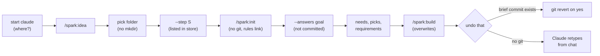

# User lens: starting a gadget project with spark and keeping its history

Lens: the user's journey (the primary persona, and the PO as n = 1), 2026-11-25. Read the commands, the code they
call, the PO's walk diaries and rows, and every project folder under ~/Development; ran seven experiments in a scratch
folder with a scratch store (`SPARK_HOME` and `GIT_CONFIG_GLOBAL` pointed at scratch; removed afterwards). Changed nothing
else.

## Findings

- USER-1 · No spark step makes a project's folder. `/spark:idea` step 0 says only "Pick the project's folder with the person: their project's folder, or a new one", and its allowed-tools hold no `mkdir`. `parts.py --step newproj S` on a folder that does not exist printed "started step S of newproj" and "listed newproj on your projects", and made no folder. `init_project.py --project newproj` then refused: "no directory at …", exit 2. So whoever runs the step first can list a folder that is not there, and the folder itself comes from a step outside spark · E commands/idea.md:3, :25-27; scripts/spark/build/project_setup.py:520-524; experiment A and B (scratch store) · supports: the product (what exists), not how often a person hits it.
- USER-2 · On a new project, the brief commit (P1027 slice 2) never fires without a manual git step. Init writes `.spark/project.json` as a new, untracked file. The first `--answers` write (the goal, in idea step 0) then prints "not committed: git does not hold .spark/project.json here, so git cannot take this change back. Ask Claude, and Claude puts the old lines back". This also happens in a folder where `git init` ran before init. A later write is committed ("committed as <sha>. To go back, run in this project: git revert --no-edit <sha>") only after the person's own `git add` and `git commit` · E experiments C, D and E; scripts/spark/records/project_commit.py:68-78; project_setup.py:383-386 · supports: the product. The brief's outcome ("its brief commit … with no step by hand") cannot be met today.
- USER-3 · Spark's git way back has never run in the PO's projects. No commit with a `spark:` subject exists in any of the 9 repositories that hold a spark project (`git log --all --grep '^spark:'` gives 0 in each). The commit code landed 2026-11-23 17:05. Of 14 walk folders, 12 have no repository. In 3 repositories the brief is untracked: firebeetle-games (`.spark/`, AGENTS.md, CLAUDE.md and package.json all `??`), zigbee-stick, and reaction-game, which is `git init`ed with no commit, its `.git` from 2026-10-19 19:55 in the same minute as its brief · E `git -C <d> rev-parse --show-toplevel`, `ls-files --error-unmatch .spark/project.json`, `log --all --grep` per folder, 2026-11-25 · supports: an account (n = 1). The feature is two days old, so not using it does not mean he rejected it.
- USER-4 · A late `git init` puts the private rules link, and with it a home path, into history. Init writes the `.git/info/exclude` line for `CLAUDE.local.md` only when a repository exists at init time. In a plain folder, init, then `git init; git add -A; git commit`, committed `CLAUDE.local.md`: a symlink whose stored content is the store's absolute path, which holds the home folder. Walk 2 raised this on 2026-10-23 (G2). The one walk folder given a repository later (p934-display2, first commit 2026-11-22 19:05, after the walk) avoided it only through a hand-written `.gitignore` line · E experiment F; scripts/spark/build/ai_files.py:84-112; spark-walks/walk2/walk2-diary.md:67; spark-walks/p934-display2/.gitignore:4 · supports: the product, and one account.
- USER-5 · A project inside another repository commits into that repository. With the brief tracked by a parent repository, a brief write committed `gadget/.spark/project.json` into the parent's history. The line said "To go back, run in this project" and named no repository. The exclude line also went to the parent's `.git/info/exclude`. 16 of the PO's 37 spark project folders share one repository: firebeetle-games and 15 `pixel-*` worktrees. A walk ran in it on a branch (P581 walk 2) · E experiment G; project_commit.py:27-29 ("may be a subfolder of the repository"); spark-walks/p581-sound-joystick/p581-rows.md:18; `git rev-parse --git-common-dir` of each pixel-* folder · supports: the product. Whether a commit in a parent repository harms the person is H.
- USER-6 · "Undo that" covers one file. Spark commits only `.spark/project.json`. It does not commit needs.json, needs-basis.json, requirements.json, boards/active.json, the build's outputs, the store's holds or the projects list. Walk 4 saw a build rewrite `firmware/pins.py` ("The broken build had rewritten `firmware/pins.py`"). Walk 3 saw that a board-only build "writes `sim/diagram.json` new each time … so an LED or a button added by hand is lost at the next build". On 2026-11-17 the PO chose "one previous version to return to; a full undo history is not wanted" (P867 D6). On 2026-11-25 he wrote "Spark be able to work with Git and revert and all these things" · E project_setup.py:380 (`BRIEF_FILE`); commands/idea.md:74-86; spark-walks/walk4/walk4-diary.md:27; spark-walks/walk3/walk3-diary.md:76; docs/discovery/2026-11-17-p867-journey-redefined/brief.md:136; D the PO 2026-11-25 (brief.md, request) · supports: the product and two of his statements that pull different ways, so it becomes a question.
- USER-7 · Without git, the way back is the conversation. The line says "Ask Claude, and Claude puts the old lines back". The idea page has Claude "say the old must list in the chat, so that it is in the conversation even without git". His rules restart a session "near 100k of context". After a restart or a `/clear`, the old lines are not in the project, so they are gone · E project_setup.py:385-386; commands/idea.md:74-75, :84-85; ~/.local/share/spark/rules.md:23 · H that a restart loses them (no project file holds them) · supports: the product.
- USER-8 · A folder in the wrong place leaves a mark in the store that no command removes. In P829, init listed the project at 13:26, before the PO's yes ("The write happened before his yes"). In P581, a trial folder stayed listed: "No command takes a project off the list". The PO's real `projects.json` holds 28 entries. 5 of them are agents' scratch folders under /private/tmp that no longer exist (`p138`, `walk`, `p`, `project`, `b`) · E spark-walks/p829-button-light/diary.md:17-19; spark-walks/p581-sound-joystick/p581-rows.md:23 (row 12); projects.json read 2026-11-25 · supports: an account. Git in the project would not cover the store.
- USER-9 · The session's folder and the project's folder differ, and the person fixes that by hand. The walks start Claude Code in the parent folder (P829: "is inside the current working directory …/spark-walks"). `/spark:page` asks the person to type `/add-dir <the project's full path>` (P934 walk 2: "The PO ran `/add-dir` for the folder"). Init and idea use `--project .`, so the project is wherever the shell stands. README says only "in a project folder, type `/spark:init`" · E spark-walks/p829-button-light/diary.md:39-44; commands/page.md:28; spark-walks/p934-display2/diary.md:27; commands/init.md:27,33; README.md:88 · H that a `cd` outside the session's folders does not carry to the next call (Claude Code's Bash tool description, read in this session) · supports: the product.
- USER-10 · What a person new to git can and cannot supply. They can say "undo that", give a yes, and name a folder. They cannot read a sha, pick the order of reverts (idea.md:79-80: "a revert of an older brief commit after a later one conflicts"), resolve a refusal ("detached HEAD or a rebase that stopped", project_setup.py:389), supply a commit identity (the commit refuses one that is not set: `user.useConfigOnly=true`, project_commit.py:82-85), or judge the permission prompt for `git revert --no-edit <sha>` (idea.md:87). The primary persona is "At home in a terminal" and is a hypothesis. Nothing in it says git · E the pointers; scrum/VISION.md:38 · H that a fresh Mac offers to install developer tools at the first `git` (model knowledge, not checked) · supports: the product. The persona's git skill is unknown (—).
- USER-11 · Many of his rules confuse a gadget session, and spark's own AGENTS section for projects is silent on history. Init links his whole rules.md (106 lines) into every project as `CLAUDE.local.md`: 22 of his 37 project folders have the link, and the 15 pixel worktrees have none. "Every change reaches main by a PR; commit after each step and push" (rules.md:51) cannot be followed in the 13 project folders that have no repository. It also differs from spark's own direct commit of the brief on the current branch. "The board is the truth … you pull the top card of your lane without asking" (rules.md:25) points a gadget session at spark's board. Spark's section of a project's AGENTS.md (data/agents-section.md, 8 lines) says nothing about git, the folder or undo · E ai_files.py:84-97; folder survey; rules.md:10-19, :25, :51-67; data/agents-section.md:1-8 · H for "confuse": no gadget session was found that did not also do spark work. The walk 2 session filed P400 and opened a spark PR from a walk (walk2-diary.md:22) as spark work · supports: the document.
- USER-12 · Nothing keeps a generated or secret file out of a project's history. Spark writes no `.gitignore` (P934 walk 2: "Spark has no secret handling and writes no .gitignore", P1004 #1463). reaction-game holds `node_modules/` (205 entries) and `package-lock.json` beside a repository with no commit. p934-display2's ignore file, written by hand, lists `firmware/wifi_secrets.py` and `sim/flash-with-firmware.bin` · E spark-walks/p934-display2/diary.md:330-333; `ls` of reaction-game; p934-display2/.gitignore:1-5 · H that `git add -A` there would commit node_modules · supports: the product.
- USER-13 · README's terminal road nests spark's repository inside the project. It runs `git clone https://github.com/xmejkal/spark` and then `python3 spark/scripts/check_spine.py requirements.json --keep build` in the same folder. Spark's own clone holds a `.spark/` folder, so `project_root` from a folder inside a spark clone stops at spark · E README.md:26-28; `ls ~/Development/spark/.spark` (cache); scripts/spark/records/board_records.py:93-105 · H that a person keeps the clone in the project · supports: the product.

## The journey today, step by step

Actor: the person and Claude, in Claude Code, from a vague idea to a first build. ⚠ marks a friction moment, and its
finding is named.

| # | who acts | command | what it writes | friction |
| --- | --- | --- | --- | --- |
| 0 | person | `/plugin marketplace add`, `/plugin install spark` (README.md:83-86); starts `claude` in some folder | nothing in a project | ⚠ README:88 says "in a project folder" and names none. Where to start Claude Code is the person's guess (USER-9) |
| 1 | person | says the idea; types `/spark:idea` (or `/spark:drawer` first) | nothing | none |
| 2 | Claude with person | idea step 0: "Pick the project's folder with the person" | nothing | ⚠ no command makes it. Claude runs `mkdir` outside allowed-tools (a permission prompt) or the person makes it. A folder outside the session needs `/add-dir` later (USER-1, USER-9). ⚠ a folder inside another repository is not noticed (USER-5) |
| 3 | Claude | `parts.py --step <project> S --dry-run`, then real | a line in the store's history; the project on `projects.json` | ⚠ lists even a folder that does not exist; a wrong folder stays listed (USER-1, USER-8) |
| 4 | Claude | `/spark:init` with no board: `init_project.py --project .` | `.spark/rules.json`, `.spark/project.json`, `package.json`, `AGENTS.md` (spark's section), `CLAUDE.md` (`@AGENTS.md`), `CLAUDE.local.md` → the store's rules.md, an exclude line only if a repository exists, `projects.json` | ⚠ no repository, no `.gitignore`, no first commit. ⚠ his whole rules.md enters the project (USER-11). ⚠ a later `git init` commits the rules link (USER-4) |
| 5 | Claude with person | goal and must lines: Write a temp answers file, `init_project.py --project . --answers <file>` | `.spark/project.json` | ⚠ "not committed: git does not hold .spark/project.json here", every time on a new project (USER-2) |
| 6 | Claude | `parts.py --needs-set` (dry run, then real) | `.spark/needs.json`, `.spark/needs-basis.json` | ⚠ no commit, no way back but a new write (USER-6) |
| 7 | Claude with person | M, C, L: `--match`, `--pick` (store holds), `init_project.py --board <id>`, `--requirements` | `boards/active.json`, `requirements.json`, the store's holds | ⚠ store writes are outside any project history (USER-8) |
| 8 | Claude | `/spark:build`: `check_spine.py requirements.json --keep .` | `board.tsx`, `dist/`, `breadboard.md`, `firmware/pins.py`, `sim/` | ⚠ rewrites pins.py; a board-only build writes diagram.json new each time; nothing committed (USER-6) |
| 9 | Claude | `init_project.py --project . --board <id> --force` (rails from the build) | `.spark/rules.json` merged | none seen |
| 10 | person | "undo that" | Claude offers `git revert --no-edit <sha>` and runs it after a yes; only for a brief commit | ⚠ there is no sha on a new project (USER-2). Without git, Claude retypes the old lines from the chat, which a restart loses (USER-7). A person new to git cannot judge the prompt (USER-10) |
| 11 | person | `/spark:page` | `page.html`, `.spark/page.json` | ⚠ `/add-dir <full path>` typed by hand (USER-9) |
| 12 | person or Claude, by hand, later | `git init`, a `.gitignore`, a first commit, maybe a remote (p934-display2: 2026-11-22 19:05, origin on GitHub) | the repository | ⚠ the exclude line is missing if init came first (USER-4). Secrets and generated files are kept out only by hand (USER-12) |

His rules for a gadget session (D-q1), read line by line in ~/.local/share/spark/rules.md:

| rules.md lines | what | in a gadget project |
| --- | --- | --- |
| 88-92 Never | secret, home path, GPS photo, paid simulation, deleting a log, a guessed null | needed. Its reason "spark is public" does not hold there, but a pushed gadget repository makes the home-path and secret lines matter (p934-epaper-clock has a GitHub origin) |
| 69-73 What waits on him | cost, can't be undone, store change, his bench | needed |
| 79-82 Talking to him | three layers, codes with a description | needed |
| 104-106 Shell, shops | `SPARK_HOME` inline; Czech and EU shops | needed. The shop line repeats what the brief's `sellers` field holds per project |
| 45-46 | count only after output; could-not-run is no pass | needed (spark's section says the second too) |
| 96-103 Agents | models per job, agents clean scratch | partly (research agents) |
| 8-19 Words | card, lane, hook, gate, sweep, prune | confuse: no meaning in a gadget folder |
| 21-29 Start of a session | the board is the truth; pull the top card of your lane | confuse: sends the session to spark's board |
| 33-47 How to work, 49-67 What every PR needs | plan council, the core, PR, hook, mutation rows, merge | confuse: "Every change reaches main by a PR; commit after each step and push" fails without a repository or remote |
| 83-86 Miro, day close | spark's board batches | confuse |

## What I could not check, and why

- Claude Code itself was not run. The permission prompt for `mkdir` and `git revert`, whether `cd` persists, `/add-dir`, and the first-`git` install prompt on a fresh Mac come from the docs, the diaries and the Bash tool's description, not from a run.
- Who made each walk folder and each repository: the diaries start inside a made folder. reaction-game has no diary. The first commit of p934-display2 is the PO's identity, which does not say whether Claude typed it.
- Whether the GitHub repository p934-epaper-clock is public: no web. A `git grep` of its committed files for the home folder's path finds nothing.
- No gadget session without spark work was found. So whether a rule misled a gadget-only session is not shown either way.
- The 15 pixel worktrees were not read for rules or history beyond their git status. Why they lack `CLAUDE.local.md` is —.
- The persona's git skill: VISION.md holds no evidence of it (—).
- LangGraph, MCP and the website are outside this lens.
- Side effect of reading: a `git status` in reaction-game, a repository with no commits, changed its `.git` folder's time to 18:21 today and left no file.

## Questions for the decider

- Q-U1 · For p934-display, p934-display2 and p829-button-light, who made the folder and how (you in Finder or a terminal, or Claude with `mkdir`), and in which folder had you started Claude Code? · decides: D-q4, who makes the folder, and whether a session starts in it or above it · kind: account.
- Q-U2 · Who ran `git init` in p934-display2 on 2026-11-22 at 19:05 (after the walk), and in reaction-game on 2026-10-19 (never committed), and what made you want a repository at that moment? · decides: D-q2, when a repository appears (at init, or after a first success) · kind: account.
- Q-U3 · In any spark project so far, what did you want to take back that spark had written (the goal, a must line, a need, a pick, the requirements, a build's pins.py or diagram), and what did you do then? · decides: D-q3, what undo must cover; reconciles D6 (one previous version, 2026-11-17) with "revert and all these things" (2026-11-25) · kind: account.
- Q-U4 · Which gadget projects did you push to GitHub (p934-epaper-clock has an origin), and were they public? · decides: D-q2's no-go on a remote, and whether the secret and home-path rules travel with the repository · kind: account.
- Q-U5 · In firebeetle-games, spark's files (`.spark/`, AGENTS.md, CLAUDE.md, package.json) have stayed untracked since 2026-11-07. Did you leave them out on purpose? · decides: whether spark may commit into a repository the person already had, D-q2 and D-q3 · kind: account.
- Q-U6 · When a session worked on a gadget only, did it ever do spark-team work you did not want there (read the board, file a card, make a branch or a PR), or skip something because of a rule? · decides: D-q1, which rules reach a gadget project · kind: account.
- Q-U7 · Did you notice p581-from-goal and the five scratch folders on your projects list, and did any of them get in your way? · decides: whether D-q4 includes taking a project back off the list (the store, which git does not cover) · kind: account.
- Q-U8 · Have you ever started a spark project inside another repository other than the games repository (for example inside spark's clone), and did you expect spark's commits to land in that repository? · decides: D-q2 for nested projects · kind: account.

## Searches

None.
