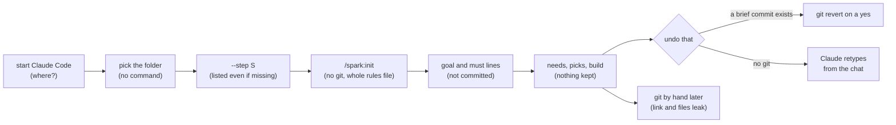
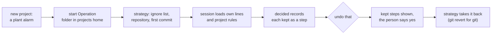

# Jobs and journeys
<!-- Tags as in the brief: E with a pointer, H with its source, D with who and when; an unknown is —. -->

## Who
<!-- One line per persona: who · evidence status (E pointer | H source).
e.g. `- Team leads who assign work · H Lena's belief, no interview yet` -->
- The PO as a maker of his own gadgets, n = 1 · E his 37 folders with `.spark/project.json` (brief ★C1), the walks in `council/user.md` <!-- REQUIRED:who -->
- The PO as the leader of spark's team, whose own projects run part of the team process · E `~/.local/share/spark/rules.md:11-12`, `council/po-assistant.md` (PO-3)
- An agent in a project session (Claude today, another tool later) · E scripts/spark/build/ai_files.py:1-12, data/agents-section.md:1-8
- A stranger who installs spark · H no outsider has installed spark (`council/po-assistant.md`, PO-20 A1)
- A visitor of a public website that runs spark · H the PO's message 5, "not sure", and D12 (seams only)

## Jobs
<!-- One job story per line, each clause tagged: When …, I want to …, so I can ….
e.g. `- When I assign a task in a meeting [E tickets.csv:6], I want the assignee to see it that day [H Lena], so I can stop chasing people [E tickets.csv:7]` -->
- Job 1 · When I start a new gadget idea [E commands/idea.md:25], I want spark to make its folder in my projects home with a repository, an ignore list and a first commit [D D5, D6, D10, the PO 2026-11-25], so I never take a folder or git step by hand [D the PO's message 1, "I would definitely like the Spark projects to have a Git repository"] <!-- REQUIRED:jobs -->
- Job 2 · When I change a record I decided (the brief, the needs, the picks, the requirements, the board) [E scripts/spark/build/project_setup.py:383-386], I want each decision kept as one step in plain words [D D8, D11], so I can say "undo that" and get any earlier step back after my yes [D D7, D9]
- Job 3 · When an agent opens a session in a gadget folder [E scripts/spark/build/ai_files.py:36], I want it to load my own lines and spark's project rules, not the team's process [D D3, D4], so it does not send the session to spark's board, lanes and PRs [E `council/user.md`, its rules table]
- Job 4 · When spark runs on another interface (in code, over MCP, on a website) [H the PO's messages 4 to 6], I want the folder, the yes and the way back to come through the core [D D5, D7, D12], so every interface starts, keeps and takes back the same way [D AGENTS.md, one core, many interfaces]

## Today they…
<!-- Per job: what they do instead today (a competitor, a workaround or nothing), tagged.
e.g. `- Job 1 · paste each task into Slack by hand · E tickets.csv:7` -->
- Job 1 · Claude or the PO makes the folder by hand, and a repository later, by hand, case by case · E `council/po-assistant.md` (PO-10), `council/user.md` journey steps 2 and 12 <!-- REQUIRED:today -->
- Job 2 · only the brief has a commit, which never fired (0 `spark:` commits in 9 repositories), and without git Claude retypes the old lines from the chat · E brief ★C4, scripts/spark/build/project_setup.py:384-385
- Job 3 · the whole `rules.md` is linked into every project whose store holds one, today only the PO's · E brief ★C3, ★C5
- Job 4 · nothing: init, the brief write, a commit and an undo are no Operations, so only the CLI starts a project · E brief ★C23

## Journeys
<!-- One ### per actor and scenario: the table, then a Mermaid flowchart of the same steps. Never a Mermaid
journey block: it forces a score on every task. "n/a — a one-step job" may replace both.
e.g. `| 2 | opens the app | E analytics, 90 days | never sees the task | not yet | Do they read email? |` -->
### The PO and Claude in Claude Code: a new gadget project today <!-- REQUIRED:journey -->
| step | what they do | evidence | friction or harm | today | open question |
| --- | --- | --- | --- | --- | --- |
| 1 | starts Claude Code in some folder and types `/spark:idea` | E README.md:88, `council/user.md` step 0 | where to start is a guess | partly | — |
| 2 | picks the project's folder with Claude | E commands/idea.md:25 | no command makes it, and `mkdir` is outside the allowed tools | not yet | Q4 answered D5 |
| 3 | Claude runs `parts.py --step <project> S` | E `council/user.md` (USER-1, USER-8) | lists even a folder that does not exist, and a wrong folder stays listed | partly | — |
| 4 | Claude runs `/spark:init` | E scripts/spark/build/ai_files.py:84-112 | no repository, no `.gitignore`, the whole rules file linked in | partly | Q2, Q3 answered D3, D4 |
| 5 | Claude writes the goal and the must lines | E scripts/spark/build/project_setup.py:384-385 | "not committed: git does not hold .spark/project.json here", every time on a new project | not yet | — |
| 6 | Claude writes the needs, the picks, the requirements, then builds | E `council/user.md` (USER-6) | no step is kept, and the build rewrites `firmware/pins.py` | not yet | Q9 answered D8 |
| 7 | the PO says "undo that" | E commands/idea.md:78-83 | no sha on a new project, and without git Claude retypes from the chat, which a restart loses | not yet | Q18 (which yes) |
| 8 | the PO or Claude makes a repository by hand, later | E `council/user.md` (USER-4, USER-12) | the rules link and generated files can enter history | partly | Q15 (existing folders) |

### The PO and Claude in Claude Code: the same project after D3 to D12 (proposed, not built)
| step | what they do | evidence | friction or harm | today | open question |
| --- | --- | --- | --- | --- | --- |
| 1 | says "new project: a plant alarm" | D D5, D10 | — | not yet | — |
| 2 | spark's start Operation makes the folder in the projects home and calls the strategy | D D5, D6, D10 | a person with no git identity gets a refusal (A5) | not yet | Q7 (a repository that existed) |
| 3 | the git strategy writes the ignore list, makes the repository and a first commit of spark's files, said in one line | D D6, D11 | a project inside another repository (no instance today) | not yet | Q8 |
| 4 | an agent session loads the PO's lines and spark's project rules, no team rule | D D3, D4 | spark's own sessions still need the team's process | not yet | Q16, Q17 |
| 5 | each decided record is written and kept as one step: "Kept. To take it back, say: undo that." | D D8, D11 | a pick's hold in the store is outside the project's git | not yet | Q14 (which branch) |
| 6 | the PO says "undo that". spark shows the kept steps, he picks one and says yes, and the strategy takes it back | D D7, D9 | a revert of an older step can conflict | not yet | Q18 |

