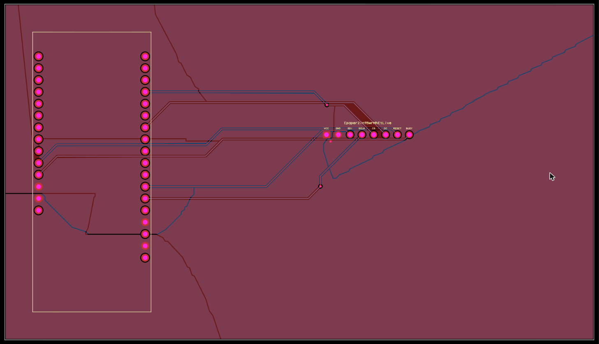
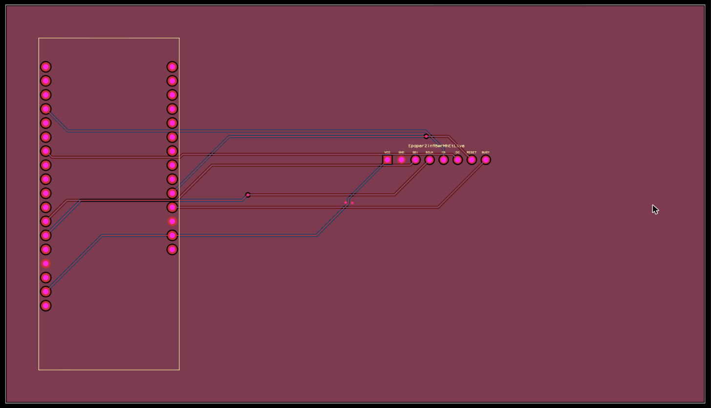
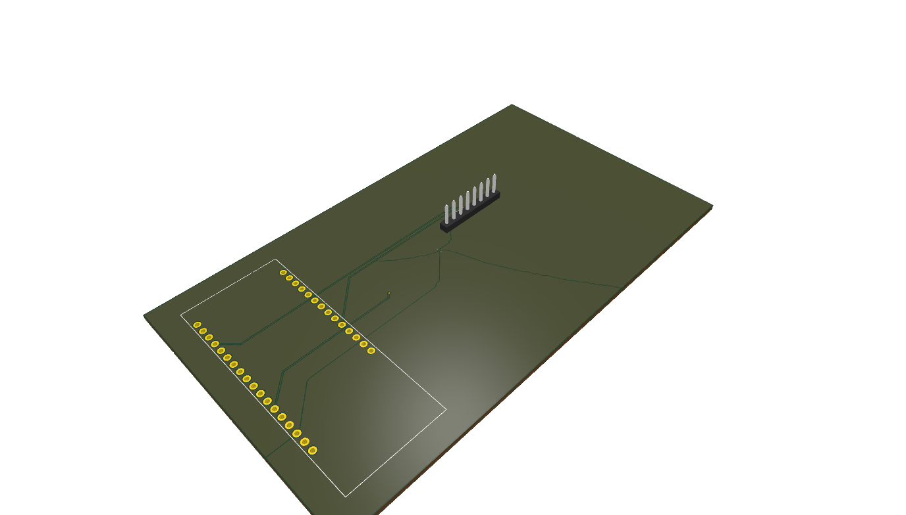

# P1089: why spark's PCBs look wrong, and where KiCad fits

Spike for [#1600](https://github.com/xmejkal/spark/issues/1600), 2026-11-26. The full text is [finding.md](finding.md).
The raw evidence, with every command and count, is [notes.md](notes.md).

## The main points

- The strange look comes mostly from one switch. spark asks tscircuit for its automatic copper pour, and that pour
  cuts both layers into 3V3 and ground pieces with staircase borders.
- One ground pour per layer, two lines in the board file, gives a clean board. The picture below shows both.
- The other faults are spark's own board file. The modules have no body, the boards are large and empty, every trace
  is 0.15 mm, and the schematic names nets by pin.
- The autorouter is not at fault. Its routes are short and they repeat. KiCad finds no error in them at the
  export's own 0.1 mm clearance, and 6 clearance errors at 0.2 mm.
- kicad-cli 10.0.6 runs headless on tscircuit's own KiCad export. It fills zones, checks the board, renders it and
  writes STEP. It cannot place or route.
- The recommendation is tscircuit with one ground pour, then kicad-cli as an optional export after the build. A
  KiCad MCP server waits. A Strategy seam keeps the board engine exchangeable.
- The PO decides on the recommendation.

## Before and after

| Today: the automatic pour | One ground pour per layer |
|---|---|
|  |  |

## Where KiCad sits

```
requirements.json -> build-board (tscircuit) -> circuit.json -> checks, sheet, pins.py, Wokwi, page
                                                     |
                                       export-board, only on request
                                                     |
                          tsci export kicad_zip -> kicad-cli: refill, DRC, render, STEP
```


