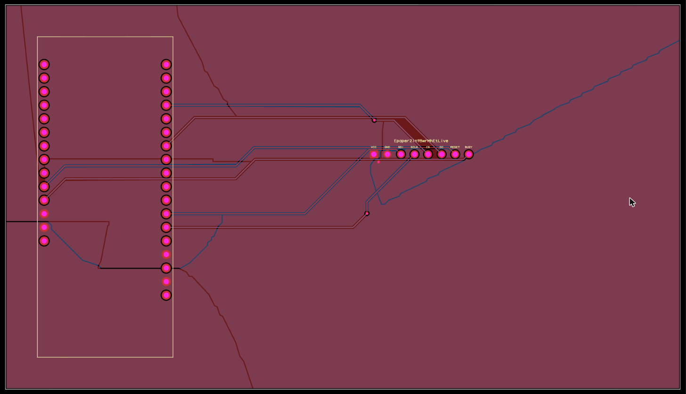
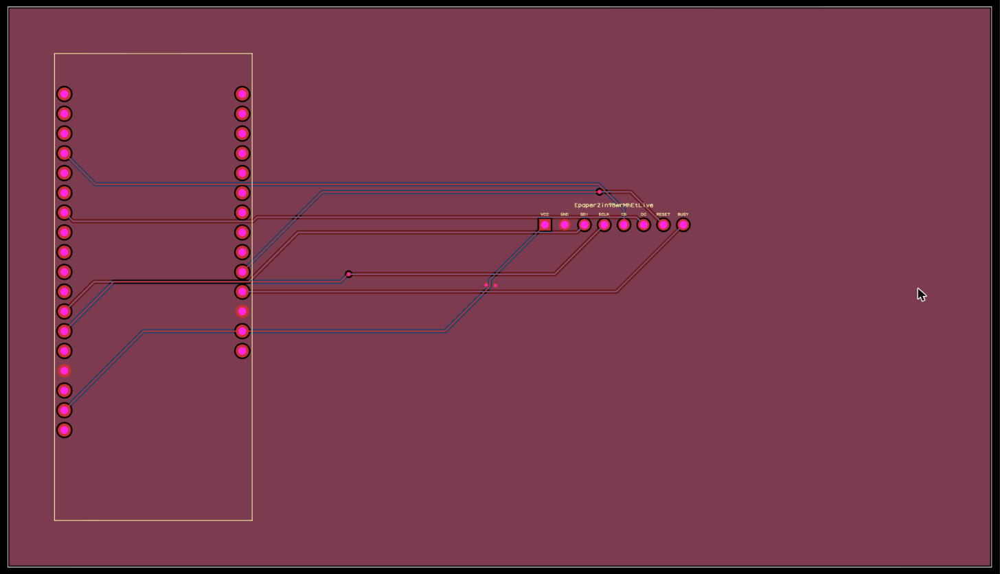
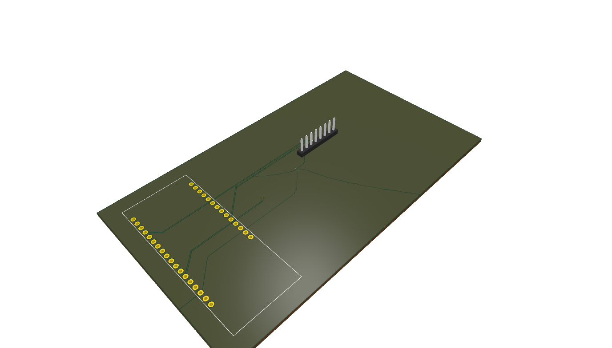
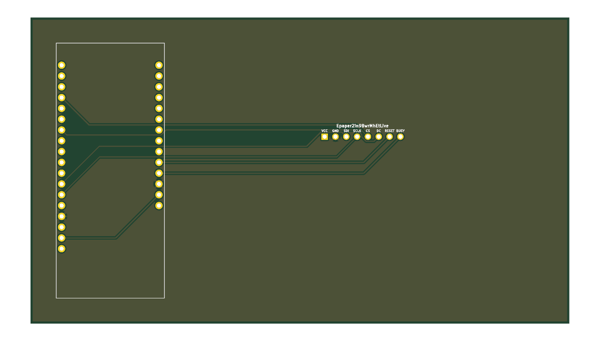
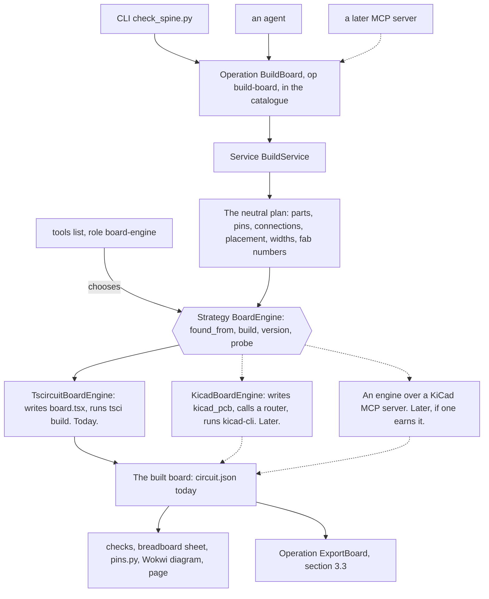

# P1089 finding: what is wrong with today's PCBs, and where KiCad fits

Spike for [#1600](https://github.com/xmejkal/spark/issues/1600), under P203 [#163](https://github.com/xmejkal/spark/issues/163).
Date: 2026-11-26. The evidence is in [notes.md](notes.md) and three pictures in this folder. The architect wrote this
text from the notes. The kicad-spike session added two explanations to section 9 and made the card titles shorter. The refuter's corrections are in sections 1.3, 1.4, 2.2, 3, 4, 5 and 9. The council's
findings are in sections 1.4, 2.3, 3.1 and 4. Section 5 holds the numbers of the filed cards. Section 2.4 holds the Freerouting run and a fair comparison of the two routers. Section 1.2 adds F12.

> In short: the "weird PCBs" are mostly tscircuit's automatic pour, which spark turns on in one line of the board file.
> The rest is spark's own: big empty boards, modules with no body, 0.15 mm traces and nets named by pin.
> The routing is not a fault.
> Recommendation: tscircuit stays the board engine with one GND pour per layer, and kicad-cli runs after the build as an optional export.
> No KiCad MCP server now, and one Strategy keeps the engine exchangeable.

## Summary

The spike read 13 built boards and named 11 faults. Seven come from spark, three from tscircuit's pour and one from a
tscircuit default. kicad-cli 10.0.6 ran headless on tscircuit's KiCad export and gave a refill, a DRC, a render and a
STEP file. It cannot place or route, so it is an export after the build and not an engine. The seam for another
engine is half there today: the role `board-engine` and the Adapter `TscircuitEngine` exist, and section 3 names what
is missing.

The PO asked on 2026-11-26, through spark-main, for an architecture that lets spark change these strategies and
tools, reusable and DRY. His words, verbatim:

```text
remember to instrauct as always that the architecture needs to be well made so that we can change these srtrategies and tools and its reusable, dry, etc etc
```

Section 3 answers them. The card holds his words of 2026-11-24 and the widened scope.

## 1. What is wrong with today's boards

### 1.1 What "weird" is, by weight

The PO did not say which fault he sees ("I'm not sure why"). This order is the architect's reading of the notes.

1. The pour (F1, F2, F3). It is what the eye meets first. Both layers are cut into V33 and GND regions with
   staircase borders. The e-paper board's top layer holds GND in 133 pieces. tscircuit's implicit pour makes it, and
   spark asks for it on every board (`scripts/spark/design/board_sections.py:138`).
2. The empty board with no bodies (F5, F4). The e-paper board is 126.4 x 72 mm for two parts. The modules show as
   pads and a box. Both come from spark's board file.
3. The thin traces and the pin names (F6, F7). Every trace is 0.15 mm. The schematic says "Mcu_pin4" and not EPD_CS.
   Both come from spark's board file.
4. Small faults (F8 to F11). One tscircuit default, two spark bugs and one fault that P512 fixed.

The autorouter is the cause of no fault at the export's 0.1 mm clearance. At 0.2 mm, its closest gap is 0.11 mm, a
via to a track (section 1.3). The pinned version is a possible cause of F3 only.



### 1.2 Each fault with its cause

The counts come from the notes' survey of 13 `dist/board/circuit.json` files. The toolchain is `@tscircuit/cli`
0.1.2113 with `tscircuit` 0.0.2600, which resolve to `@tscircuit/core` 0.0.1946.

| # | Fault | Cause | Whose |
|---|---|---|---|
| F1 | The pour splits both layers into V33 and GND regions. 10 of the 11 boards with pours show it. | spark writes `automaticPoursEnabled` (`board_sections.py:138`). tscircuit's implicit pour gives each free grid cell to a power net (`@tscircuit/core` 0.0.1946, `dist/index.js` lines 52294 to 52345 and 68859 to 68905). | spark's switch, tscircuit's pour |
| F2 | The pour leaves islands and runs 0.2 mm from the board edge. KiCad's DRC gives 396 findings on the e-paper export. | The same implicit pour. The export writes 127 pour pieces as 127 zones at priority 0. | tscircuit's pour |
| F3 | The false pour short of P958 on the 11-22 e-paper build. | tscircuit's checks on the implicit pour, reported at https://github.com/tscircuit/checks/issues/588. Three fresh builds on 2026-11-26 do not show it. spark's `pour_contact.py` drops it today. | tscircuit's checks, by route |
| F4 | The modules have no body on the PCB and in 3D. | The module footprint has no `cadModel`. A module is a `<chip footprint="pinrowN">` (`board_sections.py:259`). | spark |
| F5 | Boards are large and mostly empty. p711-sound-demo is 77.1 x 137.8 mm. | `board_components.place` puts the modules in a column with a 6 mm margin and a 4 mm gap (`board_components.py:15` to 16, 143 to 180). | spark |
| F6 | Every trace is 0.15 mm, power too. | With no stated current, `trace_width_mm` gives no width (`board_sections.py:66` to 90). The file says "UNJUSTIFIED". | spark |
| F7 | The schematic names nets by pin, and some labels overlap the MCU's pins. | The names: spark writes each signal from pin to pin and keeps its name in a comment (`board_sections.py:289` to 290). The overlap: tscircuit's schematic layout. Exact cause not found. | spark, and tscircuit |
| F8 | Silkscreen text is 0.7 mm high, under KiCad's default of 0.8 mm. | tscircuit's default text size. | tscircuit |
| F9 | The footprint file says "NOT the None mm on the vendor drawing". | `footprint_emitter.py:287` to 288 prints a `drill_mm` that the record holds as null. | spark |
| F10 | The project's footprint file is older than the one its last build used. `tsci dev` then shows another board than `dist/`. | `--keep` leaves every other `.tsx` alone and names it (`build_board.py:110`). | spark |
| F11 | Two old `dist/` folders have `source_trace_not_connected_error` for MOSI and MISO. | spark. P512 fixed it. The folders are older than the fix. | spark, fixed |
| F12 | spark states no clearance and no track width to the router. tscircuit then routes at 0.1 mm, and KiCad finds 6 errors at 0.2 mm. | `<board>` gets no `minTraceToPadEdgeClearance` or `minTraceWidth` (`board_sections.py:135` to 138). Found after the Freerouting run, section 2.4. | spark |

### 1.3 Measured, and not a fault

- Routing is short. On every board the longest trace is at most 1.4 times the straight line.
- Routing repeats. Two fresh builds of one `board.tsx` gave the same routes.
- The routes are clean in KiCad at the export's own clearance of 0.1 mm. With one KiCad GND zone per layer,
  `kicad-cli pcb drc` gives 11 findings: 9 text heights, 2 library warnings, 0 errors and 0 unconnected items.
- At a clearance of 0.2 mm, the same check gives 6 clearance errors. The closest is 0.11 mm, a V33 via to a GND
  track. The refuter found this. spark's `data/fabrication.json` states no clearance of its own.
- Every net is joined by traces. With every zone removed, KiCad still reports 0 unconnected items.
- Build time is not measured. One build alone took 6 to 7 s. The notes make no claim on speed.

### 1.4 The cheapest fix inside tscircuit, tried

The spike removed `automaticPoursEnabled` and added one `<copperpour connectsTo="net.GND" />` per layer. `tsci build`
gave 0 errors, 3 GND pour pieces, 10 traces and 4 vias. The 3V3 traces stay as they were, because 2 of
the 10 traces carry V33 in every build. The routes change. KiCad's DRC on that export gave 212 findings, and after
`--refill-zones` it gave 11, of the same kinds as above.



The first pair of pictures was not like for like, as the council's PO assistant found. The session then built a fair
pair from spark's own board of today, with today's footprint. Only the pour differs between the two builds.

| Board, built 2026-11-26 | Automatic pour | One GND pour per layer |
|---|---|---|
| e-paper, spark's board of today | 1 V33 and 37 GND pieces on top, 2 V33 and 25 GND on the bottom, 0 errors | 1 GND piece per layer, 0 errors, 10 traces |
| p711-sound-demo, five parts | 61 V33 and 165 GND pieces, 0 errors, 25 traces, 24 vias | 1 GND piece per layer, 0 errors, 25 traces, 24 vias |

The two pictures in this folder are the e-paper pair. Two things follow. This change removes F1 and most of F2 with
two lines of the board file. It also lets kicad-cli alone finish the board, with no pcbnew script.

## 2. KiCad

### 2.1 What ran, headless

kicad-cli 10.0.6 ran from a script on the output of `tsci export board.tsx -f kicad_zip`. The export wrote
`board.kicad_pcb` (file version 20241229), `board.kicad_sch`, `board.kicad_pro` and one STEP model.

| Command | Result |
|---|---|
| `kicad-cli pcb drc`, also with `--refill-zones` and `--save-board` | findings as above |
| `kicad-cli sch erc` | 53 findings: 24 off grid, 22 pins not connected, 7 library warnings |
| `kicad-cli pcb render` | two PNG views in 8 s |
| `kicad-cli pcb export svg` | ran |
| `kicad-cli pcb export step` | 0.5 s, 288 KB, only the header has a body |
| KiCad's bundled Python 3.9 with `pcbnew`, no GUI | removed and added zones, filled them, wrote a Specctra DSN |



### 2.2 kicad-cli against a KiCad MCP server

| | kicad-cli | A KiCad MCP server |
|---|---|---|
| Free | A free download from kicad.org. The spike did not read KiCad's licence text. | mixelpixx/KiCAD-MCP-Server and claynicholson/copper-kicad-mcp are MIT. oaslananka/kicad-mcp-pro is AGPL-3.0. Seeed's names no licence. Konnect-EDA is closed. |
| What installs | KiCad only. It is on the PO's Mac. | KiCad, and the server. mixelpixx needs Node 18+ and Python 3.11+. copper downloads about 120 MB on the first autoroute. |
| Headless | Yes. Every command above ran with no GUI. | The IPC API of KiCad 9 and 10 needs the running GUI. Headless use comes in KiCad 11. mixelpixx also works through the SWIG Python API. |
| Places and routes | No. kicad-cli 10.0 has no such command. | mixelpixx places and routes, and it autoroutes through Freerouting "via Java/Docker". |
| Fits AGENTS.md | Yes: free, local, a CLI, one tool for the job. | No today: a local CLI comes before an MCP server, and it adds two runtimes. |
| Tried | Yes. | No server was installed. |

Reading: kicad-cli is the tool. An MCP server gives nothing that the export path needs. For routing, each server
calls Freerouting, which spark can call direct. tsci itself exports `specctra-dsn`, so Freerouting can route a
tscircuit board with no KiCad at all.

`docs/mcp.md:44` to 47 already says `KiCad — not offered`, for an older package. The reason changes, the answer stays.

### 2.3 The card's five items

| Item | tscircuit today | KiCad, measured | Reading |
|---|---|---|---|
| The PCB and its routing | Short routes that repeat. The pour is the fault. | No routing by kicad-cli. Its refill and DRC run on tscircuit's routes. | KiCad adds the fill and the check, not the routes. |
| The 3D model with the parts | The 3D tab shows pads and a box. | The render and the STEP show a body for the header only. | The same gap in both. It is F4, spark's. |
| The export for Fusion 360 | `tsci export -f step` ran in about 2 s without KiCad: 618 KB, one product named "PCB", no module bodies. | STEP in 0.5 s. Fusion's KiCad importer needs "KiCad v7 files or higher". | No import into Fusion ran. |
| The install weight | 298 npm packages in a scratch project. | macOS download 1.4 GB, 4.8 GB installed. Windows download 969 MB. KiCad asks for up to 10 GB. | KiCad stays optional for a person. |
| A headless run from a script | `tsci build` runs from `BuildService`. | Every kicad-cli command ran headless. | Both fit. |

Fusion's personal-use limit: the licence limits electronics to 2 sheets, 2 layers and 80 cm² of board
(https://www.autodesk.com/products/fusion-360/personal.html, read through a search summary). The e-paper board is
126.4 x 72 mm, which is 91 cm². So F5 puts the import on a personal licence at risk. No one checked this against Autodesk's page. Fusion imports a STEP file as
bodies. The spike did not check whether the limit applies to a STEP import.

### 2.4 Freerouting, run on the PO's yes

The PO said "yes, run Freerouting" in the kicad-spike window. Freerouting 2.6.0 is one free file (GPL-3.0) with no
Java to install. pcbnew wrote the DSN of the e-paper board with the older footprint (F10). Freerouting routed it, and
pcbnew read the routes back and filled one GND zone per layer. Every row below was checked by KiCad at 0.2 mm.

| Router, same board | Rules the router got | Track | Vias | KiCad errors at 0.2 mm |
|---|---|---|---|---|
| tscircuit, as spark builds today | none from spark: 0.1 mm clearance, 0.15 mm tracks | 563.6 mm | 4 | 6 clearance |
| Freerouting, run 1 | the export's: 0.1 mm clearance, 0.1 mm tracks | 568.7 mm | 3 | 9 clearance, 1 thermal |
| tscircuit, rules stated | 0.2 mm clearance, 0.25 mm tracks, set on `<board>` | 567.3 mm | 5 | 0 |
| Freerouting, run 2 | 0.2 mm clearance, 0.25 mm tracks, set in the project | 561.8 mm | 0 | 0 |

Each board has 10 connections on 8 nets, and each has 0 unconnected items. Under the same loose rules, tscircuit's
routes gave fewer errors than Freerouting's (6 against 9). With the same strict rules, both gave 0 errors.
Freerouting then used no vias, and tscircuit used 5.

So on this board, each router followed the rules that it got. The 6 errors of today's boards come from spark, which
states no clearance and no track width. tscircuit's `<board>` takes `minTraceToPadEdgeClearance`, `minTraceWidth` and
`nominalTraceWidth` (`@tscircuit/props`, `RoutingTolerances`). This is a fault of spark's board file, F12 in the
notes.

Freerouting's help also lists an output of "Autodesk Fusion script (.scr)". The spike did not try it.



This changes the router's place in the seam (section 3.1, item 7), not option B. Freerouting reads a DSN. Here pcbnew
wrote the DSN and read the routes back. tsci's own `specctra-dsn` export did not go into Freerouting. No path takes
a SES file back to `circuit.json` yet.

## 3. How KiCad sits in the stack

There are two places: a strategy behind the build's engine, or an export after the build. The evidence picks the
export now. The seam keeps the engine place open.

### 3.1 The seam today: what exists and what is missing

It exists already:

- The role. `data/tools.json:6` points `board-engine` at `tscircuit`. A person or a project points a role at another
  tool with `tool_finder.use`, which refuses a tool that does not meet the contract
  (`scripts/spark/records/tool_finder.py:531` to 538).
- The Adapter. `TscircuitEngine` has `found_from`, `build`, `version` and `probe`
  (`scripts/spark/build/board_engine.py:112` to 162).
- The swap. `BuildService` takes its engine and its emitter through the constructor (`build_service.py:200` to 204).
  `tests/fakes.py:403` holds `FakeTscircuitEngine`.
- The Operation. `BuildBoard`, op `build-board`, is in the catalogue (`build_board.py:85` to 96,
  `build_operations.py:9`, `operation_catalogue.py:27` to 30). The CLI is one frontend over it.
- An export Adapter to copy. `TscircuitExport` wraps `tsci export` and never raises
  (`scripts/spark/breadboard/tabbed_page.py:32` to 49).

It is missing:

1. No selection point. `for_toolchain` builds `TscircuitEngine` by name (`build_service.py:211`), and so does
   `found_from` (`board_engine.py:129`). The role gives a path to `tsci` only (`board_engine.py:39`).
2. No base class. No Strategy says what an engine must supply. The Fake copies the Adapter's four methods.
3. The board file is tscircuit's language. `BuildService` writes `board.tsx` and the footprint's `.tsx`
   (`build_service.py:284`, 305). The engine builds the file named `board.tsx` (`board_engine.py:133`).
4. The connections are never one value. `signal_lines`, `mcu_power_lines` and `module_power_lines` write them direct
   into TSX text (`board_sections.py:266`, 306, 389). The netlist exists only after the build: `netlist.Netlist`
   reads the built `circuit.json` (`build_service.py:112`, `netlist.py:41`). One case is different. For a board
   alone, `board_alone_input` writes `netlist.json` before the build, and the converter reads it
   (`build_service.py:478`). A later neutral plan reuses that shape.
5. Every reader after the build reads `circuit.json`. 26 Python files under `scripts/` name it, and so does the Wokwi
   converter. The contract's name is `tscircuit-board` (`data/tools.json:22`).
6. The engine's choices sit in text. The router, the pour and the via sizes are attributes of the `<board>` line
   (`board_sections.py:135` to 138).
7. The router is a strategy too, as spark-main relayed. tscircuit's autorouter routes today. Freerouting, from the
   Specctra DSN that tsci or pcbnew writes, or a KiCad engine, can route later. With the second engine, the seam also keeps
   the router apart from the board writer.

The council's architect seat named more selection sites and the contract's promise. See
[council-answers.md](council-answers.md).



The names follow `docs/guide/patterns-and-names.md`: the base says the job, and only the Adapter carries the tool's
name (rule 2, line 218). `TscircuitEngine` becomes `TscircuitBoardEngine` by the subclass rule (line 245).

### 3.2 What every engine reuses, and what each adds

Reused, so that spark writes nothing twice:

| Shared part | Where it is today |
|---|---|
| The requirements, and the part and board records | `loader`, `board_records` (`build_service.py:234`, 260) |
| The pin of each signal, and the pin map `firmware/pins.py` | the assignments in `BoardInputs` (`board_emitter.py:49`, 131) |
| The power connections | `power_rails.power_connections`, `mcu_power_nets`, `supply_inputs` |
| The placement and the board size | `board_components.place` (`board_components.py:143`), called before the writer (`board_emitter.py:130`) |
| The trace widths | `copper.width_to_emit_mm` through `trace_width_mm` (`board_sections.py:66` to 90) |
| The fab numbers | `data/fabrication.json`, read into the via and thickness constants (`board_sections.py:24`) |
| The footprint's hole and pad sizes | `hole_diameter_mm`, `pad_diameter_mm` (`footprint_emitter.py:278` to 279) |
| The pad of each pin label | `board_pads.BoardPads`, which reads `pad_aliases` (`scripts/spark/records/board_pads.py`) |
| The toolchain's install and pin | the tools list's `install` and `version` per tool (`data/tools.json`), the store's toolchain folder |
| The checks after the build | `islands_in` and the five checks, as long as the engine gives `circuit.json` |

Each engine adds only its own parts. These are the board file in its language, its run, its version and its probe.
They also include the reading of its errors (`pour_contact.py` parses the words of tscircuit's error) and its views.

The arguments of `emit` are already that neutral plan, apart from the connections (`board_sections.py:478`). So gap 4
is the one real piece of new design.

### 3.3 The export after the build

```
requirements.json
      |
  build-board           tscircuit, always. KiCad is not needed.
      |
  dist/board/circuit.json  --->  checks, sheet, pins.py, Wokwi diagram, page
      |
  export-board          only when a person asks for it
      |
  tsci export -f kicad_zip        ->  board.kicad_pcb, board.kicad_sch, board.kicad_pro
      |
  kicad-cli pcb drc --refill-zones --save-board   ->  KiCad's findings, as Findings
  kicad-cli pcb render                            ->  PNG views
  kicad-cli pcb export step                       ->  board.step, for Fusion or any CAD
      |
  no kicad-cli found    ->  `could-not-run` with the install line. Never a pass.
```

The export is one new Operation with two Adapters. The first is the board engine's own export (`tsci export`). The
second is a new Adapter over kicad-cli, found by a new role in the tools list. `docs/guide/agents.md:173` to 174
holds this chain today as two lines for an agent to type. The Operation gives the chain to every frontend.

It fits the principles. KiCad stays optional, because the build never calls it. The export is a fact derived from a
record that spark holds. The findings are KiCad's, and spark names the tool and its version beside them.

## 4. Options and the recommendation

| Option | What changes | Cost | Loses |
|---|---|---|---|
| A. tscircuit only | One GND pour per layer, and the spark faults as cards. | small | The DRC, the render and the STEP stay a doc recipe. |
| B. A, and KiCad as an export after the build (recommended) | A, then the Operation of section 3.3 through kicad-cli. | small, then medium | Nothing. A person without KiCad sees `could-not-run`. |
| C. KiCad as the board engine now | spark writes `kicad_pcb`, a router routes, kicad-cli fills. Every reader needs a new input. | very large | "KiCad stays optional". 1.4 GB becomes a must. |
| D. A KiCad MCP server | A server over KiCad places and routes. | large | The CLI-first rule and two runtimes. Its SWIG path runs headless today. Its IPC path waits for KiCad 11. |

Recommendation: B. Three facts decide it.

1. The routing is not the fault, and the pour has a two-line fix inside tscircuit.
2. kicad-cli cannot place or route. A KiCad engine needs `pcbnew` and Freerouting, which ran once on one board (section 2.4).
3. Seven of the eleven faults sit in spark's shared parts. A KiCad engine inherits each of them.

So spark does not move to KiCad. It adds KiCad after the build, by kicad-cli. The engine swap stays one epic line.

The steps, each testable alone:

1. The pour card. The fixtures are the e-paper board and p711-sound-demo. `tsci build` gives 0 errors and one GND
   pour piece per layer. KiCad's check names the clearance it used, from `min_trace_to_pad_edge_clearance`.
2. The spark fault cards F9, F10, F6, F7 and F4, in that order of size.
3. The seam card. A base `BoardEngine` and one selection point. No behaviour changes. A test points the role at a fake
   second engine.
4. The export card. `export-board` on the e-paper board gives the 11 findings of section 1.3, a PNG and a STEP.
5. Later, one epic line. A second engine behind the seam.

The seam card does not build the neutral plan (gap 4) or a neutral built board (gap 5). A value with one reader is a
guess at the second reader's needs. Both come with the second engine.

## 5. Candidate cards, for spark-main to file

spark-main filed these cards on 2026-11-26 under P203, in Idea, slice 7 Perfboard to PCB. Each line reads "problem →
change". One comment on [#163](https://github.com/xmejkal/spark/issues/163) holds the epic line and F5.

- P1182 [#1726](https://github.com/xmejkal/spark/issues/1726): the automatic pour cuts both layers into V33 and GND pieces (F1, F2) → one GND pour per layer
- P1183 [#1727](https://github.com/xmejkal/spark/issues/1727): KiCad's DRC, render and STEP exist only as a doc recipe → an Operation `export-board` over `tsci export` and kicad-cli
- P1184 [#1728](https://github.com/xmejkal/spark/issues/1728): the `board-engine` role chooses a path, not an engine → a Strategy base `BoardEngine` with one selection table
- P1185 [#1729](https://github.com/xmejkal/spark/issues/1729): a module has no body (F4) → a box from `body_mm`, with a height fact
- P1186 [#1730](https://github.com/xmejkal/spark/issues/1730): a rail with no stated current gets 0.15 mm silently (F6) → the build names the rail as a missing fact
- P1187 [#1731](https://github.com/xmejkal/spark/issues/1731): the schematic names each signal's net by pin (F7) → each signal goes on a net with its own name
- P1188 [#1732](https://github.com/xmejkal/spark/issues/1732), with F10 below: the footprint file prints "None mm" for a null `drill_mm` (F9) → it says that the drawing states no drill
- P1188 [#1732](https://github.com/xmejkal/spark/issues/1732), with F9 above: `--keep` keeps an old footprint file that spark wrote (F10) → spark replaces it by `board.tsx`'s rule
- P? (not filed yet): spark states no clearance and no track width to the router (F12) → `<board>` gets both from `data/fabrication.json`
- Later epic line under P203: KiCad as a second board engine behind the seam. Done: one real board builds through the engine
  that the `board-engine` role chose, and every check reads its result.

The export card also updates `docs/mcp.md` with today's reasons. The F10 card replaces only a file that nobody changed.

No card: F3 (P958 holds it, and the pour card removes its cause to test), F8 (see question 9), F11 (P512 fixed it).

F5, the placement, is out of scope for a card now. The board file says that the placement is a first draft, and a
better one is a design job, not a bug. It stays one line under P203, with one measure: the e-paper board under 80 cm².

Three risks to put on the cards. The comment in `build_service.py:369` to 372 says that V33 is poured. It is already
untrue on this board, because V33 has traces today, and the pour card corrects it. The pour card's DRC holds at
0.1 mm clearance only, and spark states no clearance of its own. The F7 card changes what `netlist.Netlist` sees, because today a signal has no named net
(`netlist.py`, the module's docstring).

## 6. Choices for the council

Each answer is "delegated, the PO's to change". The recommended option is first. The council's answers are in
[council-answers.md](council-answers.md).

1. Does spark move its board engine to KiCad now? (a) No, KiCad comes after the build as an export. (b) Yes, as an epic now. (c) No KiCad at all.
2. Which pour does a generated board ask for? (a) One GND pour per layer. (b) The automatic pour, as today. (c) No pour.
3. Is there a KiCad MCP server in spark's tools list? (a) No, and `docs/mcp.md` says today's reasons. (b) A trial of mixelpixx/KiCAD-MCP-Server. (c) Ask again at KiCad 11, which gives a headless IPC API.
4. Does the export card go to Ready now? (a) Yes, after the pour card, because kicad-cli alone then finishes the board. (b) Before it, with a pcbnew script for the zones. (c) Not now.
5. How does the export enter? (a) A new Operation `export-board` with a role for kicad-cli. (b) A flag of `build-board --keep`. (c) The doc recipe stays.
6. When does the seam card run? (a) Now, as a small card with no behaviour change. (b) With the second engine. (c) Now, with the neutral plan too.
7. Does the spike run Freerouting? (The PO answered yes, and section 2.4 holds the run.) (a) No, the routing is not the fault. (b) Ask the PO for his yes, then run one trial on the ready DSN. The council cannot give that yes. Only the PO can allow a run of the downloaded binary.
8. Is F5, the placement, in scope? (a) No, one line under P203 with the 80 cm² measure. (b) A card now for a tighter first draft. (c) Inside P1074 #1575.
9. Does F8, the 0.7 mm silkscreen, get a card? (a) No, until a fab's rule with a source says that 0.7 mm fails. (b) Yes, a text size from `data/fabrication.json`.
10. Which body does F4 use? (a) A box from the record, with the height as a new fact. (b) A vendor STEP model per part. AGENTS.md forbids a committed vendor file. (c) Wait.

## 7. Decisions, each with its reason and the rejected option

| Decision | Reason | Rejected |
|---|---|---|
| KiCad is an export after the build. | kicad-cli has no place or route command. The routes are clean at 0.1 mm. | KiCad as the engine now: very large, and it makes 1.4 GB a must. |
| kicad-cli, no MCP server. | It ran headless today. AGENTS.md puts a local CLI first. | An MCP server: two more runtimes, and the IPC API needs the GUI. |
| The pour fix is inside tscircuit. | Two lines, tried, 0 errors. | A KiCad fill in the build: the build then needs KiCad. |
| The export is its own Operation. | The build must run without KiCad. Every frontend gets the chain. | A `--keep` flag: `BuildBoard` already holds a long argument list. |
| The seam card is a base class and one selection point. | Both gaps are real today, and the card is small. | The neutral plan now: one reader only. |
| The contract keeps its name `tscircuit-board` for now. | It says truly what the role's tool must build today. | A rename now: a person's own tools file can name it. |
| F5 gets no card now. | The placement is a stated first draft. A better one is a design job. | A layout card now: no measure of "better" exists yet. |
| Freerouting ran on the PO's yes. | He asked for the routing test. | A run without his yes. |

## 8. Claims checked in the code

| Claim | Where |
|---|---|
| spark turns the automatic pour on, and sets the router to `auto` | `scripts/spark/design/board_sections.py:135` to 138 |
| A module is a `<chip>` with a pin-row footprint | `board_sections.py:259` |
| A signal's name stays in a comment | `board_sections.py:289` to 290 |
| No stated current gives no width | `board_sections.py:54` to 58, 66 to 90 |
| The placement is a column, margin 6 mm, gap 4 mm | `scripts/spark/design/board_components.py:15` to 16, 143 to 180 |
| The footprint's comment prints a null `drill_mm` | `scripts/spark/design/footprint_emitter.py:287` to 288 |
| `--keep` leaves other `.tsx` files alone | `scripts/spark/build/build_board.py:110` |
| The role, the contract and the tool's `meets` | `data/tools.json:6`, 22, 80 to 98 |
| `find` and `use` hold a role to its contract | `scripts/spark/records/tool_finder.py:300` to 302, 531 to 538 |
| The Adapter and its four methods | `scripts/spark/build/board_engine.py:112` to 162 |
| The build names `TscircuitEngine`, `board.tsx` and `circuit.json` | `build_service.py:211`, 284, 305, and `board_engine.py:129`, 133 to 135 |
| The build counts errors by the element's type | `build_service.py:70` to 74 |
| The netlist reads the built circuit | `build_service.py:112`, `scripts/spark/design/netlist.py:41` |
| The writer takes the placement as an argument | `scripts/spark/design/board_emitter.py:130` to 132, `board_sections.py:478` |
| The Operation and the catalogue | `build_board.py:85` to 126, `build_operations.py:9`, `scripts/spark/operation_catalogue.py:27` to 30 |
| An export Adapter exists for the SVGs | `scripts/spark/breadboard/tabbed_page.py:32` to 49 |
| The docs hold the kicad-cli DRC recipe, and say no KiCad MCP | `docs/guide/agents.md:173` to 174, `docs/mcp.md:44` to 47 |
| 26 Python files under `scripts/` name `circuit.json` | `grep -rl "circuit.json\|circuit_path" scripts` |
| A part's `body_mm` holds a width and a height only | `board_components.py:20` to 22 |

Every number on a board, a DRC run, a download or a licence comes from [notes.md](notes.md). The architect ran no
tool and opened no picture.

## 9. Not checked

- Freerouting ran on one board only, with the older footprint. Its Fusion script output (`.scr`) did not run.
- No one installed a KiCad MCP server.
- No one imported a file into Fusion. The two Fusion sources came through a search summary, not the pages.
- KiCad reports 199 isolated copper areas on both exports. With the automatic pour they are in 124 GND top zones, 73
  V33 bottom zones and 2 GND bottom zones. With one GND pour they are all in the top GND zone. The equal count is not
  explained. Cause not found.
- The 133 and 34 GND pieces come from the 11-22 build (172 pour pieces). The 127 zones come from the export, which
  routed again on 2026-11-26 and gave 127 pieces, as the fresh builds did (notes, F10). So the two numbers describe
  two routes.
- Does a newer tscircuit change the implicit pour or F3? The spike read one version.
- Does the one-GND-pour change hold on the other 11 boards? The spike tried the e-paper board and p711-sound-demo.
- Does a named net per signal (F7) build? Does the Wokwi converter still read it? No one tried.
- Does a tool exist that turns a KiCad board into `circuit.json`? No one looked.
- Does a person's or a project's tools file name the contract `tscircuit-board`?
- Does a build note already name a rail with no current, beside the comment in the file?
- The size on disk of tscircuit's 298 packages, and KiCad's licence text.
- `tsci export -f glb` did not run.
- Does Fusion's 80 cm² limit apply to an imported STEP file? Autodesk's page returned HTTP 403 to the refuter.
- No DRC ran at a fab's real clearance. JLCPCB's minimum spacing was not read.
