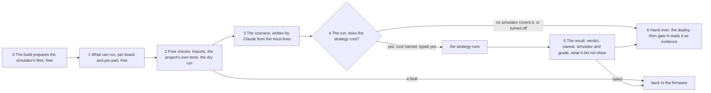
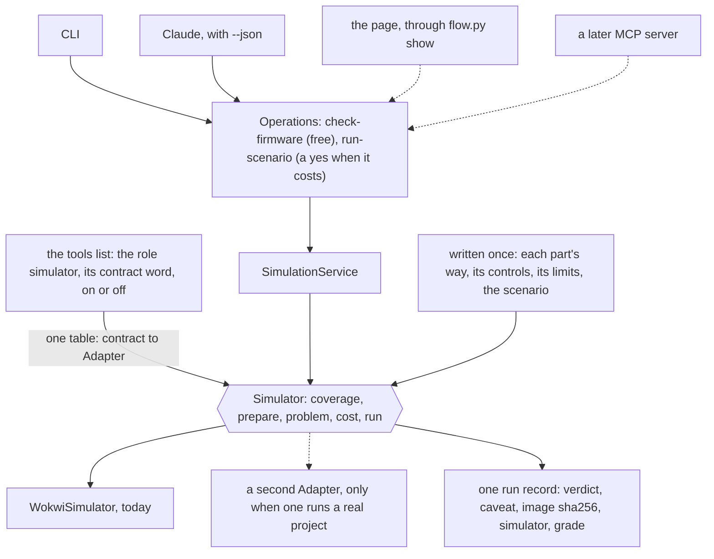

# P1190: the simulation as a step of its own

The discovery of [P1190 #1735](https://github.com/xmejkal/spark/issues/1735), 2026-11-26. Nothing here is decided.
Each choice waits on the PO, or on the delegated council of three, recorded "delegated, the PO's to change".

> TL;DR. Today the simulation is one build stage and one paid command, both written for Wokwi. The direction, as the
> delegated council set it (D3 to D9, the PO's to change): P999 puts the FireBeetle 2 C6 on a Wokwi stand-in first.
> One free Operation, `check-firmware`, then runs on every board and counts the project's own tests. A `Simulator`
> seam makes Wokwi one strategy, with no change in behaviour. Last, a board that no simulator covers reads `skipped`
> with its reason, once the PO says yes. The simulation is evidence at gate A and never a lock (his to decide).

## The order to build

1. P999 #1455 (the C6 stand-in) and item 4 (the limits list only after a run).
2. Item 2: `check-firmware`, the import check moved onto the core, with the project's own tests.
3. P1078 #1582: the scenario run as an Operation, the paid run a yes with its cost named.
4. Item 6: the `Simulator` seam, with no change in behaviour.
5. Item 1: the flip to `skipped`, after the PO's yes to Q11.

## What waits on the PO

Q1 (the assumptions' ratings and the pass line), Q3's reading of the non-goals, Q5 (gate A), Q6's "the editor",
Q7's dependency on another author's chip, Q9 (what stopped a paid run), Q10 (the vision's v0.10 line) and Q11 (the
code of his decision D-c). The questions are in [brief.md](brief.md).

## The main points

1. Paid runs are few: at least 3 in the PO's walks, none after 2026-11-01. In one walk the free checks ran and the
   paid run waited, because nobody knew the minutes left. So friction explains the rarity as well as low value
   (brief ★C16).
2. On a board that Wokwi lacks, even the free checks do not run today. The dry run needs `sim/` files that the build
   does not write there (★C17).
3. Free checks exist that spark does not show: the import check, and the host tests that the conversation wrote. The
   clock has 35 such tests, and they pass in under a second (★C18).
4. The PO's three ways to simulate a part are two models and a skip in the part record. A "setting with sliders" is
   a list of controls that either model carries (★C7, ★C8, ★C20).
5. No open simulator drives the pins of an ESP32-C6 today. QEMU names initial C6 support with no GPIO for any
   chip. Velxio has no C6 yet and is AGPL (★C12, [research-alternatives.md](research-alternatives.md)).
6. P999 (the FireBeetle 2 C6 on a Wokwi stand-in) covers the only board that Wokwi lacks today, so the clock
   then reads `skipped` from its e-paper alone (★C25, not run).
7. The seam follows the P1089 engine pattern: a role in the tools list, a contract word, a table to an Adapter, a
   base class, and a Fake. The two seams share the lookup code, not a base class.

## The step, in six substeps



## The strategy seam



## The three ways to simulate a part

| The PO's words | In the part record | Who runs it today |
| --- | --- | --- |
| a part Wokwi knows | `simulation.wokwi.part` | Wokwi |
| "a script or setting, adding sliders" | a list of controls on either model, set by a scenario step | Wokwi |
| "webassembly ... reuse existing working libraries" | `simulation.wokwi.chip`, or another author's chip by reference (URL, version, licence, sha256) | Wokwi |
| no model | `simulation.skip` with its reason | the bench |

## Screens, crude

```
The clock, the free checks done (no simulator covers its board)
+----------------------------------------------------------------------------------------------------------------------+
| e-paper clock                                                                                                        |
| Idea v  Needs v  Parts v  Parts list v  Board files v  Wiring v  Firmware v  Simulation (now)  On the board o        |
| +-- NOW  Simulation: the free checks, by Claude ---------------------------------------------------------------------+ |
| |   WHAT CAN RUN  The board: no simulator covers the FireBeetle 2 C6.  The e-paper: skipped, tested on the bench.     | |
| |   CHECKED       26 Nov, free, on this computer.                                                                     | |
| |                 Each firmware file loads     7 of 7 ok    main.py is not run.                                       | |
| |                 Your project's own tests     35 of 35 ok  Written in the chat. Spark does not know what they cover. | |
| |   NEXT          Nothing more runs here. Test on the real board.                                                     | |
| |   Ask Claude    "Look at the board."                                                                                | |
| +-------------------------------------------------------------------------------------------------------------------+ |
+----------------------------------------------------------------------------------------------------------------------+

A covered board, ready to run (the user seat's screen 4)
| NOW  Simulation: the run, by you                                                                                     |
|   COST      Up to 1 minute of your Wokwi minutes. Spark spent 3 minutes on this computer this month.                 |
|             Spark cannot see how many you have left. Your Wokwi account page shows it.                               |
|   IT TESTS  must line 2, with the sensor and the LED.  It cannot test: the real light, must line 1.                  |
|   Ask Claude  "Run the scenario 'Something close turns the LED on'. I agree to spend Wokwi minutes."                 |

The scenario, with a set value drawn and not moved
|   SCENARIO  "Something close turns the LED on"   from your must line 2                                               |
|     2  Set the distance to 80 mm      0 |----o--------------| 255   (the sensor's value "distance")                  |
|     3  Expect the LED pin to be on.                                                                                  |
|   It does not test: must line 1 (no step names it).                                                                  |

The result
|   SIMULATION  Passed, 26 Nov, 10:32: "Something close turns the LED on". 5 steps, 2 set a value.                     |
|               Run by Wokwi on a stand-in board (ESP32-C6 DevKitC-1). The sensor is a model the conversation wrote.   |
|               It did not show: the real light level, must line 1, the board's own LED and button.                    |

Gate A, on "On the board"
|   TESTED BEFORE THE BOARD   Free checks ok, 26 Nov. No simulator run: none covers this board.            (evidence)  |
```

The numbers in the sketches are examples. Spark keeps no count of minutes today (P413 #539).

## The files

- [brief.md](brief.md): the frame, the findings ★C1 to ★C25, the decisions D1 to D9, the options, the riskiest assumption and the questions.
- [jobs-and-journeys.md](jobs-and-journeys.md): seven jobs and three journeys.
- [story-map.md](story-map.md): the backbone and the slices, the walking skeleton first.
- [risks-and-tests.md](risks-and-tests.md): the risks, nine assumptions and the collection plan.
- [items.md](items.md): fifteen proposed cards. Nothing is filed.
- [research-wokwi.md](research-wokwi.md) and [research-alternatives.md](research-alternatives.md): the sources.
- council/: the PO assistant, the user, the tech lead, the architect's synthesis, the refuter, and the delegated
  council's answers ([council-answers.md](council/council-answers.md)).
- [verification.md](verification.md): each ★ claim, reproduced or not.
