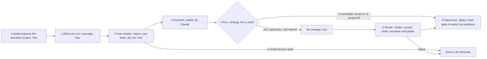
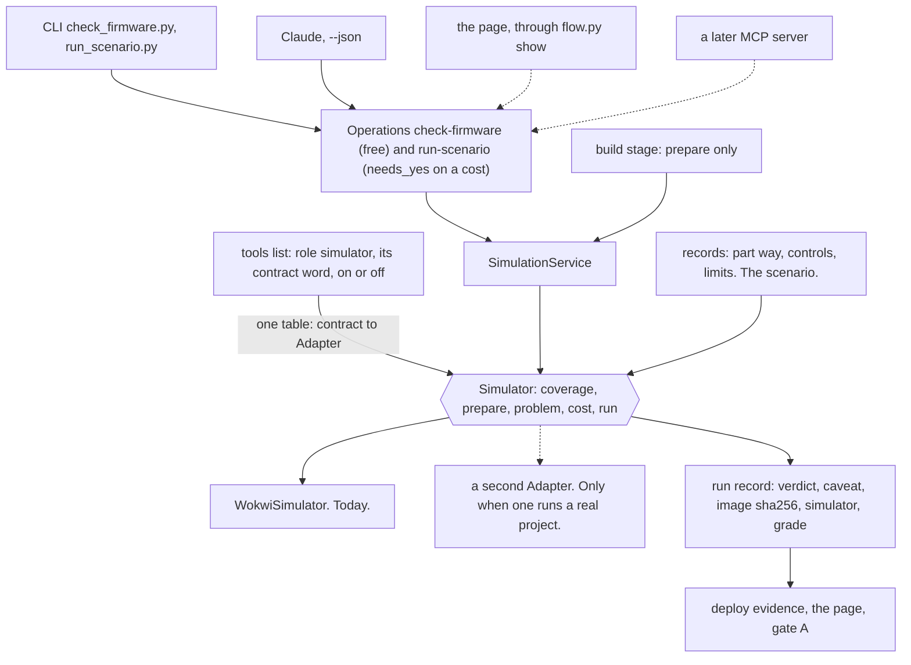

<!-- The architect's synthesis (the architect agent, the best model), P1190 #1735, 2026-11-26. Read-only on the tree; the session saved its returned text here unchanged, except the last line's paths. -->
# P1190 the simulation step: the architect's synthesis

Read on branch `p1190-simulation` at 68bdbf2b, 2026-11-26. Nothing written in the tree, nothing run that spends minutes. Tags: E evidence with a pointer, H a hypothesis with its owner, D a decision. No file I read held an instruction to me.

## 1. TL;DR and summary

**TL;DR.** The simulation becomes one step with six substeps: what can run, the free checks, the scenario, the run, the result, the hand-over. The MVP bar takes the cheap, honest half first. A board that no simulator covers reads `skipped` with a reason and not `could-not-run`. One free Operation, `check-firmware`, runs with no `sim/` folder and counts the project's own host tests. P999 gives the clock a stand-in board. The strategy seam follows as one card with no behaviour change, in the same shape as the P1089 engine seam: a role, a contract, a table to an Adapter, a base class, a Fake. A logic-level runner waits behind a spike and never holds a device model. A spark-own live slider is a no-go for this epic. At gate A the simulation is evidence and never a condition. (All H, the architect, on the claims below.)

**Summary.** The free checks and honest words move a project toward working firmware today, and they need no second simulator (H, on PO-1, PO-3, USER-1, USER-2). The seam makes the simulator selectable now and exchangeable when a second one exists, which is the PO's rule D-g at the lowest cost (H, on P1089 council-answers.md:19). The three ways to simulate a part are two models and a skip in the record, with "values you can set" as one controls list that either model carries (H, on PO-8, PO-15).

## 2. The substeps

| # | Substep | What it does | Cost | The person | Claude | Exists today |
|---|---|---|---|---|---|---|
| 0 | Prepare (inside the build) | writes the simulator's project: diagram, chips, `wokwi.toml`, the limits note | free | nothing | runs the build | E `scripts/spark/build/build_service.py:395-448`, `scripts/spark/firmware/sim_project.py:55`, `:222`, `:242`, `:429` |
| 1 | What can run (coverage) | per part and for the board: the way it is simulated, or why not, and the values a person can set | free, reads records | reads it | reads it in `flow.py show --json` | half: `simulation.wokwi.part`, `.chip`, `.skip` (E `scripts/spark/sourcing/part_rules.py:185-199`). The board's answer is a guard that ends `could-not-run` (E `build_service.py:450-456`, `stages.py:112-113`) |
| 2 | The free checks | (a) each firmware module imports on the stand-in. (b) the project's own host tests. (c) the simulator project's dry run. (d) lint and chip compile, if a spike shows them free | free | nothing, or asks for them | runs one Operation | (a) E `scripts/import_firmware.py:1-22`. (b) not seen by spark (E USER-2, PO-6). (c) E `scripts/spark/firmware/scenario_run.py:131-178`, refused first when `sim/` lacks two files (E `:133-134`). (d) chip compile runs in the build (E `build_service.py:442`). Lint is not called (E PO-13) |
| 3 | The scenario | steps from the must lines, with the values each step sets | free | says what must happen, in words | writes the YAML, checks the ids | E `scripts/spark/firmware/scenario_steps.py:17-19`, `scenario_run.py:159-166` |
| 4 | The run | the chosen strategy runs the scenario on the image | paid when the strategy has a cost | the typed yes, cost named first | asks, then runs | E `scenario_run.py:180-227`, `:266-276`. Not an Operation (E `scripts/run_scenario.py:62-81`) |
| 5 | The result | verdict, caveat, what it did not show, the simulator and its grade | free | reads it | reads fields, not text | the log header (E `scenario_run.py:229-246`), the caveat words (E `scenario_steps.py:36-44`). No simulator or grade line (E P308 #374) |
| 6 | The hand-over | the deploy takes the tested image, or an untested one after a yes. Gate A shows the simulation as evidence | free | yes to the deploy | names what no rung showed | E `scripts/spark/bench/image_evidence.py:433`, `:477-481`, `scripts/spark/flow/flow_codes.py:79` |



## 3. The strategy seam

**Names** (E `docs/guide/patterns-and-names.md:15`, `:16`, `:26`, `:218`, `:245`). The base is `Simulator`, a plain noun whose docstring says Strategy. `WokwiSimulator` is the one Adapter today. `FakeSimulator(Simulator)` goes in `tests/fakes.py`. The Service is `SimulationService`. The Value is `SimulationCoverage`. The model already in the tree is `FirmwarePlatform` with `MicroPythonPlatform` (E `scripts/spark/bench/firmware_platform.py:38-121`).

**What every strategy supplies** (H, the tech lead's TL-2, trimmed to five). `coverage(design, board)` returns the Value and reads records only. `prepare(design, board, folder)` writes the strategy's own files. `problem(project, scenario)` is the free check of its own project, a Refusal or None, as `ScenarioRun.problem` is today. `cost(scenario)` is none, or a unit with the account it spends. `run(project, scenario)` returns the run record. The limits ride inside the coverage Value, so there is no sixth method.

**Selection, one recommendation (mine).** The `simulator` role in the tools list names the tool. A person or a project already points it elsewhere, and a project can turn it off (E `data/tools.json:2`, `:5`, `scripts/spark/records/tool_finder.py:274-307`, `:531-538`). A table maps the role's contract word to the Adapter class. An unknown contract is `could-not-run`, never Wokwi (E P1089 council-answers.md:36-37). The strategy's `coverage` then says what it covers on this board. No order list across strategies exists until a second strategy runs.

**Operations** (E `scripts/spark/operation_catalogue.py:27-28`, `patterns-and-names.md:40`). A new table `firmware_operations.py` holds two. `CheckFirmware`, op `check-firmware`, effects reads, runs, writes: coverage, the import check, the project's tests, then the strategy's `problem`. `RunScenario`, op `run-scenario`, is P1078's card, with `needs_yes` when `cost` is not none. The build stage calls `prepare` only. The CLI, Claude through `--json`, the page through `flow.py show`, and a later MCP server all read the same envelope.

**Data written once.** The way per part: `simulation.wokwi.part`, `.chip` or `simulation.skip` (exists). The controls: one reader, `SimulationControls.of(part)`, gives id, label, unit, kind, min, max, step and start. It reads the chip's JSON for a chip, and a new `controls` list with its origin for a built-in part. The limits: the note the build writes (E `sim_project.py:120`, `:222`). The scenario: one file, three step kinds (E `scenario_steps.py:17`). The run record: today's log header plus two lines, the simulator with its version, and the grade (P308).

**The selection sites and which move** (E TL-4, each line read again).
- `sim_project.py:40`, `:49`: move inside `WokwiSimulator`.
- `scenario_run.py:270`: becomes the table lookup. The token test (`:273-276`) becomes `cost`.
- `build_service.py:399`, `:466` with the guard at `:450`: become `coverage`. The stage ends `skipped` with a code.
- `build_service.py:404` and `:442` (the converter and the chips): move into `prepare`.
- `flow/guide.py:25` (`NO_MODEL_CODES`): goes, because `skipped` already counts (E `guide.py:46-48`).
- `flow/phase_steps.py:36-41`: stays, and reads the cost from the strategy.
- `flow/flow_codes.py:364`, `:428`, `:441`, `:456`: the word "Wokwi" comes from the strategy's name.
- `firmware/project_image.py:37-50`: stays for now. P1001's default already covers a project with no `wokwi.toml`. A later card moves the image's name out of that file.



**DRY with P1089.** One pattern for both seams: role, contract word, a table from contract to Adapter, a base class named for the job, a Fake that subclasses it, the Service taking it through the constructor, the Operation in the catalogue (E P1089 finding §3.1). The one shared code is the lookup from a role's contract to a class, a small function beside `tool_finder.find` that both seams call. They share no base class, because they share no method. The simulator adds `coverage` and `cost`, since a project is covered in part and a run can cost. An engine has neither (E TL-12).

## 4. The three ways to simulate a part

| The PO's way | In the record | Who runs it |
|---|---|---|
| A direct part | `simulation.wokwi.part`, with pins and attrs (E `parts/led-red-5mm.json`, `parts/tactile-button.json`) | Wokwi only |
| A setting with a slider | no third model. It is the controls list on either model. The soil probe is a potentiometer whose level a scenario sets (E PO-8). The VL6180X chip has three controls (E `parts/vl6180x-breakout/chip/vl6180x.chip.json`) | Wokwi today. A later pin-level runner can drive a level on a pin (E `stand_in/machine.py:16-18`), and no bus value (E `machine.py:26-29`) |
| A custom chip in WebAssembly | `simulation.wokwi.chip`, source and `.wasm` beside the record (E `sim_project.py:1-8`) | Wokwi only. The chip's interface is Wokwi's own (H, TL-10, not checked) |

"Reuse existing libraries" means three things in practice. First, a community chip named by reference, as Wokwi's own e-paper board names `github:bonnyr/wokwi-ws29v2-custom-chip@0.0.5` (E PO-15). The record keeps URL, version, licence and sha256, and no file is copied (E AGENTS.md, "Never commit a vendor file"). Second, Wokwi's example chips as a starting file (E research-wokwi.md §2, §6). Third, the register map of the MicroPython driver already in `firmware/lib` and of the datasheet: the chip answers only a register with a cited source. The conversation writes the chip, never spark (D-b). The result says "tested against a model the conversation wrote" (E PO-9, PO-24).

A slider has three homes. In a scenario step, as a `set-control` value: it works headless today and is the first home. In Wokwi's own editor in a live run: the controls exist there (E research-wokwi.md §4), and how a spark project opens there is not checked. On spark's page: a live slider needs a script on the page, a local bridge process and a strategy that takes live input. The page is a static file (H, PO-22). That is P295-sized and waits.

## 5. Gate A

**Recommendation (mine): the simulation is evidence at gate A and never a condition.** Gate A shows one row: the highest tier reached on the current image, the simulator and its grade, and what no tier showed. A failed run on the current image already stops the deploy (E `image_evidence.py:433`), so gate A needs no second lock. Rejected: a condition "simulated and deployed", which locks the clock (E past-breadboard architect.md:9, :271). Rejected: a condition only where a strategy covers the board, which makes a paid run a toll for the persona with no Wokwi licence (E `scrum/VISION.md:38`). Rejected: leaving it out, because then no later step reads the result (H, PO pre-mortem 6). This decision is the PO's alone (E past-breadboard architect.md §6 row 2).

## 6. The screens

The user seat's screens 0 to 5 stand, with five corrections.

1. **No new status word.** "Not covered" and "turned off" are `skipped` with a code. "Free checks only" is `partial`. (E `flow_codes.py:14-16`, past-breadboard decision 10.)
2. **Screen 2** drops the row for a check that does not apply. Coverage already said it. It adds what each check did not do.
3. **Screen 3** has no slider that moves and no Save button. The page shows the value on a drawn bar, and a change goes through Claude.
4. **Screen 5** names the simulator and its grade.
5. **A gate A row** is new.

```
Screen 2, corrected (the clock)
+----------------------------------------------------------------------------------------------------------------------+
| NOW  Simulation: the free checks, by Claude                                                                          |
|   CHECKED   26 Nov 2026, 10:20. Free, on this computer.                                                              |
|             Each firmware file loads      7 of 7 ok     main.py is not run.                                          |
|             Your project's own tests      35 of 35 ok   Written in the chat. Spark does not know what they cover.    |
|   NEXT      No simulator covers this board, so nothing more runs here. Test on the real board.                       |
|   Ask Claude  "Look at the board."                                                                                   |
+----------------------------------------------------------------------------------------------------------------------+

Screen 3, corrected (the value is drawn, not moved)
|   SCENARIO  "Something close turns the LED on"   from your must line 2                                               |
|     2  Set the distance to 80 mm      0 |----o--------------| 255   (the sensor's value "distance")                  |
|     3  Expect the LED pin to be on.                                                                                  |
|   It does not test: must line 1 (no step names it).                                                                  |
|   Ask Claude  "Change the scenario: set the distance to <mm> in step 2."                                             |

Screen 5, corrected (the grade line)
|   SIMULATION  Passed, 26 Nov 2026, 10:32: "Something close turns the LED on". 5 steps, 2 set a value.                |
|               Run by Wokwi on a stand-in board (ESP32-C6 DevKitC-1). The sensor is a model the conversation wrote.   |
|               It did not show: the real light level, must line 1, the board's own LED and button.                    |

Gate A row (on "On the board")
|   TESTED BEFORE THE BOARD   Free checks ok, 26 Nov. No simulator run: none covers this board.            (evidence)  |
```

## 7. Options per open decision

Each recommendation is mine. "Council" means the delegated three can answer, the PO's to change.

| # | Decision | Options, with cost and what each proves | Recommendation | Who |
|---|---|---|---|---|
| 1 | The first slice | (a) honest `skipped`, `check-firmware`, one page line. S plus M. Proves the free checks get used and the clock reads grey. (b) the seam first. M, waits on P1078 and PR #1580. Proves selectable. (c) all screens first. L. Proves layout only | (a), with P999 beside it | Council |
| 2 | The logic-level runner | (a) now, L (E TL-11). (b) later, one free spike: the clock's `main.py` loop on the stand-in with a virtual clock. (c) never | (b). A runner of the person's firmware on the generic fake is the harness of the firmware decision (E `docs/archive/2026-10-01-firmware-and-tests.md:17`, `:60`). A device model per part in spark is "writes behaviour" and "reimplementing Wokwi" (E `scrum/VISION.md:78`, `:81`) | "Not now": council. The non-goal reading: his |
| 3 | One setting or two | (a) one: the `simulator` role, on, off or another tool, per project with a personal default. The free checks always run. (b) a second setting for P410's check choice. (c) an automatic pick by coverage with an order list | (a). It is P410's "per project with a personal default" with no new file | Council |
| 4 | Gate A | evidence, a condition, a condition where covered, left out | evidence | His |
| 5 | The sliders' home | a scenario step now. Wokwi's editor after a free spike. Spark's page live, L | the scenario step. What "the editor" edits (QD1) stays his | Council for the first home |
| 6 | Community chips | (a) by reference, permissive licences only, after a spike that shows wokwi-cli loads one. (b) copy the source. (c) none | (a). (b) breaks the vendor rule | The spike: council. Depending on another author's chip: his |
| 7 | The project's own tests | run and count them, or leave them unseen | run and count. Spark writes none and claims nothing about their cover | Council |
| 8 | The ladder's words | the tiers T0 to T4 of the firmware decision plus P308's "grade", or the tech lead's new rungs R1 to R5 | the existing tiers and "grade". One word for one thing | Council |

## 8. Proposed no-gos and rabbit holes

No-gos: an own simulator or a Python device model in spark. A second strategy built only to prove the seam. A live slider on spark's page in this epic. Velxio, or QEMU for the C6 (E research-alternatives.md). A simulation verdict as a gate A condition. A scenario or a chip that spark generates. A new status word. A paid run in any spike without the PO's yes.

Rabbit holes: an e-paper chip before the bench read of the controller (P1000). A custom `board.json` for the FireBeetle C6 (not confirmed in wokwi-cli). The minutes balance, which Wokwi does not report. Renaming "wokwi" in 29 modules in one pass. Splitting the board record's `wokwi_` keys (E TL-7). The breadboard's drawing source (E TL-6). Generating the chip's JSON from the record. Moving the deploy logs out of `sim/runs/board/`.

## 9. The riskiest assumption

Value: "the free checks, once on the page, get run before the first deploy and catch a fault that otherwise costs a bench round" (H, mine, narrowed from the PO assistant's). Evidence against the wider belief: 3 paid runs in 16 walks (E PO-1, USER-7). Cheapest test, two parts. One question to the PO (Q-a). And a replay with no cost: in a temporary copy of the clock, run the import check and `tests/` on the firmware of each commit before a deploy that preceded a fix. Proposed pass line, dated 2026-11-26 before any result: the replay catches at least 2 faults that reached the bench, and on the next walk the free checks run before the first deploy. Below that line, only the honest words ship and the screens wait.

## 10. The story map

Backbone: know what can run, check free, write the scenario, run, read the result, hand over.

- **Slice 0, the walking skeleton.** A board no simulator covers reads `skipped` with a reason (J2). `check-firmware` runs with no `sim/` and counts the project's tests (J1, J3). The page's Simulation step shows coverage in one line and the free checks' result (J1, J2). The limits list shows only after a run (J2). P999 beside it (J2).
- **Slice 1, the seam.** `run-scenario` as an Operation (J6). `Simulator`, `WokwiSimulator`, the Fake and the table (J7). Coverage from the strategy (J2, J7). The run record names simulator and grade (J1, J6).
- **Slice 2, the paid run made visible.** The cost and the time cap before the yes (J3). The result screen with the caveat as a field (J1, J6). The scenario as sentences with values and ranges (J4). The role turned off as the "no paid run" choice (J3).
- **Slice 3, models.** The rules for a chip the conversation writes (J5). A community chip by reference (J5). A live value in Wokwi's editor (J4).
- **Later.** The image's name out of `wokwi.toml` (J7). The runner spike (J1, J2).

## 11. Items

Parent is P1190 #1735 unless named.

1. Story. A board no simulator covers ends the stage `skipped` with a code, and the top status follows. Depends on nothing. Removes D-c's special case. Absorbs the clock half of P995 #1452 (close as answered).
2. Story. `check-firmware`: the import check and the project's `tests/` in one Operation, with one kept record stamped with the firmware's sha256. Depends on the P1078 pattern only for the envelope. Absorbs P410's "quick free check".
3. Story. The page: the Simulation step's coverage line and free checks state. Depends on 1 and 2. Parent: the page epic, linked here.
4. Story. The limits list prints only after a run. Depends on nothing.
5. Spike, free. Do `wokwi-cli lint` and `chip compile` run with no token? Depends on nothing. Absorbs Q1 of P492 #671. Leaves its Q3.
6. Story. The seam card, no behaviour change, every site of section 3. Depends on P1078 #1582 (left as is, a prerequisite).
7. Story. The run record names its simulator and grade. This is P308 #374, absorbed. Depends on 6.
8. Story. The `simulator` role, on or off, as the one setting, said by the commands. Replaces P410 #536. Depends on 6.
9. Story. The cost before the yes. P413 #539 stays as it is and feeds it.
10. Story. `SimulationControls`, and the scenario shown as sentences with values. Depends on 6.
11. Story. The result on the page. Depends on 7.
12. Spike. A community chip by reference in wokwi-cli, and its licence rule. Replaces P409 #535.
13. Spike. A live value in Wokwi's editor for a spark project. Depends on nothing.
14. Spike, free. The clock's main loop on the stand-in with a virtual clock. Parked until slice 0's test result.
15. Story. Gate A's evidence row. Parent: P79 #16. Depends on 7 and the PO's answer.

Left alone: P999 #1455 (do it beside slice 0), P1000 #1456, P344 #439 (a worked example for item 12).

## 12. The direction for the page-design session

1. Simulation stays one station. Its sub-line shows only when it is NOW: what can run, free checks, scenario, run, result.
2. Station states use existing words: not started, partly done (free checks only), ok, problems, could-not-run, skipped (not covered, or turned off), out of date.
3. "Skipped" is grey, names its reason, and never reads as a failure. No tick on `could-not-run`.
4. What can run: one line for the board, one per part, with the way and "values you can set". Detail in a fold.
5. Free checks: one row per check that ran, with a count and what it did not do. A check that does not apply has no row.
6. Scenario: steps as sentences. A set value shows on a drawn bar with its range. No moving slider, no Save, no Run button.
7. Run: the cost, the time cap and what the run tests come before the typed yes. The yes stays in the chat or the terminal.
8. Result: verdict, caveat in the verdict's line, the simulator and its grade, what it did not show. The log is in a fold.
9. The limits list appears only after a run.
10. Every offer is "Ask Claude" with its sentence.
11. Gate A: one evidence row, "Tested before the board", with the highest tier reached. It never locks the gate.
12. Claude reads every state above as fields of `flow.py show --json`.

---

## Decisions, each with its reason and the option rejected

1. **Free checks and honest words first.** They serve the bar on every board, and the clock reached the bench with no simulator (E PO-3, USER-1). Rejected: the seam or the screens first.
2. **The seam as one card with no behaviour change, after slice 0.** D-g asks for changeable, and the P1089 council chose the same (E council-answers.md:19). Rejected: waiting for a second strategy, and building one to prove it.
3. **`skipped` with a code, no new status.** The stage already has that ending for "every part skipped, which is no defect" (E `stages.py:125`). Rejected: a status "not possible".
4. **`check-firmware`, not `check-simulation`.** It must run where no simulator exists. Rejected: the tech lead's name. The plan runs the name check.
5. **Five methods, limits inside coverage.** Rejected: six methods.
6. **One setting: the role, on or off.** The mechanism exists (E `tool_finder.py:274-307`). Rejected: a second settings file, and an order list.
7. **A setting is the controls list, not a third model.** Wokwi itself has one mechanism (E PO-15). Rejected: a `simulation.setting` key.
8. **One reader for controls, each control written in one place.** The chip's C reads its ids, so its JSON stays the source. Rejected: the tech lead's TL-9, the JSON generated from the record.
9. **Tiers and grade, not rungs.** The tiers exist since 2026-10-01 (E firmware-and-tests.md:59-63). Rejected: R1 to R5.
10. **The runner waits, and holds no device model.** See option 2. Rejected: now, and never.
11. **Gate A reads evidence.** See section 5.
12. **The project's tests count.** The firmware decision already names them as written in the conversation (E firmware-and-tests.md:60). Rejected: unseen.

## Claims I checked

- The guard and the stage: `build_service.py:395` (`_simulation`), `:399`, `:450-456`, `:466`. The brief's ★C1 cites `:451`. The function starts at `:450`.
- `stages.py:112-113` (could-not-run ending), `:125` (the skipped ending).
- `guide.py:25`, `:46-48`. `phase_steps.py:36-41`, `:52-60`. `flow_codes.py:79`, `:141`, `:364`, `:441`, `:456`.
- `scenario_run.py:131-134`, `:159-178`, `:229-246`, `:256-276`. `scenario_steps.py:17-19`, `:36-44`.
- `project_image.py:37-50`. `image_evidence.py:433`, `:477-481`.
- `data/tools.json:2`, `:5`, `:21`, `:40`. `tool_finder.py:290-307`, `:531-538`.
- `operation_catalogue.py:15-30` (no firmware table). `firmware_platform.py:38-121`.
- `stand_in/machine.py:1-29`. `import_firmware.py:1-22`.
- The 8 part records' `simulation` keys, and the VL6180X chip's three controls.
- `scrum/VISION.md:38`, `:67`, `:77-81`. `patterns-and-names.md:15-27`, `:40`, `:216-245`.
- P1089 finding §3.1 and council-answers.md:19, :32-37, read at commit 70a6a5c7. The branch `origin/p1089-kicad-spike` named in my brief does not exist here.
- The cards P1078 #1582, P308 #374, P410 #536, read with `gh`.
- The clock project holds `tests/test_schedule.py`, `tests/test_quotes.py`, and `sim/` with only the image and `runs/`.
- Past-breadboard architect.md:1-45, :230-280, and refuter.md point 4.

## What I did not check

- Whether `lint` or `chip compile` need a token, and whether a free-plan run spends minutes.
- Whether wokwi-cli loads a chip named by a `github:` reference, or a local custom board.
- How a spark project opens in Wokwi's editor with live controls.
- Whether a Chips API chip loads outside Wokwi.
- The exit code and the goldens after the stage changes from `could-not-run` to `skipped`. The plan must read `phase_readers.py` for it.
- PR #1580 and P1078's plan, so the fit with the reporter change is unread.
- The other cards' bodies (P409, P413, P492, P995, P999, P1000, P344). I took them from the PO assistant's reading.
- The page's code and its request mechanism. "Static, no script" is the PO assistant's H.
- I ran no test, no import check and no replay. The "7 of 7" in the sketch is an example.

Files: this folder's brief.md, jobs-and-journeys.md, the two research notes and council/, `scripts/spark/firmware/scenario_run.py`, `scripts/spark/build/build_service.py`, `scripts/spark/records/tool_finder.py`, `data/tools.json`, `docs/archive/2026-10-01-firmware-and-tests.md`, and the store's councils/past-breadboard/architect.md. The P1089 finding merged to main with PR #1733 on 2026-11-26, at `docs/discovery/2026-11-26-p1089-kicad-and-tscircuit/`.

## Searches

none. The architect read the repository, the store's council files and the P1089 finding with `git`, and made no web search.
