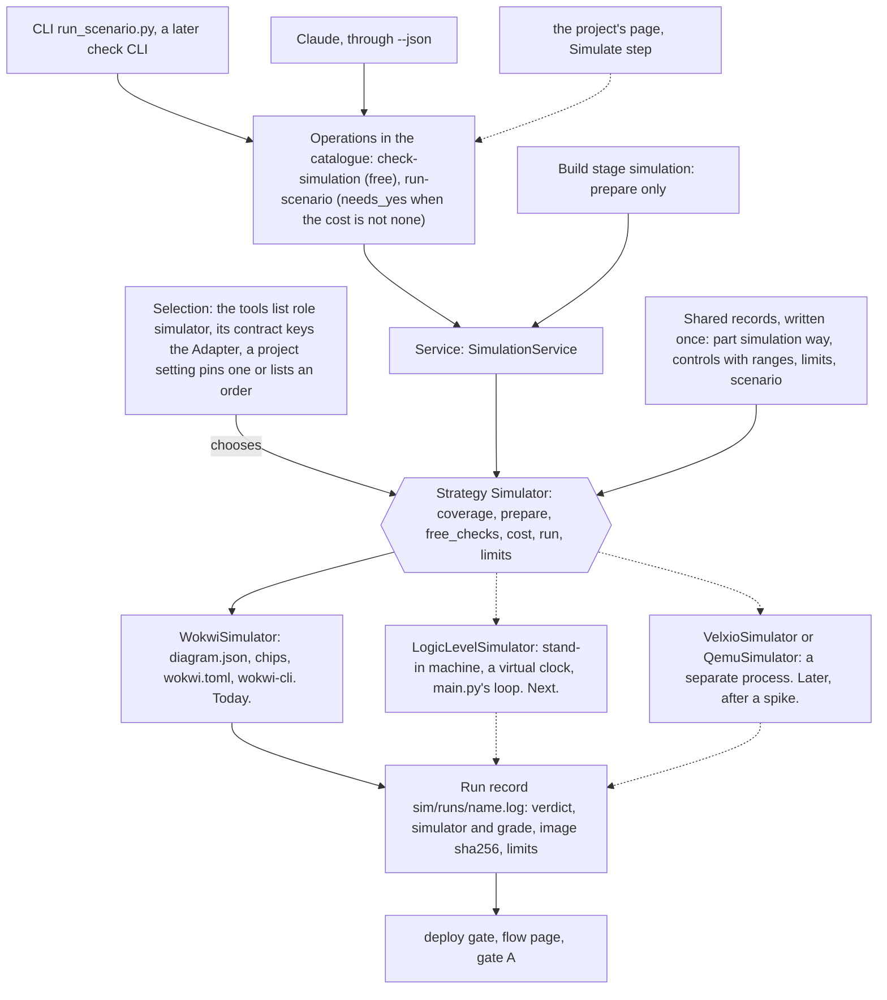

# P1190 council: the tech lead

Seat: the tech lead, with the lens Feasibility and the extension lens electronics-firmware:physics. Read on 2026-11-26
in the branch `p1190-simulation`. Nothing was run that changes a file, and no simulation ran. Tags: E is evidence with a
pointer. H is a hypothesis with its source. D is a decision with who and when. The mark — is an unknown.

## 1. Findings

### Feasibility

TL-1 · The seam already has a model in the repository, and it is not the P1089 engine. The bench's `FirmwarePlatform` is
a Strategy base with one subclass per firmware language, a Fake that subclasses the base, and tools found by role
through `find_tool`. A simulation seam can copy that shape and those names. · E
`scripts/spark/bench/firmware_platform.py:38-121`, `tests/fakes.py:237`, `docs/guide/patterns-and-names.md:24` ·
supports: the seam's shape and names. It does not show that one base fits Wokwi and a logic-level run equally.

TL-2 · The proposed seam. The base is `Simulator`, a Strategy (a plain noun, as `BoardReader` and `Flasher` are, with
the docstring saying Strategy). Only the Adapter carries the tool's name: `WokwiSimulator` today, `LogicLevelSimulator`
(on spark's stand-in) next, and `VelxioSimulator` or `QemuSimulator` later. Every strategy supplies six things.
(1) `coverage(design, board)`: a Value that says, per part and for the board, which way it is simulated (a model, a
setting, a chip) or why it is not, with a code. It reads records only and is free. (2) `prepare(design, board, folder)`:
writes the strategy's own project files (for Wokwi: diagram.json, the chips, wokwi.toml). It is free. (3)
`free_checks(project, scenario)`: a Refusal or None, and the not-checked lines. (4) `cost(scenario)`: none, or minutes
with the account it spends. Only a cost asks the person (`needs_yes`). (5) `run(project, scenario)`: the run record.
(6) `limits()`: what this strategy cannot show, from the records and from its own dated feature table. · H, this seat,
from TL-1, the P1089 finding §3.1 and the existing split of `ScenarioRun.problem` (free) and `ScenarioRun.simulate`
(paid) in `scripts/spark/firmware/scenario_run.py:128-246` · supports: a seam that the code's own free and paid split
already suggests. Not proven for a second strategy until one exists.

TL-3 · Today the role `simulator` exists, but its contract is Wokwi's own project shape. If a second tool says it meets `wokwi-project`, a person can point the role at it. No other tool passes. `tools.py`'s own example of a custom simulator declares
`"meets": ["wokwi-project"]`. · E `data/tools.json:5`, `:21`, `:49`, `scripts/spark/records/tool_finder.py:300-302`,
`:531-538`, `scripts/tools.py:55` · supports: the role as the selection point. With a new contract word per strategy
(`wokwi-project`, a logic-level one), `tool_finder.use` refuses a mismatch, as the P1089 architect proposed for
the engine ("the table keys on a fact in the tool's entry, not its name. An unknown key is could-not-run" (quoted), P1089
council-answers.md, read from `origin/main`).

TL-4 · The selection sites a seam card must cover. `find_tool("simulator")` is called in three places, and the board's
Wokwi type decides the build's stage in two more. The deploy and the flow find the flash image through `sim/wokwi.toml`.
Sites: `scripts/spark/firmware/sim_project.py:40`, `:49`, `scripts/spark/firmware/scenario_run.py:270`,
`scripts/spark/build/build_service.py:399` and `:466` (`no_wokwi_part`, defined at `:450`),
`scripts/spark/firmware/project_image.py:37-50` (the image is the one `sim/wokwi.toml` names),
`scripts/spark/flow/guide.py:25` (`NO_MODEL_CODES` holds only `board_not_in_wokwi`),
`scripts/spark/flow/phase_steps.py:36-41` (the step names `run_scenario`). · E those lines · supports: the size of the
seam card (TL-11). The image is coupled to a Wokwi file. A strategy that writes no wokwi.toml leaves the deploy and the flow with
`no_sim_toml`. The fix is to move the image out of that file.

TL-5 · The 42 modules that contain "wokwi" split into 13 that only draw and 29 that hold simulation logic, record facts
or words that say "Wokwi" where "the simulator" is meant. Draw only (the breadboard reuses Wokwi's pictures, geometry
and pin positions): `breadboard/drawing.py` (47), `part_shape.py` (17), `drawing_catalog.py` (14), `sheet.py` (13),
`kept_moves.py` (11), `part_pictures.py` (8), `svg_diagram.py` (5), `spacing.py` (2), `picture_makers.py` (2),
`drawing_match.py` (2), `wiring_steps.py` (1), `wire_routing.py` (1), `records/board_pads.py` (1). The other 29 fall into
four groups. Wokwi logic that moves inside `WokwiSimulator` under the seam: `firmware/sim_project.py` (39), `firmware/scenario_run.py`
(35, it parses wokwi-cli's exit codes and lines), `build/build_service.py` (14), `build/board_alone_input.py` (8, it writes
a Wokwi diagram), `build/board_engine.py` (3, the converter `circuit-to-wokwi`), `records/onboard_parts.py` (12, it wires
Wokwi's LED and button for a stand-in board). Record facts and their rules: `sourcing/part_rules.py` (23),
`sourcing/part_records.py` (4), `records/board_records.py` (16, `wokwi_part_type` is a required key), `records/board_rules.py`
(8), `design/needs.py` (10, the pick prefers a part with a Wokwi model). Words, codes and the image's place: the flow
(`flow_codes.py` 13, `guide.py` 8, `phase_steps.py` 3, `phase_readers.py` 2, `run_request.py` 1), the bench
(`board_codes.py` 3, `image_evidence.py` 2, `deploy_image.py` 1), firmware (`firmware_codes.py` 11, `project_image.py` 7,
`scenario_steps.py` 4, `image_builder.py` 1) and build (`stages.py` 5, `build_codes.py` 6, `requirements_build.py` 8,
`build_board.py` 4, `kept_files.py` 1), and `records/tool_finder.py` (1, a comment). · E `grep -rci wokwi scripts/spark
--include='*.py'`, run 2026-11-26, 42 files, then `grep -in wokwi` with up to 5 lines read per module · supports: which
modules a seam touches. The split is by the lines read, so a module whose first lines are drawing can hold a simulation
line further down. A full read per module was not done.

TL-6 · The breadboard's dependence on Wokwi is a drawing source, not a simulator. It reads `data/wokwi-geometry.json`,
measured once, and writes `breadboard.json`, a Wokwi diagram the person can edit. A change of simulator does not touch
it. A change away from Wokwi's pictures is a separate seam (`ShapeSource`, `WokwiGeometryShapeSource`). · E
`scripts/spark/breadboard/drawing.py:3-23`, `scripts/spark/breadboard/part_shape.py:47-99`,
`scripts/spark/breadboard/sheet.py:69-80` · supports: leaving the breadboard outside the simulation seam.

TL-7 · The board record mixes drawing facts and simulation facts under one `wokwi_` prefix. `wokwi_size_px` and
`wokwi_pin_naming` serve the drawing. `wokwi_part_type`, `wokwi_is_stand_in`, `wokwi_power_pins` and
`deep_sleep.simulated_by_wokwi` serve the simulation. `simulated_by_wokwi` is read by no Python module. · E
`boards/xiao-esp32-c6.json:13-16`, `:50-51`, `:208-209`, `scripts/spark/breadboard/part_shape.py:81-99`,
`scripts/spark/records/onboard_parts.py:60`, `grep -rn simulated_by_wokwi scripts` (no hit) · supports: a later
record split. It is no blocker for the seam, because the Adapter can keep reading the `wokwi_` keys.

TL-8 · The Operations. Today no firmware Operation is in the catalogue: its tables are idea, sourcing, research, design,
build, checks, bench and flow. `run_scenario.py` and `import_firmware.py` have their own argparse. P1078 #1582 moves
`run_scenario.py` onto the core with the paid run as a `needs_yes` step, and it waits on PR #1580. The seam fits two
Operations: `check-simulation`, free, with the effects reads and runs, which runs `coverage`, the import check and the
strategy's `free_checks`. And `run-scenario` (P1078's). When `cost` is not none, it has a `needs_yes` step.
Both go in a new `firmware_operations` table, as the area rule says for an area whose `__init__` imports nothing. The
build's simulation stage keeps calling `prepare` only. · E `scripts/spark/operation_catalogue.py:15-30`,
`scripts/run_scenario.py:62-81` (the brief's ★C15), [#1582](https://github.com/xmejkal/spark/issues/1582) read
2026-11-26, `docs/guide/patterns-and-names.md:40` (the area table rule), `scripts/spark/core/operation.py:24-30` (the
effects words) · supports: where the seam sits. The op names follow rule 4 (verb, then object). H for the names
themselves.

TL-9 · The shared data, written once. What every strategy can share: (a) the part's way, one of model, setting, chip or
skip, with its reason. (b) The controls, each with id, label, unit, kind (range or boolean), min, max, step and start
value. (c) The limits, in the record's words. (d) The scenario. (e) The run record. Today (b) lives only in a Wokwi file,
the chip's `chip.json` (`parts/vl6180x-breakout/chip/vl6180x.chip.json`), and for a Wokwi built-in part such as the
DHT22 nowhere in spark. (a) and (c) live in `simulation.wokwi` or `simulation.skip` and in `note`/`stand_in`. (d) uses
Wokwi's step kinds, which spark already reads by name. (e) is the log whose header the deploy reads. · E
`scripts/spark/sourcing/part_rules.py:87`, `:192-199`, `scripts/spark/sourcing/part_records.py:518-525`,
`scripts/spark/firmware/scenario_steps.py:17`, `scripts/spark/firmware/scenario_run.py:248-265`, `parts/*.json` read
2026-11-26 · supports: one neutral `simulation.controls` list in the part record, from which the Wokwi Adapter writes
the chip.json controls. That removes the one copy that exists today only in the chip.

TL-10 · Which of the three ways one record field can carry for every strategy. The controls and the limits can be one
field for all. The model cannot. A Wokwi part type and a Chips API WebAssembly chip run only inside Wokwi. The chip's ABI
is Wokwi's Chips API, so Velxio, QEMU or the stand-in cannot load it. A setting on a digital part (a button) maps to
`set_level` on the stand-in. It maps to `set-control` in Wokwi. So the setting is the only way that both strategies drive
from the same field. An analogue or bus sensor on the stand-in needs a model in Python, which is behaviour, as the C
chips are already. · E `scripts/spark/firmware/stand_in/machine.py:16-23` (`set_level`, `level`), `:57-62` (I2C `scan`
is empty), `scripts/spark/firmware/sim_project.py:90-97` (`chip-` type, Wokwi only), research-wokwi.md §2 (the Chips API
languages, read by a research agent) · H that a C chip cannot be reused outside Wokwi, from the Chips API being Wokwi's
own import table. Not checked against the ABI. · supports: a record of the shape `simulation: {controls, limits,
skip, wokwi: {part | chip, pins, attrs}, logic: {...}}`, where each strategy has its own sub-key and the shared keys sit
beside them.

TL-11 · Sizes, each with what it rests on.

| Piece | Size | Rests on |
|---|---|---|
| `Simulator` base, `WokwiSimulator` Adapter, `FakeSimulator(Simulator)`, the three `find_tool("simulator")` sites behind it, no behaviour change | M | P1078 #1582 landed, which waits on PR #1580. TL-4's sites |
| Selection: a contract word per strategy, a table from contract to Adapter, an unknown contract is `could-not-run` | S | `tool_finder.use` and contracts (TL-3) |
| `coverage` Value, and a board Wokwi lacks reads "not covered" in grey, not as `board_not_in_wokwi` with the status `could-not-run` | S to M | `stages.py:112-113`, `guide.py:24-25` (D-c, the PO 2026-11-21) |
| Operation `check-simulation` (free), with the import check inside | S to M | P1078's pattern. `import_firmware.py` is P793 piece 5's line, not yet a card |
| The run record names its simulator and grade | S | P308 #374 |
| The flash image found without `sim/wokwi.toml` | S to M | `project_image.py:37-50`, 6 modules in bench, flow and firmware (TL-5) |
| `simulation.controls` in the part record, written into chip.json by the Wokwi Adapter | S | `part_rules.py:87-199`, the two chips |
| `LogicLevelSimulator`: run `main.py`'s loop on the stand-in, a virtual clock that advances ticks and sleeps, `Pin.irq` handlers called on a level change, the scenario's three step kinds mapped to pins and serial | L | the stand-in, P295 option B priced "large" with the page (finding.md:72) |
| A Python model per bus sensor for the logic level | M per part kind, growing | behaviour code, the same tension as the C chips (P995's finding) |
| The C6 on Wokwi's ESP32-C6 DevKitC-1 as a stand-in | S | P999 #1455 |
| `VelxioSimulator` | L | an unconfirmed MicroPython load, AGPL as a separate process, a 15 to 30 minute first build (research-alternatives.md) |
| A C6 on QEMU | not feasible today | QEMU's C6 has strap-only GPIO (research-alternatives.md, the 9 Nov 2026 release) |

· H, this seat's sizes, on the pointers in the table · supports: an order. Not a plan.

TL-12 · The P1089 engine pattern compared. Both seams have a role in the tools list, a contract, one Adapter today and
no base class. They differ in three ways. The engine has its Operation in the catalogue already (`build-board`), and
the simulator has none. The engine's output, `circuit.json`, is read by 26 files. The simulator's output, the run
log, is read by the deploy and the flow through a few named readers (`run_record`, `file_hashes`, `ScenarioSteps.from_log`,
`SimulationLimits.from_log`). And a build has one engine. A project can need two simulators
(Wokwi for the parts it models, logic level for a board it lacks). So the simulation seam needs `coverage` and an order,
which the engine seam does not. · E P1089 finding.md §3.1 (read from `origin/main`), `scripts/spark/firmware/scenario_run.py:250-252`
(the log's readers), `scripts/spark/firmware/sim_project.py:142-178` · supports: copying the engine's names and its
contract-keyed table, and adding `coverage` as the one new method.

TL-13 · The scenario can stay one file for every strategy. Spark reads Wokwi's three step kinds by name (`set-control`,
`expect-pin`, `wait-serial`) and the `part-id` key. If the part's record maps a control to a pin, a logic-level runner can honour the same three. On the logic level, Wokwi's other step kinds (the screenshot compare, for example) are
`not checked`. · E `scripts/spark/firmware/scenario_steps.py:17-21`, `:119` · H that a logic-level
runner can honour them, untested · supports: the scenario written once by the conversation (D-b).

TL-14 · The free checks are split over two commands, and neither is on the core. `run_scenario.py --dry-run` checks the
sim project, `main.py`, the steps, the ids and the image. `import_firmware.py` imports each module on the stand-in. A
board Wokwi lacks has no `sim/wokwi.toml`, so `ScenarioRun.problem` refuses it with `no_sim_project` before any check
that still applies, such as the steps or the image. · E `scripts/spark/firmware/scenario_run.py:131-133`,
`scripts/import_firmware.py:1-40` · supports: `check-simulation` running the checks that do not need a strategy's
project before those that do.

TL-15 · What a read can settle and what needs a spike. A read settles: the selection sites (TL-4), the module split
(TL-5), the record shape (TL-9), the Operation's place (TL-8). A free local spike settles: whether `wokwi-cli chip
compile` runs with no token (spark's tools list says "free, local", Wokwi's page does not say), and whether `main.py`'s
loop can run on the stand-in with a virtual clock for the clock project. A spike with a cost or a heavy install settles:
whether a local `wokwi-cli` run on the free plan spends the 50 minutes (it spends minutes, so the PO's yes first, D-a),
whether Wokwi accepts the `boolean` control spark's chip uses (needs a run), and whether Velxio loads a MicroPython image
(a Docker build). Nothing short of the bench settles power, brown-out or the C6's GPIO wake (PHYS findings). · E
`data/tools.json:40`, research-wokwi.md §1, §2, §5 · supports: which questions go to a spike.

### Physics

The rungs: R1 the import on the stand-in, R2 a logic-level run (does not exist), R3 Wokwi with a stand-in board, R4
Wokwi with the board's own part, R5 the bench. The Wokwi limits are from https://docs.wokwi.com/guides/esp32, read
2026-11-26, whose only date is "Built with Docusaurus at 2026-11-16T09:25:38.948Z". Its matrix covers ESP32, S3, C3,
C5, C6 and P4. A limit shown on one chip is assumed for the others.

PHYS-1 · Timing. R1 has none: `time.sleep` never waits and `ticks_ms()` is always 0, so a wait loop on ticks times out.
If R2 is built, it has a virtual clock only. That clock shows the order of events, never their real duration. R3 and R4 cap the CPU at about 8 MHz by default. The page says the cap "does not affect the timing of the peripherals, only the
speed instructions are executed". So a peripheral's timing is true and a busy loop's is slow. R5 is the truth. · E
`scripts/spark/firmware/import_child.py:15-19`, `:37-40`, the Wokwi page above · supports: a timing question goes to R3
at least, and a CPU-bound timing question to R5.

PHYS-2 · Interrupts. R1 remembers `Pin.irq`'s handler and never calls it. R2 can call it on a level change set by a
step (H). R3 and R4 simulate GPIO with interrupts on every listed chip. R5 adds bounce, which Wokwi's pushbutton does
not model per spark's own record. · E `scripts/spark/firmware/stand_in/machine.py:73-75`, the Wokwi matrix ("GPIO ...
Interrupts supported"), `parts/tactile-button.json` (`"no bounce is modelled"`) · supports: debounce logic is tested
only at R5.

PHYS-3 · PWM. R1 and R2 keep the last frequency and duty and make no signal, so they can check the values the firmware
set. R3 and R4 simulate LEDC PWM on every listed chip and do not implement MCPWM on any. R5 with the sigrok role
measures it. · E `scripts/spark/firmware/stand_in/machine.py:1-9`, the Wokwi matrix (LEDC ✔, MCPWM ❌), `data/tools.json:13`
(`"bench": "sigrok"`) · supports: a duty value is R1, a waveform is R3, an MCPWM motor drive is R5 only.

PHYS-4 · I2C and SPI traffic. R1's buses keep their arguments, answer with fixed values and find no device. R2 answers
only what a Python model answers. R3 and R4 simulate I2C as master only, with no 10-bit addressing. They simulate SPI fully. If a Wokwi part or a chip exists for a device, the device answers. Otherwise nothing answers. A chip is only as true as its author made it: the
VL6180X chip "always reports a good status and a ready sample". R5 is the truth. · E
`scripts/spark/firmware/stand_in/machine.py:24-27`, `:204-210`, the Wokwi matrix, `parts/vl6180x-breakout.json` (its
`note`) · supports: a slider sets a value inside the chip's own model, never a real sensor's noise or error.

PHYS-5 · Displays. R1 has a `framebuf` stand-in that draws nowhere. R3 and R4 show a display only through a Wokwi part
or a framebuffer chip. For the clock's e-paper, the panel's controller is not known (SSD1675A, SSD1675B or SSD1680), so no
part or chip can be chosen honestly before a bench read. · E `scripts/spark/firmware/stand_in/fallback/framebuf.py`
(exists), [P995 #1452](https://github.com/xmejkal/spark/issues/1452) finding comment of 2026-11-22 · supports: R5 is the
cheapest rung that settles the e-paper, and a sim rung after it.

PHYS-6 · Deep sleep and wake. R1's `machine` has no `deepsleep`, so a module-level call fails the import, and
`sleep_calls.py` only finds the calls in the text. The Wokwi matrix has no row for deep sleep and marks RTC as partial,
"Only RTC pull-up/pull-down resistors". Spark's own experiment on the C6 found this: Wokwi wakes it from a timer, not from a GPIO. The board record says "Deep sleep is a bench test". By the rule above, that limit is assumed for the
S3 too. R5 is the only rung that shows a GPIO wake. · E `grep deepsleep scripts/spark/firmware/stand_in/machine.py` (no
hit), `scripts/spark/firmware/sleep_calls.py:1-10`, `boards/xiao-esp32-c6.json:203-209`, the Wokwi matrix (RTC 🟡) ·
supports: the clock project (it sleeps, per the brief's ★C14) has its wake tested only on the bench, whatever the
simulator.

PHYS-7 · Power and brown-out. No rung before R5 shows supply current, a sagging rail or a brown-out reset. The Wokwi
page names none of them. Spark's bench role is a logic analyser (sigrok), and the tools list names no current or voltage
meter. So even R5 shows a brown-out only as a reset the board reports, not its cause. · E the Wokwi page (no row),
`data/tools.json:13` · — whether any open simulator models brown-out: not searched · supports: a power question is
never a simulation verdict.

PHYS-8 · Audio and radio. I2S is partial on the ESP32 and not implemented on the S3, C3, C5, C6 or P4. Bluetooth is not
implemented on any listed chip. Wi-Fi is simulated. Spark's I2S amplifier record already skips the simulation. · E the
Wokwi matrix, `parts/max98357a-dfr0954.json` (`simulation.skip`) · supports: an I2S or BLE project gets "not covered"
from Wokwi's `coverage`, read from its feature table, not from a failed run.

PHYS-9 · A stand-in board (R3) against the board's own part (R4). R3 tests the chip's GPIO numbers and its peripherals.
It misses the board's silkscreen, its own LED and button (spark wires Wokwi's in their place and says so), and any pin
the stand-in lacks (the C6 DevKitC-1 has no GPIO14). R4 adds the board's pin names and parts as Wokwi's board
definition draws them. Neither shows the board's regulator, battery charger or antenna. · E
`scripts/spark/records/onboard_parts.py:32-45`, `boards/firebeetle2-esp32s3.json` (`//wokwi_part_type`),
[P999 #1455](https://github.com/xmejkal/spark/issues/1455) · supports: the run record's grade naming R3 or R4 (P308).

PHYS-10 · The cheapest rung per open question.

| Open question | Cheapest rung | What that rung cannot show |
|---|---|---|
| Do the firmware's names and module-level calls exist? | R1, free, today | anything at run time |
| Does the state logic meet the must lines for a button and an LED? | R2, free, not built | real timing, bounce, the chip |
| Does the firmware set the right PWM duty or I2C address? | R1 (the kept values) or R2 | the waveform, a device's answer |
| Does a sensor at an edge value drive the right behaviour? | R3 with a chip or part control | the real sensor's noise, error and status codes |
| Does the clock's C6 run its pins as wired? | R3, after P999, Wokwi minutes | GPIO14, the board's LED and button, the GPIO wake |
| Which controller does the e-paper have? | R5, a bench read | nothing to add before it |
| Does a GPIO wake the C6 or S3 from deep sleep? | R5 | repeatability across many cycles |
| Does an I2S amplifier or BLE work? | R5 | — |
| Does the supply hold under load, is there a brown-out? | R5 with a meter spark lacks | the cause, with sigrok alone |

· E the PHYS findings above · H for R2's row, which does not exist · supports: a step that names its rung and what that
rung cannot show.

## 2. What I did not check, and why

- Whether a local `wokwi-cli` run on the free plan counts against the 50 minutes. It needs a run with a token, which
  spends minutes, and D-a forbids that without the PO's yes.
- Whether `wokwi-cli chip compile` runs with no token. It needs a run of the binary. Spark's tools list says it is free
  and local, and Wokwi's pages do not say.
- Whether Wokwi accepts a `boolean` control in chip.json. Its page lists only `range`. A run shows it.
- Whether a Chips API WebAssembly chip can load outside Wokwi. I did not read the Chips API's import table.
- Whether Velxio loads a MicroPython image. That needs its Docker build.
- Whether `main.py`'s loop of the clock project runs on the stand-in with a virtual clock. That needs a local spike.
- The split of the 42 modules rests on up to five lines read per module, not a full read.
- The Wokwi page has no row for deep sleep, light sleep, DAC, touch, brown-out or power. I read their absence, not a
  stated "not simulated", apart from spark's own C6 wake experiment.
- PR #1580 and P1078's plan were not read, so the seam's fit with the reporter and renderer change is not checked.

## 3. Questions for the decider

- Who chooses the strategy: the tools list's `simulator` role alone, a project setting that lists an order of
  strategies, or each strategy's `coverage` of the board, with the setting able to pin one? · decides: the selection
  point and whether one project can use two strategies.
- Does a board that no strategy covers read "not covered" (a grey state of its own on the page), so `board_not_in_wokwi`
  stops being a `could-not-run`? · decides: D-c's special case in `guide.py` goes, and the build stage only prepares.
- Does the logic-level strategy (R2) come before or after the seam card with Wokwi alone? · decides: whether the seam is
  proven with a second strategy (the tech lead's view on P1089 was "with the second engine") or made selectable first.
- Does spark ship a Python model per bus sensor for the logic level, as it ships C chips for Wokwi? · decides: whether
  R2 covers sensors or only pins, and how far "facts, never behaviour" reaches into simulation models.
- Do the controls move into the part record as `simulation.controls`, with the chip's JSON written from it? · decides:
  one place for the sliders on the page, in a scenario and in a chip.
- Does the flash image move out of `sim/wokwi.toml` into a place no simulator owns? · decides: whether the deploy and
  the flow depend on Wokwi's file.
- Does the run record carry the rung (R1 to R5) and the deploy gate read it (P308)? · decides: what "tested" means at
  the deploy and at gate A.
- Does a spike spend free-plan Wokwi minutes to learn whether a local run counts them? · decides: the cost line the page
  names before a run.

## 4. Searches

- No web search was made.
- One page was fetched, not searched: https://docs.wokwi.com/guides/esp32 · it served the physics limits of R3 and R4
  (PHYS-1 to PHYS-9) · used.
