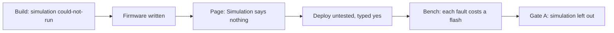
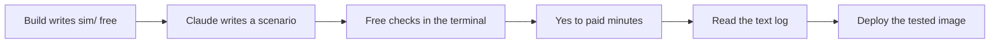
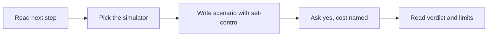

# Jobs and journeys
<!-- Tags as in the brief: E with a pointer, H with its source, D with who and when; an unknown is —. -->

## Who
- The PO as a hobbyist who builds his own gadgets with spark (n = 1) · E the walks P829, P934 and the bench notes in the store (bench-2026-11-20.md, bench-2026-11-25.md), scrum/VISION.md's hobbyist persona <!-- REQUIRED:who -->
- Claude, the agent that runs spark for the person in the conversation and reads each answer as JSON · E AGENTS.md ("One core, many interfaces"), the PO's lens of 2026-10-18 (design every interface for a person and for Claude)
- A later hobbyist who did not write spark and pays for no Wokwi plan · H the vision's persona, nobody asked

## Jobs
- J1. When my firmware is written [E flow_codes.py:11, the firmware phase before simulate], I want to know whether it does what I asked before I wire and flash [E the PO's words on P1190: "it doesn't always pass or can run at all even though its actually working in real life"], so I can avoid a bench round on a fault that a free check finds [H the session, from P410's words]. <!-- REQUIRED:jobs -->
- J2. When my board or a part is not in Wokwi [E ★C1, ★C2], I want spark to say what it can still test, and how [E the PO's words on P1190: "we need to analyze and design how it should actually work"], so I do not read a working gadget as a failure [E the PO's words on P1190].
- J3. When a run costs Wokwi minutes [E ★C10], I want the free checks first and the cost named before I say yes [E the PO on P1190: "there are some free steps we can do, but then the payd part", D-a], so I spend minutes only on a run that can pass [E P410 #536, P413 #539].
- J4. When a part measures something, such as a distance or a temperature [E ★C8, research-wokwi.md §4], I want to set the measured value with a slider and see what the firmware does [E the PO on P1190: "adding sliders etc to set the measured value"], so I can test the behaviour at the edges without the real world [H the session].
- J5. When a part or board has no model [E ★C7, ★C11], I want Claude to write one from a library that works, kept beside its record [E the PO on P1190: "werite the webassembly ... reuse existing working librariws and then just extend them"], so the next project reuses it [E AGENTS.md "Records grow by need", H the session for the reuse].
- J6 (Claude). When the person asks to test the firmware, I want one Operation that runs the strategy the setting names and returns the verdict with what it could not show [E AGENTS.md, P1078 #1582, the PO's strategy rule D-g], so I never pick the tool by guess or report a `could-not-run` as a pass [E docs/guide/agents/never-assume.md].
- J7. When I change the simulator or a tool [E the PO's rule D-g], I want the change in one place, so the screens, the checks and the scenarios keep working [E D-g "reusable, dry"].

## Today they…
- J1 · run `run_scenario.py` in the terminal (paid), or nothing: the import check (`import_firmware.py`) imports modules and never runs `main.py` · E ★C3, ★C13 <!-- REQUIRED:today -->
- J2 · the build ends its simulation stage as `could-not-run, board_not_in_wokwi`. The page counts the build as done and says there is no simulation. The person deploys untested after a typed yes · E ★C1, ★C2, `scripts/spark/flow/flow_codes.py:79`
- J3 · `run_scenario.py --dry-run` makes the free checks, and the paid command makes them again before it asks. Nobody counts the minutes spent · E ★C4, P413 #539
- J4 · the Wokwi web editor shows a part's popup slider (the DHT22) or a chip's controls (the VL6180X). A scenario sets a value with `set-control`. Spark has no slider of its own · E ★C8, research-wokwi.md §4, `scripts/spark/firmware/scenario_steps.py:17`
- J5 · two chips written by hand in C for one project (`parts/vl6180x-breakout/chip/`, `parts/l9110s-module/chip/`). No chip of another author is reused · E `ls parts/*/chip`, research-wokwi.md §6
- J6 · Claude runs the CLI `run_scenario.py`, which is no Operation, and reads its text · E ★C15
- J7 · a change of simulator touches the build stage, the firmware area, the flow and the records: 42 modules name Wokwi · E ★C6

## Journeys

### The PO — the e-paper clock on the FireBeetle 2 C6 (no Wokwi board) <!-- REQUIRED:journey -->
| step | what they do | evidence | friction or harm | today | open question |
| --- | --- | --- | --- | --- | --- |
| 1 | builds the board from the parts list | E the walk project p934-display2's `.spark/build.json` | the simulation stage ends `could-not-run` | partly | does the person read this as a failure? |
| 2 | Claude writes the firmware | E the walk P934 | — | works | — |
| 3 | opens the page: Simulation shows no state of its own | E ★C2, ★C3 | the step says nothing that he can do | not yet | which free checks run without a Wokwi board? |
| 4 | asks Claude to deploy firmware/ untested | E `flow_codes.py:79` | the deploy asks a yes for untested firmware, after zero free checks of behaviour | partly | — |
| 5 | tests on the bench | E the store's bench-2026-11-25.md | each fault costs a flash and a look | works | — |
| 6 | reaches gate A ("it works") | E ★C14 | the simulation has no say, and "ready unknown" locks the clock | not yet | does the simulation's result appear at gate A as evidence? |

### The PO — the button light on the XIAO ESP32-C6 (a Wokwi board)
| step | what they do | evidence | friction or harm | today | open question |
| --- | --- | --- | --- | --- | --- |
| 1 | builds: the diagram, `wokwi.toml` and the chips are written, free | E `boards/xiao-esp32-c6.json`, P410 #536 | — | works | — |
| 2 | Claude writes a scenario from the must lines | E `run_scenario.py:23-25` | a scenario with no `set-control` step proves little | works | — |
| 3 | runs the free checks (`--dry-run`) | E ★C4 | a terminal command, not a page step | partly | — |
| 4 | says yes to a paid run | E `run_scenario.py` EPILOG | the minutes left are unknown to spark | partly | — |
| 5 | reads the log in `sim/runs/` | E `run_scenario.py:27-31` | a text log, no result screen | partly | what does a result screen show? |
| 6 | deploys the tested image | E P308 #374 | the gate does not name the simulator's grade | partly | — |

### Claude — asked "test the firmware" in a project with a VL6180X
| step | what they do | evidence | friction or harm | today | open question |
| --- | --- | --- | --- | --- | --- |
| 1 | reads the flow's next step | E `scripts/spark/flow/phase_steps.py:52-71` | the step names a terminal command, not an Operation | partly | — |
| 2 | picks the simulator | E ★C5 | only one strategy exists, so there is nothing to pick | not yet | who picks: a setting, the board's coverage, or both? |
| 3 | writes a scenario that sets the distance slider | E ★C8 | the control ids live in the chip's JSON only | partly | — |
| 4 | asks the person's yes, cost named | E D-a | the cost is "Wokwi CI minutes", no number | partly | — |
| 5 | reads the verdict and what the run could not show | E `scenario_run.py`, ★C15 | text, not the core's envelope | partly | — |

