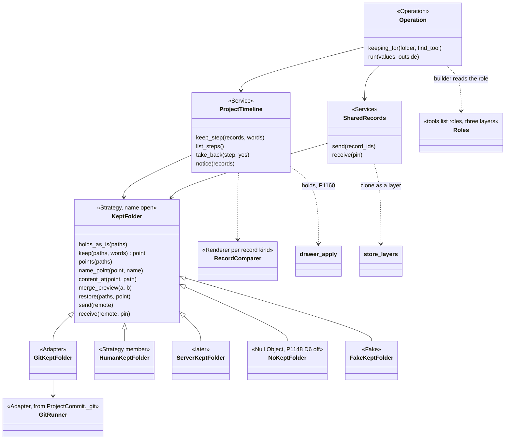

# Architecture lens: P1193 change tracking

The architecture lens on Opus, 2026-11-26. Its role is read-only, so the main session wrote this file from its
returned report, word for word.

Read at commit c0b914e2 on branch p1193-change-tracking, 2026-11-26. The PO's decisions of 09:08 CET (brief.md:89-92: D2 the shared side starts now, D3 a new public repository under his account, D4 drawn pictures only, D5 the project timeline first) are taken as D. In this report they are written "brief D2" to "brief D5", so they are not mixed up with P1148's D5.

## Findings

- **ARCH-1** · Spark already holds the seam the PO asks for, in another place. In P1036 a Store keeps one entity and its rules, and a Storage "holds JSON objects by namespace and key and knows no entity". The same split fits here. The rules (which files make a step, what is private, who reviews) go in two Services: the project timeline and the shared records. The mechanism (git, a person, a server, a fake) goes in one lower Strategy that knows only paths and points. This is GoF's Bridge, so the rules and the mechanism can change apart. · E `scripts/spark/records/storage.py:3-8`, `:69-74` (Storage, a Strategy), `:108` (FileStorage, an Adapter) · supports: D-q6 "one lower seam under two higher Services", and D-l (change a tool in one class)
- **ARCH-2** · The two callers differ on every verb. What a step keeps: decided records with their stamps (P1148 D8) against public records with owned, sourcing and photo filtered out (store discovery:200) and only drawn pictures (brief D4). Privacy: the ignore list against private places refused inside any work tree. Remote: none (the P1148 no-go proposal) against a public repository (brief D3). Merge: refuse on conflict (P1160) against a layer that wins by being nearest. Take-back: the core yes plus moving holds against an older pin. One Strategy with both sets of verbs would make a human member refuse about half of them, and each caller would see verbs it never calls. · E `docs/discovery/2026-11-25-spark-and-git/brief.md:125`, `docs/archive/2026-10-04-store-discovery.md:199-200`, `scripts/spark/records/store.py:145-148`, `:386-390`, `docs/discovery/2026-11-25-p1160-take-back-chain/finding.md:115-126`, brief.md:90-91 · supports: two Services over one seam, against one Strategy with two callers
- **ARCH-3** · P1157 plans `ProjectTimeline` as the Strategy, with the members `GitProjectTimeline`, `HumanProjectTimeline` and `FakeProjectTimeline`. Under ARCH-1 those members move down one level, to the lower seam, and `ProjectTimeline` becomes a Service. Otherwise the shared side needs its own Git, Human and Fake members, which makes 2 × N classes for N mechanisms. This changes a delegated decision on names. · E `docs/guide/words.md:21` · D-g (delegated council, 2026-11-25) · supports: a question for the decider
- **ARCH-4** · The git code that both sides can reuse is `ProjectCommit._git` and `_stop`: they clear the GIT_* variables, write output to temp files, stop the whole process group and enforce a timeout. Two places build it inside themselves: `write_brief` and `IgnoreList`'s default. It runs `Popen` itself, so neither `OutsideWorld.run` nor the effects gate sees it. `ProgramRunner.run` is `subprocess.run` and has no group stop. So a git-runner Adapter split out of `_git` is the one place to keep DRY. Moving it onto `outside.run` would lose the hook-safe stop unless `ProgramRunner` gains one. · E `scripts/spark/records/project_commit.py:36-68`, `:42`, `scripts/spark/build/project_setup.py:421`, `scripts/spark/build/ignore_list.py:36`, `scripts/spark/core/outside.py:54-57` · H that `subprocess.run` kills only the child on a timeout (model knowledge, Python docs not read) · supports: where the shared Adapter sits
- **ARCH-5** · Precedents exist for the setting and for the hand-in. The setting: the tools list maps a role to a tool, with a contract, in three layers (spark's defaults, the person's file, the project's file), and `use(role, tool)` refuses a tool that does not meet the role's contract. The hand-in: the bench Operations take `platform_for(project, find_tool)` in the constructor, with the real one as the default. Git has no entry in `data/tools.json`, and no role names change tracking. One role, a `_for(folder, find_tool)` builder handed to each Operation, and P1148 D6's "off" as a Null Object member (as `NO_SPINNER` is) would give one setting that both Services read. · E `scripts/spark/records/tool_finder.py:39-46`, `:91-112`, `:531-538`, `data/tools.json` roles, `scripts/spark/bench/deploy_image.py:492-508`, `scripts/spark/bench/check_grant.py:57-61`, `docs/guide/patterns-and-names.md:79` · H for the proposal itself · supports: D-q6 "chosen by one configuration and handed in"
- **ARCH-6** · On the store side, a pull fits the existing read path. `layers()` reads the project, then the shelf, then the library, then the catalog, and the nearest record wins. A read-only clone at a pinned commit becomes one more layer, so the shared side needs no merge verb: being nearer decides. `inside_git` only walks up from the target, so a clone in its own subfolder of the store does not make its private siblings refused. A push is the Service's copy, filtered, into the clone, then a keep and a push. Under brief D3, a person with no write access to the PO's repository needs a fork and a pull request, which git alone does not do. · E `scripts/spark/records/store.py:118-140`, `:203-208` (a code read, not run), `docs/archive/2026-10-04-store-discovery.md:209-211` · H the fork and pull request point (no host page read) · supports: D-q5's shape, and the verb table's "merge" cell for the store
- **ARCH-7** · The PO's words "mark" and "snapshot" are already taken. "Mark" names the status glyph in the text view and on the page, a board's printed marks, and a ledger row's mark. "Snapshot" names `tools/snapshot.py` and the 2026-10-11 baseline. D-g already rules out "history", "commit", "revision" and "change". "Kept files" is ruled out, and "Store" is a role word. The named point and the lower seam both need words before any code. · E `docs/guide/patterns-and-names.md:40`, `GLOSSARY.md:185-188`, `:271-275`, `docs/guide/words.md:25-29` · supports: a naming question, which belongs to the UX lens and the PO
- **ARCH-8** · For an outside change (D-q2), the lower seam can only say whether its mechanism holds a file as it is on disk (`held_as_is`). The phase readers' stamps say what is out of date. A human member cannot answer `held_as_is`, so it must answer "unknown", never "held". The planned timeline also answers `IgnoreList`'s git-index reads (`tracks`, `tracked_files`), and its docstring says a timeline with no git "answers False and []". That puts git's index into the Strategy, and it turns "cannot say" into "nothing tracked". Keeping the index reads on the git Adapter keeps the Strategy free of git. · E `scripts/spark/records/project_commit.py:69-79`, `:81-94`, `scripts/spark/build/ignore_list.py:28-33`, `scripts/spark/flow/phase_readers.py:128-593` (cited by the brief, not reread) · supports: D-q2's split, and the human member's "notice" cell
- **ARCH-9** · A take-back of a pick also changes holds in the store, through `drawer.apply`, outside the project folder. That cross-scope step belongs to the project timeline Service, never to the lower seam. A server or human member then needs no knowledge of holds. · E `docs/discovery/2026-11-25-p1160-take-back-chain/finding.md:100-106` · supports: the split between the Service and the seam
- **ARCH-10** · Git gives the bytes for the tools behind compare, merge and back-to-a-point without touching the work tree. `git merge-tree --write-tree` "does not make any new commits and does not read from or write to either the working tree or index" (`git help -m merge-tree`, git 2.49.0). `git restore --source=<tree>` puts the content of named paths back (`git help -m restore`). Lightweight and annotated tags both exist (`git help -m tag`). A compare in plain words (P1148 D11) then needs a Renderer for each record kind over two contents, never git's diff text. · E the three local man pages, git 2.49.0 · H that each area declares its comparer, in line with the Q0 rule that "each area declares its kept step's records" · supports: the verb table, and P1160's dry merge for a preview
- **ARCH-11** · The effect words are `reads`, `runs`, `board`, `deletes`, `writes`, `asks` and `fetches`. A push sends records to a network, which no effect word names, so neither the gate nor a later MCP tool annotation can tell a push apart. · E `scripts/spark/core/operation.py:27-31` · H that an MCP client uses such annotations (no web) · supports: a new effect word with the push Operation
- **ARCH-12** · P1148 D5's "human does that, using just file manipulation" has two readings. Either the person copies files by hand and spark says how, or spark copies files with no git. A file-copy keep already exists in P877: the previous version of `requirements.json` staged on a yes. · E `docs/discovery/2026-11-25-spark-and-git/brief.md:122`, `scripts/spark/design/entry_origin.py:148-152` · supports: the human column of the verb table
- **ARCH-13** · The LangGraph and MCP fit. A LangGraph checkpoint keeps a graph's state, so it would hold a kept step's id, never the files (carried over from P1148 ARCH-13). MCP already gets each Operation's `input_schema` and `output_schema`. The list of points could also be a read-only MCP resource. · H model knowledge, no web · E `scripts/spark/core/operation.py:114-126` · supports: P1148 D12 "only the seams"
- **ARCH-14** · Brief D5 builds the project timeline first. A lower seam designed with only one caller can grow verbs that fit only the project. Building only the verbs the first caller uses (keep, list, take back, notice), and adding send and receive with the shared Service, keeps the seam small and still serves the second caller. · D brief D5 · H the risk · supports: the order of the slices

### Proposed seam (H, names open, see ARCH-7)

### The verbs against the members (H unless marked)

| verb | level | git | human | server | fake |
| --- | --- | --- | --- | --- | --- |
| keep | seam | commit only the named paths, with the person's identity or a refusal (E `project_commit.py:81-90`) | says what to copy and keeps nothing, or a copy of the files (ARCH-12) | its own store, with the server's identity (P1148 Q20 open) | in memory |
| list | seam | the points that touch the paths | — or the copies it made | its own list | in memory |
| mark (a named point) | seam | a tag (E `git help -m tag`), in spark's own name space (H) | a named copy, or refused | its own | in memory |
| compare | Service plus seam | `content_at` twice, then a per-kind Renderer, never diff text | the person's own two files, read the same way | as git | planted contents |
| merge | seam preview, the Service decides | `merge-tree --write-tree` as a preview (E man page). The project refuses on a conflict (P1160). The store does not merge: nearest layer wins (ARCH-6) | refused | its own, or refused | a planted result |
| take back | Service (yes, preview, holds) plus seam restore | revert (P1148 D7) or `restore --source` to a point (E man page) | says what to put back, refused | its own | in memory |
| push | the shared Service only | push to the clone's remote (brief D3), or a fork and a PR for others (H) | refused, the person copies by hand | its own sync | records what was sent |
| pull | the shared Service only | fetch and check out a pinned commit in a clone outside the private places (H) | refused | its own | planted |
| notice | seam (`holds_as_is`), stamps for out of date | hash compare (E `project_commit.py:69-79`) | unknown (None), never "held" | its own | planted |

## What I could not check, and why

- LangGraph's checkpointer and MCP's resources and annotations: I had no web tool, so ARCH-11 and ARCH-13 rest on model knowledge.
- That a git clone in a subfolder of a scratch store leaves private writes allowed: I read the code but did not run it.
- Push, fetch, and checkout at a pinned commit, and tag name spaces: not run, so H.
- `subprocess.run`'s behaviour on a timeout: the Python docs were not read.
- The comments on #123 and #1688: not read in the time limit. I read #437 and #505.
- The past-breadboard architect file: read only in part, by grep.
- `phase_readers.py`: cited from the brief, not read again.

## Questions for the decider

- Is there one lower seam under two Services, the project timeline and the shared records, with the git, human, server and fake members on that seam? Or are there two Strategies that share only a git Adapter? · decides D-q6's shape (ARCH-1, ARCH-2)
- May `ProjectTimeline` become a Service, so the members P1157 planned move to the lower seam? · decides P1157's planned names (ARCH-3)
- Is the strategy chosen by a role in the tools list's three layers, with "off" as a Null Object member? · decides where the one setting lives (ARCH-5)
- Does the human strategy mean the person by hand, or spark copying files with no git? · decides the human column (ARCH-12)
- Which words replace "mark" and "snapshot" for a named point, and what is the lower seam called? · decides the names (ARCH-7)
- Does a push get its own effect word? · decides the gate and the MCP annotation (ARCH-11)
- How does a person without write access to the PO's public repository share a record: a fork and a pull request through the host's CLI, or only through the PO? · decides whether the push verb needs a host Adapter (ARCH-6)

## Searches

none. No web searches.

## Local reads that served a decision

The lens listed these under Searches. The main session moved them under this heading, word for word, because they are local reads, not web searches.

- `grep -rn "ProjectCommit\|project_commit" scripts tests` · where git is built and who reuses it · used (ARCH-4)
- `grep -rn "\.git\b\|\"git\"" scripts/spark` · which places know git · used (ARCH-4, ARCH-8)
- `grep -rn "platform_for" scripts/spark` · the hand-in precedent · used (ARCH-5)
- reading `data/tools.json` roles and contracts with python3 · the setting precedent · used (ARCH-5)
- `grep -n -i -w "snapshot\|tag\|bookmark\|checkpoint"` and `-w "mark"` in GLOSSARY.md and the guides · whether the words are taken · used (ARCH-7)
- `git help -m merge-tree`, `git help -m restore`, `git help -m tag` (git 2.49.0) · the preview, back-to-a-point and the named point · used (ARCH-10)
- `grep -rn "previous" scripts/spark` · the file-copy precedent · used (ARCH-12)
