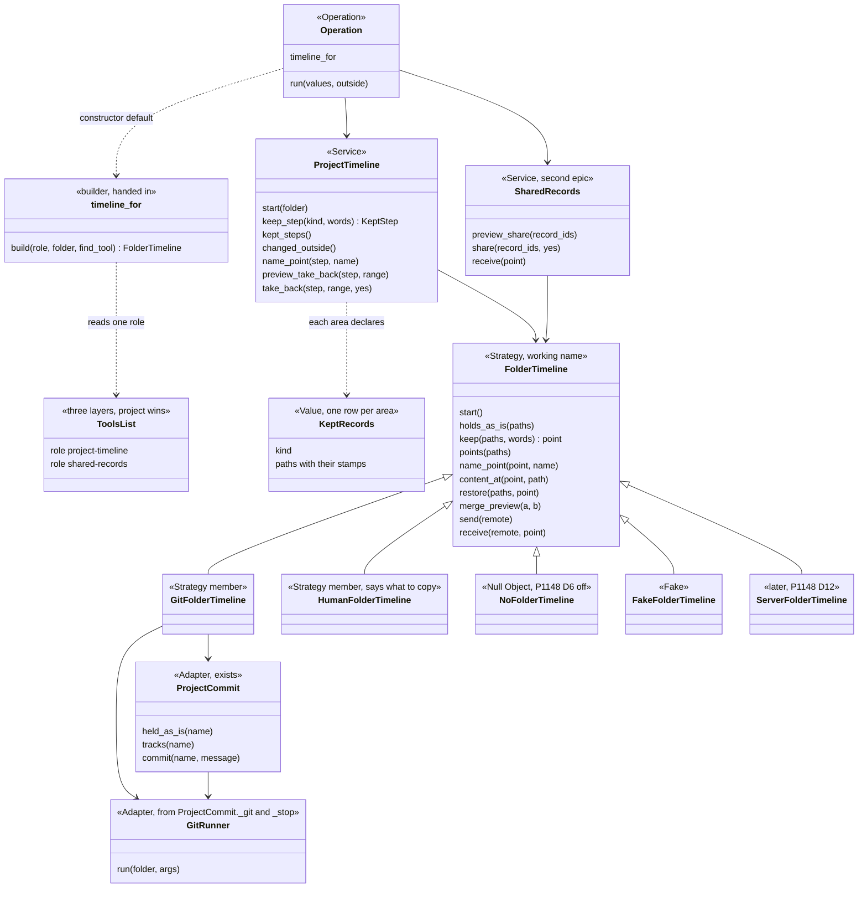
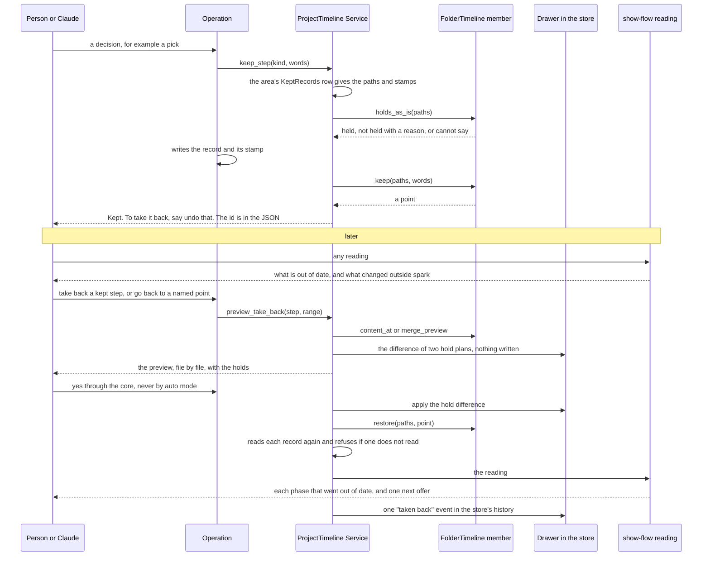
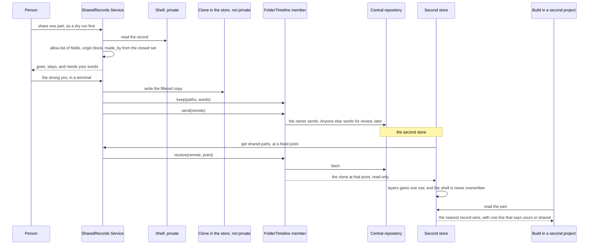

# P1193 change tracking: the council's synthesis

Note by the main session, after the refuter (council/refuter.md): this file stays as the architect wrote it. Its statements below are corrected in brief.md. The "24 hand commits" at lines 152 and 320 are 22 of 24 co-authored by Claude (★C16). "The digest that `based_on` holds already" at line 241 holds only for a shelf copy shelved from a project, and the P158 proposal says two `based_on` shapes exist (★C13). The A2 pass line's "the named point survives the squash" cannot fail and was revised (brief.md, Test). The narrowing of C11 to "a transport that merges" is the architect's reading, while the source says "any transport".

The architect on Fable, 2026-11-26. Read at 8ad5c005 on branch p1193-change-tracking. Tags: E is a pointer I or a lens read, H names its source. "brief D2" to "brief D5" are this discovery's decisions, so they are not mixed up with P1148's D5. No file I read asked me to run or change anything.

## 1. The direction

The project timeline widens from "the brief is committed" to four verbs on every main step: keep a step, notice an outside change, name a point, and go back to it. A compare in plain words follows, and a merge stays out [H the tech lead TL-12, E #1738 "maybe"]. The store's shared side adds a read-only layer of shared records at a fixed point, and a filtered copy out to the PO's public repository after a preview and a yes [D brief D2, D3, D4, E scripts/spark/records/store.py:118-130]. Both reuse one seam: a lower Strategy that knows only a folder, its paths and its points, with git as its first member [H the architecture lens ARCH-1, checked below]. The rules stay in two Services above it, the project timeline and the shared records, because the two differ on every verb [E ARCH-2's pointers]. One file chooses the member, the tools list with its three layers, and a builder hands it to each Operation [E scripts/spark/records/tool_finder.py:91-112, scripts/spark/bench/deploy_image.py:492-508].

## 2. The seam

**Recommendation: one lower Strategy under two Services (ARCH-1, ARCH-2), with the git runner split out below it (TL-1, ARCH-4).** The opinion is the architect's, with the architecture lens.

The reason, in three steps.

- The PO's own examples of "another strategy" are all mechanisms: git, "human does that, using just file manipulation", "on the server some other system" [D P1148 D5, docs/discovery/2026-11-25-spark-and-git/brief.md, Decisions]. So the exchangeable thing is the mechanism. The rules are not exchangeable: what a kept step holds and what may leave the store are spark's own decisions.
- The rules differ on every verb. A project keeps decided records with stamps, has no remote, refuses on a conflict and moves holds on a take-back. The shared side filters fields, has a remote, never merges and goes back by an older fixed point [E ARCH-2, E P1160 finding "The two cases" and Council answers rows 3 and 4, E store.py:145-148].
- "Reuse the selected strategy" [D the PO, #1738] then holds for every member. A server member is one class. A new step or a new shared kind adds a row to a Service, never a class to the seam.

**The rival I reject: two Strategies over one git Adapter (PO-5, the Q0 architect seat).** It reuses only the process runner. The off member, the by-hand member, the Fake and a later server member are then each written twice, which is 2 × N classes (ARCH-3). The choice is also made twice, so "selected once" holds only for git. I also reject one Strategy that carries both sets of rules, because each caller sees verbs it never calls and a by-hand member refuses half of them (ARCH-2).

**TL-1 is kept as the bottom layer, not as the answer.** `ProjectCommit._git` and `_stop` hold nothing of a project: they strip the GIT_* variables, write output to temp files, stop the whole process group and enforce a timeout [E scripts/spark/records/project_commit.py:35-67]. Two places build `ProjectCommit` inside themselves today [E scripts/spark/build/project_setup.py:421, scripts/spark/build/ignore_list.py:36]. One line starts git in all of scripts/spark [E `grep -rn '"git"' scripts/spark` gave project_commit.py:42 alone, this session]. That code becomes the Adapter `GitRunner`. `ProjectCommit` stays an Adapter over it, and the git member reuses both.

**The cost: a delegated word changes.** docs/guide/words.md:21 plans `ProjectTimeline` as the Strategy with the members `GitProjectTimeline`, `HumanProjectTimeline` and `FakeProjectTimeline`. Under this seam `ProjectTimeline` is a Service and the members move down one level. The person's words "project timeline", "kept step" and "take-back" do not change. The docstring at scripts/spark/build/ignore_list.py:31-32 names `GitProjectTimeline` and changes with P1151. The working name of the lower Strategy here is `FolderTimeline`: "timeline" then means the kept points of one folder, and "project timeline" is a project's one with its rules. "Timeline" appears only in GLOSSARY.md, words.md and ignore_list.py today [E `git grep -i -l timeline -- scripts GLOSSARY.md docs/guide`, this session]. The name is the council's to settle (question C1).

**Built by need (ARCH-14).** The first caller builds `start`, `holds_as_is`, `keep`, `points` and `restore`. `name_point`, `content_at` and `merge_preview` come with their slices. `send` and `receive` come with the shared Service. A member that cannot do a verb raises a `SparkError` with one core code, so every interface says the same refusal [E docs/guide/patterns-and-names.md, "The core contract", H the code's name is a proposal].

**How the strategy is chosen and handed in (TL-7, ARCH-5).**

- The setting lives in the tools list. It already maps a job to a tool in three layers: spark's `data/tools.json`, the person's file in the store and the project's `.spark/tools.json`, with the project winning [E tool_finder.py:39-44, 91-112]. `use(role, tool)` refuses a tool that does not meet the role's contract [E tool_finder.py:531-538]. Git has no entry there today, and the file holds 14 roles [E python read of data/tools.json, this session].
- Two roles, one family of members: `project-timeline` and `shared-records`, both `git` by default. This is one configuration with two keys.
- The hand-in copies the bench: an Operation takes `timeline_for` in its constructor with the real builder as the default, and `run` calls `self.timeline_for(role, folder, outside.find_tool)` [E scripts/spark/bench/deploy_image.py:492-508, scripts/spark/bench/check_grant.py:57-61]. A test hands in the Fake. No Operation builds a member itself.
- A new settings file is the rejected rival. PO-6 found that no settings file is read anywhere in scripts/, so it would be a second home beside the tools list.
- One gap: the tools list knows the kinds path, python, mcp and download [E tool_finder.py:164, 197, 230, 344]. The members `by-hand` and `none` are no programs, so they need entries of one new kind. H, my proposal, not sized.

**D6's "off".** `project-timeline: none` in the person's file gives `NoFolderTimeline`. It keeps nothing, says so in one line, and answers `holds_as_is` with "cannot say" [D P1148 D6, E #1688 "First slice", E the Null Object precedent `NO_SPINNER`, scripts/spark/core/cli.py:262].

**PO-6's coupling.** It cannot happen, because "off" is a member of the `project-timeline` role only. The `shared-records` role is read on its own. A single key for both is rejected for this reason. It is also wrong on the facts: the central repository is a git repository (brief D3), so the shared side needs git even for a person who keeps projects by hand. A test pins it: with `project-timeline: none`, a receive from a local bare repository still runs.

**Three edges.**

- An outside change (ARCH-8): the seam answers only "held as it is", "not held, with a reason" or "cannot say". The phase readers' stamps say what is out of date. `IgnoreList`'s two index reads go through one neutral question, "which of these files do you keep already", and a member with no index answers "cannot say", never "none". The docstring at ignore_list.py:32 says False and [] today, which turns "cannot say" into "nothing tracked".
- Holds (ARCH-9): the move of holds through `drawer.apply` stays in the project Service, so no member knows the store.
- The effects gate (ARCH-4, ARCH-11): `GitRunner` starts git with its own `Popen`, so `OutsideWorld.run` and the gate do not see it [E project_commit.py:42, scripts/spark/core/outside.py:45-57]. Each Operation that keeps declares `runs` and `writes`. A push needs a new effect word, because the seven words name no send to a network [E scripts/spark/core/operation.py:27-31].

## 3. The decisions

Costs are S, M or L. They are H, the architect's estimate, and nothing is measured.

### D-q1: which main steps the project timeline keeps

- Option A: only D8's decided records. board.tsx and breadboard.json stay outside. Cost: none. Proves nothing new, and leaves a person's layout edit kept by no step [E brief ★C3, ★C4].
- Option B: each area declares its kept step's records in one small table (`KeptRecords`). The first rows are D8's records with their stamps. Two rows follow for the person's own layout files, board.tsx and breadboard.json, each with a stamp of its own. Cost: S for the table, M for the two rows. Proves that a new phase adds a row and the timeline does not change (J8).
- Option C: keep everything in the folder. Cost: S. Rejected by P1148 D8, and it would keep dist/ and the page.

Recommendation: B, in two parts. The table goes into the walking skeleton. The two layout rows wait for the notice slice, which counts how often a person's edit happens. The opinion is the architect's, with the Q0 council's rule (3 of 3) and the PO assistant's condition PO-2.

- The PCB and the perfboard get no row now. The PCB's layout is board.tsx since #1600 closed with "B: KiCad as an export", and the perfboard has no record [E PO-3].
- The evidence is split. 24 hand commits touch board.tsx in 4 of 9 repositories [E PO-1]. No board.tsx differs from its `written_sha256` in the 6 projects with a build record [E UX-6, n = 6].
- The layout rows need a stamp that travels with the file. `written_sha256` lives in build.json, which a kept step never holds [E P1160 finding change 3, E scripts/spark/build/build_record.py:32]. Without it a taken-back board.tsx reads as the person's file and no build makes it again [E PO-2, scripts/spark/build/kept_files.py:105-114]. breadboard.json has no stamp at all [E TL-6].
- Keeps: P1160's "a stamp travels with its record" and "no dependency record". Widens: P1148 D8. Reopens: P1160 Q2 ("board.tsx stays a build output", delegated), and it touches Q4.

### D-q2: what spark does when a file changed from the outside

- Option A: notice at the next reading and say it. A person's yes then keeps it as a step. Cost: S for the reading, M for the keep. Proves J2 with no new mechanism.
- Option B: keep it silently at spark's next write. Cost: S. Spark then commits bytes it did not write, with no yes.
- Option C: refuse the next write until the person resolves it. Cost: S. It blocks a walk on a file the person meant to change.

Recommendation: A. The opinion is the architect's, with the tech lead (TL-5) and the UX lens (UX-1, UX-7, UX-8).

- The first slice needs no git. The build phase reads `written_sha256`, which only the build reads today [E TL-5, kept_files.py:231, 506-520, scripts/spark/flow/phase_readers.py:479-507]. A record with no stamp says "spark cannot tell" where it is silent today [E UX-1, phase_readers.py:164-170].
- Claude gets data, not English: a `changed` list in the show-flow JSON with the file, its record, the kept step since, the seam's "held" answer and what it makes out of date [H UX-8's sketch].
- "Noticed" means at the next reading. The page does not watch the folder [E UX-7, scripts/spark/flow/flow_codes.py:303-306].
- A by-hand member answers "cannot say", never "held" [H ARCH-8].
- Keeps: P1160's "the check is the existing reading", P1148 D11 and D12. Touches: P1148 Q7, still queued, for a file that git does not hold yet.

### D-q3: what a snapshot is

- Option A: a name on a kept step. Going back to it is P1160's "this step and the steps after it", with D14's preview and yes. Cost: S on top of the take-back. Proves J3 with no second object [H UX-11].
- Option B: a separate snapshot that also copies build outputs. Cost: M to L. Gives old drawings with no rebuild. It adds a fifth word and breaks D8.
- Option C: nothing. The list of kept steps is enough. Cost: none. Fits the evidence of 0 tags in 9 repositories [E PO-1]. It drops his words "make tags or like snapshots".

Recommendation: A, and no named point for the store. The opinion is the architect's, with the UX lens and the tech lead (TL-12).

- The store's shared clone already has its fixed point, and the private store has history.jsonl.
- The git member keeps the name as a ref in spark's own name space, not as a tag. In a scratch repository such a ref still resolved after a squash merge, a branch delete and `git gc --prune=now`. `git restore --source=<ref> -- <path>` brought back one file and left the firmware file alone [E this session's scratch run, git 2.49.0, n = 1, folder removed]. Caveat: git does not push or clone such a ref by default, so a named point stays on one machine.
- The list shows a refusal before the person chooses a point, not after the yes [E UX-10].
- Keeps: D7, D11, D14. Widens: D9 and the kept step's row in words.md by a `name`. Touches: P1160 Q4, see C9.

### D-q4: where a compare and a merge help

- Option A: a compare in plain words per record kind, between a point and now, and no merge. Cost: M. Proves J4. It reuses three differs that exist: the needs basis, the traces and the bench changes [E UX-9, flow_codes.py:36-37, kept_files.py:209-211, scripts/spark/breadboard/bench_changes.py:15-16].
- Option B: A plus the old point's drawings, by building that point again in a scratch folder. Cost: L.
- Option C: a merge of two points in a project. Cost: L. It gives a record that nobody decided [E P1160 finding, Risks row 6].

Recommendation: A as a later slice, B not now, C not built. The opinion is the architect's, with the tech lead (TL-12) and the PO assistant (PO-7: "maybe" in his words).

- `merge_preview` stays on the seam for one use only: the dry merge that P1160 Q3 needs to refuse "only this step" on a conflict [E P1160 Council answers row 3, E ARCH-10's man page read].
- The store never merges: the nearest layer wins [E store.py:133-140].
- Each area declares its comparer beside its kept records, as a Renderer [H ARCH-10].
- Keeps: P1160 Q3, P1148 D11. Reopens nothing. J5 stays open as his "maybe", a proposed no-go until he confirms.

### D-q5: what the shared side pushes and pulls

- Option A: a clone of the central repository in a new place of the store that is not private, read as one more layer at a fixed point. A share is a filtered copy into that clone, then a keep and a send. Cost: M for receive, L for share. Proves outcome (4).
- Option B: the store itself becomes the repository. Refused by the code for the 11 private places [E store.py:145-148, 386-390].
- Option C: records go to spark's repository by PR. Rejected by brief D3.

Recommendation: A. The opinion is the architect's, with the architecture lens (ARCH-6) and the tech lead (TL-2).

- A repository in a sub-folder of the store leaves a shelf write allowed [E TL-2's scratch run, store.py:201-208]. The new place is classified in storage.py too [E store.py:109].
- The filter is an allow-list of fields. A block-list of `owned`, `sourcing` and `photo` misses the `//` comments in 28 of 28 records, `based_on.project` and two fact sources with his name and a folder under his home [E PO-4, UX-4, TL-3].
- A picture goes only when its record says who made it, from a closed set. `--made-by` is a free word today [E UX-5, scripts/spark/sourcing/keep_picture.py:33, D brief D4].
- A receive never overwrites the shelf. It adds a layer, and one line per part says "yours", "shared, newer than yours" or "only shared" [H UX-13, E `based_on.digest`, brief ★C13].
- A share cannot be undone, so its yes is the strong kind after a preview of what goes, what stays and what needs his words [H UX-4].
- "Push" means a direct send for the owner only. Everyone else needs a fork and a review [H TL-9, ARCH-6, UX-12, no host page read].
- Keeps: the 10-04 plan's "read-only at a pinned commit" and "no automatic pull on every search", D-j (holds never leave), P1148 D12. Widens: P1148 D5 from the project to the store. Replaces: the 10-04 trigger (brief D2) and the plan text "no sharing of document bytes", for drawn pictures only (brief D4). Reopens: the P1148 no-go proposal "no remote and no push by spark" [E spark-and-git brief.md:81], for the store's clone only. A project still gets no push from spark.

### D-q6: the one strategy

Options, reason and the rejected rivals are in part 2. Recommendation: one lower Strategy under two Services, two roles in the tools list, one builder handed in. The opinion is the architect's, with the architecture lens. The PO assistant's PO-5 and the Q0 architect seat held the rival.

- Cost: M inside P1151 and P1152's first slice, which build the seam anyway.
- Proves: P1148's A7 pass line (a Fake and git run with no change to the area) and the PO-6 test in part 2.
- Keeps: P1148 D5, D6, D7, D12 and D-l. Changes: the planned class names in words.md:21 (delegated).

### D-q7: which slice comes first

- Option A: keep, notice, name a point, go back, then compare, then the shared side [H TL-12].
- Option B: A, with the no-git notice slice moved to the front, because it serves a walk today.
- Option C: the shared receive early, to prove the seam with two callers.

Recommendation: B for the first epic, and the read-only receive as the second epic's first slice. The opinion is the architect's, with the tech lead.

- P1155's A1 walk runs before any later slice, as P1148 D13 set [E #1688 "Depends on"].
- P1165 and P1166 come before the take-back slice [E #1688 comment 3].
- ARCH-14's risk is covered without building early: the skeleton's test runs the seam under a second, fake caller.
- Keeps: brief D5, P1148 D13 and the order on #1688 (P1151 with P1152's first slice, then P1155).

### D-q8: a record's identity and a tombstone

- Option A: an `origin` block (who made it from a closed set, a digest of the content, the written time with its zone) before the first share, and a "withdrawn" record in the central repository when the first record is withdrawn. Cost: M. Proves that a same-named record from two stores is refused, not overwritten.
- Option B: both built before any transport, as the P158 proposal says [E brief ★C11].
- Option C: git's history is the identity, and a deleted file is the tombstone. Cost: none. A shelf copy based on a withdrawn record then never hears of it.

Recommendation: A. The opinion is the architect's, with the PO assistant (PO-10).

- It narrows C11's rule, and here is why. C11 speaks of a transport that merges. A receive as a read-only layer merges nothing, so the first receive needs only the `id` and the digest that `based_on` holds already [E brief ★C13]. H: CH-70's experiment was never run, so this rests on reading, not on a test.
- `id` and `vendor` with `sku` are in 28 of 28 records. No record has `origin`, `review` or `written` [E PO-10].
- A property enters when a check or a stage needs it, with its origin (AGENTS.md, "Records grow by need").
- Keeps: D-j and the 10-04 plan's item 8. Widens: `based_on`. Touches: P342's RecordAdder, which writes the block.

## 4. The open questions

### (a) For the council of three on Fable

| # | Question (from) | Options | My recommendation |
| --- | --- | --- | --- |
| C1 | The seam's shape and its names (ARCH q1, q2, PO q2) | one lower Strategy under two Services, or two Strategies over one Adapter | One lower Strategy. `ProjectTimeline` becomes a Service. `FolderTimeline` is the working name below it. Amend words.md:21, delegated |
| C2 | The setting's home (TL q5, ARCH q3, PO q2) | roles in the tools list, or a new settings file | Two roles in the tools list, `none` as a Null Object member, one new kind for a member that is no program |
| C3 | What the by-hand member does (ARCH q4) | it says what to copy and keeps nothing, or spark copies files with no git | It says and keeps nothing first. A copying member is a later class. `PreviousVersionFiles` is the precedent [E build_record.py:154-158] |
| C4 | The words a person sees (UX q2, ARCH q5, PO-13) | git's words, or plain ones | "name this point" and "back to <name>", with `kept_step.name`. "share" and "get shared parts". Never tag, mark, pull, push, pin or snapshot, which are taken [E UX-3, ARCH-7] |
| C5 | The Operation names beside `keep`, `kept` and `step` (UX-3) | bare names, or names that carry "kept-step" whole | Every new name carries "kept-step" or "shared" whole |
| C6 | An effect word for a send (ARCH q6) | reuse `writes`, or a new word | A new word, `sends`. No such word exists [E operation.py:27-31] |
| C7 | An outside change (TL q2, UX q4) | say only, keep silently, or refuse | Say it, and keep it on a yes. A record with no stamp says "cannot tell", and nothing is stamped silently |
| C8 | Is the page told live (UX q8) | watch the folder, or the next reading | The next reading |
| C9 | P1160 Q4 for a return to a named point (PO q1, UX-10) | keep the refusal, or name the person's later changes in the preview and let the yes cover them | Keep Q4 until the test in part 6 has a result. Its count decides |
| C10 | Named point or snapshot (PO q6, TL q3, UX q1) | a name on a kept step, or a second object | A name on a kept step |
| C11 | Merge (PO q7) | in scope, or paused | Paused as a proposed no-go. P1160 Q3 stands |
| C12 | What a receive does to a local record (PO q5, UX q7), and the layer's place | overwrite, stand beside, or wait for a pick | Stand beside, never overwrite. Order: project, shelf, library, shared, catalog, so a shared record never hides spark's library. H, mine |
| C13 | The filter's kind and the `made_by` set (UX q6, TL q6 in part) | block-list or allow-list, free word or closed set | An allow-list, and a closed set required before a picture is shared |
| C14 | D-q8's timing | before any transport, or before the first share | Before the first share. The first receive needs only `id` and the digest |
| C15 | board.tsx and breadboard.json as kept steps (TL q1) | never, always, or only while the bytes are the person's, with a stamp | Only while the bytes are the person's, with a stamp. It reopens the council's own Q2 |
| C16 | The firmer mark of spark's steps (P1160 remark, UX q3 in part) | the "spark: " prefix, or the ids spark records | `kept_step.id` stays git's id, as D11 says. The Service also lists the ids it made, and the named point is a ref |
| C17 | `GitRunner` onto `outside.run` (ARCH-4) | now, or later | Later. `ProgramRunner` has no group stop [E outside.py:45-57] |
| C18 | Does D12 ("nothing for a server is built") forbid a hosted repository (PO-13) | yes or no | No. A git host is not spark's server. Recorded as delegated |

PO q8 is settled: the brief's scope line now reads "A git host account is in scope since D3" [E brief.md:20].

### (b) For the PO only

| # | Question | Why only he can | Options | My recommendation |
| --- | --- | --- | --- | --- |
| P1 | Which text may leave the store: `//` comments, `based_on.project`, `order_code_at`, a fact source with his name or a folder of his (PO q3, TL q6, PO-4, UX-4) | his privacy | none of these, some, or all | None. A string that names him or a folder of his blocks the share until he edits or drops it |
| P2 | The author name and email on the public repository's commits (UX-4) | his name | his git identity, the host's no-reply address, or a spark identity | The host's no-reply address, shown in the preview. H, not tested |
| P3 | The first public push, and the repository itself: its name, its licence, who creates it (UX q5, D3) | cannot be undone, his account | spark creates and pushes, or he creates it by hand and gives the first yes in his own terminal | He creates it by hand. The first share is his yes in a terminal after a dry run against a local bare repository. No mode answers it. The licence is his call, and this is no legal advice |
| P4 | Is a drawing that the conversation traced from his own photo "drawn" under D4 (PO-11) | his earlier decision D4 | yes, or no | Yes when the record's maker is spark, the person or the conversation and the source is his own photo. Never a vendor's picture |
| P5 | How another maker contributes (PO q4, TL q4, ARCH q7, UX-12) | his account, and a review duty for him | only he sends for now, or a fork and a review through the host's CLI | Only the owner sends in the first slices. "Send for review" is a later card, with no host CLI now |
| P6 | P1148 Q14, with UX-2: the branch for kept steps in a project that merges by PR, and a squash merge on the host | his own projects, his queued question | the checked-out branch, or refuse on a PR-flow main | The checked-out branch. After a squash the list says which steps the host merged into one |
| P7 | P1148 Q7: may spark stage a file that git does not hold yet, for a declared kept record | his queued question, against P1027's "never stages" | yes for the named files after a yes, or no | Yes for a declared record after his yes, never a folder-wide add |
| P8 | Does J5, the merge, wait (C11) | his own words on #1738 | wait, or keep in scope | Wait |
| P9 | Q1: how important each assumption is, and the pass line of the test in part 6 | the frame gives it to the decider | — | The pass line in part 6 |

No question here costs money. A public repository and git are free, and no large-file service is used [H, no price page read].

## 5. The story map

Backbone: Start → Keep → Notice → Name a point → Go back → Compare → Share → Get shared → Build with it.

| slice | activity | story | job | tag | the proof the PO can read |
| --- | --- | --- | --- | --- | --- |
| 0 walking skeleton | Start, Keep | The seam exists with the git, none and Fake members. Init calls it, and a brief write is one kept step (P1151 with P1152's first slice) | J1, J8 | E #1688 "First slice" | A7's lines: a Fake and git run with no change to the area, 0 output lines say "git" or "Claude", and the CLI still commits |
| 0 | Keep | The A1 scratch walk (P1155) | J1 | D P1148 D13 | 3 of 3 kept lines and 0 tracked files that the ignore list covers |
| 1 | Notice | With no git: the build phase says "you changed the board file after the build", and a record with no stamp says "spark cannot tell" | J2 | E TL-5, UX-1 | `flow.py show` on a scratch copy of a project with no needs basis prints the "cannot tell" line |
| 1 | Notice | P1165 and P1166: a hold that differs from the picks, and a parts-list entry whose pick is gone | J2 | E P1160 changes 1 and 2 | each card's own proof |
| 2 | Keep | Each decided record is one kept step with its stamp, from the area's row in the table | J1, J8 | D P1148 D8, E P1160 change 3 | A6's lines: at most one kept step per decision and a clean tree |
| 2 | Notice | The `changed` list in the show-flow JSON, and "keep this as a step" on a yes | J2 | H UX-8 | the JSON of a scratch project after a hand edit of the brief |
| 3 | Go back | A take-back of the newest or any kept step, in P1160's five steps | J1 | D P1148 D7, D9, D14 | A2's lines, with P1160's three added cases |
| 4 | Name a point, Go back | A name on a kept step, and a return to it after a preview and a yes | J3 | H UX-11, E this session's scratch run | outcome (2): a named point is taken and the scratch project returns to it |
| 5 | Keep, Notice | board.tsx and breadboard.json as kept steps while the bytes are the person's, each with a stamp | J1, J2 | E brief ★C3, ★C15, TL-6 | outcome (1): a layout change by hand is noticed and kept as one step |
| 6 | Compare | A point against now in plain words, per record kind | J4 | E UX-9 | outcome (3): the lines of one compare in a scratch project |
| 7 | Get shared, Build with it | A receive from a local bare repository into a second scratch store, as a read-only layer at a fixed point | J7, J8 | E ARCH-6, TL-2 | a second scratch project builds with the received record, and a shelf write still passes |
| 8 | Share | The `origin` block, the allow-list, the closed `made_by` set, and a dry run that lists what goes, what stays and what needs his words | J6 | E PO-4, UX-4, UX-5 | the dry run over the 28 records: 0 strings with his name, a folder of his or a project name in what would go |
| 9 | Share | A share to a local bare repository after the strong yes. Then his own first share to the public repository | J6 | D brief D3 | outcome (4), then the public repository's first commit, which he reads before and after |
| 10 | Share, Get shared | A withdrawn record is named. Another maker sends for review | J6, J7 | H TL-9, UX-12 | one sentence, not refined |
| not planned | — | A merge of two points | J5 | E P1160 Q3 | — |

Slices 0 to 6 are the first epic and 7 to 10 the second (brief D5). Only slices 0 and 1 are refined now. The rest are one line each in their epic, by "Plans shrink with distance" (AGENTS.md).

## 6. The assumptions, the riskiest one and the pre-mortem

| id | belief | type | evidence now |
| --- | --- | --- | --- |
| A1 | Spark's commits in a person's repository happen and are safe | feasibility | open since P1148 D13, never run [E PO-6] |
| A2 | A return to a named point runs in the maker's real repositories, with his own commits and a PR flow between spark's steps | feasibility | against it: UX-10, PO-1, PO-2, UX-2. For it: this session's scratch run, n = 1 |
| A3 | The maker wants named points and a way back from spark, beyond git by hand | value | 0 tags in 9 repositories [E PO-1]. P1148's A3 is unrated |
| A4 | A person or Claude edits board.tsx or breadboard.json outside spark often enough to keep it | value | 24 hand commits [E PO-1] against 0 of 6 files that differ [E UX-6] |
| A5 | One lower Strategy serves both Services and stays small | feasibility | H ARCH-1, ARCH-14. No code yet [E brief ★C1] |
| A6 | An allow-list and a check of free text keep every private string out of the public repository | ethics | against it: `//` keys in 28 of 28, his name in 2 fact sources [E PO-4, UX-4] |
| A7 | A person and Claude read "changed outside spark" and know the one next step, with no git word | usability | H UX-8's sketch, no test |
| A8 | A clone in a sub-folder of the store works as one more layer, and a receive at a fixed point runs | feasibility | half E (TL-2's shelf write), half H (no fetch or checkout was run) |
| A9 | Someone reads the shared repository: at least his own second project builds with a received record | viability | n = 1, and the 10-04 trigger is gone [E PO-8] |
| A10 | Kept steps on the checked-out branch of a PR-flow project are what he expects | viability | P1148 A8 and Q14, still queued |
| A11 | D4 can be read from a record | feasibility | not today: `--made-by` is a free word [E UX-5] |

**The riskiest: A2.** D-q1's layout rows, D-q3's return and C9 all rest on it. The real evidence points against it: in p934-display2 the brief changed in 2 of 2 later commits, so a return under Q4 would refuse [E UX-10]. The opinion is the architect's, pending Q1. A6 has the worst outcome, since a leak stays in a public history. It is cheaper to hold: slice 8's dry run and P3 gate it, and nothing is pushed before both.

**The cheapest test.** P1148's A2 scratch spike, widened, not a new test. Kind: spike, about one hour, no code of spark's. In temporary clones of the three repositories with a remote (p934-display2, smartbin-local, firebeetle-games), with the originals read-only: write three kept steps by hand the planned way, name the second, add one own commit on the firmware, one own commit on a kept record and one squash merge. Then return to the named point by content.

**The proposed pass line, set 2026-11-26 before any result.** In 3 of 3 clones the kept step's records are byte-identical to the named point after the return. 0 files outside those records change. An uncommitted edit of the person is byte-identical after, or the return refuses in plain words. The named point still resolves after the squash in 3 of 3. The spike also writes down how many of the 3 returns Q4 as written would have refused.

**A result that changes the decision.** A file outside the records changes, or a point is lost: the kept step ids then move out of git's ids, and D-q3 is redone. Q4 would refuse 2 or more of 3: C9 flips, and the preview names the person's changes for the yes to cover.

**The pre-mortem: six months after this shipped, it failed. Why?** Merged from PO-14, with three reasons from the other lenses. All H, each resting on the E rows named.

1. A `//` comment, a project name or his name went to the public repository and stays in its history (PO-4, UX-4). Held by A6, slice 8 and P3.
2. Every return refused, because his own commits sat between spark's steps (PO-1, PO-2, UX-10). Held by A2's test and C9.
3. A taken-back board.tsx was never made again, so the PCB drifted from the circuit (PO-2). Held by D-q1's stamp.
4. Nobody received. The shared repository has one writer and no reader (PO-8). Held by A9.
5. Turning git off for projects turned off sharing (PO-6). Held by two roles and the test in part 2.
6. A merge gave a record that reads and that nobody decided (P1160 risk 6). Held by D-q4: no merge.
7. Two copies of one part split, with no identity and no withdrawn record (PO-10, brief ★C11). Held by D-q8.
8. Kept steps landed on a PR-flow main, and a squash on the host lost their ids (PO-12, UX-2). Held by P6 and the named ref.
9. The strategy was widened before A1 had ever run (PO-6). Held by D-q7: P1155 before any later slice.
10. An agent picked `keep` or `step` where it meant a kept step, because the names sat side by side (UX-3). Held by C5.
11. The lower seam grew a verb per caller, and the by-hand member refused most of them (ARCH-2, ARCH-14). Held by "built by need" and the skeleton's second fake caller.

## 7. Items

**Existing cards, widened first.** No new card for any of these.

- P1152 #1688 · the project timeline keeps only what D8 named, and has no named point, no outside change and no compare → the epic gains slices 1 to 6 of part 5, the `KeptRecords` table and the Service over the lower Strategy · epic · parent — · depends on P1155 for slices 2 to 6 · "we actually want to have that with all main steps that can be reverted" (#1738)
- P1151 #1687 · the git Adapter is built inside two callers and no setting chooses it → init's Operation takes the builder, `GitRunner` is split from `ProjectCommit`, and the two roles with `none` enter the tools list · story · parent #1105 · depends on P1150 (done) and N1 · "again our strategies should be configurable" (#1738)
- P1155 #1691 · nobody has seen spark's commits, or a return across his own commits and a squash → the A1 walk plus the widened A2 spike of part 6 · spike · parent #1688 · depends on P1152's first slice for A1, on nothing for the A2 part · P1148 D13
- P1157 #1693 · closed. Its rows change by N1 below, not by a reopen
- P1153 #1689 · the plain words cover only a kept step → they also cover a named point, an outside change and "cannot tell" · story · parent #1688 · depends on slice 2 · P1148 D11
- P1165 #1702 and P1166 #1703 · unchanged. Both come before slice 3 [E #1688 comment 3]
- P1163 #1699 · spark has no one concept of what a change makes out of date → a note on the card: a layout edit on the page is a kept step through the same Service, and its effects are D-q2's `changed` list. No second seam · epic · depends on slices 2 and 5 · his words of 2026-11-25 on #1699
- #123 · the shared store waits on a trigger that brief D2 replaced → the body records D2, D3 and D4 and takes N3 as its child · epic · "definitely pushing and pulling things to some central repo" (#1738)
- P342 #437 · RecordAdder's "publish" step has no target, and a record has no origin → publish calls the shared Service's share, and RecordAdder writes the `origin` block and the closed `made_by` · story · parent #425 · depends on slice 8 · his words of 2026-10-19 on #437
- P390 #505 · its body says `layers()` adds the shelf for parts only, which is out of date [E TL-11, store.py:129] → re-read first. What may remain: the copy onto the shelf at `--requirements` and the label in `--match`. A board then becomes a shared kind with no new seam · story · parent #123 · "at least locally for all projects first" (#505)

**New cards, only where nothing covers it.**

- N1 · the planned names make `ProjectTimeline` the Strategy, and a named point, a share and a receive have no words → words.md rows: the Service, the lower Strategy, `kept_step.name`, "share", "get shared", the effect word · chore · parent #1688 · depends on C1, C4, C5, C6 · "we want the system to be consistent, not to repeat ourselves" (#1738)
- N2 · a file that changed outside spark is read as current, or silently as fine when it has no stamp → the build phase reads `written_sha256`, a record with no stamp says "spark cannot tell", with no git · story · parent #1688 · depends on nothing · "be able to see if things changed from the outside" (#1738)
- N3 · the store has no shared side → the shared records Service on the same seam: receive as a read-only layer first, then the filter and the share (slices 7 to 10) · epic · parent #123 · depends on slice 0's seam and on P1 to P5 · "definitely pushing and pulling things to some central repo, like the parts maybe and probably more things, the learned facts about parts, svg pictures" (#1738)
- N4 · nobody has counted what a share of today's 28 records would carry → a read-only dry run with a draft allow-list, counting each string with his name, a folder of his or a project name · spike · parent N3 · depends on P1 · brief D3, D4

Slices 3 to 6 stay lines in #1688 until each is next.

## 8. Two more diagrams

One kept step, from a write to a take-back [E P1160 finding "The check after a take-back", D P1148 D7, D14, H the Service and seam names].

One part record, from the shelf to a second store [E store.py:118-130, 145-148, TL-2, D brief D3, D4, H the Service's steps].

## Decisions, each with its reason and the option rejected

1. One lower Strategy under two Services. Reason: the PO's exchangeable things are mechanisms, and the rules differ on every verb. Rejected: two Strategies over one git Adapter, and one Strategy with both rule sets.
2. `GitRunner` split from `ProjectCommit`, which stays. Reason: the hook-safe stop exists once and words.md already plans the reuse. Rejected: moving git onto `outside.run` now.
3. Two roles in the tools list and one builder. Reason: the three layers and the contract check exist, and "off" for projects must not reach sharing. Rejected: one key for both, and a new settings file.
4. Area-declared kept records. Reason: a new phase adds a row. Rejected: a list inside the timeline.
5. An outside change is said, then kept on a yes. Rejected: a silent keep and a blocking refusal.
6. A named point is a name on a kept step, kept as a ref of spark's own. Rejected: a snapshot object and a git tag.
7. Compare in words, no merge. Rejected: a merge in a project or in the store.
8. The shared side is a clone as one more layer plus a filtered copy out. Rejected: the store as a repository.
9. The filter is an allow-list. Rejected: the 10-04 block-list.
10. Identity before the first share, a withdrawn record at the first withdrawal. Rejected: both before the first receive.
11. The riskiest test widens P1148's A2 and rides on P1155. Rejected: a new test card.

## Claims I checked myself, with file and line

- `ProjectCommit` is the only git runner, with `_git`, `_stop`, `held_as_is`, `tracks`, `tracked_files`, `commit` · scripts/spark/records/project_commit.py:27-110, and the grep above
- It is built inside two callers · scripts/spark/build/project_setup.py:421, scripts/spark/build/ignore_list.py:36, and the docstring at :28-33
- The Storage split of Store and Storage · scripts/spark/records/storage.py:3-8, 69-74, 108-113
- `layers()`, the board shelf, the private places, `inside_git`, the refusal · scripts/spark/records/store.py:109-113, 118-130, 133-140, 145-148, 201-208, 386-390
- The tools list's three layers, `use`, the kinds and `on: false` · scripts/spark/records/tool_finder.py:39-44, 91-112, 164-344, 531-538, and a read of data/tools.json (14 roles, no git entry)
- The effect words and `OutsideWorld`'s fields, `ProgramRunner` · scripts/spark/core/operation.py:27-31, scripts/spark/core/outside.py:42-57
- The hand-in precedent · scripts/spark/bench/deploy_image.py:492-508, scripts/spark/bench/check_grant.py:57-61
- The build's rule for a person's board.tsx, `OWN_FILES`, `PreviousVersionFiles` · scripts/spark/build/kept_files.py:89-123, scripts/spark/build/build_record.py:32, 154-158
- The nine phases, `basis_says` with no record · scripts/spark/flow/flow_codes.py:11, scripts/spark/flow/phase_readers.py:164-170
- The delegated words · docs/guide/words.md:14-29
- P1148's decisions, questions Q7, Q14, Q18 and the no-go line · docs/discovery/2026-11-25-spark-and-git/brief.md:81 and its Questions and Decisions sections, and its risks-and-tests.md A1 to A8
- The P1160 finding, whole · docs/discovery/2026-11-25-p1160-take-back-chain/finding.md
- The cards #1688 with its three comments, #1687 with its comments, #1691, #1689, #1690, #1693, #1699, #1702, #1703, #1696, #123, #437, #505 · `gh issue view`, this session
- One scratch run in a temporary folder, removed after: a ref of spark's own survives a squash merge, a branch delete and a gc, and `git restore --source` returns one file · git 2.49.0, n = 1

## What I did not check

- Every count the lenses took in the PO's store and project folders (PO-1, PO-4, PO-10, PO-12, TL-3, TL-4, UX-1 to UX-6). I read none of those files.
- TL-2's scratch run, which I cite and did not repeat. No fetch, checkout at a fixed point or push was run by anyone.
- A squash merge made by the host. My run used `git merge --squash` locally.
- Whether the host keeps a ref outside heads and tags, and how a no-reply address behaves (P2). No web page was read, and none of my 5 fetches was used.
- The size of a new kind in the tools list, and every S, M and L above.
- The comments on #123, the 10-04 store discovery and the P158 proposal at first hand. I rest on the brief's and the lenses' pointers for them.
- Whether P1151's plan already has a home for D10's projects home, and whether a card for P1148's A2 exists.
- The canvas artboard "Moment: undo that", which no lens could open either.
- LangGraph and MCP fit (ARCH-13), which stays H from model knowledge.
- The refuter has not run yet, so no ★ claim here carries its verdict.

## Searches

none
