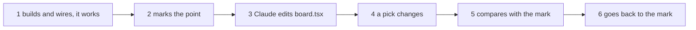
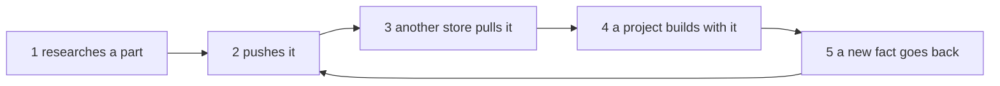

# Jobs and journeys
<!-- Tags as in the brief: E with a pointer, H with its source, D with who and when; an unknown is —. -->

## Who
<!-- One line per persona: who · evidence status (E pointer | H source).
e.g. `- Team leads who assign work · H Lena's belief, no interview yet` -->
- The maker: a person who builds a gadget with spark and Claude, from the idea to a breadboard and later a perfboard or a PCB. The PO is the one maker with evidence · E #1738 (his words, 2026-11-26), E P1148 ★C1 (his 37 project folders, n = 1)
- A maker who shares: a person who gives a part record, its learned facts or its picture to others, or takes theirs · H the PO's words on #123 (2026-10-09, 2026-10-22), no such person observed
- Claude, or another agent, which runs spark's Operations for the maker and changes the maker's files on request · E P1148 ★C10 (only an Operation's own text reaches every interface), E the store's councils/past-breadboard/refuter.md part 3 (Claude edits board.tsx) <!-- REQUIRED:who -->

## Jobs
<!-- One job story per line, each clause tagged: When …, I want to …, so I can ….
e.g. `- When I assign a task in a meeting [E tickets.csv:6], I want the assignee to see it that day [H Lena], so I can stop chasing people [E tickets.csv:7]` -->
- J1 · When a main step changes, for example the breadboard layout and wiring, the perfboard layout or the PCB [E #1738], I want spark to keep that change as a step [E #1738 "all main steps that can be reverted"], so I can go back to it later [E #1738 "be able to go back"]
- J2 · When a file of my project changed outside spark, by my hand, by Claude or by a pull [E #1738 "changed from the outside", E brief ★C3], I want spark to see it and say what it makes out of date [E #1699, his words of 2026-11-25], so I can trust what spark shows me next [H the facilitator, from P1160's links]
- J3 · When my project reaches a point I like, for example a breadboard that works [H the facilitator's example], I want to mark it with a name [E #1738 "make tags or like snapshots"], so I can return to it after I try something else [E #1738 "to be able to go back there"]
- J4 · When I have two versions of a step [E #1738], I want to compare them [E #1738 "a comparison of two", "maybe"], so I can see what changed between them [H the facilitator]
- J5 · When two versions each hold something I want [H the facilitator], I want to merge them [E #1738 "or even merging them", "maybe"], so I can keep both changes [H the facilitator]
- J6 · When I researched a part, learned facts about it or have its SVG picture [E #1738], I want to push it to a central repository [E #1738 "definitely pushing and pulling things to some central repo"], so other projects and other people can use it [E #123, his words of 2026-10-09 and 2026-10-22]
- J7 · When someone else shared a part, a board or a module [E #123], I want to pull it into my store [E #1738, E #123], so my project builds with it without research [E #123 "people could download those, edit them"]
- J8 · When spark gains a new step or a new kind of shared record [H the facilitator], I want it to reuse the strategy that was chosen once [E #1738 "reuse the selected strategy"], so nothing is built twice and the strategy can change in one place [E #1738, his rule for every brief] <!-- REQUIRED:jobs -->

## Today they…
<!-- Per job: what they do instead today (a competitor, a workaround or nothing), tagged.
e.g. `- Job 1 · paste each task into Slack by hand · E tickets.csv:7` -->
- J1 · spark commits the brief only, one file, in a repository that holds it already. The maker or Claude commits the rest by hand, in the 9 of 23 existing project folders that have a repository · E brief ★C2, E P1148 ★C1
- J1 · a build replaces dist/ whole and leaves the maker's own board.tsx alone, so a layout edit stays but is kept by no step · E brief ★C3
- J2 · the needs and build readers compare sha256 stamps, the requirements and breadboard readers compute their content again, and the firmware reader shows a file time. They say "out of date", but names no author and has no check on five links · E brief ★C5
- J3 · nothing in spark. A maker with git can tag by hand · H, no tag seen; not counted
- J4 · nothing in spark. `compare_design.py` compares written rules with a built design, not two versions · E scripts/compare_design.py:1-8
- J5 · nothing in spark. A git merge by hand, which P1160 found can give a record that nobody decided · E P1160 finding, "The two cases"
- J6 · a part record lives in the maker's private shelf or the catalog. Spark's own library travels only by a PR to spark's repository · E brief ★C7, ★C9
- J7 · nothing in spark beyond spark's own library. P390 #505 moves a board record to the shelf for every local project first · E brief ★C8, E #505
- J8 · one git Adapter exists, built inside the brief's write, and a Storage seam serves two store places. Neither knows the other · E brief ★C2, ★C12 <!-- REQUIRED:today -->

## Journeys
<!-- One ### per actor and scenario: the table, then a Mermaid flowchart of the same steps. Never a Mermaid
journey block: it forces a score on every task. "n/a — a one-step job" may replace both.
e.g. `| 2 | opens the app | E analytics, 90 days | never sees the task | not yet | Do they read email? |` -->
### The maker: a layout change, then back to the breadboard that worked <!-- REQUIRED:journey -->
| step | what they do | evidence | friction or harm | today | open question |
| --- | --- | --- | --- | --- | --- |
| 1 | builds the board, wires the breadboard and sees the firmware run | E README "What works today", Bench row (P934, 2026-11-22) | none | works | — |
| 2 | marks this point as "works on the breadboard" | E #1738 "make tags or like snapshots" | no way to mark it in spark | not yet | Is a mark a kept step with a name, or a second thing? |
| 3 | asks Claude to make the board smaller, and Claude edits board.tsx | E the store's councils/past-breadboard/refuter.md part 3 | the edit is kept by no step, and a rebuild leaves it with a "traces differ" line | partly | Is board.tsx a kept step's record after all (C4)? |
| 4 | changes a pick, so the requirements and the build change | E P1160 finding, links 4 and 5 | the phase readers say out of date, and the board.tsx edit is now on an old circuit | partly | — |
| 5 | wants to see what changed since the mark | E #1738 "a comparison of two" | no compare in spark | not yet | Compare records as text, or as the drawings? |
| 6 | goes back to the mark | E P1148 D9, D14 | the take-back runs per kept step, not to a named mark | not yet | Is "back to a mark" a range take-back (P1160 "This step and the steps after it")? |

### The maker who shares: a part researched on one machine, used in another store
| step | what they do | evidence | friction or harm | today | open question |
| --- | --- | --- | --- | --- | --- |
| 1 | researches a part, with its learned facts and its picture | E README "What works today", Research row | none | partly | — |
| 2 | pushes the record and its picture to a central repository | E #1738 | the shelf is private and refused inside git, and the record holds `owned` and sourcing facts | not yet | Which fields leave the store, and which stay private? |
| 3 | a second store pulls it | E #123 | no pull, and no identity rule for the same part twice | not yet | Read-only at a pinned point (D-i), or a merge into the local record? |
| 4 | the second project picks the part and builds | E #123 | none once the record is on the search path | not yet | — |
| 5 | the second maker learns a new fact and pushes it back | E #123 "edit them" | two records of one part can differ | not yet | Who reviews a change to a shared record (D-i: a reviewer's CI)? |

