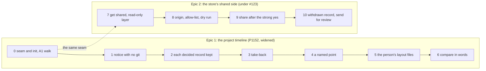

# Story map
<!-- Proposed, not applied: this map stays here until the decider confirms it; nothing changes the product's own
map file. -->
**Status:** proposed, not applied <!-- REQUIRED:map-status -->

## Backbone
<!-- The activities, left to right, as the user does them. e.g. `Assign → Notice → Act → Close` -->
Start → Keep → Notice → Name a point → Go back → Compare → Share → Get shared → Build with it <!-- REQUIRED:backbone -->

From the architect's synthesis, part 5 (council/synthesis.md). Slices 0 to 6 are the first epic, the project
timeline. Slices 7 to 10 are the second epic, the store's shared side (D5). Only slices 0 and 1 are refined now
(AGENTS.md, "Plans shrink with distance").

## Slices
<!-- Walking skeleton first: the thinnest slice that runs end to end. One row per story. job: a job in
jobs-and-journeys.md. tag: as in the brief. proof: something the decider can read.
e.g. `| 0 | Notice | the assignee gets one daily digest | job 1 | H ★C2 | the digest log for one team |` -->
| slice | activity | story | job | tag | proof |
| --- | --- | --- | --- | --- | --- |
| 0 walking skeleton <!-- REQUIRED:slices --> | Start, Keep | The seam exists with the git, none and Fake members. Init calls it, and a brief write is one kept step (P1151 with P1152's first slice) | J1, J8 | E #1688 "First slice" | P1148 A7's lines: a Fake and git run with no change to the area, 0 output lines say "git" or "Claude", and the CLI still commits |
| 0 | Keep | The A1 scratch walk (P1155) | J1 | D P1148 D13 | 3 of 3 kept lines, and 0 tracked files that the ignore list covers |
| 1 | Notice | With no git: the build phase says that the board file changed after the build, and a record with no stamp says "spark cannot tell" | J2 | E council/tech-lead.md TL-5, council/ux-ai-ux.md UX-1 | `flow.py show` on a scratch copy of a project with no needs basis prints the "cannot tell" line |
| 1 | Notice | P1165 and P1166: a hold that differs from the picks, and a parts-list entry whose pick is gone | J2 | E P1160 changes 1 and 2 | each card's own proof |
| 2 | Keep | Each decided record is one kept step with its stamp, from the area's row in the table | J1, J8 | D P1148 D8, E P1160 change 3 | P1148 A6's lines: at most one kept step per decision, and a clean tree |
| 2 | Notice | The `changed` list in the show-flow JSON, and "keep this as a step" on a yes | J2 | H UX-8 | the JSON of a scratch project after a hand edit of the brief |
| 3 | Go back | A take-back of the newest or any kept step, in P1160's five steps | J1 | D P1148 D7, D9, D14 | P1148 A2's lines, with P1160's three added cases |
| 4 | Name a point, Go back | A name on a kept step, and a return to it after a preview and a yes | J3 | H UX-11, E the synthesis's scratch run (n = 1) | outcome (2): a named point is taken and the scratch project returns to it |
| 5 | Keep, Notice | board.tsx and breadboard.json as kept steps while the bytes are the person's, each with a stamp. This reopens P1027's guard that a person's own edits give no commit (P7, the PO's) | J1, J2 | E brief ★C3, ★C15, TL-6 | outcome (1): a layout change by hand in board.tsx is noticed and kept as one step. breadboard.json needs a stamp first (★C15) |
| 6 | Compare | A point against now in plain words, per record kind | J4 | E UX-9 | outcome (3): the lines of one compare in a scratch project |
| 7 | Get shared, Build with it | A receive from a local bare repository into a second scratch store, as a read-only layer at a fixed point | J7, J8 | E ARCH-6, TL-2 | a second scratch project builds with the received record, and a shelf write still passes |
| 8 | Share | The `origin` block, the allow-list, the closed `made_by` set, and a dry run that lists what goes, what stays and what needs the person's words | J6 | E PO-4, UX-4, UX-5 | the dry run over the PO's 28 records: 0 strings with his name, a folder of his or a project name in what goes |
| 9 | Share | A share to a local bare repository after the strong yes. Then the PO's own first share to the public repository | J6 | D brief D3 | outcome (4), then the public repository's first commit, which he reads before and after |
| 10 | Share, Get shared | A withdrawn record is named. Another maker sends for review | J6, J7 | H TL-9, UX-12 | one sentence, not refined |
| not planned | — | A merge of two points | J5 | E P1160 Q3 | — |

## Delta to the product's map <!-- REQUIRED:spark-process:map-delta -->
<!-- The rows to add or change in the repository's own story map file, in that file's table shape, with its journey
step numbers; proposed, not applied. "n/a — no map file" is allowed. -->
Proposed, not applied, for `scrum/STORY_MAP.md`:

- The row "v0.13 and later" (line 45) names "the store shared". Proposed: "the project timeline, every main step kept, named and taken back (P1152, widened by P1193), then the store shared (P1193's second epic, under #123)".
- No new journey step. The project timeline runs across steps 1 to 11 of the journey table, so it is a slice row, not a step row. The journey table's step 11 "PCB and fab" gains no gap line: the PCB's layout is board.tsx, which slice 5 keeps.
<!-- EXTEND:map -->
