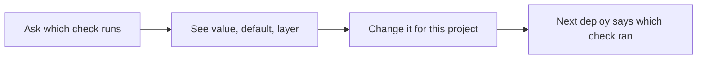
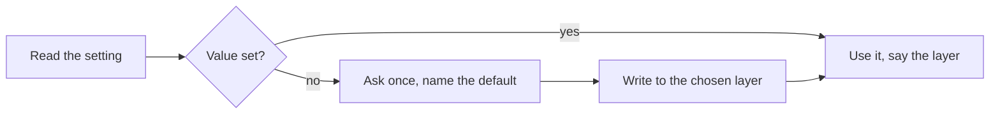

# Jobs and journeys
<!-- Tags as in the brief: E with a pointer, H with its source, D with who and when; an unknown is —. -->

## Who
<!-- One line per persona: who · evidence status (E pointer | H source).
e.g. `- Team leads who assign work · H Lena's belief, no interview yet` -->
- The maker (Petr), the test bench: directs Claude, one store on one Mac, several projects · E his words on #1740 and on P1193 #1738 (n = 1) <!-- REQUIRED:who -->
- The hobbyist, the primary persona: at home in a terminal, one board in the drawer · H scrum/VISION.md (no outside person has installed spark)
- The agent at the keyboard (Claude), a constraint: it acts on a script's answer and must never guess a value · E scrum/VISION.md, AGENTS.md (what never to assume)

## Jobs
<!-- One job story per line, each clause tagged: When …, I want to …, so I can ….
e.g. `- When I assign a task in a meeting [E tickets.csv:6], I want the assignee to see it that day [H Lena], so I can stop chasing people [E tickets.csv:7]` -->
- J1 · When I start a new project [E #1740 "for new projects"], I want my usual choices already set [H the PO's "asks until configured"], so I can skip the same questions each time [H] <!-- REQUIRED:jobs -->
- J2 · When one project needs another choice than my usual one [E #536 P410 "per project with a personal default"], I want to set it for that project only [E #536], so my other projects keep mine [H]
- J3 · When spark does something I did not expect, such as sharing a picture or spending Wokwi minutes [E P1193 #1738 P1, P4], I want to see which setting caused it and which layer set it [H], so I can change it in one place [E #1740 "we will move the config there"]
- J4 · When I work on another machine or under another account [E #1740 "per account logged in"], I want my personal choices to follow me [H], so I set them once [H]
- J5 · When Claude must make a choice in a plan or a run [E memory settings-layers-rule], it wants the value and the layer that set it, and the person's answer when none is set [E #1740 "asks until configured"], so it never guesses [E AGENTS.md]

## Today they…
<!-- Per job: what they do instead today (a competitor, a workaround or nothing), tagged.
e.g. `- Job 1 · paste each task into Slack by hand · E tickets.csv:7` -->
- J1 · /spark:init asks the brief per project; the tools list sits in the store and /spark:setup edits it · E commands/setup.md, records/tool_finder.py:42 <!-- REQUIRED:today -->
- J2 · only the tools list has a project layer (.spark/tools.json); the vendor order lives in each project's brief; the firmware check of P410 is a flag, run by run · E records/tool_finder.py:44, sourcing/brief_choices.py:15, bench/board_grant.py:16
- J3 · only the tools list can say who set a value (setter_of) · E records/tool_finder.py:266
- J4 · nothing: the store is one folder per machine · E records/store.py:59-65
- J5 · Claude reads the tools list through tool_finder; other choices are flags or code · E council/inventory.md

## Journeys
<!-- One ### per actor and scenario: the table, then a Mermaid flowchart of the same steps. Never a Mermaid
journey block: it forces a score on every task. "n/a — a one-step job" may replace both.
e.g. `| 2 | opens the app | E analytics, 90 days | never sees the task | not yet | Do they read email? |` -->
### The maker — one project uses another firmware check than his usual one <!-- REQUIRED:journey -->
| step | what they do | evidence | friction or harm | today | open question |
| --- | --- | --- | --- | --- | --- |
| 1 | asks "which check runs before the board?" on the page or in the chat | E #536 | no place names it | not yet | does the page show all settings or only this step's? |
| 2 | sees the value, its default and the layer that set it | H | — | not yet | how is "set by you, for all projects" said in plain words? |
| 3 | changes it for this project only | E #536 | today a flag on each run | not yet | a sentence to Claude, or a page request? |
| 4 | the next deploy uses it, and says so in its first line | H | a silent setting surprises | not yet | — |

### Claude — a choice with no value yet
| step | what they do | evidence | friction or harm | today | open question |
| --- | --- | --- | --- | --- | --- |
| 1 | reads the setting before a run | E settings-layers-rule | — | partly (tools list only) | — |
| 2 | finds no value and asks the person once, naming the default | E #1740 | asking every run would nag | not yet | does the answer go to the project or to the person's layer? |
| 3 | writes the answer to the layer the person chose, and says which | H | a wrong layer changes other projects | not yet | — |

