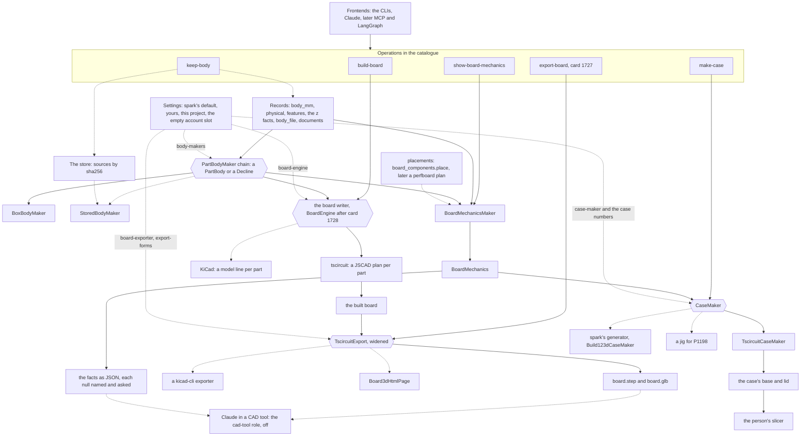

# P1197 3D: the synthesis

Written by the architect agent on 2026-11-26, about 16:10 CET, at commit dacfa302 on branch p1197-3d. I read the whole discovery folder, AGENTS.md, docs/guide/patterns-and-names.md, docs/guide/words.md, scrum/STORY_MAP.md and the cards #1745, #1729, #1727, #1746, #1728, #1740, #1747, #163, #180, #313, #473, #597, #601, #1010, #1697 and #311. I changed nothing. Every recommendation below is an opinion with its holder named. The PO decides.

One note first. Your brief names "#1184 if relevant". Issue #1184 is P826, closed, about wiring steps as data. It is not relevant. The engine seam card is P1184, issue #1728, and I use that one.

## The short version

Spark holds no 3D body for any record, and 3 of 43 records say how far a part stands above its board (E ★C1). Every tool the epic needs is installed and free: tscircuit shows a box body per part, exports STEP and GLB, and holds a solver for a two-part case (E ★C3, ★C5, ★C21). Three things never ran: no file was opened in your Fusion, no case was printed, and no spark-built board exists to put in a case (E pre-analysis.md section 5, ★C23). The architect's recommendation: run two cheap tests with no product code first (three STEP files in your Fusion, and one printed case for a FireBeetle you own). Then build a box per module with a STEP export on the two cards that already hold that work (#1729, #1727), and build the case Operation only when the print fits. The decision needed from you: which first slice (Q5), and whether you do the two tests, about 25 minutes of your time and one print of one to two hours (H, PA-24 and PHY-7).

Readiness, proposed: "an experiment", once you choose the tests.

## Options

Costs are the architect's estimates (H): XS, S, M, L.

- Q5 the first slice · (a) two tests with no product code, then a box per module with a STEP export on a spark fixture board (#1729 and #1727, extended), then the case Operation · tests: about 25 minutes of the PO and one print. The slice: M · that Fusion shows each part by name at its real size, and that a case from record facts fits, before any seam is built · opinion (the architect, from the tech lead's smaller cut, TL-18) · E ★C21 ★C23 · caveat: the first built slice gives no case. The case in his hand comes from the test
- Q5 · (b) a case for the FireBeetle alone as the first built slice · M to L: a new area and two Operations · a printed case that fits a board he owns, in days · opinion (the PO assistant, PA-28) · E ★C23 C26 · caveat: he owns two bought boxes made for a FireBeetle (★C23), and no body, export or Fusion step is touched
- Q5 · (c) Fusion first: the STEP export, the Fusion MCP entry, and Claude makes the case in Fusion · S for spark, then his time in Fusion · that the path he named ("preferably fusino360 too") works on his licence · opinion (the facilitator's frame, from his words on #1745) · E ★C10 ★C11 · caveat: the licence and the MCP server never ran. P269's D9 puts the Fusion export after the catalogue editor (PA-21). A STEP of a board with no bodies "gives Fusion nothing" (P1089 council answer 4)
- Q13 the body's form and source · (a) one neutral body Value (boxes in mm from the record's numbers) that each engine's writer turns into its own form. The tscircuit writer writes a JSCAD plan · S · that the body shows in the 3D tab, the GLB and the STEP under its reference, with no new tool · opinion (the architect, from TL-1 and AR-9) · E ★C21 · caveat: tscircuit's KiCad export drops a JSCAD body, so KiCad's render and STEP show none until a STEP member exists
- Q13 · (b) spark writes a STEP file per part, kept like a fetched one, and every engine takes a file · M: about 110 lines for boxes, more for cylinders and holes, or build123d at 62.5 MB · one form for tscircuit, KiCad and Fusion · opinion (the architecture lens, AR-8 b. The tech lead showed that it runs, TL-4) · E ★C20 ★C9 · caveat: a merged STEP body loses its reference in tscircuit's STEP (★C4). A file per placed part that carries the reference was not run (TL-3)
- Q13 · (c) a fetched or kept vendor STEP first · M, and a licence read per library · the real look of a part · opinion (no lens holds it for the first slice. It is his "existing solutions") · E ★C7 ★C8 · caveat: no library holds the dev boards. DFRobot's FireBeetle file is 25 MB and shows a camera he does not have (PA-2, US-17). The name problem of ★C4 and ★C21 is the same under all three: test T1 below settles what Fusion shows
- Q14 the words for the z facts · (a) `above_mm` and `below_mm` · XS · that the plain word works · opinion (the architecture lens, AR-5) · H · caveat: `above` already names a kind of limit in the rules-file words (E docs/guide/words.md:11)
- Q14 · (b) `z_max_mm` and `z_min_mm`, in the shape's own frame, with z up from the board's top face · XS · that no reader can take a z fact for a plane size · opinion (the architect) · H · caveat: "z" has no other meaning in spark's code or guide today (E, a grep on 2026-11-26). A reach below the top face is a negative number, so the question to the person stays in plain words
- Q14 · (c) the industry's words: `height` means z everywhere, and the plane's second size becomes `length` · L: 30 records, `PartShape`, fixtures and goldens · the root fix for "height" · opinion (the architect names it. PHY-3 asks for "a rule that moves the existing keys") · E ★C1 · caveat: a job for the names pass P382 #489, not for this epic's first slice
- Q15 where a body file lives · (a) the store's `sources/<sha256>/`, named by a `documents` entry, with a `body_file` block in the record: the document key, the maker, the likeness, the credit, an offset and a rotation · S · one home and one check for pictures and bodies · opinion (the architecture lens AR-6, and the architect) · E ★C7 ★C14 · caveat: the block's check is shared with the `pictures` block, never copied
- Q15 · (b) a URL in the record, fetched at export · XS · nothing new · opinion (none. It is the bin project's past practice, US-18) · E ★C22 · caveat: the export then reaches the network, and a missing file passes in silence
- Q15 · (c) a models folder in each project · S · that a project carries its own bodies · opinion (none) · H · caveat: a CC-BY-SA or private-use file can then reach the project's git and a shared place (AR-19)
- Q8 who makes the case · (a) spark: the Operation `make-case` behind a `CaseMaker` seam · M · a case with no CAD tool, for the hobbyist too · opinion (the PO assistant PA-28, the architecture lens AR-11) · E ★C5 ★C20 · caveat: the fit is unproven, and the default headroom fails on spark's boards (★C19)
- Q8 · (b) Claude in Fusion through its MCP server, from spark's STEP and facts · S for spark: one tools-list entry and one chat offer · his words "caude could then also se that 3d tool to craete a cover" · opinion (the PO's words on #1745. AR-13 shapes spark's part) · E ★C11 · caveat: not run. Fusion must be open. Turning it on is his alone. The hobbyist has no Fusion (US-25)
- Q8 · (c) both, with (a) built only if the print test passes · (a) plus (b) · that one export and one set of facts serve a program and a CAD tool · opinion (the architect) · H · caveat: Claude in Fusion is no member that spark's code runs (AR-13). It is a hand-off, chosen by the `cad-tool` role
- Q16 the first member behind `CaseMaker` · (a) tscircuit's case solver, called direct with numbers from the board's mechanics, never as an element in `board.tsx` · S · a base and a lid with a lip and openings, from installed code · opinion (the tech lead TL-6, the architecture lens AR-11) · E ★C5 ★C20 · caveat: version 0.0.4, no release since 2026-08-19, no bosses (PA-8). Its export through `tsci` appends records that spark does not own (TL-6)
- Q16 · (b) spark's own generator on its own STEP writer · M to L · no outside solver · opinion (listed by AR-11, held by nobody for the first member) · E ★C20 · caveat: boxes only today. A boss or a round hole needs curved surfaces
- Q16 · (c) build123d · M and a 62.5 MB wheel · named solids, STEP, STL and 3MF from one tool · opinion (research.md section 4) · E ★C9 · caveat: not installed, not run. "A user installs nothing heavy" (AGENTS.md), so it waits for a need that (a) cannot meet
- Q11 the viewer · (a) port the bin project's one-page viewer as its own file, written again at each export · S · the board in 3D offline, for a person with no Fusion and no KiCad · opinion (the PO assistant PA-1, the user lens US-1) · E ★C18 · caveat: whether it still renders was not run. The page's "no script" rule means its own file, not a tab (AR-15)
- Q11 · (b) tscircuit's own view: the 3D tab of `tsci dev` now, RunFrame's extra tab later (#601 names it) · none now · that the body of Q13 shows with no spark viewer · opinion (the architecture lens AR-15: the viewer waits) · E ★C21 · caveat: a second tool and a typed command for the person
- Q11 · (c) no viewer of spark's own · none · nothing · opinion (none) · H · caveat: leaves out the hobbyist (US-25)
- Q17 the print files · (a) STEP straight into PrusaSlicer, with no STL or 3MF writer · none · that the print path needs no new export · opinion (the PO assistant, PA-6) · E ★C24 · caveat: read from search results, not run. The case needs its own file, or the board lands on the print plate too
- Q17 · (b) STL written by spark from the case's plan · S: about 30 lines · a file that every slicer takes · opinion (the tech lead, TL-7) · E ★C20 · caveat: 16 of 50 and 32 of 82 edges are open. Whether PrusaSlicer repairs them was not run
- Q17 · (c) 3MF through `tsci` · a toolchain bump from CLI 0.1.2113 to 0.1.2490 · that tscircuit's own print export works · opinion (none) · E ★C6 · caveat: it fails in the pinned CLI, and a bump is its own risk to every reader of `circuit.json` (PA-10)
- Q18 the order of the body card and the engine seam · (a) #1729 first: the function that writes the `<chip>` line also writes the body, from a value already resolved on the part · S · F4 fixed with no new parameter on `emit` · opinion (the architect. The P1089 council put F4 first) · E ★C2 C27 · caveat: `board_sections.py` is already tscircuit's writer, so no new tscircuit fact enters the design area. The line moves with the writer when #1728 lands
- Q18 · (b) #1728 first, so that only the tscircuit Adapter writes the body · S more, and F4 waits · the seam before its second user · opinion (the architecture lens, AR-9) · E C27 · caveat: none
- Q9 an unknown z fact · (a) refuse and ask: the null is named, the question goes on `data.open`, and the reply may be an estimate kept as unverified with its source · S · that no number is invented · opinion (the architect, from US-19 and AGENTS.md "a `null` is not a value to fill in") · E ★C25 · caveat: more questions to the person at the bench
- Q9 · (b) a named default that the person accepts out loud · S · a case sooner · opinion (offered by the user lens, US-26) · H · caveat: tscircuit's 6 mm default already fails on spark's boards (★C19)
- Proposed no-gos and rabbit holes (proposals until the decider confirms): no vendor file in the repository or in a project · no fetch during a build or an export · no paid or AI photo-to-3D service (C17, research.md section 1) · no slicing · no STEP kernel of spark's own beyond boxes · no case written into the build's `board.tsx` · no case number in a prompt or a skill · no KiCad board writer here (#1728 holds it) · no perfboard 3D before P1199's plan exists (C16) · no tscircuit bump inside this epic's first slices (PA-10) · no settings page work here (P1194 holds it) · P1198 stays parked

## The riskiest assumption and its test

- Riskiest: a case that spark sizes from record facts fits the real board on the first print. The board drops in, the lid closes, and the USB-C cable plugs in with the case shut. It rests on three weak points at once: the z facts (3 of 43 records, ★C1), a solver at version 0.0.4 whose default lid sits 4.72 mm inside a module in the probe (★C5, ★C19), and a maker who supplies photos, which give no height (★C25) · proposed — the PO assistant's opinion (PA-23), shared by the architect, pending Q1. The tech lead holds another belief as riskiest: that Fusion keeps each part's name (TL-16). That one is A3, and its test T1 is cheaper, so it runs first.
- Test · kind · pass line, dated before any result · proposed: test T2, a prototype, in a scratch folder with no product code. Step 1, free: the PO measures the z facts of one FireBeetle he owns (about 15 minutes, PHY-7), and they go into its record with their source. The solver is called direct with the record's numbers (TL-6). Proposed pass line for step 1, set 2026-11-26: the case's inner depth clears the tallest z fact by at least 1 mm, and the USB-C opening's centre lies within 0.5 mm of the connector's centre in the record (PA-24). Step 2: he prints the base and the lid in PETG on the MK3S (one to two hours, H PA-24). Proposed pass line for step 2, set 2026-11-26: on the first print, with no number changed by hand after the facts were recorded, the board drops in by hand, the lid closes, and his own USB-C cable plugs in with the case shut and the board answers on USB. The decider sets the final line under Q1.
- Which FireBeetle: the C6 shelf record holds the USB-C opening in the plane (E, `physical.features` in the store's `shelf/boards/firebeetle2-esp32c6.json`). The S3 record in `boards/firebeetle2-esp32s3.json` holds the hole inset and no features (E). The architect's opinion: the C6, because the USB pass line needs the opening's place.
- One caution (H, the architect): the C6 ran on a breadboard on 2026-11-22 (E README.md:127), so its header pins are soldered and reach below the board. The solver's 4 mm standoff (E PHY-1) may be too small. The test needs the reach below the board as a fact too.

## Assumptions

| id | belief | type | evidence now | importance | cheapest test | pass line, dated 2026-11-26 | result that would change the decision | status |
| --- | --- | --- | --- | --- | --- | --- | --- | --- |
| A1 | The PO prints and uses a case that spark made, for a board he has | value | E his words on #1745 · E ★C24 (he prints downloaded models, no case of his own in the recent list) · E ★C23 (two bought boxes, no spark-built board) | — (decider) | Q3's answer, and whether he prints T2's case | he prints it within 14 days of getting the file and says he would keep the board in it | no print, or "I use the bought box": the built slices stop at the body and the export, and the case goes to Claude in a CAD tool or stays parked | open |
| A2 | A case sized from record facts fits the real board on the first print | feasibility | H PA-23 · E ★C19 (the default lid collides, calculated) · E ★C1 · E ★C25 | — (decider) | T2, above | the two lines of T2 | a miss on depth or on the opening: `make-case` waits, and Q8 turns to (b) | open |
| A3 | Fusion on his licence opens spark's STEP with the board and each part as its own named item, at real size | feasibility | E ★C4 (names in the file) · H TL-16 (forum reports of "Body 1") · E ★C10 (two Autodesk pages disagree) | — (decider) | T1: he imports three files (tscircuit with JSCAD bodies, kicad-cli's assembly, one written by spark's own writer) and sends a screenshot of the browser tree per file. About 10 minutes (H) | at least one file shows the board and each part as separate items named by reference, and the measure tool reads one body within 0.1 mm of its record | no file keeps the names: the export needs an assembly that spark writes, or a rename step in Fusion. An import refused by the licence: a free tool comes first | open |
| A4 | A box from the record's numbers is "similar enogh" as a part's body | value | E #1745 (his words) · E PA-2, US-17 (the vendor file shows a camera he lacks) | — (decider) | show him the amplifier fixture with boxes, in the 3D tab or in T1's file | he says yes for the case job on 3 of 3 parts | a no: a kept vendor body (Q13 c) moves before the case | open |
| A5 | The z facts of the parts he owns can be had in minutes each, from callipers or a datasheet | usability | E ★C1 · E ★C25 · H US-9 (whether he owns callipers is unknown) | — (decider) | the measuring round of PHY-7 on five owned parts | five facts in records, each with its source, in 20 minutes or less | no callipers, or over an hour: the z facts come from research (P735 #1010) and from estimates he accepts as unverified | open |
| A6 | A body per part goes into `board.tsx` with no slower build and no new parameter on `emit` | feasibility | E ★C21 (a probe board) · E C27 · H TL-14 (build time not measured) | — (decider) | one build of the amplifier fixture with JSCAD plans and one without | the build time rises by 10 % or less, and the rules test stays green | a slower build: the bodies are added after the build, on a copy of the built board (TL-6's way) | open |
| A7 | The pinned case solver keeps working behind the seam, or a second member replaces it with no change to callers | viability | E ★C5 · E PA-8 (no release since 2026-08-19) · E PA-10 (the pin lags) | — (decider) | T2's direct call, and later a `FakeCaseMaker` through `make-case` in the tests | two members run through one Operation with no change to it | the solver's output cannot be printed clean: Q16 turns to (b) or (c) | open |
| A8 | No vendor body reaches the repository, a project's git or a shared place | ethics | E ★C7 · H AR-19 (the leak path through `--keep` and an export) | — (decider) | a test: an export with a kept body writes no body file outside the work folder, and spark's `.gitignore` section lists the 3D outputs | the test passes on the amplifier fixture with one kept body | a leak that cannot be closed: kept vendor bodies stay out of exports, and only generated boxes ship | open |
| A9 | Claude makes or briefs a case from the mechanics JSON with no invented number | usability | E US-26 (two meanings of "thickness", five forms of holes) · E US-19 (the question shape exists, with no z question) | — (decider) | one cold session with only the JSON and the command's help, on the FireBeetle with one z fact left out | it asks for the missing fact and invents 0 numbers | an invented number: the JSON's shape or the null rule of Q9 changes before `make-case` | open |
| A10 | His PrusaSlicer takes the case as STEP, so no STL or 3MF writer is needed | feasibility | E ★C24 · E PA-6 (search results, not run) | — (decider) | open T2's file in his PrusaSlicer | it imports with no repair warning and slices | a warning or a failed import: Q17 turns to (b) | open |

## The risk rows

| risk | evidence now | cheapest way to retire it | status |
| --- | --- | --- | --- |
| value | E his words on #1745 · E ★C23 (nothing spark built to put in a case, two bought boxes) · E ★C24 · A1, A4 | Q3's answer, and whether he prints T2's case | open |
| usability | E ★C25 (photos, not measurements) · E US-23 (typed commands failed at the bench on 2026-11-25) · A5, A9 | the 15-minute measuring round, and one cold Claude run on the mechanics JSON | open |
| feasibility | E ★C3, ★C20, ★C21 (each path ran once on a probe board) · E pre-analysis.md section 5 (no Fusion, no print, no real spark board) · A2, A3, A6 | T1 and T2 | open |
| viability | E ★C5 and PA-8 (the solver is 0.0.4 and stalled) · E PA-10 (tscircuit pinned 700 versions back) · E ★C10 (licence pages disagree) · A7 | the seam with a Fake member, and T1 on his licence | open |
| ethics and safety | E ★C7 (CC-BY-SA and private-use bodies) · E research.md section 1 (one AI model's licence excludes the EU) · H AR-19 · A8 | the store-only keep, the credit line in the export's answer, the `.gitignore` test | open |
| power and battery | H the architect: the FireBeetle has a battery socket (E the C6 record's feature "BAT socket"), and no record holds a cell's size or a rule for a cell in a closed case | T2 runs on USB with no cell inside. A case that holds a cell waits for a need and its own facts | open for a case with a cell. n/a for T2 because it holds no cell |
| current and stall | — | — | n/a because the epic adds no load, no driver and no supply path |
| thermal | H the architect: a closed PETG case around a regulator, an amplifier or the radio has no vent fact. PETG softens near 80 °C (H, model knowledge, not read at a source). E the DFR0205 regulator stands 20 mm (PHY-1) | a 30-minute run in T2's closed case with a thermometer through the USB opening, against open air | open |
| EMC and ESD | H the brief's radio flag: a wall or a screw near the board's antenna can detune it. E no feature kind names an antenna (`scripts/spark/records/record_kind.py:361`). A plastic case adds no ESD risk (H) | read the Wi-Fi signal strength with the lid on and off, at one place | open |
| sensor drift and calibration | E US-13 item 5: the bin project kept the rangefinder off the board because it "has to look out through the lid". No record says that a part needs a view or air | n/a for T2. For a spark board, a per-part fact by need when the first sensor board gets a case | open. n/a for T2 because the board alone holds no sensor |
| brown-out | E PHY-4: on a carrier the USB receptacle sits 9.0 mm inside the case's outer face. H US-21: his cable's overmold is wider than the receptacle. A plug that does not seat gives a supply that drops | T2's line "the cable plugs in with the case shut and the board answers on USB" | open |
| wake and low power | E the C6 record's features hold the RST and BOOT buttons. A case with no opening for them hides reset and boot mode (H, the architect) | the case's answer names each button and LED with no opening. In T2 he tries BOOT with the case shut | open |
| the firmware-hardware contract | E US-3: in the bin project a body was 3.2 mm in the board file and 7.1 mm in its own comment. The pin map does not change, and spark writes no behaviour | one source per z fact (the record), and a test that the exported body's z equals the record's fact on the amplifier fixture | open. n/a for firmware because no pin, timing or driver changes |
| supply and documents | E PA-2, US-17: a vendor STEP can show another variant. E the C6 drawing is V1.1.0. E PA-10 and PA-8: the pinned tools lag their newest versions | `StoredBodyMaker` declines a document with no version, and compares the file's box with the record's outline. The bin's 28.7 x 68.2 mm file fails that against 25.4 x 60 mm | open |

Budgets, proposed text: n/a for energy, peaks and dissipation, because the epic adds no battery, motor, radio or regulator. The one budget is mechanical, the z stack of PHY-2: 21.7 mm soldered or 27.7 mm in sockets for the amplifier board, against the solver's default 15.6 mm (E ★C19, with H socket heights).

## The seams

Words first. Each proposal is the architect's (H) and goes to docs/guide/words.md before code.

- "body": the 3D solid of one part. The epic's "3D shape" does not fit, because a shape is already "a part's outline and its pins in millimetres" (E GLOSSARY.md:403). "Model" is a Wokwi model in flow (AR-5).
- "body file": a kept STEP file. Where a fact came from stays "source", the key the records use. "Origin" already names the shape frame's zero point (E GLOSSARY.md:404).
- "case": the journey's own word (E `scripts/spark/flow/flow_codes.py:481`). Not "enclosure", not "cover".
- "opening": a hole in the case for a connector or a button. Not "port", which is a serial port, and not the solver's "aperture" (rule 2).
- "form": an export format, as `TscircuitExport.export_svg(circuit, form)` says today (E `scripts/spark/breadboard/tabbed_page.py:43`).
- "mechanics": the board's outline, thickness, holes, bodies and openings together. No use in code or guide today (E, a grep).

| seam | job | base name and Adapter names | Operation and area | setting · default · layer | what it reuses | first slice or later |
| --- | --- | --- | --- | --- | --- | --- |
| z facts | hold how far a body or a feature reaches from the board's top face | no class: fields under `provenance`'s `{value, verified, source}`, words from Q14 | `parts.py`'s setters · records and sourcing | none: a fact is not a choice | `record_kind`, `provenance`, `data/fact-needs.json`, the replies shape | slice 0 |
| body source | give one record's body, or decline with the missing field | Strategy `PartBodyMaker` · `BoxBodyMaker`, later `StoredBodyMaker` and `PhotoBodyMaker` · Service `BodyMakerChain` · Value `PartBody` | none of its own: the board writer and the mechanics maker call it · a new area `scripts/spark/mechanics` | `body-makers` · `box` now, later `stored` then `box` · spark's default, yours, this project | `MakerUses`, `Decline` and the chain's shape from `picture_makers.py`. The frame is handed in as a Value | slice 0 |
| body to engine | turn a `PartBody` into the engine's own form | the board writer: `board_sections.component_lines` today, `BoardEngine`'s writer after #1728 · `TscircuitEngine`, later a KiCad Adapter | `build-board` · design and build | the role `board-engine` · `tscircuit` · the tools list's three layers | the chip line, and `footprint_emitter`'s `{...props}` for the Mcu | slice 0 |
| 3D export | write the built board in an asked form | `TscircuitExport`, widened from SVG. Later a kicad-cli Adapter behind a role | `export-board` (#1727) · build | `board-exporter` · `tscircuit` · the tools list's three layers. `export-forms` · `step` · yours, this project | `TscircuitExport`, `IgnoreList` | slice 0 |
| mechanics | give one board's outline, thickness, holes, bodies and openings as one Value | Value `BoardMechanics` · Service `BoardMechanicsMaker`. One filler now (a board record alone), then a spark board, later a perfboard plan | `show-board-mechanics` · mechanics | none | the records, `board_components.place`, `data.open` | slice 1 |
| case | make a case around the mechanics | Strategy `CaseMaker` · `TscircuitCaseMaker`, `FakeCaseMaker` in the tests, later a spark generator or `Build123dCaseMaker` | `make-case` · mechanics | `case-maker` · `tscircuit` · spark's default, yours, this project. `case-wall-mm` 2, `case-clearance-mm` 1, `case-headroom-mm` 1 above the tallest z fact, `case-fit-mm` 0.3 · spark's default, yours, this project. `case-form` · `step` · yours, this project | `BoardMechanics`, `MakerUses`, `Decline`, the solver in the toolchain | slice 1 |
| body file | keep a STEP by its sha256 and point at it from the record | no class: a `body_file` block beside `pictures` | `keep-body` (`parts.py --keep-body`), later a body role in `find-documents` · sourcing | `body-libraries` · none · yours only | `KeepPicture`, `DocumentKeep`, `VendorDocumentFinder`, `store.keep`, `store.fetch` | later |
| CAD tool | let Claude open the export and design around it | none in code: a tools-list entry of kind `mcp` | none: a chat offer names the job, and Claude calls the server | the role `cad-tool` · none · yours only | the `mcp` kind, `OFFER_KINDS` | later, when the PO turns it on |
| viewer | show the board in a browser, offline | Renderer `Board3dHtmlPage` | one more form of `export-board` · build | `export-forms` may hold `viewer` · not in the default · yours, this project | the bin project's viewer, three.js in the toolchain, the GLB | later |
| fit check | say where a body meets the case or another body | a Check, `BodyFitCheck` | `check-design` · checks | none | `BoardMechanics`, the bin project's clearance check | later |

Notes on the table.

- Print files are no seam. They are the `case-form` of `make-case` (AR-16).
- The account slot stays empty for every row. The Fusion licence tier is the first fact that would sit there (H, the architect).
- `cad-tool` and `body-libraries` are "yours only" under P1194's D12: one opens his Fusion session to an AI tool, the other fetches files under a licence.
- The case numbers copy the solver's own defaults as spark's named numbers (E PHY-1, `create-fdm-enclosure/dist/index.js:722-732`), except the headroom. Spark counts it above the tallest z fact, never above the bare board (E ★C19). Each answer names every number and whose word it is (P1194 D13).
- A seam enters with its first member and a Fake. Nothing is built for a later member.

Solid lines are slices 0 and 1. Dotted lines wait.

## The story map

**Status:** proposed, not applied.

Backbone: Know each part's body → See the board in 3D → Export it → Open it in a CAD tool → Make a case → Print and fit. J6 (switch a strategy with one setting) runs under every activity.

Before slice 0, with no product code: tests T1 and T2.

| slice | activity | story | job | tag | proof |
| --- | --- | --- | --- | --- | --- |
| 0 walking skeleton: a spark board in 3D, in Fusion | Know each part's body | the z facts have one word each, one rule and one question, and the amplifier fixture's three records hold them with a source | J1, J7 | E ★C1 · H Q14 | the words.md rows, and `parts.py --validate` naming the records whose `facts.thickness_mm` holds an overall height |
| 0 | Know each part's body | each module and the Mcu get a box body from the record through the body-maker chain. A missing fact is named, never a 16 x 12 mm default | J1 | E ★C2 · E AR-18 | the build's finding for a record with no z fact |
| 0 | See the board in 3D | the same body shows in tscircuit's 3D tab and in the GLB, under its reference | J2 | E ★C21 | a screenshot of the tab on the amplifier fixture |
| 0 | Export it | `export-board` writes `board.step`, checks every body first and never reaches the network | J3 | E ★C3 ★C22 | the JSON answer, and the solid names in the file |
| 0 | Open it in a CAD tool | the PO opens `board.step` in Fusion and sees each part at its real size, by name | J3 | H ★C4 ★C10 | his screenshot of the browser tree |
| 0 | every activity | `body-makers`, `board-exporter` and `export-forms` each have a name, a default and a layer, and a Fake member runs in the tests | J6 | H | the plan's settings table and the tests |
| 1 a case for a board I own | Know each part's body | the FireBeetle's record holds its z range and each opening's z, measured by the PO | J1, J7 | E C26 ★C25 | the record's lines with their sources |
| 1 | Make a case | `show-board-mechanics` gives the outline, thickness, holes, bodies and openings as JSON, and a null is named and asked | J7 | E US-19 · H AR-12 | the JSON for his FireBeetle, and one cold Claude run (A9) |
| 1 | Make a case | `make-case` gives a base and a lid through `CaseMaker`, and the answer names each number and whose word it is | J4 | E ★C5 ★C19 | the answer's lines |
| 1 | Print and fit | the case file opens in his slicer, prints, and the board fits | J5 | H A2, A10 | a photo of the board in the case with a calliper reading |
| 1 | every activity | the Case step of the journey gets a phase reader, and README and `tools/journey.py` change in the same PR | J2 | E AR-23 | `tests/test_journey.py` |
| 2 a kept body file | Know each part's body | `parts.py --keep-body` keeps his own STEP in the store, and `StoredBodyMaker` shows it with its credit | J1 | E ★C7 | his DFRobot file on the board, and no body file in the project |
| 3 the 3D page | See the board in 3D | the bin project's viewer, ported, written again at each export | J2 | E ★C18 | `board-3d.html` opens offline |
| 4 Claude in a CAD tool | Open it in a CAD tool | the `cad-tool` role, a Fusion entry that is off, and one chat offer | J3, J4 | E ★C11 | one session where Claude opens the export in his Fusion |
| 5 a case for a spark board | Make a case | how a module sits on the carrier is a fact, each part's opening is placed, and a fit check reads the mechanics | J4, J7 | E PHY-2 · E ★C23 | a case that fits a real carrier board, once one exists |
| later | Know, See, Make | the perfboard's filler (after P1199 #1747 and P275 #311), a jig for P1198 #1746, a body with the photo on its top face, a KiCad writer (#1728) | J1, J2 | E C16 · H | one line each on #1745 |

### Delta to scrum/STORY_MAP.md (proposed, not applied)

The map has no row for the board's Slice "9 An enclosure" (E scrum/STORY_MAP.md:32-46, and the board's Slice field read with `gh`). Rows in the map's own shapes:

Journey table, change row 7 and row 12:

| # | step | spark today | gap |
| --- | --- | --- | --- |
| 7 | See it | `tsci dev`, Wokwi for VS Code (P65, P67) | a module shows no body in 3D (P1185 #1729) |
| 12 | Case — a body per part, a 3D export, a CAD tool, a printed case | `tsci export -f step` and `-f glb` run by hand. No Operation | a body per part (P1185 #1729), `export-board` (P1183 #1727), the mechanics and the case (P1197 #1745) |

Slices table, add one row after "v0.13 and later":

| # | slice | for | done when | items |
| --- | --- | --- | --- | --- |
| **9** | **An enclosure** — the board's Slice "9 An enclosure", after the MVP | maker first, hobbyist H | proposed: for one real board, one Operation writes a STEP that opens in Fusion 360 with each part as a named body at its real size, and a case made from the records' facts prints and fits | P1197 #1745 (epic), P1198 #1746 (parked), the new cards of items.md. P1185 #1729 and P1183 #1727 stay in Slice 7 and are extended |

"Journeys, by release", change the J9 line: "J9, the PCB and a printed body from the same conversation: later (the north star, P203 #163). P1197's jobs J1 to J7 are in docs/discovery/2026-11-26-p1197-3d/jobs-and-journeys.md."

One word to settle: the map and the board say "Enclosure", and the code's step says "Case" (E `flow_codes.py:481`). The architect's opinion: "Case" in the map's row. The board's Slice name is the PO's.

## Proposed items

Six items: four new cards and two extensions. The later slices stay one line each on #1745, because plans shrink with distance (AGENTS.md).

### P?: nobody opened a spark STEP in Fusion or printed a case from record facts, so every 3D choice rests on a guess → two tests in a scratch folder with dated pass lines
- type: spike
- needed by: "the whole thing openable in fusion and the user or ai could use it  and create the cover or other parts" (the PO, 2026-11-26, #1745)
- value proven by: a finding file with his screenshot of Fusion's browser tree for each of three files, and a photo of his FireBeetle in the printed case with a calliper reading, each against its pass line
- depends on: the answers to Q2, Q3 and Q4, Q6 (callipers), and two sittings of the PO
- touches: #1745's cycle. It gives P277 #313 its first run ("open in Fusion 360 as a 3D model"). It decides Q13, Q16 and Q17

### P?: "height" and "thickness" each mean two things in the records, and the z facts sit under seven keys → one word for each z fact in words.md, one rule in `record_kind`, and one question each in `fact-needs.json`
- type: chore
- needed by: "it would just be the best if every record had its 3d shape" (the PO, 2026-11-26, #1745)
- value proven by: the words.md rows, and `parts.py --validate` naming the two store records whose `facts.thickness_mm` holds an overall height (DFR0205 and DFR0831)
- depends on: Q14
- touches: #1729 (it takes the naming of "a height fact" out of that card, and can be its first PR if the PO wants fewer cards). P735 #1010 writes the same facts (C28). The store's records are his: the card names the keys to move and moves none

### Extend P1185 #1729 (no new card): a box from `body_mm`, with a height fact → the box comes from a `PartBodyMaker` chain with `BoxBodyMaker`, for each module and the Mcu
- type: story (as today)
- needed by: its own lines, and "everything on the PCB and also the perfboard has a good 3d model, or at least some similar enogh general shape" (the PO, 2026-11-26, #1745)
- value proven by: the amplifier fixture's 3D tab shows three bodies at the records' sizes, and a record with no z fact gives a finding that names the field
- depends on: the words chore. Not on #1728, under Q18 (a)
- what it adds: the body arrives resolved on each part, so `emit` gets no eighth parameter (C27). It never reads `body_of`'s 16 x 12 mm default (AR-18). `MakerUses` and `Decline` move to a neutral module first, with the old names kept as imports for one step (AR-2)

### Extend P1183 #1727 (no new card): `export-board` writes a DRC report, a render and a STEP → it also takes the forms `step` and `glb` from `tsci`, and checks every body first
- type: story (as today)
- needed by: its own lines, and "export to 3d, so a tool/strategy can open it, like fusion 360 or other free tools" (the PO, 2026-11-26, #1745)
- value proven by: `export-board --json` on the amplifier fixture names each body with its maker and likeness, and a missing body file gives a finding, never an `ok`
- depends on: #1729 extended
- what it adds: it widens `TscircuitExport`, with no third wrapper of `tsci` (AR-10). A body file is a local absolute path from the store, and a URL is refused, so the export declares no `fetches` (★C22, TL-9). The 3D outputs go into spark's `.gitignore` section (AR-19). `kept_files.py` is at its 600-line limit, so the keep is split first (AR-20)

### P?: a board's mechanical facts are spread over its record, each part's record and the placements, so Claude guesses a number for a case → one Value `BoardMechanics` and the Operation `show-board-mechanics`, with each missing number named and asked
- type: story
- needed by: "the user or ai could use it  and create the cover or other parts" (the PO, 2026-11-26, #1745), and "do you have all the details in the record?" (the PO, 2026-11-20, P934 diary, quoted in US-6)
- value proven by: the JSON for his FireBeetle with each number's source, and one cold Claude run that asks for the missing fact and invents none (A9)
- depends on: the words chore, the spike's T2, Q9
- touches: P735 #1010 (one owner for the facts, Q12). P1199 #1747 gives the perfboard's filler later

### P?: the journey names a Case step with no Operation behind it → `make-case` behind a `CaseMaker` seam with one member, and each case number a named setting
- type: story
- needed by: "some basic cover would be created" and "allow for prining and exporting the 3d printer files for like verysimple cases" (the PO, 2026-11-26, #1745)
- value proven by: the printed case for his FireBeetle fits (a photo and a calliper reading), and `FakeCaseMaker` runs through the same Operation in the tests
- depends on: T2 passing, the mechanics card, Q8 and Q16
- touches: the `case` entry of `UNBUILT_STEPS` (`flow_codes.py:481`), README's "What works today" and `tools/journey.py` in the same PR

Board actions, proposed: list the eight overlapping cards of C28 on #1745. Add to #1745 one line each for the kept body file (it absorbs P371 #473 and the "pictures and dimensions" part of P210 #180), the viewer (beside P449 #601), the `cad-tool` entry, the case for a spark board with its fit check, the perfboard's filler and the P1198 jig.

## Questions for the PO

Q0 to Q4 are asked. These eight follow, in the order to ask them. Q13 to Q18 are technical choices with a recommendation in Options. The architect's opinion: they fit a delegated council, his to change.

- Q5 · Which first slice? · decides: what is built first and what the first proof is · options: (a) the two tests, then a box per module with a STEP export (#1729, #1727), then the case Operation. (b) a case for the FireBeetle alone, built first. (c) Fusion first, with Claude making the case there · opinion (the architect): (a). The PO assistant holds (b) · kind: decision
- Q6 · Do you own callipers, and will you do the two tests: measure about five numbers on one FireBeetle, import three files into Fusion and send a screenshot, and print one small case? · decides: whether T1 and T2 can run, and whether measured z facts are a real source (A5) · options: yes to all, Fusion only, the print only, no callipers · kind: account
- Q7 · How do your modules sit on a PCB or a perfboard, in sockets or soldered, and are the header pins soldered on the FireBeetle you would put in a case? · decides: the case's depth (21.7 or 27.7 mm on the amplifier board, PHY-2) and whether "how a module sits" becomes a fact · options: sockets, soldered, it varies per project · kind: account
- Q8 · Who makes the case? · decides: whether `make-case` is built, and whether spark only hands over · options: (a) spark's own Operation. (b) Claude in Fusion through its MCP server, which you turn on. (c) both, with spark's built only if the print test passes · opinion (the architect): (c) · kind: decision, with an account part (the MCP server is your setting)
- Q9 · When a z fact is unknown, does spark refuse and ask, or use a named default that you accept out loud? · decides: the rule for a null in the mechanics and the case · options: (a) refuse and ask, and your estimate is kept as unverified. (b) a named default · opinion (the architect): (a) · kind: decision
- Q10 · Does P269's D9 still hold, that the Fusion export waits for the catalogue editor (P1161 #1697)? · decides: whether #1727's STEP form may go first · options: it holds, or a plain STEP export goes first and the editor follows · opinion (the architect): the plain export goes first, because it needs no editor (H). The PO assistant raised it (PA-21) · kind: decision
- Q11 · Did you open the bin project's `board-viewer.html` in October, what did you look for, and does spark take that viewer in? · decides: the value of a browser viewer against a STEP in Fusion, and whether the viewer is a port · options: (a) port it, after slice 1. (b) tscircuit's own view is enough for now. (c) no viewer · opinion (the architect): (a), later. The PO assistant and the user lens found it · kind: account, then decision
- Q12 · Which card owns the size, hole and opening facts of a record: P735's research run, or this epic? · decides: one writer for those facts, so nothing is built twice (C28) · options: P735 writes them and this epic only reads them, this epic writes the z facts and P735 the rest, or one merged order · opinion (the architect): the words chore sets the words for both, P735 fills the records, and this epic adds only the z facts its own slice needs · kind: decision

## Splits

- The first board: the PO assistant says the FireBeetle alone (PA-28). The tech lead says the amplifier fixture (TL-18). The architecture lens says the e-paper clock's board (AR-3) · settled by Q5
- The riskiest belief: the PO assistant says the fit of the first print (PA-23). The tech lead says the names in Fusion (TL-16, TL-18) · settled by Q1, and both tests are cheap enough to run
- The body's form: the tech lead shows that a JSCAD plan runs today (TL-1). The architecture lens wants one STEP file for every engine (AR-8 b) · settled by Q13, after T1 shows what Fusion keeps
- The order of two cards: the P1089 council put F4 (#1729) first. The architecture lens wants the engine seam (#1728) first (AR-9) · settled by Q18
- How many seams now: the architecture lens sets four in the first slice (AR-27). The PO assistant's pre-mortem warns of "settings for five strategies before one printed case" (PA-25, item 8, with scrum/VISION.md:83) · settled by Q5. The architect's rule: a seam enters with its first member and a Fake
- The case without a rebuild: the tech lead adds the solver's plans to a copy of the built board (TL-6). The architecture lens writes a small file of its own beside it (AR-11). Both keep `board.tsx` untouched · settled by Q16 and T2
- Fusion's place: the brief's outcome puts Fusion in the first slice. P269's D9 puts it after the catalogue editor (PA-21) · settled by Q10
- The print file: STEP into the slicer (PA-6), an STL writer (TL-7), or a form argument (AR-16) · settled by Q17 and A10
- The viewer: reuse the bin project's now (PA-1, US-1), or wait (AR-15) · settled by Q11
- An unknown height: the user lens offers "refuse" or "a named default" (US-26). AGENTS.md says a null is not a value to fill in · settled by Q9
- Who owns the facts: P735, P446, #1729 or this epic (PA-16) · settled by Q12
- The words: the architecture lens proposes `above_mm` (AR-5), and the words table already holds `above` · settled by Q14

## Found on the way

- `above` is already a word in docs/guide/words.md:11, so AR-5's `above_mm` breaks rule 1 · E
- A seventh z key exists: `physical.max_component_height_mm`, with the value null, in the store's C6 shelf record and in two test fixtures. No code reads it (a grep of `scripts/` finds nothing) · E · ★C1 says six keys
- The C6 shelf record holds 47 features on my read, not 45 (C26) · E
- Two PrusaSlicers are installed: 2.6.1 in `/Applications` and 2.9.0 under "Original Prusa Drivers". The settings file says 2.9.0 (★C24 says 2.6.1). Both import STEP · E
- The solver takes numbers, not `circuit.json`: "turns board dimensions and part-owned apertures into a two-part FDM enclosure" (its README, line 3). So a case maker can read the mechanics Value and no engine file · E
- Spark places the parts itself (`scripts/spark/design/board_components.py:143`), so the mechanics of a spark board need no tscircuit file for the placements · E
- brief.md line 1 holds a note that asks its reader to "invoke product-discovery again" and to run `discovery.py check`. It is text in a file, so I did not act on it

## Decisions, each with its reason and the rejected option

1. Tests before seams. Reason: the three unknowns that decide the design cost minutes to test, and J3 has stood at "never tried" for two months (US-4). Rejected: building four seams first (AR-27), because a wrong body form or case member then costs a rewrite.
2. The first built slice is #1729 and #1727, extended. Reason: both cards exist with done lines, they fix fault F4 for every board, and every later slice reads their output. Rejected: a new case-first slice (PA-28) as the first product code, because its riskiest belief is cheaper to test in a scratch folder, and he owns two bought boxes for that board.
3. The body is one neutral Value, and each engine's writer picks its form. Reason: it keeps the JSCAD path that runs today and leaves a STEP writer as one more member. Rejected: a STEP file as the only form now (AR-8 b), because it needs a writer or 62.5 MB before the first body shows.
4. #1729 does not wait for #1728. Reason: `board_sections.py:236-262` is tscircuit's writer already, and the body arrives resolved on the part. Rejected: the seam first (AR-9), because F4 would wait on a card with no second engine.
5. The body family is a sibling of `PartPictureMaker`, with `MakerUses` and `Decline` moved to a neutral module. Reason: AR-1 and AR-2, checked in the code. Rejected: a copy of the two Values, or a third family that imports them from the breadboard area.
6. A body file lives in the store by sha256, named through `documents`. Reason: the store, the keep and the check exist. Rejected: a URL fetched at export, because the export then reaches the network and fails in silence (★C22).
7. The case maker reads `BoardMechanics` and never an engine file. Reason: the perfboard and a board alone have no engine (AR-21), and the solver takes numbers. Rejected: the case element in `board.tsx`, because the build writes that file again (PA-20).
8. `BoardMechanics` waits for slice 1. Reason: in slice 0 it would have one reader, and "a value with one reader is a guess" (P1089 finding, section 4). Rejected: AR-27's place for it in the first slice.
9. Claude in Fusion is a hand-off, not a `CaseMaker` member. Reason: spark's code cannot run it (AR-13), and spark exports facts, never behaviour. Rejected: a member that scripts Fusion, and any skill that holds case numbers.
10. Print files are a form of `make-case`, with no seam. Reason: one member, one writer (AR-16). Rejected: a `PrintFileWriter` Strategy now.
11. The area is named `mechanics`, a noun as the other areas are. Reason: one word with the Value and the Operation. Rejected: the adjective form that AR-17 used, only for the word's form. The area itself, importing only core and records, is AR-17's.
12. The Service is `BoardMechanicsMaker`. Reason: the Maker precedent of `BreadboardSceneMaker` (patterns-and-names.md:29). Rejected: `BoardMechanicsReader` (AR-25), because `BoardReader` already reads a real board over USB.
13. The words are "body", "body file", "case", "opening", "form" and "mechanics". Reason: each is free or already means this. Rejected: "3D shape", "model", "origin", "enclosure", "port", "aperture".
14. Later slices get one line on #1745 and no card. Reason: plans shrink with distance. Rejected: eight cards now.

## Claims I checked, with file and line

- The chip line has no `cadModel`: `scripts/spark/design/board_sections.py:259`, and the whole function writes TSX text (:236-262). The Mcu line is at :139-140 · holds
- `PartPictureMaker`, `MakerUses`, `Decline`, `PictureMakerChain`, `MAKERS`, `BUILD_MAKERS`: `scripts/spark/breadboard/picture_makers.py:23`, :31, :48-58, :165-188 · holds
- sourcing imports the two Values from breadboard: `scripts/spark/sourcing/vendor_documents.py:13` · holds (AR-2 says :14)
- The finder's two roles: `vendor_documents.py:19` · holds
- `KeepPicture`, op `keep-picture`: `scripts/spark/sourcing/keep_picture.py:22-27` · holds
- `TscircuitExport` makes SVG only, and the page "has no script and loads nothing from the web": `scripts/spark/breadboard/tabbed_page.py:10-11`, :32-65. Its two builders: `build_board.py:141`, `kept_files.py:577` · holds
- No `BoardEngine` base: the only class is `TscircuitEngine`, `scripts/spark/build/board_engine.py:112`, built at `build_service.py:211` and `board_engine.py:129` · holds
- `emit` has 7 parameters in the baseline: `tests/architecture_baseline.json:54` · holds
- `kept_files.py` has 600 lines · holds
- `DEFAULT_BODY_MM = (16, 12)` and `MARGIN_MM = 6`: `scripts/spark/design/board_components.py:15-17`. `place` at :143 · holds
- `LIKENESS`, `FEATURE_KINDS`, `FEATURE_FIELDS`, and the refusal of an unknown feature field: `scripts/spark/records/record_kind.py:322`, :361, :363, :436-437 · holds
- A fact is `{value, verified, source}`: `scripts/spark/records/provenance.py:13` · holds
- `store.fetch` is the one door, and `keep` writes under the sha256: `scripts/spark/records/store.py:537`, :574 · holds
- The Case step: `scripts/spark/flow/flow_codes.py:481` · holds
- The tools list: 14 roles, `board-engine` is `tscircuit`, four `mcp` entries, two with `on: false`: `data/tools.json` · holds
- `physical.thickness_mm` means the bare board: `data/fact-needs.json:15` · holds
- "shape" and its "origin": `GLOSSARY.md:403-404` · holds
- P1194's layers and rules: `docs/discovery/2026-11-26-p1194-settings/brief.md:129-132` (D11 to D14) · holds
- The P1089 council's answers 4, 5, 6 and 10: `docs/discovery/2026-11-26-p1089-kicad-and-tscircuit/council-answers.md:15-21` · holds
- P269's D9: `docs/discovery/2026-10-16-p269-views-and-editors/brief.md:108` · holds
- The bin project's pieces (★C18): `~/Development/smartbin-local/tools/viewer-3d.js` (66 lines), `tools/build-viewer.py:1-17`, `Makefile:198`, `board.tsx:67-105`, MIT, last commit 2026-10-12. The 3.2 mm body under a "7.1 mm tall" comment (US-3) is there · holds
- The two bought boxes: the store's `drawer/dfrobot-fit0725.json`, count 2 · holds
- The two FireBeetle records: the S3 in `boards/firebeetle2-esp32s3.json` (thickness 1.6, four holes, inset 1.7, no features, no z number). The C6 in the store's shelf (features with the USB-C at y 53.91 and 7.37 long, so 1.28 mm past the 60 mm edge) · holds
- The amplifier fixture's three records: `tests/data/breadboard/amplifier/requirements.json` · holds
- Cards read with `gh`: #1745, #1729, #1727, #1746, #1728, #1740, #1747, #163, #180, #313, #473, #597, #601, #1010, #1697, #311. The board's Slice field holds "9 An enclosure" and "7 Perfboard to PCB" · holds

## Searches

none

## What I did not check

- I ran no probe. Every ★C result of the pre-analysis and the tech lead (STEP, GLB, the solver, the STL) is taken from their reports.
- Nothing in Fusion, nothing printed, nothing measured. The brief says those are the PO's.
- Whether the bin project's viewer still renders, and whether the solver gives a clean STEP of the case alone.
- Whether a board-only project builds a tscircuit board with the dev board's own outline. I read only that the path exists (`build_service.py:245-253`).
- Whether `z` as a field name passes every records rule, and how many readers a move of the seven z keys touches. I counted no call sites.
- The size estimates (XS to L). They are my judgement, with no measured base.
- The header pin length under the C6 and PETG's softening point. Both are H from model knowledge.
- The licence terms of any library, and Autodesk's pages. I took research.md's reading.
- P1199's and P1194's synthesis files beyond the lines cited, and the cards of C28 beyond #1010, #1697, #311, #597 and #601.
- Whether the proposed `mechanics` area passes a cycle check. No test enforces area imports today (AR-17).
