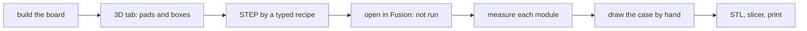
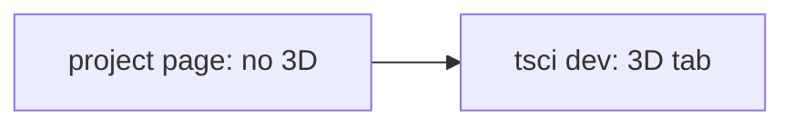

# Jobs and journeys
<!-- Tags as in the brief: E with a pointer, H with its source, D with who and when; an unknown is —. -->

## Who
<!-- One line per persona: who · evidence status (E pointer | H source).
e.g. `- Team leads who assign work · H Lena's belief, no interview yet` -->
- The maker: a person who builds a gadget with spark and Claude, from a breadboard to a perfboard or a PCB, and wants a case for it. The PO is the one maker with evidence · E #1745 (his words, 2026-11-26), E #163 (2026-10-11), E #180 (2026-10-12), E #313 (2026-10-16)
- Claude, or another agent: it runs spark's Operations for the maker and drives a CAD tool to make a case · E #1745 ("caude could then also se that 3d tool to craete a cover")
- The hobbyist who installs spark with no Fusion and no KiCad · H scrum/VISION.md (no outside person installed spark) <!-- REQUIRED:who -->

## Jobs
<!-- One job story per line, each clause tagged: When …, I want to …, so I can ….
e.g. `- When I assign a task in a meeting [E tickets.csv:6], I want the assignee to see it that day [H Lena], so I can stop chasing people [E tickets.csv:7]` -->
- J1 · When a part, a module or a board is in my design [E #1745], I want it to have a 3D shape with its origin, from a library, from its dimensions or from pictures [E #1745 "create it based on the pictures we have or have found online or took pictures of"], so the board in 3D looks like the real thing, "or at least some similar enogh general shape" [E #1745]
- J2 · When my PCB or perfboard is designed [E #1745 "the perfboard and PCB could be put together"], I want to see it assembled in 3D, in the engine's own view or in a browser [E #1745 "display the 3d in browser", and his follow-up on "the built in 3d view from KicAD or tsscript"], so I can check how it fits before I order or solder [H the facilitator]
- J3 · When the board is done [E #313], I want to open it in Fusion 360, or in a free tool, with the board and each part as its own body [E #1745 "the whole thing openable in fusion"], so I or Claude can design around it [E #1745 "the user or ai could use it and create the cover or other parts"]
- J4 · When I want a case [E #1745 "some basic cover would be created"], I want Claude to make a simple one, in that tool or by a CLI [E #1745 "using the MCP version of fusion or some other strategy, a LCI based"], so I do not model it by hand [H the facilitator]
- J5 · When the case is very simple [E #1745 "for like verysimple cases"], I want print files [E #1745 "exporting the 3d printer files"], so I print it on my own printer [H PrusaSlicer installed, pre-analysis section 3]
- J6 · When a source, an engine or a tool changes [E his standing line, 2026-11-26], I want to switch it with one setting, at one seam [E P1194 #1740], so nothing is built twice [E his standing line "reusable, dry"]
- J7 · When Claude is asked for a case [E #1745], it wants the board's mechanical facts as data (outline, holes, each body's size and height, each opening) [H the facilitator], so it does not guess a number [E AGENTS.md "a null is not a value to fill in"] <!-- REQUIRED:jobs -->

## Today they…
<!-- Per job: what they do instead today (a competitor, a workaround or nothing), tagged.
e.g. `- Job 1 · paste each task into Slack by hand · E tickets.csv:7` -->
- J1 · nothing in spark: no record holds a model, and 3 of 43 records hold a body's overall height · E brief ★C1. Outside spark, the PO gave his bin project's modules bodies by hand through `cadModel` · E brief ★C18
- J2 · tscircuit's 3D tab and KiCad's render show pads and a box, or a header body only · E P1089 finding section 2.3, brief ★C2. His bin project exports `board.glb` and shows it in an offline one-page viewer, rebuilt with each build after it went stale once · E brief ★C18, council/user.md US-1
- J3 · no doc gives a STEP recipe: docs/guide/agents.md:170-176 exports `kicad_pcb` and runs a DRC. An agent can type `tsci export -f step` by itself. The STEP has no module bodies. No one opened it in Fusion · E docs/guide/agents.md:170-176, P1089 finding section 2.3, council/architecture.md AR-24
- J4 · nothing in spark. tscircuit's case element is installed but spark does not write it · E brief ★C5. For the FireBeetle alone, the PO owns two bought DFRobot FIT0725 boxes · E brief ★C23 · H that he models a case by hand in Fusion (asked as Q3)
- J5 · nothing in spark. tscircuit's 3MF export fails in the installed CLI · E brief ★C6
- J6 · the tools list maps a role to a tool, and `ShapeSource` chooses a 2D drawing. Nothing does this for 3D · E brief ★C14
- J7 · Claude reads the records and finds no height, no holes and no openings for most parts · E brief ★C1, pre-analysis section 1 <!-- REQUIRED:today -->

## Journeys
<!-- One ### per actor and scenario: the table, then a Mermaid flowchart of the same steps. Never a Mermaid
journey block: it forces a score on every task. "n/a — a one-step job" may replace both. -->
### The maker — wants a case for a finished board, today <!-- REQUIRED:journey -->
| step | what they do | evidence | friction or harm | today | open question |
| --- | --- | --- | --- | --- | --- |
| 1 | builds the board with `/spark:build` | E BuildService, P1089 finding section 3.3 | none | works | — |
| 2 | looks at the board in tscircuit's 3D tab | E P1089 finding section 2.3 | each module is pads and a box, not its size | partly | Does the PO look at the 3D tab today? (account question) |
| 3 | exports a STEP file with a command he types | E P1089 finding section 2.3 · no doc recipe (council/po-assistant.md PA-18) | a command to type, no module bodies | partly | — |
| 4 | opens the STEP in Fusion 360 | — not run | unknown: names, units, the licence | — | Which Fusion licence does the PO use? (account question) |
| 5 | measures each module with callipers and models it | H the facilitator | slow, and a wrong height gives a case that does not close | — | How did the PO make his last case? (account question) |
| 6 | draws the case around the board | H the facilitator | by hand | — | — |
| 7 | exports STL and slices it in PrusaSlicer | E PrusaSlicer installed · H that he prints | none known | — | Which printer does the PO print on? (account question) |

### Claude — asked "make a case for my board", today
| step | what they do | evidence | friction or harm | today | open question |
| --- | --- | --- | --- | --- | --- |
| 1 | reads the records for sizes | E brief ★C1 | a height as a field for 3 of 40 records, holes as a block for 8 | partly | — |
| 2 | looks for an Operation that exports 3D or makes a case | E scripts/spark/operation_catalogue.py | none | not yet | — |
| 3 | adds `<enclosure.fdm.box>` to board.tsx by hand | E brief ★C5 | the build writes board.tsx again, so the edit does not stay | partly | — |
| 4 | tries to drive Fusion through its MCP server | E brief ★C11 | Fusion must be open and its server turned on by the PO | not yet | Does the PO want the server on? (decision question) |
| 5 | hands the maker a file to print | E brief ★C6 | tscircuit's 3MF export fails today | not yet | — |

### The hobbyist with no Fusion and no KiCad — wants to see the board in 3D
| step | what they do | evidence | friction or harm | today | open question |
| --- | --- | --- | --- | --- | --- |
| 1 | opens the project page | E P1038 discovery (the page) | the page has no 3D view | not yet | — |
| 2 | opens tscircuit's 3D tab through `tsci dev` | H the facilitator | a second tool and a command | partly | — |

