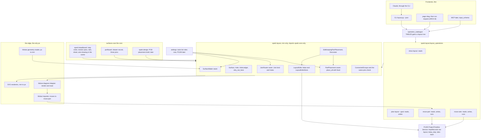

# P1199 council: the architecture lens (ARCH)

Read on 2026-11-26 at e138b9bd (branch p1199-layout-core), read-only. Line numbers are from that commit. This lens
decides nothing.

## Findings

- ARCH-1 · The router sits in the view, not in the plan. `TrackJumperRouter` runs inside `BreadboardSceneMaker.make`, after the same-pins check has already run on the layout. Its obstacles hold the printed marks, placed through a view's text measure (`PxLabelMeasure`). On a breadboard that is right, because the route is only a picture. On a perfboard the route is the connection, so its router must run inside the plan, before the check, with no input from a view. Two seams follow, not one: a join router in the layout core (electrical, its output read by the check) and the breadboard's wire drawing in the scene (a picture). · E · scripts/spark/breadboard/breadboard_scene.py:186, :188-194 · scripts/spark/breadboard/sheet.py:297-299 (the check runs on `layout`, the scene comes later at :479) · scripts/spark/breadboard/board_marks.py:4-5 · supports D-q1, D-q3

- ARCH-2 · Refutes pre-analysis §4's row "TrackGrid, TrackRouting: keep, the router of every surface" and its line "only `_round_px` ties it to px". The router's rules are a loose wire's picture rules. A hole is a blocked cell. A wire leaves along its hole's column. It has at most 4 bends and lies in a band of at most 4. It keeps off a rail's line. `LEG_CLEARANCE` is 2.5 px. The grid's origin is read from `letters_y`, a breadboard word. A perfboard's bare wire lies on the pads, and a solder bridge joins two neighbours (#311 note 3, as research.md Q2 quotes it), so none of these rules holds there. What can be shared is the A* search over a cost table (`_search`, `_estimate`). Lifting that out as a grid search with its costs and its blocked-cell rule as parameters is H (this lens's reading). · E · scripts/spark/breadboard/wire_routing.py:120, :126, :128, :141, :198-207, :232-270, :279 · pre-analysis.md:100 · supports D-q3

- ARCH-3 · The placement interface is per part and shaped like a breadboard. `PartPlacement.place(part_id, drawn, ledger, after, pinned)` carries the breadboard's step-order bound `after` and the resistor's `pinned` row. It already has 5 parameters, R3's limit, so a `goal` parameter would breach R3. A goal placer (simulated annealing, research.md Q1) moves and swaps all the parts together, so a call per part does not fit it. A shape that fits both: `place_all(parts, ledger, fixed)`, where `fixed` holds the kept edits. First fit becomes one member that loops over the parts. The breadboard's own planner keeps its step order and its resistor pass by calling the core per part through its own adapter (H, this lens). This refutes the pre-analysis row "PartPlacement: keep as an interface" for its method, and confirms "FirstFitPartPlacement: keep as one strategy". · E · scripts/spark/breadboard/drawing.py:229-237, :338-348 · tools/measure.py:245 (PARAMETERS = 5) · H the shape · supports D-q2

- ARCH-4 · Whether a part may lie at a place is decided twice today, and a move Operation would be a third. `FirstFitPartPlacement._fit`, `_covered` and `_pins_keep_a_free_hole` decide it for spark's own placement. `KeepMovesFirstFitPartPlacement._keep` decides it again for a kept part, with different rules. `_keep` does not check that each pin keeps a free hole for a jumper (drawing.py:290), nor the body gap (drawing.py:282). One predicate in the core, for example `why_not_here(part, place, ledger)`, returning a code or None, would serve every placement, the keep of edits, and a move Operation. Claude could then hear why a move cannot happen before the edit, which today it hears only after a rebuild (jobs-and-journeys.md, Claude's journey, step 4). · E · scripts/spark/breadboard/drawing.py:282-317 · scripts/spark/breadboard/kept_moves.py:186-215 · H the predicate's name · supports D-q4

- ARCH-5 · A move as a fact, and how it replaces kept moves' diff. Today a part counts as moved when its place in the earlier file differs from where a fresh plan puts it. So a move to the place spark would have picked is not seen as a move. A shape that fits P1193 (H, this lens): a Value `PartMove(part, pin, hole, turn)`, with the part keyed by its circuit name (ARCH-6), the hole by its surface's hole name, and a quarter turn. A Value `WireMove(joins, holes, route)`. Both sit in one Value `LayoutEdits(surface kind, parts, wires)`, saved by one `LayoutEditsStore` as one project file that carries its own stamp ("a stamp travels with its record", P1193 D-h). It joins P1193 as one `KeptRecords` row of kind "layout", kept through the Service's `keep_step`. A Decorator, `EditKeepingPartPlacement(inner, edits)`, claims each kept edit through the ARCH-4 predicate and then hands the remaining parts to any placement. A refused edit is named with today's codes (`hole-taken`, `row-shared`, `pin-off-row`). The Wokwi round trip (P273) stays as one importer at the edge. It reads a pasted breadboard.json once, finds what the person moved against the layout spark last wrote, and records the moves through the same Operation. No diff then runs at plan time. Hole names and quarter turns hold no unit, so the moves survive the change to mm. · E · scripts/spark/breadboard/kept_moves.py:233-255 (the diff at :252) · jobs-and-journeys.md, the maker's journey, step 5 · docs/discovery/2026-11-26-p1193-change-tracking/council/synthesis.md:59-63, :146 · H the shape · supports D-q4

- ARCH-6 · A resistor's id on the breadboard is its order, "R%d". So "an earlier R1 can be a different resistor now", and keeping a resistor is a special case in three places. The circuit gives each resistor a stable name (`c["name"]`, written by `host_part_names` as the part, its kind and the pad). A move keyed by that name drops the special case, and the R tag stays a word on the sheet. · E · scripts/spark/breadboard/sheet.py:239-242 · scripts/spark/breadboard/drawing_catalog.py:51-52 · scripts/spark/breadboard/kept_moves.py:13-15, :55-56, :217-222 · scripts/spark/design/board_components.py:188-194 · supports D-q4

- ARCH-7 · Edits as a decided record make P1193's planned row "breadboard.json as a kept step while its bytes are the person's, with a stamp" unnecessary for the breadboard. breadboard.json becomes a build output again, made by a Renderer from the plan and the edits. That reopens part of a delegated answer (C15, accepted under D6), so it goes to the decider. The build's rule that leaves breadboard.json in place when it holds parts would also go. The edits record keeps a move across a rebuild before P1152's Service exists. The Service adds the take-back when its slices 2 and 5 land (items.md:56 "depends on slices 2 and 5"). · E · docs/discovery/2026-11-26-p1193-change-tracking/council/synthesis.md:153, :266, :303 · its brief.md:117 (D6) · scripts/spark/build/kept_files.py:429-431 · H the consequence · supports D-q4

- ARCH-8 · The page's drag cannot call the same Operation as Claude through today's page seam. `run-request` runs a step "only when spark offers that key now", and "the values of the step come from spark's own offer key, never from the request". Its allow-list holds three Operations. A drag carries values: a part, a hole and a turn. So either that rule changes or the drag takes another road. This is a misfit with the core, and it goes to the decider. · E · scripts/spark/flow/run_request.py:1-5, :42-44 · D-h of brief.md (every feature an Operation, a drag only in its interface) · supports D-q5

- ARCH-9 · No Operation reaches the layout. The catalogue's `TABLES` has no breadboard or layout row. `breadboard.py` is a CLI with no Operation, "library-only until an Operation writes JSON". The layout is planned only inside the sheet's `write`. A proposed table, `spark/layout/layout_operations.py` (the pattern for an area whose `__init__` imports nothing), as a `TABLES` row after build (H, this lens): `show-layout` (reads: the holes, the parts, the joins, and with `--part` each legal place with its code), `plan-layout` (reads, writes: `--goal` overrides the setting for one run, writes the drawings), `move-part` and `move-wire` (reads, writes, and runs once the Service keeps through git, as P1193 ARCH-4 says). Take-back stays P1193's `take-back-kept-step`. Planning again needs no `tsci`, because the sheet reads the kept `dist/board/circuit.json`. Each Operation is one for every surface, and the surface comes from the project, so there is never a `move-breadboard-part` beside a `move-perfboard-part`. · E · scripts/spark/operation_catalogue.py:27-30 · scripts/breadboard.py:65 · scripts/spark/breadboard/sheet.py:225-233, :466-477 · docs/guide/patterns-and-names.md, "The package" · docs/discovery/2026-11-26-p1193-change-tracking/council/synthesis.md:137 · supports D-q4, D-q5

- ARCH-10 · Px enters at two edges, not one, and more px hides inside than the pre-analysis names. At the input, Wokwi's part geometry is measured in px (`tolerance_px` 1.5, pitch 9.6, each part's pins), and `part_shape` turns a record's mm into px before the planner (`PX_PER_MM`, `project_to_px`). At the output, `_round_px` lives in the planner's module, and both `wire_routing` and `svg_diagram` import it as a private name. Literals in px sit in the logic: 0.01 in `BodyBox.columns`, 0.5 in the lane router, 2.5 in `LEG_CLEARANCE`, and 34 by 12 for the USB end. So "mm in the core" means a reader at the input (Wokwi px to mm) and the renderers at the output (mm to px), with one `PX_PER_MM` in one edge module. `part_shape`'s projection then goes, and `PartShape` stays in mm. The frames differ too. The breadboard and `PartShape` put the origin at the top left with y down. The footprint's pads and `board_components.place` count from the centre with y up. The core needs one frame, and `part_shape` already writes one down. · E · data/wokwi-geometry.json (`tolerance_px`, `breadboard.pitch`) · scripts/spark/breadboard/part_shape.py:7-9, :26, :38-55 · scripts/spark/breadboard/drawing.py:596-599 · scripts/spark/breadboard/wire_routing.py:26, :96, :102, :205 · scripts/spark/breadboard/svg_diagram.py:20 · scripts/spark/breadboard/spacing.py:45 · scripts/spark/breadboard/breadboard_scene.py:233-240 · scripts/spark/design/board_components.py:168-178 · supports D-q1

- ARCH-11 · The move to mm changes the drawn bytes of an unchanged project unless the ties are ranked first. `claim_free_hole` picks the rail hole nearest a jumper's other end by float distance. With the holes in mm in place of px, that choice changes in 2 of the 63 columns of spark's full board (4 exact ties in px, 3 in mm). It changes in 0 of the 30 columns of Wokwi's half board. Ranking by hole index before distance, as `Surface.by_gap` already does for the parts, keeps the golden bytes. · E · scripts/spark/breadboard/drawing.py:209-217, :132-138 · this lens's command, `python3 -I -c` over data/wokwi-geometry.json and data/breadboards.json, 2026-11-26, output "half columns 30 argmin differs 0" and "full columns 63 argmin differs 2 exact ties px 4 exact ties mm 3", no file written · supports D-q1 and the brief's must-not-get-worse line (tests/golden-breadboard)

- ARCH-12 · A part's body is modelled three times, not twice as G8 says. `BodyBox` is in px, from Wokwi's measured sizes. `board_components.body_of` is in mm, with an invented default of 16 by 12 mm, which the module's own docstring calls a number "invented two lines earlier". `PartShape` is in mm, and its `ModuleShapeSource` refuses a record with no `body_mm`. So two rules answer the same missing fact (a default against a refusal). One copy goes: `PartShape` is the body in mm, `BodyBox` is its turned box at a place, and `body_of`'s default goes. A seam for the body already exists, the ordered `ShapeSource` list, which the brief's list of seams leaves out. · E · scripts/spark/breadboard/spacing.py:21-36 · scripts/spark/design/board_components.py:15-22, :43-52 · scripts/spark/breadboard/part_shape.py:33-35, :61-76, :263-274, :361-378 · pre-analysis.md:82 · supports D-q1

- ARCH-13 · Connectivity is read twice, and the union-find is written twice. `wiring_steps.points` follows a trace through ports and nets, "followed through both", which is transitive by design. `design/netlist.Netlist` keeps a pin-to-pin trace's net apart on purpose, which is not transitive. `DrawnNets` writes its own union-find beside the one in `wiring_steps.points`. It also reads a part's inside contacts (`joined_pins`) from Wokwi's geometry, so a part drawn from its record has none. A shape (H, this lens): one `ConnectedGroups` Value in the core that joins groups by the joins and by each part's contacts, with the contacts read from the part record. The same-pins check compares it with `wiring_steps.points`, the physical reading. Which reading the perfboard check uses is for the decider (Q7). · E · scripts/spark/breadboard/wiring_steps.py:311-330 · scripts/spark/design/netlist.py:1-30 · scripts/spark/breadboard/drawing_match.py:37-62, :49 · supports D-q3

- ARCH-14 · Wokwi's file format is written in two modules and read a third time. The writer (`WokwiBreadboardDiagram.render`) and the reader (`EarlierDiagram.parse`, `_jumper_of`) each know the `bb1:` prefix, the `[end, end, colour, route]` list and the position keys. `sheet.holds_parts` parses the file once more. `wiring-record.json` keeps `drawn_jumpers`, a copy of which jumpers breadboard.json drew. One Wokwi diagram Adapter at the edge, with `render` and `read`, removes the second copy. The importer of ARCH-5 then becomes its only reader. · E · scripts/spark/breadboard/drawing.py:577-589 · scripts/spark/breadboard/kept_moves.py:113-149 · scripts/spark/breadboard/sheet.py:328-332 · scripts/spark/breadboard/bench_changes.py:144-149 · supports D-q1, D-q4

- ARCH-15 · Where the core lives, and its imports. Proposed: a new area, `scripts/spark/layout`, in mm. It holds the hole and its group, the surface, the ledger, the body box over `PartShape`, the ARCH-4 predicate, the placement seam, the join router seam, the joins, `ConnectedGroups`, `LayoutEdits` with its Store and Decorator, and its Operations. It imports only `spark.core` (codes, errors, the Operation). It never imports `spark.breadboard`, `spark.design`, `spark.build`, `spark.flow`, the tools list, `data/wokwi-geometry.json` or any px. Breadboard, a perfboard area and later design import it. Inside breadboard would be wrong: breadboard already imports design (`part_shape` imports `footprint_emitter`, and `sheet` imports `design.loader`), so a PCB placement draft in design that imports breadboard would close a cycle. Inside design would put the physical layout beside the design area's job, "the design and the pin of each signal". No test enforces the direction between areas today. The rules test knows U1 only, which covers the leaves. So "never imports" needs a test, like the catalogue's import test. · E · scripts/spark/breadboard/part_shape.py:21-23 · scripts/spark/breadboard/sheet.py:15-21 · AGENTS.md ("What spark is and where its code is") · tools/measure.py:280-292 (U1) · scripts/spark/operation_catalogue.py:3-5 · H the area's name and content · supports D-q1

- ARCH-16 · The seams one by one, checked against pre-analysis §4. Every setting below is H, this lens's proposal, until P1194 holds it. · E for the pointers · H for the interfaces and the settings · supports D-q1 to D-q3

  | seam | interface | default | setting (name, default, layer) | first member today | pre-analysis row |
  | --- | --- | --- | --- | --- | --- |
  | surface maker per board kind | `make(record) -> Surface` | breadboard | `layout-surface`, `breadboard`, project. The full or half board stays a fact of the board record, as `part_px.full_surface` decides it today (sheet.py:270-275) | `Surface.__init__` (drawing.py:113-138) | "split": confirmed, and more than the constructor moves. `letters_y` and `top_letters` leak into wire_routing.py:120 and spacing.py:101-102, and `claim_free_group` (drawing.py:219-226) is a breadboard rule |
  | placement with a goal | `place_all(parts, ledger, fixed) -> [placed]` (ARCH-3) | first fit | `layout-placement`: `first-fit`, user then project, with `--goal` for one run | `FirstFitPartPlacement` (drawing.py:249) | member confirmed, interface refuted (ARCH-3) |
  | router with join kinds | `route(layout, surface) -> [Join(kind, holes)]` | breadboard: none (the planner picks a jumper's holes at drawing.py:353-368). Perfboard: — | `perfboard-router`, —, project. The picture router stays `breadboard-wire-drawing`: `track`, spark (breadboard_scene.py:186) | none for a perfboard. `TrackJumperRouter` stays the breadboard's drawing | "every surface": refuted (ARCH-1, ARCH-2) |
  | keep of edits | Decorator `EditKeepingPartPlacement(inner, edits)` | on when an edits record exists, a no-op when none does | none proposed: a missing record is the off state (H). The decider may want `layout-keep-edits` | the logic of `KeepMovesFirstFitPartPlacement` and `KeepMovesJumperPlacement` (kept_moves.py:158, :262) | "change to a decorator": confirmed. Today both are subclasses fed by Wokwi's file |
  | same-pins check | `differences(points) -> [finding]` over `ConnectedGroups` | always on | none proposed: a safety check with an off member could hide a short (H). The decider's (Q8) | `DrawnNets` (drawing_match.py:37) | "widen": confirmed, plus the contacts from the record (ARCH-13) |
  | body source (not in the brief's list) | `describe_part(board)` | Wokwi's geometry, then the record | the ordered list `SHAPE_SOURCES`, spark layer | `ShapeSource` (part_shape.py:61) | not in §4 (ARCH-12) |

  Where these settings live is open. The tools list maps a job to a program in three layers (spark, the person's store, the project), and the project wins. A layout member is a class inside spark, not a program. P1193 found the same gap for its `none` and `by-hand` members and proposed one new kind of entry. · E · scripts/spark/records/tool_finder.py:39-44, :91-112 · docs/discovery/2026-11-26-p1193-change-tracking/council/synthesis.md:127 ("One gap") · #1740 ("Until it is built")

- ARCH-17 · The names collide three times. "Move" already names `MoveHold` (op `move-hold`, a held part moved to another project). "Layout" already names `PillLayout`, `PadLabelLayout` and `BreadboardLayout`. "Kept" already names a kept step, the build's `kept_files` and a kept document, and words.md says a kept step is neither of the last two. "Kept moves" would make a fourth "kept". Rule 1 gives one word one meaning, so the new area, the Operations and the edits record each need a row in words.md before code. · E · scripts/spark/idea/move_hold.py · `grep "class .*Layout"` over scripts/spark (PillLayout, PadLabelLayout) · scripts/spark/breadboard/drawing.py:41 · docs/guide/words.md:20-28 · docs/guide/patterns-and-names.md ("One responsibility, one name", rule 1) · supports D-q1, D-q4

- ARCH-18 · The first change has to split `drawing.py`. It has 599 lines, R1's limit for a module is 600, and the baseline holds no R1 entry for it. So one more line fails the rules test. The Wokwi renderer (drawing.py:543-599) and the planner share that module, so moving the renderer to the edge is both the split and the step toward ARCH-10 and ARCH-14. · E · `wc -l scripts/spark/breadboard/drawing.py` gives 599 · tools/measure.py:242 · tests/architecture_baseline.json (no `R1:scripts/spark/breadboard/drawing.py:<module>`) · supports D-q8

- ARCH-19 · The proposed shape, as one diagram. It shows the areas, the seams, the Operations, the renderers at the edge, and P1193's Service. · H, this lens's synthesis of ARCH-1 to ARCH-18 · supports D-q1, D-q4, D-q5

## What could not be checked, and why

- Whether a perfboard router of three join kinds fits the router's budget on a board of 30 by 70 holes. There is no code, and nothing was timed.
- Whether Wokwi takes a part placed in mm and turned back into px with no drift beyond `tolerance_px`. That needs a run in Wokwi, and this lens runs no simulation.
- Whether a golden breadboard other than the full board's rail jumpers changes under mm. Only the rail tie of ARCH-11 was computed. The golden tests were not run, because a run in mm needs code that does not exist.
- How the P1152 Service's `keep_step` will name a layout step's words, and the exact path of the edits record. P1152 has no code yet, and P1193 left the layout row to its slice 5.
- What P1194's layers will be. #1740 is in Discovery with no design.
- Whether the PO has ever edited breadboard.json by hand or in Wokwi. The store was not read for it, since no question of this lens needs his data, and P1193 UX-6 counted board.tsx, not breadboard.json.
- The A* search was not lifted out in a scratch run, so ARCH-2's "shared search" stays H.

## Questions for the decider

- Q1 · Where does the layout core live? · decides D-q1 and every import rule after it · options: (a) a new area, `scripts/spark/layout`, which imports only `spark.core`, (b) inside `spark.breadboard`, (c) inside `spark.design` · I would pick (a) first (ARCH-15).
- Q2 · Is a person's or Claude's move kept as a fact in its own decided record, with breadboard.json made again from it at every build? This reopens P1193's planned row for breadboard.json (C15 under D6, delegated). · decides D-q4 and P1152's slice 5 · options: (a) the edits record is the only kept layout row, (b) both the edits record and breadboard.json are kept, (c) breadboard.json alone, as P1193 planned · I would pick (a) first (ARCH-5, ARCH-7).
- Q3 · How does a drag on the page reach `move-part`, given that `run-request` never takes values from the request? · decides D-q5 · options: (a) widen `run-request` for an allow-listed Operation, whose `input_schema` checks the request's values, (b) the drag only drafts a request that Claude runs through the CLI, (c) spark offers each legal move as an offer key · I would pick (a) first (ARCH-8).
- Q4 · Where do the layout's settings live until P1194 exists? · decides every row of ARCH-16 · options: (a) roles in the tools list, with the one new kind of entry for an in-process member that P1193 also needs, (b) a block in `.spark/project.json`, (c) constructor defaults named in the plan until P1194 · I would pick (a) first, so there is one home beside P1193's.
- Q5 · Is the placement seam one call for all parts, with the kept edits as fixed parts, or one call per part? · decides D-q2 · options: (a) `place_all(parts, ledger, fixed)`, with the breadboard's step order kept in its own planner, (b) keep `place` per part and add a second seam for a goal placer · I would pick (a) first (ARCH-3).
- Q6 · Is a goal one setting with three members, or a goal beside an algorithm? · decides D-q2 · options: (a) one setting, `first-fit`, `smallest` or `spread`, where the last two are one class with two sets of weights, (b) two settings, the algorithm and the goal · I would pick (a) first, as research.md Q1 reads a goal as a cost function.
- Q7 · Which reading of the circuit does the perfboard's same-pins check compare with? · decides D-q3 · options: (a) `wiring_steps.points`, transitive like a physical row, (b) `design/netlist.Netlist`, not transitive · I would pick (a) first (ARCH-13).
- Q8 · Does the same-pins check get a setting with an off member? · decides the check's row in ARCH-16 · options: (a) no setting, it always runs, (b) a setting · I would pick (a) first.
- Q9 · Does the move to mm keep every golden byte? · decides the must-not-get-worse line and the first slice · options: (a) rank holes by index before any float distance, so no byte changes, (b) accept new bytes for the 2 columns and update the goldens · I would pick (a) first (ARCH-11).

## Searches

None.
