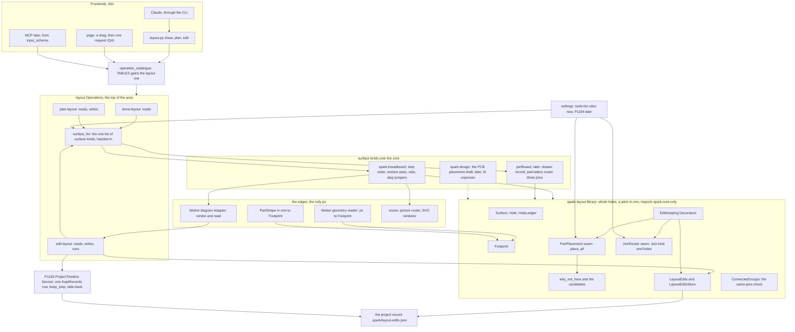

# P1199 layout core: the council's synthesis

The architect on Fable, 2026-11-26, 13:20 to 13:50 CET. Read at 605070c6 and checked again at abd360b3 on branch p1199-layout-core, after D1 confirmed the frame. Tags: E is a pointer that I or a lens read, H names its source, D names who decided and when. ★C1 to ★C19 are the brief's claims. No file I read asked me to run or change anything. This file decides nothing. Every recommendation is mine and is labelled so.

## The short version

- The four lenses agree on the shape of an edit. It is a fact (the part, its pin, the hole, the turn), not bytes of breadboard.json. One Operation records it after one check, and a Decorator applies it to any placement [H ARCH-5, TL-12, US Q1].
- They split on when the core is built. My resolution: nothing is built before the MVP. After it, the core is born in the first slice that needs it, as the split of `drawing.py` that R1 forces anyway, and it holds only what that slice calls [E ★C12, ★C19, H mine].
- The core places on whole holes, with one pitch in mm per surface. Px stay at three edges: the Wokwi geometry reader, the Wokwi diagram Adapter and the SVG scene [E ★C5, E my scratch checks in part 2].
- With that unit, the question "may two goldens change" does not arise. Rail ties broken by rank kept 9 of 9 goldens in a scratch run [E part 2].
- Three Operations, each one for every surface: `show-layout`, `plan-layout`, `edit-layout`. I reject `move-part` and `move-wire`, because `move-hold` and "wire" already mean other things [E part 2, the names check].
- Versions join P1193 with no second mechanism. The edits record is one more decided record with one `KeptRecords` row. `kept_moves.py` goes [H ARCH-5, ARCH-7, TL-13].
- Two misfits go to the PO: breadboard.json as a build output reopens the delegated C15, and run-request cannot carry a drag's values [E ARCH-7, ARCH-8].
- The riskiest assumption is value, not feasibility. No move of a part was ever seen in the PO's data [E ★C10, ★C11]. The cheapest test is one account question and a 14-day log.

## 1. Agreements and splits

### Where the four lenses agree

| # | Agreement | Who | Tag |
| --- | --- | --- | --- |
| G1 | No Operation reaches the layout, and the breadboard area has no table | PA-7, ARCH-9, TL-14, US-5 | E `scripts/spark/operation_catalogue.py:27-28`, `scripts/breadboard.py:65`, ★C13 |
| G2 | An edit is a fact: the part, the pin that goes in the hole, the hole's name, a quarter turn. A hole name carries no unit | ARCH-5, TL-12, TL Q2, US Q1, US-5 | H the shape. E `scripts/spark/breadboard/kept_moves.py:152-155` already maps a place to holes |
| G3 | Keep moves becomes a Decorator around any placement. The Wokwi round trip becomes an importer at the edge | ARCH-5, ARCH-16, TL-11, pre-analysis §4 | E `kept_moves.py:158` (a subclass of the first fit today), ★C8 |
| G4 | The reason comes before the write, from one predicate | ARCH-4, TL-15, US-5 | E `scripts/spark/breadboard/drawing.py:282-317` and `kept_moves.py:186-215` decide it twice today, with different rules |
| G5 | The breadboard's wire router is a picture router. The perfboard needs a join router inside the plan, read by the same-pins check | ARCH-1, ARCH-2, TL-6 | E `scripts/spark/breadboard/breadboard_scene.py:187-199`, `scripts/spark/breadboard/sheet.py:302-304`, ★C4 |
| G6 | A resistor needs a stable key. Its id today is its order | ARCH-6, TL-12 | E `sheet.py:239-242`, `kept_moves.py:13-15` |
| G7 | The Operations come before any page. A page with its own rules would hold the logic twice | PA-5, US-7, ARCH-8, ARCH-9 | D-h the PO, 2026-11-26 |
| G8 | The perfboard, the goals and the editors come after the MVP. The breadboard keeps the first fit | PA-3, TL Q3, US-6, ARCH-16 | D-a the PO, 2026-10-16. D-i the PO, 2026-11-25. E ★C12 |
| G9 | With edits as facts, breadboard.json is a build output again | ARCH-7, TL-13 | H both. It reopens C15 (part 7, Q3) |
| G10 | The PO's one perfboard record lacks the facts a surface needs | TL EP-4, US Q4 | E ★C15 |

### Where they split, and my resolution

| # | The split | My resolution | Reason |
| --- | --- | --- | --- |
| S1 | When the core is built. PA-6 and Q-b: it waits until the perfboard card is pulled. The tech lead: slices 1 to 8 in order, starting now with the geometry | Neither as written. Before the MVP only evidence and comments. After it, the core is born in the first ordered slice (edits and Operations on the breadboard) and grows by need. The goal placer, the surface makers and the join router wait for the perfboard card | The MVP bar: nobody is blocked [E ★C12]. A core built ahead of its second client is the first line of PA-5's pre-mortem. But the first slice needs a shared home for the ledger and the predicate, and `drawing.py` has 599 of 600 lines, so its first change splits it anyway [E `wc -l`, `tools/measure.py:242`]. The order itself is the PO's (Q2) |
| S2 | The placement seam. ARCH-3: `place_all(parts, ledger, fixed)`. TL-8: a generator of legal candidates and a chooser inside the per-part `place`. TL-10: annealing needs a whole-plan seam | Two layers of one seam, not rivals. The seam that a setting swaps is `place_all`. Under it one helper yields legal candidates in rank order, through the one predicate. First fit takes the first candidate. The goal member takes the cheapest, with integer costs and ties by rank. Annealing is a later member of the same seam | A goal needs all parts at once, and a perfboard has no step order, so the strategy must own the order [H ARCH-3]. `place` already has 5 parameters, R3's limit [E `drawing.py:236`, `tools/measure.py:245`]. The greedy member needs no seed [H TL-8]. Python promises only `random()` across versions [E part 8, search 3] |
| S3 | The goal's unit. The brief's outcome (2): mm². US-6: holes across and down, and the size to cut | Holes first. The plan reports holes across and down (the size to cut), then mm from the pitch, then the count of each join kind. Drop mm² | The maker cuts by holes [E #311 note 2, "holes across and down, pitch"]. The costs are whole pitches anyway [H TL-8]. The outcome line is still "proposed" in the brief, so the main session can change it |
| S4 | The core's unit. The card and pre-analysis G1: mm. TL-3 and TL-4: mm floats change 3 of 6 goldens, and exact geometry keeps 7 of 9. PA-5: the px are drawing facts and a round trip drifts | Whole holes, with a pitch in mm. See "The unit" in part 2 | E ★C5, and my two scratch checks. The artefact that cost TL-4 its 2 goldens lives in the picture router, which stays in px by G5 |
| S5 | The setting's name and home. ARCH-16: `layout-placement` as a tools-list role. TL Q6: `layout.placement`. PA-6: `layout.placement_goal` | One name, `layout-placement`, as a role in the tools list until P1194 holds it. One setting with three members, not an algorithm beside a goal | The 14 roles are hyphenated [E `data/tools.json`]. P1193 put its two roles there and named one new kind for a member that is no program [D P1193 D6, C2, delegated]. One home beside P1193's [D-g the PO, 2026-11-26] |
| S6 | The perfboard's default goal. US Q3: roomy. TL Q6: first fit. #311 note 2: "the smallest that fits" | Two choices were mixed. Which board: the smallest in the drawer that fits (`perfboard-pick`). How the parts use it: the goal. The default goal I cannot settle from evidence, so it is Q6 | E #311 note 2 is about the board, not the spacing. US-6's bridge risk is H |
| S7 | The layout's kept row. PA-6 items 2 and 3: a stamp on breadboard.json and kept_moves fed at P1152's slice 5, as P1193 planned. ARCH-7 and TL-13: the edits record is the row | The edits record. One refinement of ARCH-7: the build still needs a written digest of breadboard.json, only to notice a hand edit and offer the import. No kept-step row for the file | The board the PO wired writes no breadboard.json at all [E ★C11]. A fact in hole names has no px for Claude to compute. It reopens C15, so it is Q3 |
| S8 | Who owns "move a part". PA Q-c: P1199, P1163 or P293 | P1199 owns the Operation. P1163 owns the page's drag. P293 owns the conversation's chain (find a part, pick it, set its pin, place it) | D-h: the CLI reaches every feature first. US-4: "Connect it to pin 20" is a design change, not a layout edit [E `kept_moves.py:15-16`] |
| S9 | A take-back of an older edit whose hole a later edit holds. US Q2: refuse and offer both | No new rule. The take-back's preview plans the layout with the restored record, and the one predicate names the edit that no longer fits, before the yes. The person then picks "only this step" or "this step and the steps after it" | Both choices exist already [E `docs/guide/words.md:23`]. A refused edit is one more named finding |
| S10 | The first perfboard routing. Research Q2: rip-up or PathFinder. TL-7: one pass, then a jumper for each failed connection, then a named code | TL-7 first. A second pass is a later member of the same seam | Completeness needs only two free holes per failed connection [H TL-7]. Only spike B can count jumpers |

A lens finding I refine. ARCH-9 puts the Operations in `spark.layout`, and ARCH-15 says `spark.layout` never imports a surface area. Both cannot hold, because `plan-layout` must reach the breadboard's planner. My resolution is in part 2 (the `SurfaceKind` seam, handed in). No lens has reviewed it [H mine].

A small disagreement on a number. The tech lead gives at most 40 × 30 holes for the FIT0193 and the user lens at most 39 × 29 [E EP-4, user.md "What I could not check"]. Spike C settles it.

## 2. The proposed shape

### The area and its modules

A new area, `scripts/spark/layout` [H ARCH-15, mine]. Its library modules import `spark.core` only. They never import `spark.breadboard`, `spark.design`, a px or `data/wokwi-geometry.json`. A test pins that direction, like the catalogue's import test [E `scripts/spark/operation_catalogue.py:3-5`]. The breadboard, a later perfboard area and later the design area import it. It cannot live in the breadboard area, because that area already imports design [E `scripts/spark/breadboard/part_shape.py:23`, `scripts/spark/breadboard/wiring_steps.py:23-26`].

| Module (working name, H) | Holds | From today's code |
| --- | --- | --- |
| `surface` | `Hole` (name, cell, group), `Surface` (the cells, the groups, the pitch in mm), `HoleLedger` | `drawing.py:28`, `:106-148`, `:189-226` |
| `footprint` | `Footprint`: a part's pins as whole-hole offsets from its anchor pin, per turn, the cells its body takes, and its body box in mm | `spacing.py:10-45`, `drawing.py:319-325`, `part_shape.py:35` |
| `placement` | `why_not_here`, the candidate helper, `PartPlacement`, `FirstFitPartPlacement`, later the goal member | `drawing.py:229-317` |
| `joins` | `Join(kind, holes)`, `JoinRouter`, `ConnectedGroups` with the same-pins check | `drawing.py:240-246`, `:351-370`, `drawing_match.py:36-93` |
| `layout_edits` | `PartEdit`, `JoinEdit`, `LayoutEdits`, `LayoutEditsStore`, the two Decorators | `kept_moves.py:158-230`, `:262-310` |
| `layout_codes` | the codes as `Code` objects | `kept_moves.py:28-53`, `drawing.py:45-73` |
| `layout_operations` and one module per Operation | the table and the three Operations | none today |

Built by need. The first slice makes `surface`, the predicate and first fit, `layout_edits`, the codes, `show-layout` and `edit-layout`. The rest enters with its slice.

What stays with the breadboard: the step order, the resistor pass, the rail seating, the body spacing, the picture router, the scene and both renderers [E `drawing.py:338-372`, `:420-445`, `scripts/spark/breadboard/rails.py:10-35`, `wire_routing.py:168-177`]. What a perfboard area adds: its surface maker from a drawer record, and its join router with three kinds.

The PCB's placement draft and the sculpture are not hole surfaces. `board_components.place` works in free mm from the centre with y up [E `scripts/spark/design/board_components.py:143-180`]. They can reuse the placement seam and the body boxes in mm on a fine grid. That fit is H and unproven, and the scope asks only for a fit check. So I read the card's "every surface" as "every hole surface first".

### The unit

- A surface is a lattice of cells. A hole has a name, a cell (column, row) in whole numbers and a group. The surface holds one pitch in mm. A position in mm is the cell times the pitch, derived, never stored [H mine, from ★C5 and TL Q2].
- A part reaches the core as a `Footprint`. A reader at the edge makes it once per turn: from Wokwi's px for a Wokwi part, by snapping inside the measured tolerance, and from `PartShape` in mm for a part drawn from its record [E `data/wokwi-geometry.json` `tolerance_px`, `part_shape.py:35-58`].
- A placed part is (id, anchor pin, hole, turn, its holes). It has no px. The edge derives the px corner with today's arithmetic, the hole's px minus the turned pin's px [E `drawing.py:280`].
- Px live at three edges only: the Wokwi geometry reader (in), the Wokwi diagram Adapter (in and out, one module where two write and three read today [E ARCH-14]), and the scene with its picture router and both renderers (out).
- A part whose leads do not fit the pitch is refused with a code that names the missing fact. The JST PH has a 2.0 mm pitch [E ★C14, H TL Q5].

Two scratch checks support this. I ran both in a temporary folder with the tree read-only, then removed the folder.

1. One footprint per part and turn explains every placement test. Over 7 fixtures of `tests/data/breadboard`, 10 part shapes and 4 turns gave 9,374 placements with every pin over a hole. The pin holes, the covered holes (for a part that covers holes), the columns the body spans and the rail holes under the body were each the same whole-hole offsets from the anchor hole in every one: 0 mismatches. That holds on spark's full board and on Wokwi's half board, whose rail holes lie up to 1.6 px off the lattice [E measured, 2026-11-26]. Supports only: a place is a function of the anchor hole and the turn. Three fixtures were skipped (two need a board record from a store, one is not built).
2. Rail ties broken by rank keep the goldens. I replaced the float distance in `HoleLedger.claim_free_hole` (`drawing.py:215`) with a whole-number distance, the first hole in surface order winning a tie. All 9 of 9 cases of `tests/golden_breadboard.py` gave the same text and files as today's code. A control that gave ties to the last hole changed 3 of 9, so the patch was live [E measured]. On the full board 9 columns tie exactly between two neighbouring rail holes, and today's px floats pick the first hole in all 9 [E calculated]. A caveat: among holes further out, 123 of 625 exact-tie pairs go the other way in px floats. That state needs the nearer rail holes taken, and no golden has it.

So TL-4's "7 of 9" does not apply to this shape. Its two changed goldens lose a zero-length corner that a float equality makes in the picture router [E `wire_routing.py:364`, TL-3]. Here that router stays in px. Not checked: a whole-hole planner run end to end, because none exists (assumption A2).

### The seams

| Seam | Interface | Default member | Setting (name, default, layer) | First member from today's code |
| --- | --- | --- | --- | --- |
| Surface kind | `surface(project) -> Surface` and `plan(surface, parts, placement, router) -> Layout` | `breadboard` | `layout-surface`, `breadboard`, project. Full or half board stays a fact of the board record [E `sheet.py:270-274`] | `Surface.__init__` and `BreadboardPlanner.plan` (`drawing.py:113-138`, `:338-372`) |
| Footprint source | `describe(part) -> Footprint or None`, asked in order | Wokwi's geometry, then the record | an ordered list in code, spark layer, no person's setting | `ShapeSource` and `sources_for` (`part_shape.py:61-73`, `:361-367`) |
| Placement | `place_all(parts, ledger, allowed) -> [PlacedPart]`. `allowed` is the surface's own filter (the breadboard's column bound and pinned row) | `first-fit` | `layout-placement`, `first-fit`, project then user, and `--goal` for one run. Members `first-fit`, `smallest`, `spread` | `FirstFitPartPlacement` (`drawing.py:249-297`) |
| Keep of edits | Decorator `EditKeepingPartPlacement(inner, edits)` with the same `place_all`. It claims each edit through `why_not_here`, then hands the other parts on. The same for joins: `EditKeepingJoinRouter(inner, edits)` | on when the record exists | none. No record is the off state [H ARCH-16] | `_keep` and `place_jumpers` (`kept_moves.py:186-215`, `:277-310`) |
| Join router | `route(wanted, ledger) -> [Join(kind, holes)]`. `wanted` is the pairs of ends to join | per surface: `step-jumpers` on the breadboard, `pad-lattice` on the perfboard | `layout-join-router`, the surface's default, project. A second pass is a later member, not a second setting | the planner's jumper pass with `JumperPlacement` (`drawing.py:351-370`, `:240-246`). The perfboard's member is new |
| Same-pins check | `ConnectedGroups(layout).differences(points)` | always on | none. An off member could hide a short [H ARCH Q8] | `DrawnNets` (`drawing_match.py:36-93`), compared with `wiring_steps.points` [H ARCH-13] |
| Picture router (stays in the breadboard's scene) | `route(layout, obstacles) -> {step: JumperPath}` | `track` | `breadboard-wire-drawing`, `track`, spark. Other member `lane` | `TrackJumperRouter`, `LaneJumperRouter` (`wire_routing.py:45-52`, `:168`) |

Join kinds, three for every surface [H mine, from #311 note 3]: `jumper` (an insulated wire between two holes on the parts side, the breadboard's only kind), `bare-wire` (along pads on the back) and `bridge` (two neighbouring pads). The breadboard's jumper and the perfboard's insulated jumper are one kind.

One predicate, `why_not_here(footprint, hole, turn, ledger)`, returns a code or None. First fit, the goal member, both Decorators and `edit-layout --dry-run` call it. Today `_keep` skips two rules that first fit applies: each pin keeps a free hole for a jumper, and the body gap [E `drawing.py:282`, `:290`, `kept_moves.py:186-215`].

Until P1151 gives the tools list its kind for a member that is no program, a slice names its default as a constructor default in its plan [H ARCH Q4, D-g].

### Edits as facts

- The shape [H ARCH-5, TL-12, mine]. `PartEdit(part, pin, hole, turn)`. `JoinEdit(ends, holes)`. Both sit in one Value, `LayoutEdits(surface kind, parts, joins)`.
- The stable keys. A part is keyed by its component name in the circuit. A resistor's name is its part, its kind and its pad, so it does not move when another resistor enters [E `board_components.py:188-194`, `sheet.py:239-242`]. "R1" stays a word on the sheet. A join is keyed by the two ends it joins, not by its step number. A step number changes with the circuit, exactly as R1 does [H mine. TL-14 proposed `--step N`]. The CLI may take a step number and turn it into ends at write time.
- A join's edit holds holes only. On the breadboard the drawn way is a picture, so a hand-drawn route from Wokwi is not kept [E `kept_moves.py:304` keeps route strings today]. This changes a behaviour nobody was seen to use [E ★C10].
- Where they are kept. One project record, `.spark/layout-edits.json`, beside `requirements-origin.json` [E `scripts/spark/design/entry_origin.py:22`]. One `LayoutEditsStore` reads and writes it. It carries its stamp inside: the surface kind and the build it was made against [H mine, from P1193's "a stamp travels with its record"].
- How the Decorator applies them. At each plan it claims every edit first, through the predicate. An edit that no longer fits is named with its code and its part is placed by the inner strategy. Only recorded edits hold a part in place. Today every earlier part is held, so a new goal would change nothing [E `kept_moves.py:175-184`, ★C8]. Q5 asks the PO about that.
- How the Wokwi importer feeds them. The Wokwi diagram Adapter reads a pasted breadboard.json once, maps each part's px to its holes [E `kept_moves.py:152-155`], compares with the layout spark last wrote, and hands the differences to `edit-layout`. No diff runs at plan time, so a move to the place spark would pick is still an edit.
- How this joins P1193. The layout area declares one `KeptRecords` row, kind `layout`, path the edits record [E P1193 `council/synthesis.md:59-63`, `:146`]. `edit-layout` writes the record, then calls the project timeline Service's `keep_step` through a builder handed in by its constructor, as deploy takes its platform [E `scripts/spark/bench/deploy_image.py:492-508`]. Before P1152 exists the builder gives the member that keeps nothing and says so in one line [E P1193 `council/synthesis.md:129`]. The edit still survives a rebuild, because the planner reads the file. The way back is P1193's `take-back-kept-step` [E `docs/guide/words.md:23`]. Nothing else keeps versions. `kept_moves.py` goes, and so does `drawn_jumpers` in the wiring record [E ARCH-14].
- The row is a decided record, so it can join at P1152's slice 2 with the other records, not at slice 5 with the person's files [H mine. E `council/synthesis.md:299`, `:303`].

### The Operations

| Op (H) | CLI | Arguments | Effects | What it answers or writes |
| --- | --- | --- | --- | --- |
| `show-layout` | `layout.py show` | `--project`, `--json` | `reads` | The surface (kind, holes across and down, pitch), each part (pin, hole, turn, its holes, placed by spark or by an edit), each join (kind, holes), each edit with kept or its code. Hole names, no px. It plans from the kept circuit and writes nothing [E `sheet.py:225-244`] |
| `plan-layout` | `layout.py plan` | `--project`, `--goal` (choices from the setting's members), `--dry-run` | `reads`, `writes`. With `--dry-run` only `reads` | Plans again and writes the drawings and the sheet. It reports holes across and down and the count of each join kind |
| `edit-layout` | `layout.py edit` | `--project`, one of `--part ID --pin PIN --hole HOLE --turn {0,90,180,270}`, `--join END END --holes HOLE HOLE`, `--edits FILE` (a payload, a batch as one kept step), `--wokwi FILE` (the importer), plus `--clear` and `--dry-run` | `reads`, `writes`, and `runs` once the timeline's member runs a program. With `--dry-run` only `reads` | Checks with the predicate, writes the edits record, keeps one step, plans again. A refusal is a Finding with its code, and nothing is written |

The contract fits as it is: `choices`, `payload`, `effects_of` and `written_project` exist [E `scripts/spark/core/operation.py:14-25`, `:103-112`]. `--dry-run` is the existing word for "a write is the default and the flag holds it back" [E `docs/guide/patterns-and-names.md:70`, `deploy_image.py:496-499`]. I do not add `--check`, which names a mode of grant.py.

The table. `OPERATIONS` in `scripts/spark/layout/layout_operations.py`, the pattern for an area whose `__init__` imports nothing [E `patterns-and-names.md:40`]. One `TABLES` row, `("layout", LAYOUT)`, after `checks` and before `bench`, which is where AGENTS.md lists the breadboard. Two lenses said "after build" [H ARCH-9, TL-14]. Either order works.

The direction problem and its answer [H mine]. The Operations must reach a surface's planner, and the library must not import a surface. So each Operation takes `surface_for` in its constructor, with the real builder as the default. The real builder is the one place that lists the surface kinds. The table module and that builder are the top of the area. The library modules are its bottom, and the import test pins only them.

The names, checked against `patterns-and-names.md` and `words.md`.

| Name | Rule 4 (verb, then object) | Rule 1 (one word, one meaning) |
| --- | --- | --- |
| `show-layout`, `plan-layout`, `edit-layout` | meets it. Module, class and op share the words | "Layout" is `BreadboardLayout` in this meaning [E `drawing.py:41`]. `PillLayout` and `PadLabelLayout` mean a label's arrangement [E `wire_pills.py:37`, `breadboard_scene.py:33`]. A words.md row must say which is which. "Layout edit" is already P1193's phrase [E P1193 `items.md:56`]. "Plan" also names plan first and `MovePlan`, a mild second meaning |
| `move-part` (the lenses' name) | meets it | breaks it. `move-hold` moves a held part to another project [E `scripts/spark/idea/move_hold.py:135`]. An agent could pick the wrong one |
| `move-wire` (the lenses' name) | meets it | breaks it. A "wire" is a jumper's drawn way [E `wire_routing.py:2-4`], and a perfboard has three join kinds |
| `place-part` | meets it | the verb fits `wiring_steps.PLACE` and `PartPlacement`. The noun "place" is a location in the store [E `scripts/spark/records/tool_finder.py:42`], so a Value could not be called a place |

My recommendation: the three `-layout` names. Each carries "layout" whole, as P1193's C5 asks of its own names. The rows for layout, layout edit, join and footprint enter words.md before any code [E ARCH-17]. The names are the delegated council's to settle, as P1193's were.

The codes. The kept-moves codes are hyphenated strings with no fix, so `Finding.of` raises on them [E `scripts/spark/core/codes.py:28-37`, `scripts/spark/core/result.py:26-28`, US-5]. The area's codes are `Code` objects in snake_case. The old strings are named in `docs/guide/agents/scripts.md:211-219`, which changes in the same slice.

### The whole shape

## 3. One recommendation per decision

Sizes are S, M or L. They are H, the tech lead's estimates or mine, and nothing is measured.

### D-q1: the core's boundary and its unit

- A, recommended (mine, with ARCH-15 and the main session's fact ★C5): a new area on whole holes with a pitch in mm, born as the split of `drawing.py` in the first ordered slice, holding only what a caller uses. The breadboard first, the perfboard second. Cost: M for the first slice. It would prove that the planner leaves px with 9 of 9 goldens unchanged, and that one predicate serves placement, keep and edit.
- B (the card's words, pre-analysis G1, ARCH-10 in part): a core in mm floats. Cost: M to L. It would prove the same, but TL-3 measured 3 of 6 goldens changed, and TL-2 shows a stored mm needs 4 decimals.
- C (the PO assistant, Q-b): no core until the perfboard card is pulled. Cost: none now. It proves nothing, and the perfboard then pays for the whole refactor at once.

### D-q2: placement goals

- A, recommended (mine, with TL-8 and ARCH Q6): one seam `place_all`, one setting `layout-placement` with `first-fit`, `smallest` and `spread`. The two goals are one greedy class with two integer cost tables, ties by rank, no seed. Goals apply on the perfboard first. Cost: S to M. It would prove that one setting switches the goal and the same input gives the same bytes.
- B (research Q1): simulated annealing behind the same seam. Cost: M. It needs spark's own generator over `random()` only [E search 3]. It would prove a tighter packing, if the greedy member misses a dated pass line. pyplacer's own source calls its results "not flattering" [E research.md Q1].
- C (PA-8): OR-Tools CP-SAT as an optional tool. Apache 2.0 [E search 1]. Its wheel is 21.9 MB on macOS arm64 and about 29.8 MB on Linux [E search 5]. Cost: M and a dependency the person installs. It would prove a goal with no randomness. Later, and only as an optional member.

### D-q3: perfboard routing

- A, recommended (the tech lead's TL-7, with ARCH-1 and ARCH-13): a join router inside the plan. One A* pass on the pad lattice, shortest first. Then a jumper for each failed connection. Then a named code. The same-pins check reads the joins and compares with `wiring_steps.points`. Cost: L, after spikes B and C. It would prove #311's "Done when".
- B (research Q2): rip-up and reroute, or negotiated congestion, from the start. Cost: L and more. It would prove fewer jumpers, which nobody has counted yet.
- C (research Q3): read perfwire's solver first. Apache 2.0 [E research.md, its LICENSE read]. Cost: a spike, S. It would prove whether reuse beats writing. Its maturity is unknown.

Physics [E EP-1, EP-2, ★C16, calculated with handbook constants that are H]: below about 1.5 A the join kind is a mechanical choice. No per-net wire rule enters now. A net's current is derived from its largest consumer when a check needs it. A run above 2 A waits for a source.

### D-q4: edits that survive a rebuild

- A, recommended (mine, with ARCH-5, ARCH-7, TL-12, TL-13, US Q1): facts in one edits record, one Operation, two Decorators, the Wokwi importer, one `KeptRecords` row. breadboard.json is a build output. Cost: M. Five tests break by name and three pinned behaviours change [E TL-11, TL-12]. It would prove outcome (3), also on the full board that has no Wokwi diagram [E ★C11].
- B (P1193's council, delegated, and PA-6 items 2 and 3): breadboard.json kept while its bytes are the person's, with a stamp, at P1152's slice 5. Cost: M. It leaves full-board projects with no edit path and Claude with px.
- C (listed by ARCH Q2, held by nobody): keep both. Cost: M and more. Two records then answer where one part lies.

### D-q5: the web editors

- A, recommended (mine, with US-7, ARCH-8 and P294): one thin page component for both surfaces. It draws `show-layout`'s JSON, and a drop sends one request to `edit-layout`. Pictures from `@wokwi/elements` (MIT) and a drag layer on Konva or SVG.js [E `docs/discovery/2026-10-18-p294-wokwi-reuse/finding.md:8-9`, `:84-88`]. Cost: L, after the Operations and after the MVP [D-i]. It needs the PO's answer to Q4.
- B: the page holds the placement rules for a live snap. Cost: L and more. The logic then exists twice [H US-7. I did not read P1038's D24].
- C (research Q4): perfwire's page for the perfboard. Cost: a spike. It brings its own JSON state, a second data file.

### D-q6: reuse of outside code

- A, recommended (mine, with research.md): ideas only from the GPLv3 tools (Fritzing, VeroRoute, DIY Layout Creator, PerfDesign, Freerouting [E search 4]). No new dependency in the first slices. spark's A* exists [E `wire_routing.py:232-270`]. One spike reads perfwire's solver and stripboard-py's router spec. Cost: S. Any copy of code comes back to the PO with its notice [E AGENTS.md, "Spark is public, under MIT"].
- B: copy perfwire's solver with its notice. Cost: S to M. It would prove a working perfboard plan sooner, on code with no release.
- C: a dependency for placement, rectpack (Apache 2.0 [E search 2]) or OR-Tools. Cost: M. Not before a greedy member has missed a pass line.

### D-q7: the perfboard record

- A, recommended (mine, with EP-4 and US-6): the drawer record of a perfboard gains a grid block (holes across, holes down, pitch in mm, pad kind), each fact with its origin. `perfboard-pick` chooses the smallest that fits. The plan reports the cut size in holes. Spike C measures the FIT0193 first. Cost: S for the facts. It would prove J8.
- B (#311 note 2, the P269 architect): a new perfboard record kind in the store. Cost: M. It would prove the canvas artboard's list. I did not read the store's record kinds, so the choice between A and B is the design's.
- C: no record, and the board's size as an argument of `plan-layout`. Cost: S. It drops "the sizes the user has available".

### D-q8: the order by the MVP bar

- A, recommended (mine, with PA-3 and PA-6): before the MVP, evidence and comments only. After it: the skeleton (edits and two Operations on the breadboard), then the timeline row when P1152's slices 2 and 3 land, then the perfboard with its spikes and the goals, then the page editors.
- B (the tech lead's table): slices 1 to 8 in order. It would prove the core early. It pays for goals before a perfboard exists.
- C: pull the skeleton before the MVP, because the board the PO wired has no edit path [E ★C11]. Cost: M before the MVP. Only if Q1's answer says he wanted a move and could not make it.

Proposed no-gos [H mine]: no annealing and no rip-up in the first perfboard slice, no code copied from a GPLv3 tool, no rules in the page, no merge of two layouts [D-f the PO, 2026-11-26], no stripboard [D-a].

## 4. The settings this epic names

| Setting | Default | Layer (proposed until P1194) | From |
| --- | --- | --- | --- |
| `layout-surface`: the surface kind | `breadboard` | project | D-q1, ARCH-16 |
| `layout-placement`: `first-fit`, `smallest`, `spread` | `first-fit` on the breadboard. The perfboard's default is Q6 | project, then user. `--goal` for one run | D-q2, TL Q6, PA-6 |
| `layout-join-router`: `step-jumpers`, `pad-lattice`, later a member with a second pass | the surface kind's own | project | D-q3, TL Q6 |
| `perfboard-pick`: which drawer board | the smallest that fits | user | #311 note 2, TL Q6 |
| `breadboard-wire-drawing`: `track`, `lane` | `track` | spark | `breadboard_scene.py:187`, ARCH-16 |
| the footprint sources' order | Wokwi's geometry, then the record | spark, a list in code | `part_shape.py:361-367` |
| a resistor's lead span on a perfboard | none yet. A convention to decide at the perfboard's design (EP-6) | project | TL EP-6 |
| the keep of edits | on when the edits record exists. No setting | none | ARCH-16 |
| the same-pins check | always on. No setting | none | ARCH Q8 |
| a seed for a random member | a constant in code, not a setting | none | TL Q6 |

The home is the tools list's roles, beside P1193's two, until P1194 #1740 holds them [D-g, D P1193 D6 C2]. That needs P1151's new kind for a member that is no program.

## 5. The riskiest assumption, its test, and nine more

**The riskiest: A1, value.** The PO or Claude will place a part by hand, or want a goal, often enough to pay for a refactor of code that 181 tests pin [H PA-4, my opinion too, pending Q7]. The evidence points against it. 1 of 23 project folders holds a breadboard.json, and it equals what spark drew [E ★C10]. The board he wired cannot be edited at all today [E ★C11].

**The cheapest test.** First the account question Q1, which costs one answer. Then a use log: for 14 days, each time the PO or Claude wants a part or a wire elsewhere on a drawn breadboard, one line goes into the store's bench file. Kind: a log, no code.

**The proposed pass line, to be dated by the PO before any result.** At least 3 such wishes across at least 2 projects in 14 days [H PA-4's numbers]. A result that changes the decision: fewer than that, and the skeleton waits until the perfboard card is pulled.

| id | Belief | Type | Evidence now | Cheapest test |
| --- | --- | --- | --- | --- |
| A2 | A planner on whole holes keeps every golden byte | feasibility | E my two scratch checks, TL-1. No end-to-end run | the skeleton's PR runs `tests.test_golden_breadboard`: 9 of 9 the same |
| A3 | One A* pass with a jumper fallback joins every net of button-light and one motor circuit, with few jumpers | feasibility | H TL-7. TL-5 timed a stand-in rule set [E ★C7] | spike B, with a pass line set before it runs |
| A4 | The FIT0193 is a 2.54 mm board of single pads, about 39 or 40 by 29 or 30 holes | feasibility | E ★C15: the record has none of it | spike C: calipers, or the seller's page |
| A5 | Claude finds `edit-layout`, uses hole names and reads the refusal before it writes | usability | H TL-15, US-5. No test | one walk on a scratch project: one dry run, one write, 0 edits of breadboard.json |
| A6 | A person who has wired the board accepts that a rebuild may move parts that no edit holds | usability | Against it: today every earlier part stays on a Wokwi-drawn board [E `kept_moves.py:175-184`], and he wires before he looks [H US-8] | Q5 |
| A7 | P1152's kept step and take-back land, so an edit has a way back | viability | P1152 is in Idea, and P1193's A2 spike has not run [E #1688] | P1155's result |
| A8 | The greedy `spread` plan is easier to solder than `smallest` | value | H US-6, a guess at a beginner's bridge risk | show the PO both plans of one circuit |
| A9 | Every part has a footprint on the pitch, or is refused with a useful code | feasibility | E ★C14: the button's and the resistor's lead patterns are missing | read the button's datasheet. Decide the resistor's span |
| A10 | A join plan never joins two nets, and each join carries its net's current | ethics and safety | E the check exists for jumpers (`drawing_match.py`). EP-2 is calculated on H constants | a planted short in a perfboard fixture. A source for wire ampacity before any net above 2 A |

## 6. The items

Comments on open cards first. A new card only where no card owns the job. Filing and every board move are spark-main's, after the PO's yes.

**Before the MVP (no code).**

1. Comment on P1199 #1747: the 14-day log and Q1's answer are the epic's first evidence · needed by "being also able for humans to edit the connections and move the parts around ?" (the PO, 2026-11-26, #1747) · slice Views and editors · order 1.
2. Comment on P269 #304: its "common base" for the breadboard and the perfboard is P1199's layout core. P269 keeps the views · needed by "please also create some common base" (the PO, 2026-10-16, #304) · slice Views and editors · order 2.
3. Comment on P1194 #1740: the ten rows of part 4 · needed by "for now just remember it for all configurable streategies and things like this" (the PO, 2026-11-26, #1740) · slice 10 The store · order 3.
4. Comment on P1152 #1688, only after Q3: the layout's kept row is the edits record, declared by the layout area, at slice 2. Slice 5 keeps board.tsx alone · needed by "This time its regarding the  breadboard layoutand wiring, the PCB, the perfobard ayout etc" (the PO, 2026-11-26, #1738) · slice Project timeline · order 4.
5. Comment on P1202 #1751, only after Q3: the build also records a written digest of breadboard.json, so a hand edit is noticed and the import is offered. No kept-step row for the file · needed by "be able to see if things changed from the outside" (the PO, 2026-11-26, #1738) · slice Project timeline · order 5.

**After the MVP.**

6. New card N1, a chore: words.md rows for layout, layout edit, join and footprint, and the three op names · needed by "one seam per strategy, chosen by a setting, behind an Operation, interfaces thin, nothing twice" (the PO, 2026-11-26, #1747) · parent P1199 · slice Views and editors · order 6.
7. New card N2, a story, the walking skeleton: the layout area born from `drawing.py`'s split, the one predicate, rail ties by rank, the edits record with its Decorator for a part, `show-layout` and `edit-layout` · needed by "Can we refactor out some protocole or omdule or class or whatever to reuse for these common problems?" (the PO, 2026-11-26, #1747) · parent P1199 · depends on N1 and on #94's breadboard PR [H TL] · order 7.
8. Lines in P1199 until each is next: join edits with the Wokwi importer, `plan-layout`, then the goal member with `layout-placement` · order 8.
9. Comment on P293 #352: Claude's "put it there" is `edit-layout`. "Connect it to pin number 20" is a design change, and a layout edit never changes what is connected · needed by "I would like to just kind of tell Claude, and he would do it for me on the board" (the PO, 2026-10-18, #352) · order 9.
10. Comment on P275 #311: the perfboard is one more surface kind (a group of one hole), with the join router, the three join kinds, the grid facts in the drawer record, the same-pins check over joins and the cut size in holes. Spikes first · needed by "they can be made smaller but not bigger" (the PO, 2026-11-26, #311) · order 10.
11. New card N3, a spike under #311: measure the FIT0193 (pitch, pad, holes across and down) and record the facts with their origin · needed by "we probably want to be able to set what sizes of perfboards the user has available" (the PO, 2026-11-26, #311) · order 11. It needs the PO's hands or the seller's page (Q8).
12. New card N4, a spike under #311: a pad-lattice A* with a jumper fallback in a scratch folder, on button-light and one motor circuit, against a pass line set first · needed by "using good algorithm to offer the best options of routing" (the PO, 2026-11-26, #1747) · order 12.
13. Comment on P1163 #1699, only after Q4: the page's move is one request to `edit-layout`. Its effects are the Operation's findings and P1202's `changed` list · needed by "I'd also lke to be able to change the position of elements and wiring etc on the breadboard (later also on perfboard)" (the PO, 2026-11-25, #1699) · slice parked, after v0.10 · order 13.
14. Comment on P1162 #1698: the drag on the breadboard and the perfboard is P1163's. P1162 keeps the other pages. The drag layer follows P294 · needed by "adding drag&drop to the pages" (the PO, 2026-11-25, #1698) · order 14.

**Found on the way, each a separate proposal.**

- A rebuild with no room writes the fresh plan over breadboard.json with no copy [E ★C9]. N2 removes the case if Q3 is (a). If Q3 is (b), it needs its own card.
- A kept part skips two of first fit's rules [E `kept_moves.py:186-215` against `drawing.py:282`, `:290`]. N2's one predicate fixes it.
- Two goldens draw a zero-length doubled corner, from a float equality [E `wire_routing.py:364`, TL-3]. A small card, after the MVP.
- `board_components.body_of` still invents 16 × 12 mm, which its own module calls invented [E `board_components.py:17-22`, `:43-52`]. A card for the design area.

## 7. The questions only the PO can answer

Ordered by what each changes. Q1 comes first because it is the cheapest and it informs Q2.

**Q1 (an account, so it has no recommended answer).** When did you last want a part or a wire in another place on a drawn breadboard, and what did you do then? · decides whether J3 and J4 are worth a slice · (a) you name the time and the project · (b) never so far · (c) you would have, if spark had let you.

**Q2. When is the layout core built?** Example: today the planner lives in `drawing.py`, at 599 of 600 lines. · decides D-q8 and D-q1's timing · (a) recommended: after the MVP, born in the first slice that needs it (an edit of a part on the breadboard, through an Operation) · (b) only when the perfboard card is pulled · (c) now, before the MVP, as its own refactor · (d) the skeleton before the MVP, because the FireBeetle board you wired has no way to move a part today.

**Q3. Is a move a fact in its own record, with breadboard.json made again at every build?** Example: you move the buzzer to e12. Option (a) writes "buzzer, pin 1, hole 12t.e, turn 90" into `.spark/layout-edits.json`, and the next build draws breadboard.json from it. A breadboard.json you edited in Wokwi is then noticed and offered for import, not kept by itself, and a route you drew there by hand is not kept. This reopens C15, which your council of three answered for you on 2026-11-26 ("breadboard.json kept while its bytes are the person's, with a stamp"). · decides D-q4 and P1152's slice 5 · (a) recommended: the edits record is the only kept layout record · (b) C15 stands, and breadboard.json is the kept file · (c) both are kept.

**Q4. May a page's request carry values for an Operation on an allow-list?** Example: you drag the LED onto f20. Today run-request runs a step "only when spark offers that key now", and takes its values "from spark's own offer key, never from the request" [E `scripts/spark/flow/run_request.py:1-5`]. A drag has a part, a hole and a turn, so it cannot travel. · decides D-q5 · (a) recommended: run-request takes values for an allow-listed Operation, checked by that Operation's own input schema, with the page's freshness check kept · (b) the drag only drafts a sentence that Claude runs through the CLI · (c) spark offers every legal move as an offer key.

**Q5. What stays in place at a rebuild?** Example: you wired the board, then you add a buzzer to the circuit. · decides A6 and the Decorator's rule · (a) recommended: only the parts and wires that you or Claude placed stay. The others may move, and the sheet says which · (b) every part stays once you say the board is wired · (c) every earlier part always stays, as on a Wokwi-drawn board today.

**Q6. Which goal is the perfboard's default, and in which unit does the plan speak?** Example: a button and a LED on your 100 × 75 mm board. "Roomy" spreads them over the board. "Smallest" packs them, and the plan says "cut to 12 × 9 holes". · decides D-q2 and the outcome line (2) · (a) recommended: roomy by default, and the size in holes across and down, with mm beside it · (b) smallest by default, in holes · (c) no default, spark asks once per project.

**Q7. How important is each assumption, and which pass line must the first test meet?** · decides the brief's Q1 · (a) recommended: the line of part 5 (at least 3 wishes across at least 2 projects in 14 days, dated on the day you answer), and your council of three proposes the ratings, as in P1193 · (b) you change the line · (c) you rate the ten assumptions yourself.

**Q8. Who settles the facts of your FIT0193 perfboard?** Its record has no pitch and no hole counts. · decides spike C and D-q7 · (a) recommended: you measure it with calipers, about five minutes, when the perfboard card is pulled · (b) spark reads the seller's page now, a lower rung · (c) you measure it now.

Not for the PO, by his delegation: the three op names, the join's key, the perfboard's check reading, the off-pitch refusal, and which card owns which job. Each has my recommendation above.

## 8. Searches

Five pages, each for a licence or a fact that a decision rests on.

1. https://raw.githubusercontent.com/google/or-tools/stable/LICENSE · OR-Tools is under the Apache License, Version 2.0. PA-8 named it from memory, and it holds.
2. https://raw.githubusercontent.com/secnot/rectpack/master/LICENSE · rectpack is under the Apache License, Version 2.0. research.md had read only its AUR entry.
3. https://docs.python.org/3/library/random.html · "Notes on Reproducibility": across versions Python promises only that `random()` gives the same sequence for the same seed. `shuffle`, `choice` and `sample` may change. So TL-10's condition holds.
4. https://raw.githubusercontent.com/freerouting/freerouting/master/LICENSE · Freerouting is under the GNU General Public License, version 3. Ideas only.
5. https://pypi.org/project/ortools/ · version 9.15.6755 of 2026-01-14, Python 3.9 or later, a wheel of 21.9 MB for macOS arm64 and about 29.8 MB for Linux x86_64. The page lists no dependencies, and I did not read the wheel's own metadata.

## Decisions of this synthesis, each with its reason and the option rejected

1. Whole holes with a pitch in mm. Reason: Wokwi's px are drawing facts, and a place is a function of the anchor hole and the turn in 9,374 of 9,374 placements. Rejected: a core in mm floats, and a core that stays in px.
2. The core is born by need, after the MVP. Reason: nobody is blocked, and R1 forces the split at the first change. Rejected: eight slices now, and waiting for the perfboard.
3. `place_all` is the seam, and the candidate helper and chooser build its members. Rejected: a per-part `place` with a goal parameter, and annealing first.
4. One predicate. Reason: two copies with different rules exist today. Rejected: a third copy in a move Operation.
5. Edits in one record with one `KeptRecords` row. Reason: no second mechanism, and a path for the full board. Rejected: breadboard.json as the kept file.
6. A join is keyed by its two ends. Reason: a step number moves like R1. Rejected: `--step N` as the stored key.
7. Three Operations with "layout" in each name. Reason: `move-hold` and "wire" are taken. Rejected: `move-part` and `move-wire`.
8. The Operations reach a surface through `surface_for`, handed in. Reason: the library must not import a surface. Rejected: the Operations inside the library's import rule, and a table in the breadboard area.
9. The picture router stays in the breadboard's scene, in px. Rejected: one router for every surface.
10. Settings as tools-list roles under one name each. Rejected: dotted keys, and a second settings file.
11. The riskiest test is an account question and a log. Rejected: a spike of code for a value question.

## Claims I checked myself

- No layout table in the catalogue · `scripts/spark/operation_catalogue.py:27-30`. Its 8 tables hold 51 ops, among them `move-hold`, `show-flow` and `show-bench` · a read through Python, 2026-11-26.
- `breadboard.py` parses its own arguments and is "library-only until an Operation writes JSON" · `scripts/breadboard.py:56-65`.
- `Hole`, `Surface`, `HoleLedger`, `claim_free_hole` by float distance · `scripts/spark/breadboard/drawing.py:28`, `:106-148`, `:189-217`.
- `PartPlacement.place` has 5 parameters, and first fit's rules · `drawing.py:229-237`, `:265-325`. R1 is 600 lines and R3 is 5 · `tools/measure.py:242`, `:245`. `drawing.py` has 599 lines · `wc -l`.
- The planner's step order, resistor pass and jumper pass · `drawing.py:338-372`, `:420-445`.
- A placed part's px corner comes from its start hole and its turned pin · `drawing.py:280`. The one rounding · `drawing.py:596-599`.
- Keep moves: a subclass, every earlier part reserved, `_keep`'s rules, the diff with a fresh plan, the kept route strings · `scripts/spark/breadboard/kept_moves.py:158-230`, `:175-184`, `:186-215`, `:233-255`, `:304`.
- The sheet plans fresh and then with the two keep strategies, and checks the layout before any scene · `scripts/spark/breadboard/sheet.py:290-325`. It reads the kept circuit and names resistors "R%d" by order, keyed by the circuit's name · `sheet.py:225-244`.
- The router is the scene maker's, with a px label measure · `scripts/spark/breadboard/breadboard_scene.py:185-209`. Its rules, costs, budget and the float equality · `scripts/spark/breadboard/wire_routing.py:1-20`, `:117-141`, `:196-207`, `:232-270`, `:364`. It imports `_round_px` · `wire_routing.py:26`.
- `DrawnNets` joins jumper ends and `joined_pins` only · `scripts/spark/breadboard/drawing_match.py:36-62`.
- Bodies in px and the three body rules · `scripts/spark/breadboard/spacing.py:21-45`, `scripts/spark/breadboard/rails.py:38-43`.
- `PartShape` in mm, `project_to_px`, the ordered sources · `scripts/spark/breadboard/part_shape.py:26-58`, `:61-73`, `:361-381`.
- The PCB draft's frame and its invented default · `scripts/spark/design/board_components.py:13-22`, `:43-52`, `:143-194`.
- The Operation contract: `payload`, `choices`, the seven effect words, `effects_of`, `written_project`, `input_schema` · `scripts/spark/core/operation.py:14-31`, `:103-122`.
- run-request's rule and its allow-list of three · `scripts/spark/flow/run_request.py:1-5`, `:42-44`, `:88-102`.
- The hand-in precedent and `--dry-run` narrowing the effects · `scripts/spark/bench/deploy_image.py:492-499`.
- A plain-string code makes `Finding.of` raise · `scripts/spark/core/codes.py:28-37`, `scripts/spark/core/result.py:26-28`.
- The build leaves a breadboard.json that holds parts · `scripts/spark/build/kept_files.py:429-436`.
- The tools list's three layers and six kinds, and 14 hyphenated roles · `scripts/spark/records/tool_finder.py:39-44`, `:91-112`, `:542`, `data/tools.json`.
- Wokwi's px: legs 58.8 px, LED 10 px, button 67 px, tolerance 1.5, pitch 9.6. The half board's rails start at 34 where the lattice gives 35.6 · `data/wokwi-geometry.json`, `data/breadboards.json`.
- The naming rules and the taken words · `docs/guide/patterns-and-names.md:27`, `:40`, `:70`, `:210-238`, `docs/guide/words.md:14-37`.
- P1193's `KeptRecords`, the builder, the member that keeps nothing, the effects of a keep, C15 and slices 2, 3 and 5 · `docs/discovery/2026-11-26-p1193-change-tracking/council/synthesis.md:59-63`, `:125`, `:129`, `:137`, `:146`, `:153`, `:266`, `:299-303`, `brief.md:117`, `items.md:56`, `council/c-answers.md` row C15.
- P294's recommendation · `docs/discovery/2026-10-18-p294-wokwi-reuse/finding.md:8-9`, `:84-88`.
- The cards #1747, #311 (both comments), #1699, #1698, #304, #352, #1688, #1751, #1740 · `gh issue view`, 2026-11-26. P1082 #1587 is open and owns the page's allow-list.
- Three scratch runs in one temporary folder, removed after: the footprint check (9,374 placements, 0 mismatches), the golden run with rank ties (9 of 9 the same, a control 6 of 9), and the tie count (9 neighbour ties, 625 tie pairs, 123 the other way) · Python 3 on the PO's Mac, 2026-11-26, 13:25 to 13:40 CET.

## What I did not check

- Every count the lenses took in the PO's store and project folders (PA-1, PA-2, US-1, EP-4). I read none of those files.
- TL-1 to TL-5's measurements. I cite them and did not repeat them. My golden run tested one change only.
- A whole-hole planner end to end, a pad-lattice router, and any timing on a perfboard. None exists.
- Whether Wokwi opens a diagram whose kept part moved by up to 1.5 px to its hole's exact place.
- The 181 tests and their 62 s, and the five tests TL-11 names.
- P1038's D24 and the canvas's Perfboard and Undo artboards.
- The store's record kinds, so D-q7's choice between a block and a new kind stays open.
- The physics constants of EP-2 and EP-3, and any wire ampacity. No source was read.
- perfwire's and stripboard-py's code, and pyplacer's. Only research.md's reading of their licences stands, plus my two licence fetches.
- What P1194's layers will be, and when P1151's new kind lands.
- The refuter has not run on this synthesis. No lens has reviewed my four own findings: the unit, the direction problem, the join's key and Q5.