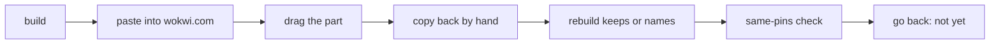
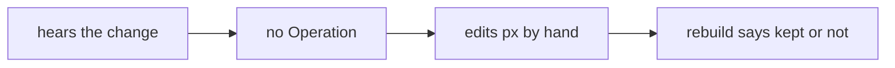
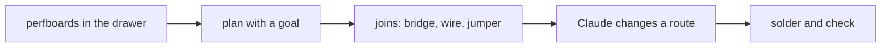

# Jobs and journeys
<!-- Tags as in the brief: E with a pointer, H with its source, D with who and when; an unknown is —. -->

## Who
<!-- One line per persona: who · evidence status (E pointer | H source).
e.g. `- Team leads who assign work · H Lena's belief, no interview yet` -->
- The maker: a person who builds a gadget with spark and Claude, wires it on a breadboard and later solders it on a perfboard. The PO is the one maker with evidence · E #1747 (his words, 2026-11-26), E #311 (his three notes, 2026-11-26), E #352 (his words, 2026-10-18)
- Claude, or another agent, which runs spark's Operations for the maker and changes the layout on request ("Spark plans, Claude changes") · E #311 note 1, E #352 ("I would like to just kind of tell Claude, and he would do it for me on the board") <!-- REQUIRED:who -->

## Jobs
<!-- One job story per line, each clause tagged: When …, I want to …, so I can ….
e.g. `- When I assign a task in a meeting [E tickets.csv:6], I want the assignee to see it that day [H Lena], so I can stop chasing people [E tickets.csv:7]` -->
- J1 · When spark plans my breadboard or perfboard [E #1747], I want to choose a goal, the smallest board or the whole board used [E #1747 "options to go for the smallest size or to take up the whole perfobard and use the space"], so I can fit the board I own or have room to solder [H the facilitator]
- J2 · When my circuit goes onto a perfboard [E #311], I want spark to route each connection as a solder bridge, a bare wire or an insulated jumper, with few jumpers [E #311 note 3], so I can solder it from the plan [E #311 Done when, "a button-light perfboard layout that the circuit check accepts"]
- J3 · When I or Claude move a part or a wire [E #1747 "being also able for humans to edit the connections and move the parts around"], I want the move to stay after a rebuild, or spark to say why not [D P269 D11, 2026-10-16], so I do not redo my work [H the facilitator]
- J4 · When I ask Claude to change the layout, for example "put the buzzer there and connect it to pin 20" [E #352], I want Claude to do it through spark [E #311 note 1 "Spark plans, Claude changes"], so the change is checked and kept like my own [D P1193 D-e on #1699]
- J5 · When a layout change went wrong [H the facilitator], I want to go back to an earlier layout [E #1747 "Does it also support the steps reverting"], so I can try again from a layout that worked [H the facilitator]
- J6 · When I look at my breadboard or perfboard on the project's page [E #1747 "What about the webeditors for them?"], I want to move parts and wires there by hand [E #1699, E #1698], so I can fix a detail faster than I can say it [H the facilitator]
- J7 · When spark gains a new surface, such as the perfboard, the PCB's placement draft or a circuit sculpture [E #1747 scope], I want it to reuse the one layout core and its strategies [E #1747 "Can we refactor out some protocole or omdule or class"], so nothing is built twice and a strategy can change in one place [E #1747, his standing rule]
- J8 · When I own perfboards of some sizes [E #311 note 2], I want spark to plan on the smallest one I own that fits, which I can cut down [E #311 note 2 "they can be made smaller but not bigger"], so I use what is in my drawer [H the facilitator] <!-- REQUIRED:jobs -->

## Today they…
<!-- Per job: what they do instead today (a competitor, a workaround or nothing), tagged.
e.g. `- Job 1 · paste each task into Slack by hand · E tickets.csv:7` -->
- J1 · spark places by the first fit, left to right, with no goal. The board is spark's full board or Wokwi's half board · E scripts/spark/breadboard/drawing.py:249-297, scripts/spark/breadboard/sheet.py:260-274
- J2 · nothing: P275 #311 is not built, and no perfboard code exists · E pre-analysis.md §1
- J3 · the maker pastes breadboard.json into a new project on wokwi.com, moves parts there, and copies the diagram back. The next build keeps each part that still fits and names the rest · E scripts/spark/breadboard/drawing.py:555-556 (the sheet's words), scripts/spark/breadboard/kept_moves.py:1-17
- J4 · no Operation moves a part. Claude can only edit breadboard.json as text, and the next build keeps or names the move · E scripts/spark/operation_catalogue.py (no layout table) · H that Claude edits the file by hand, not observed
- J5 · nothing in spark for the layout. breadboard.json has no stamp, and a maker with git can restore it by hand · E P1193 brief ★C15
- J6 · no editor exists. wokwi.com is the only editor, by the paste round trip in J3 · E P294 finding §1 (docs/discovery/2026-10-18-p294-wokwi-reuse/finding.md)
- J7 · three layout engines share no code: the breadboard planner in px, the PCB's fixed column in mm, and tscircuit's autorouter · E pre-analysis.md §1, G8
- J8 · nothing: the drawer has no perfboard record kind · E #311 note 2 ("It needs a perfboard record kind in the store") <!-- REQUIRED:today -->

## Journeys
<!-- One ### per actor and scenario: the table, then a Mermaid flowchart of the same steps. Never a Mermaid
journey block: it forces a score on every task. "n/a — a one-step job" may replace both.
e.g. `| 2 | opens the app | E analytics, 90 days | never sees the task | not yet | Do they read email? |` -->
### The maker — moves a part on the breadboard, today <!-- REQUIRED:journey -->
| step | what they do | evidence | friction or harm | today | open question |
| --- | --- | --- | --- | --- | --- |
| 1 | builds, and gets breadboard.json and breadboard.svg | E sheet.py:290-325 | none | works | — |
| 2 | opens wokwi.com, makes a new project and pastes breadboard.json into its diagram.json | E drawing.py:555-556 | leaves spark and the page, needs an account on wokwi.com | works | How often did the PO do this round trip? (account question) |
| 3 | drags the part in Wokwi | E P294 finding §1 | Wokwi does not know spark's rules: a body over a hole, a row shared | works | — |
| 4 | copies the diagram back into breadboard.json by hand | H, the sheet names no way back | a wrong paste breaks the file. Spark then says "is not a Wokwi diagram of spark's kind" and keeps nothing | partly | — |
| 5 | rebuilds. Spark keeps each part that fits and names each one it could not keep | E kept_moves.py:1-17, :233-255 | the move is found by a diff with a fresh plan, so a move to the place spark would pick is not seen as a move | works | — |
| 6 | reads the same-pins check | E drawing_match.py, D P279 (2026-10-18) | none | works | — |
| 7 | wants the layout before the move back | E #1747 | no step keeps breadboard.json | not yet | — |

### Claude — asked to move a part and connect it, today
| step | what they do | evidence | friction or harm | today | open question |
| --- | --- | --- | --- | --- | --- |
| 1 | hears "move the LED two columns right" | E #352 (his example of a spoken change) | none | works | — |
| 2 | looks for an Operation that moves a part | E operation_catalogue.py | none exists, and `--describe` lists none | not yet | — |
| 3 | edits breadboard.json as text, in Wokwi's px | H, not observed | Claude must compute px from holes. A wrong number puts a pin off a hole | partly | Does Claude edit breadboard.json today, in any project log? |
| 4 | rebuilds and reads what was not kept | E kept_moves.py:233-255 | the reason comes after the edit, never before | works | — |

### The maker — puts the circuit on a perfboard, today
| step | what they do | evidence | friction or harm | today | open question |
| --- | --- | --- | --- | --- | --- |
| 1 | says which perfboards are in the drawer | E #311 note 2 | no record kind | not yet | — |
| 2 | asks for a plan on the smallest that fits, or on the whole board | E #1747 | no placement goal, no perfboard surface | not yet | — |
| 3 | reads where each bridge, bare wire and jumper goes | E #311 note 3 | no router for joins | not yet | What current runs in the PO's perfboard projects? |
| 4 | asks Claude to change one route | E #311 note 1 | no Operation | not yet | — |
| 5 | solders it and checks it | E #311 Done when | no check | not yet | — |

