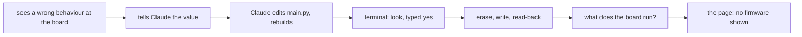
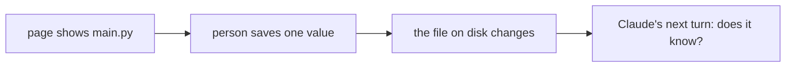

# Jobs and journeys
<!-- Tags as in the brief: E with a pointer, H with its source, D with who and when; an unknown is —. -->

## Who
<!-- One line per persona: who · evidence status (E pointer | H source). -->
- The maker is the PO. He directs Claude and types few commands · E scrum/VISION.md ("Who it is for"), the walk diaries and the store's board record (council/user-ux.md, UX-1 to UX-3), n = 1 <!-- REQUIRED:who -->
- Claude in the conversation is the second writer of `firmware/main.py`. It must see an edit made on the page · E council/user-ux.md, UX-1 (17 of 18 commits of main.py carry a Claude co-author line), UX-9 · H UX-19
- The hobbyist who is at home in a terminal, and a stranger with no Python (P218 D11's revisit condition) · H scrum/VISION.md:38, council/po-assistant.md, PO-3. Nobody outside the project installed spark yet

## Jobs
<!-- One job story per line, each clause tagged: When …, I want to …, so I can …. -->
- J1 · When Claude changed the firmware and I am about to deploy [E council/user-ux.md, UX-2, UX-3], I want to read what main.py and pins.py hold [H the PO's words on #1748, "display of the generated code"], so I can check it before the flash [H] <!-- REQUIRED:jobs -->
- J2 · When I saw something wrong at the board, such as a flipped picture or a slow refresh [E UX-2, p934-display2 diary], I want to change one value myself [H #1748, "on the page editing", with no observed case, PO-2], so the next deploy carries it without a round through the chat [H UX-17]
- J3 · When a deploy ends [E UX-15: 11 of 28 deploys of 22 and 23 November ended "ready unknown"], I want to see what the board runs now [H], so I know whether my change is on it [H P1038 D10, a read-back in plain words]
- J4 · When I deploy [E UX-3: 24 of 28 deploys had a yes typed in the terminal], I want to give the look and the yes where I already am, with no long line to copy [E UX-4, bench-2026-11-25 notes 1, 6, 9, 14, 17], so the loop is shorter [H]
- J5 · When the person changed main.py outside its turn [H UX-19], Claude wants to learn of it at its next turn [E UX-9, a FileChanged hook gives Claude no context], so it does not undo the change by a whole-file write [H UX-19]

## Today they…
<!-- Per job: what they do instead today (a competitor, a workaround or nothing), tagged. -->
- J1 · asks Claude what the firmware does, or opens the file in an editor. Thonny, VS Code and Cursor are on his Mac, use for firmware unknown · E council/po-assistant.md, PO-2 · the page shows only the file time of main.py (preanalysis.md, section 4) <!-- REQUIRED:today -->
- J2 · tells Claude in the chat, and Claude edits the file. 17 of 18 commits of main.py, three projects · E UX-1. His one hand edit was a Wi-Fi value in a gitignored secrets file · E UX-1, UX-16
- J3 · reads the deploy's output in the terminal, or asks spark-main · E UX-4, UX-15
- J4 · types yes in his own terminal, or types a 60-minute standing yes once (P1028) · E UX-3, UX-5
- J5 · Claude reads the file again before an edit. No record tells it that the person changed the file · E UX-9 · H UX-19

## Journeys
<!-- One ### per actor and scenario: the table, then a Mermaid flowchart of the same steps. -->
### The maker, change one value after seeing the board (the p934-display2 walk, 22 and 23 November) <!-- REQUIRED:journey -->
| step | what they do | evidence | friction or harm | today | open question |
| --- | --- | --- | --- | --- | --- |
| 1 | sees a wrong behaviour at the board (the picture upside down, a slow refresh timed with a stopwatch) | E UX-2, diary.md:468 | none, this is where the change starts | works | — |
| 2 | tells Claude in the chat which value to change | E UX-1, UX-2 | none observed. Whether he wanted to type the value himself is unknown | works | QA1, QA2 in council/user-ux.md |
| 3 | Claude edits main.py and rebuilds the image | E UX-10, commands/deploy.md:111-113 | a change that misses the rebuild looks deployed but is not | works | — |
| 4 | switches to his terminal, runs the look and types yes | E UX-3, UX-4 | long lines cut on paste, one-line yes prompt, esptool's raw output | partly | QA8 |
| 5 | erase, write (about 109 s for 4 MB) and read-back | E PO-13, bench-2026-11-25 note 20 | the board must be at hand for RESET and BOOT (UX-14) | works | — |
| 6 | finds out what the board runs | E UX-15 | 11 of 28 deploys ended "ready unknown" | partly | QA6 |
| 7 | opens the page | E UX-5, P1038 brief.md:45 | the page shows nothing of the firmware and says deploy "not started" beside 27 deploys | not yet | QA3 |

### Claude, the person edited main.py on the page (no case yet, a scenario from the lenses)
| step | what they do | evidence | friction or harm | today | open question |
| --- | --- | --- | --- | --- | --- |
| 1 | the page shows main.py as Claude last wrote it | H | the page shows an older copy if Claude wrote since the page was made | not yet | QD3 |
| 2 | the person changes one value and saves | H UX-2 | the fingerprint reads nothing in `firmware/` (fingerprint.py:17-36), so a save on an old copy is not refused | not yet | QD3 |
| 3 | the edit reaches the file on disk: in the Artifact through Claude's own `/spark:page` run, on a local host by the host itself | E UX-8, UX-9, architecture.md AR-2 | a host that writes the file directly does not tell Claude | not yet | QD5 |
| 4 | Claude's next turn | H UX-19 | a whole-file write from Claude's copy in context undoes the person's edit | not yet | QD5 |

