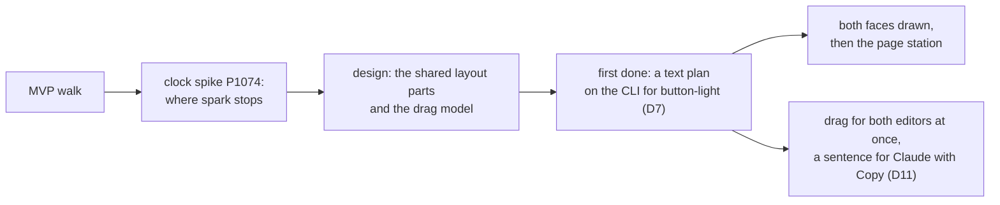

# The perfboard step: discovery, the short version

Card P1352 [#1939](https://github.com/xmejkal/spark/issues/1939), a sub-issue of P1199 [#1747](https://github.com/xmejkal/spark/issues/1747). The brief is [brief.md](brief.md). This page sums it up.

## Where it stands

The discovery is ready for an experiment: the clock spike P1074 [#1575](https://github.com/xmejkal/spark/issues/1575), after the MVP walk. The design comes after it, on the PO's order. The PO confirmed the frame (D1), the jobs, the direction and the remaining risk (D14). No design and no refactor is written before the spike's finding (D5, D6).

## What the PO decided

| D | Decision |
| --- | --- |
| D3, D4 | Only A1 ("you solder soon") rates high. No test for it. The design covers the whole step, each part tagged faintly with its slice (D16). |
| D5, D6 | The clock spike runs first, after the MVP walk. The refactor is decided after its finding. |
| D7 | The first done result is a text and JSON plan on the CLI, with the same-pins check passing. |
| D8 | The dev board goes on female headers by default, through a setting `perfboard.board_mount`. |
| D9 | The person picks the board each time, and spark spreads the parts over it. |
| D10 | No gadget is planned for a perfboard yet. Button-light is the example. |
| D11 | The drag comes for the breadboard and the perfboard editors at once. |
| D12 | Spike P1239 reads Perfboard Designer's licence and router first. |
| D13 | He turns a board over like a page, so the back view mirrors left to right. |

## What the code shows

- The same-pins check joins only the two ends of a jumper. A perfboard bare wire joins every pad it lies on, so the check must read each join as a set of holes (★C15).
- The router's search loop is generic, but its start legs, state and goal are breadboard rules, so the worth of sharing it is still a guess (★C13). Its penalties are class attributes and become one named value per surface (★C14, D-h).
- First fit refuses parts on single pads because of the free-hole rule of P412, in one in-memory trial (★C10). Three pieces fail with no row letters (★C11).
- drawing.py has 599 of 600 lines (★C19). The breadboard area has no Operation (★C21).

## The whole around the perfboard (rough, D17)

A rough pass over the features around this step, each with its slice. The tags are rough and can change.

| Feature | Its card | Rough slice | Link to the perfboard |
| --- | --- | --- | --- |
| The breadboard sheet and its layout | P1199 #1747, P1237 #1790 | after the MVP | shares the surface, the placer, the search and the check |
| The drag editors for both boards | P1163 #1699 | after the perfboard's text plan (D11) | one drag model, one sentence for Claude with Copy |
| The settings layer | P1194 #1740 | after the MVP | `perfboard.board_mount` and the router's weights get their layer |
| A photo of the wired or soldered board | P1164 #1700 | later | reads the real board back into the plan |
| The PCB to order | P79 #16 | later | a tested perfboard's places in mm start the PCB draft (H) |
| The CAD model and the enclosure | P203 #163, P1197 discovery | later | the soldered board's size and its parts' heights |
| Stripboard | #310, closed | dropped (D-a) | none |

## What comes next

- The six proposed cards are in [items.md](items.md). Filing needs the PO's yes.
- The canvas artboards Perfboard and LayoutPerfboard are redrawn to D8 to D13. The drag screens for both editors come with them, and each gets its row on the Built board.
