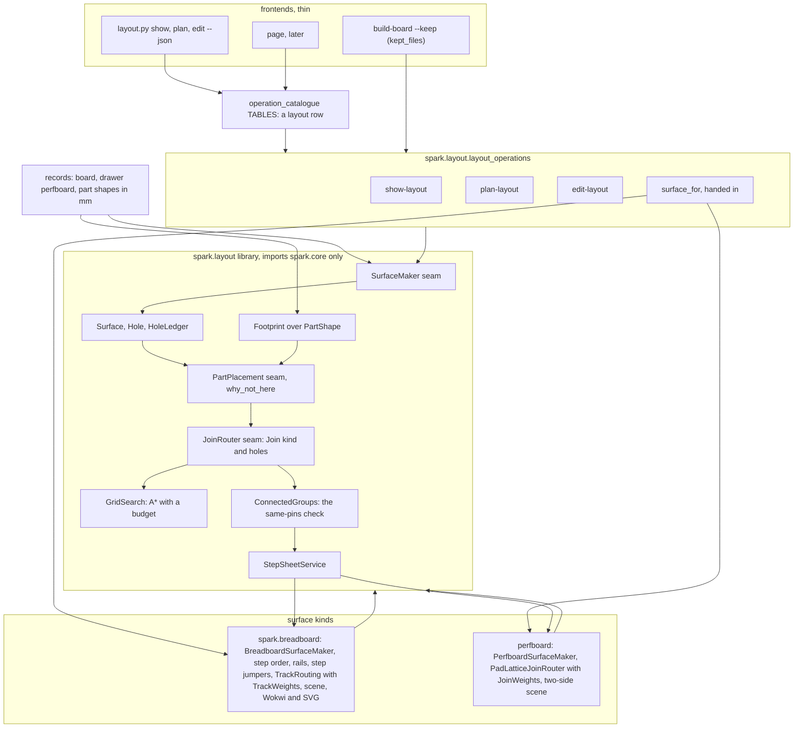

# P1352 council: the architecture lens (ARCH)

The architecture lens on Opus, 2026-11-28. Read-only at f975a3ab (branch of the worktree spark-wt-perfboard). Line
numbers are from that commit. This lens decides nothing. It builds on P1199's lens (ARCH-1 to ARCH-19) and its
synthesis, and repeats a P1199 finding only where the perfboard changes it. E is a pointer I read. H is this lens's
proposal or inference. No file I read asked me to run or change anything.

## The short version

- The plan already has a seam for joins, and it runs before the same-pins check. `JumperPlacement.place_jumpers` is
  called at the end of the plan, and the check reads its output. The perfboard's join router is a member of that seam,
  renamed `JoinRouter`. It needs no seam in the scene [E scripts/spark/breadboard/drawing.py:240-246, :371, sheet.py:312-314].
- What the two routers share is the search loop, not the router. The A* loop with its budget is surface-neutral. Its
  moves, its estimate and its rules are the breadboard's picture rules [E wire_routing.py:232-259 against :261-330].
- The penalties become one Value per router, handed in through the constructor with today's numbers as defaults. So
  the bytes stay, and the PO can play with the numbers [E wire_routing.py:198-207, H].
- Spark repeats itself in five places today: two half-pitch grids, three readings of connectivity, two header-pad
  placers, three body models and two Wokwi readers [E below].
- Nothing in `scripts/spark/breadboard` moves before P1350 merges, and the first move must split `drawing.py` (599 of
  600 lines) [E tools/measure.py:242].
- Two misfits go to the PO: P1199 D3 against his words of 2026-11-28, and two package cycles that a shared area must
  not inherit [E below].

## 1. Inventory of the layout jobs

Marks: BB is breadboard-only. SH is shareable as is. SEAM is shareable behind a seam, and the seam is named.

| Job | Class or function | Where | Mark | Why |
| --- | --- | --- | --- | --- |
| hole | `Hole` (name, x, y, group, column) | drawing.py:28 | SEAM | px and a column. A perfboard hole needs a cell (column, row) and a side. ARCH-10's unit question |
| surface | `Surface.__init__` | drawing.py:106-138 | SEAM | the constructor reads letters, rails, rail blocks and `by_gap`, all breadboard words. The holes list, `pitch` and `hole_at` are shareable. Seam: a surface maker per kind |
| surface | `Surface.load_full`, `WokwiGeometry` | drawing.py:140-187 | BB | spark's full board and Wokwi's measured file |
| ledger | `HoleLedger.claim`, `is_free`, `group_is_free`, `claim_free_hole` | drawing.py:189-217 | SH | a set of taken holes by name. On a perfboard each group is one hole, so the same code works. `claim_free_hole`'s float tie stays as ARCH-11 says |
| ledger | `HoleLedger.claim_free_group` | drawing.py:219-226 | BB | "the first free row right of column `after`" is a breadboard rule |
| footprint | `rotate` | spacing.py:10-19 | SH | pure geometry |
| footprint | `BodyBox`, `BodyBox.columns` | spacing.py:21-45 | SEAM | in px, `columns` reads a breadboard's columns |
| footprint | `PartShape` (mm) | part_shape.py:35 | SH | the fact in mm. The perfboard needs exactly this |
| footprint | `ShapeSource`, `WokwiGeometryShapeSource`, `RecordShapeSource`, `ModuleShapeSource`, `sources_for` | part_shape.py:61-367 | SEAM | they read design's `footprint_emitter` (part_shape.py:24). The module imports a view, `breadboard_scene`, for a label constant (:23, :42) |
| footprint | `project_to_px` and its view flags | part_shape.py:42-58 | BB | facts and view hints in one dict (`usb_mark`, `labels`, `pad_labels`, `full_surface`) |
| footprint | `OneRowHeaderPlacer` | part_shape.py:231-261 | SEAM | see D3 below |
| placement | `PartPlacement` | drawing.py:229-237 | SEAM | the interface carries `after` and `pinned`, the breadboard's bounds (ARCH-3) |
| placement | `FirstFitPartPlacement.place`, `_fit`, `_covered`, `_pins_keep_a_free_hole` | drawing.py:249-325 | SEAM | the loop over turns and candidate holes is shareable. `tall_module_row`, `body_gap_columns` and `after` are the breadboard's. `_fit` has 6 parameters in the R3 baseline (tests/architecture_baseline.json:47) |
| placement | `BreadboardPlanner.plan` and its helpers | drawing.py:328-458 | BB | step order, resistor pass, rails, crowded. It calls the two seams |
| placement | `BodySpacing`, `tall_module_row`, `ends_toward_their_runs` | spacing.py:48-122 | BB | columns between bodies on a breadboard |
| placement | `RailSeating`, `rail_holes_under` | rails.py:10-50 | BB | rails |
| placement | `board_components.place` | design/board_components.py:143-181 | SEAM, later | the PCB draft, free mm from the centre, y up. See D5 |
| joins | `JumperPlacement` | drawing.py:240-246 | SEAM | the plan-side seam for joins. Its members today: the default (keeps the planner's holes) and `KeepMovesJumperPlacement` (kept_moves.py:262) |
| joins | `Jumper` | drawing.py:36 | SEAM | `role` and `pill_words` are a view's. A `Join(kind, holes)` is the shared fact |
| routing search | `TrackRouting._search`, `_back`, `_step` | wire_routing.py:232-259, :333-338, :370-371 | SH | A* over cells with a heap, a closed set and a state budget. Nothing in it is a breadboard word |
| routing rules | `TrackRouting._estimate`, `_moves`, `_open`, `_bend_ok`, `_band_full`, `_leg_ok`, `_clear_of_ends`, `_taken`, `_along_the_holes` | wire_routing.py:261-367 | BB | odd tracks, legs along a column, bands, rings round an end. ARCH-2 holds |
| routing grid | `TrackGrid` | wire_routing.py:106-160 | SEAM | the half-pitch lattice is shareable, its origin from `letters_y` (:120) is not |
| routing grid | `SceneGrid` | breadboard_scene.py:105-125 | SEAM | the same lattice again (D1 below) |
| routing | `JumperRouter`, `LaneJumperRouter`, `TrackJumperRouter` | wire_routing.py:45-177 | BB | picture routers, chosen in the scene maker (breadboard_scene.py:187) |
| costs | `CELL, OUTSIDE, BESIDE_A_LINE, BEND, CROSS`, `MAX_BENDS, FALLBACK_BENDS, BAND`, `TRIES`, `LEG_CLEARANCE`, `BUDGET` | wire_routing.py:198-207 | SEAM | class attributes. P1350 adds `END_CLEARANCE_PX` beside :205 (store plans/p1350-plan.md, S2). The bare `2` for one pitch has no name (the same plan, "Three repeats") |
| same-pins check | `DrawnNets`, `DrawingDiffersResult` | drawing_match.py:29-93 | SEAM | union-find over groups by jumpers and Wokwi's `joined_pins` (:43-51). It reads `drawing.end_group` (:68), the breadboard catalog's map from an end to a group |
| connectivity | `wiring_steps.points` | wiring_steps.py:311-341 | SH | the circuit's points, transitive (ARCH-13) |
| connectivity | `BreadboardSceneMaker._joined_groups` | breadboard_scene.py:249-256 | SEAM | a third reading of "which groups join" (D2) |
| scene | `BreadboardSceneMaker.make` | breadboard_scene.py:194-209 | SEAM | marks, bodies, router, pills, captions, labels. A perfboard scene reuses captions, pictures and labels, not marks or the track router |
| scene | `PadLabelLayout` and members, `PartCaption`, `part_pictures` | breadboard_scene.py:33-79, part_captions.py, part_pictures.py | SH (H) | D-e wants the breadboard's part pictures without pins. Not read line by line |
| scene | `BoardMarks`, `BoardBackground` | board_marks.py, svg_diagram.py:31-77 | BB | the breadboard's printed letters and rails |
| renderers | `WokwiBreadboardDiagram`, `SvgBreadboardDiagram` | drawing.py:543-594, svg_diagram.py:79-255 | BB | Wokwi has no perfboard |
| step sheet | `sheet.sheet`, `_read_build`, `_check_fresh`, `_parts_table`, `_have`, `_plan_once`, `write` | sheet.py:119-515 | SEAM | one module of 515 lines with 18 imports (sheet.py:15-33). Reading the build, the parts table, the "have" column and the record staging are surface-neutral. The plan, the kept moves and the drawings are the breadboard's |
| step sheet | `BreadboardSteps`, `RowAnchor`, `RailAnchor`, `NumberedList`, `MermaidDiagram` | wiring_steps.py:70-276 | BB | the step model is rows and rails |
| bench changes | `WiringLog`, `WiringLogStore`, `changes_between`, `ChangeList` | bench_changes.py:141-346 | SEAM | it keys steps by their ends, "never by holes" (bench_changes.py:4). A perfboard rebuild could reuse the keys. It reads `wiring_steps` words (:25) |
| kept moves | `EarlierDiagram`, `KeepMovesFirstFitPartPlacement`, `KeepMovesJumperPlacement`, `name_*_not_kept` | kept_moves.py:63-340 | BB, goes | P1199 D4 replaces it with `.spark/layout-edits.json` and a Decorator |
| px edge | `_round_px` | drawing.py:596 | BB | imported as a private name by wire_routing.py:26 and svg_diagram.py:20 (ARCH-10, still open) |
| px edge | `PX_PER_MM` | part_shape.py:26 | BB | the one mm-to-px factor |

## 2. Findings

- ARCH-P1 · The plan-side join seam exists. `BreadboardPlanner.plan` ends with `self.jumper_placement.place_jumpers(layout, parts_only)`, and `_plan_once` runs `DrawnNets(...).differences` on that layout before any scene is made. So the order that P1199's ARCH-1 asked for (route in the plan, then check) is already the order of the code. The perfboard's router is one more member of this Strategy. Rename the seam `JoinRouter` with `route(layout, ledger)` when the perfboard comes. The picture router stays in the scene. · E · drawing.py:240-246, :371-372 · sheet.py:312-314, :489 · breadboard_scene.py:198
- ARCH-P2 · Share the search, not the router. `_search` holds a heap of (estimate, cost, state), a closed set, parents, a budget and two counters. It calls only `_moves`, `_estimate` and `_leg_ok`. A `GridSearch` with `find(starts, goal, moves, estimate)` serves both routers. The breadboard's `TrackRouting` keeps its rules as its `moves`. The perfboard router gets its own `moves` over the hole lattice on two sides, with a state of (cell, side, came, bends). The risk is the counters. `cut_short` is pinned exactly and `expanded` by a bound, and both depend on the heap's tie order. The tuple (f, g) + state must stay as it is. · E · wire_routing.py:232-259, :236-241 (the start legs are a rule inside the loop), tests/test_wire_routing.py:180-187 · H the interface
- ARCH-P3 · The penalties as one named Value per router. Today they are class attributes of `TrackRouting`, read as `self.CELL` and so on. A Value `TrackWeights(cell=1, outside=2, beside_a_line=2, bend=4, cross=6, most_bends=4, fallback_bends=8, band=4, leg_clearance_px=2.5, end_clearance_px=5.8, budget_states=60000)` handed to `TrackRouting(layout, obstacles, weights=TrackWeights())` keeps every byte at the defaults. The perfboard gets `JoinWeights` with its own fields (bridge, bare wire, jumper, bend, cross, budget). They share no fields, so one class for both would be a bag. "Cost" means money in spark's rules, so the word is "weights" and the docstring quotes the PO's "penalties". The unnamed one-pitch gap (the bare 2) gets a field only when P1194 lets it move the counters. A setting for them waits on P1194 (D-j). The spark layer is the code default. · E · wire_routing.py:198-207, :240, :288, :296-297 · AGENTS.md ("Name any cost and ask first") · store plans/p1350-plan.md ("The router's penalties and limits") · H the names
- ARCH-P4 · P1350 owns wire_routing.py now. Its pieces: `END_CLEARANCE_PX` beside :205, a module function `is_beside_an_end`, the ring loop of `__init__` (:212-216), and `DASHED_NOTE` in breadboard_scene.py:150-151 reading `MAX_BENDS`. No move above touches wire_routing.py until P1350 merges. ARCH-P2 and ARCH-P3 then rebase onto it and add `end_clearance_px` to the Value. · E · store plans/p1350-plan.md S2 to S4
- ARCH-P5 · The perfboard's same-pins check is `DrawnNets` with two inputs handed in. On a perfboard each hole is its own group, so the union-find works unchanged once it joins the holes of each `Join` in place of `jumper.one.group` and `jumper.other.group`. It needs (a) the joins and (b) a part's inside contacts from a source that is not Wokwi's file, since a perfboard part has no Wokwi geometry. Its codes are hyphenated strings, which the core's `Finding.of` refuses (P1199 synthesis, "The codes"). They change once, in the move, with docs/guide/agents/scripts.md. · E · drawing_match.py:18-20, :43-51, :68 · docs/guide/agents/scripts.md (names them)
- ARCH-P6 · The step sheet is the biggest repeat waiting to happen. `sheet.py` reads the build, checks it is fresh, writes the parts table with its "have" column, plans, keeps moves, checks, makes the scene, stages the record and writes four files. A perfboard sheet written beside it would copy the first three and the last two. Shape: a `StepSheetService` that runs those steps, with a `SurfaceSheet` Strategy per kind for the plan, the step words and the drawings. Build it when the perfboard sheet is built, not before. · E · sheet.py:119-260, :476-515 · H the shape
- ARCH-P7 · `drawing.py` still has 599 lines, the limit is 600, and the baseline has no R1 entry for it. Every move below starts by taking the Wokwi renderer and `_round_px` out of it. `sheet.py` has 515. The new modules' names are free under C1 (I checked surface, footprint, placement, joins, grid_search, layout_operations, step_sheet, layout_edits). · E · tools/measure.py:242, :291 · `wc -l` · `find scripts -name <name>.py` gave none

## 3. Duplication: almost the same thing twice

- D1 · Two half-pitch grids. `SceneGrid` says it turns px into cells "as the router's TrackGrid does". Both take `pitch / 2`, the origin from the first terminal hole and `min(letters_y)`, and the same `cell` and `point`. One `HalfPitchGrid` Value with the origin and step. `TrackGrid` adds its obstacles to it. The scene grid becomes a call. · E · breadboard_scene.py:105-125 · wire_routing.py:117-120, :130-134, :153-154
- D2 · Connectivity read three times. The circuit's points by union-find, the drawing's nets by a second union-find, and the scene's "groups that join something" by a third rule. One `ConnectedGroups(groups, joins, contacts)` in the shared area serves the check and the scene, on both surfaces. ARCH-13 named two of them. · E · wiring_steps.py:318-323 · drawing_match.py:53-62 · breadboard_scene.py:249-256
- D3 · Header pads placed twice. `OneRowHeaderPlacer.place` (top-left origin, y down) and `footprint_emitter.pads` (centre, y up) each put pad n at the first pad's offset plus n pitches along a flush edge. `RecordShapeSource` already flips the second into the first frame. One pad placer with a frame Adapter would serve the PCB, the breadboard and the perfboard. The two handle different cases (one row against two flush rows), so "almost the same" is H until a test runs both on one record. · E · part_shape.py:231-261 · design/footprint_emitter.py:225-261 · part_shape.py:7-9 (the flip)
- D4 · The body three times, still. `BodyBox` in px, `board_components.body_of` in mm with an invented 16 by 12 mm default, `PartShape` in mm that refuses a missing `body_mm`. Unchanged since ARCH-12. The perfboard is the second caller that needs mm, so it is the moment to drop one. · E · spacing.py:21-45 · design/board_components.py:15-23 · part_shape.py:35
- D5 · Three placements. The breadboard's first fit on holes, the PCB draft in free mm, and the perfboard's on holes to come. The perfboard can use the breadboard's loop on its own surface. The PCB draft cannot yet (no hole lattice), but a tested perfboard's places in mm are a better start for it than its column of bodies. That link is H and later. · E · drawing.py:249-297 · design/board_components.py:143-181
- D6 · The pitch in two units. The breadboard's pitch is 9.6 px in data, the checks hold `HEADER_PITCH_MM = 2.54`, and the drawer's perfboard will hold its pitch in mm (D-c). A surface carries `pitch_mm` from its record. The breadboard's comes from 9.6 / `PX_PER_MM`. · E · build_check.py:83 · part_shape.py:26 · wire_pills.py:17
- D7 · Wokwi's file read twice and written once (ARCH-14), still open. It goes with kept_moves.py under P1199 D4, so it needs no perfboard work. · E · kept_moves.py:89-150 · drawing.py:543-594 · sheet.py:338-343

## 4. The shape

A new area, `scripts/spark/layout`, whose library modules import `spark.core` only (P1199 synthesis, part 2). The
surfaces sit above it. The Operations take a `surface_for` builder in their constructor, with the real builder as
default, so the catalogue's rule "every entry builds with no argument" holds [E operation_catalogue.py:8-10].

| Piece (H) | Role | Job | Chosen by |
| --- | --- | --- | --- |
| `Hole`, `Surface`, `HoleLedger` | Value, Value, Value with claims | the holes, their groups and pitch, the taken holes | |
| `SurfaceMaker` | Strategy | `make(record) -> Surface`. Members: `BreadboardSurfaceMaker` (in spark.breadboard), `PerfboardSurfaceMaker` (the drawer record, every hole its own group, two sides) | setting `layout-surface`, project layer |
| `Footprint` over `PartShape` | Value | a part's pins as whole-hole offsets per turn, and its body in mm | |
| `PartPlacement` with `place_all(parts, ledger, fixed)` and `why_not_here` | Strategy | members `first-fit` (breadboard), `spread` (the perfboard's roomy, D7 of P1199) | setting `layout-placement` |
| `JoinRouter` | Strategy | `route(layout, ledger) -> [Join(kind, holes)]`. Members: the breadboard's step jumpers (today's `JumperPlacement`), `PadLatticeJoinRouter` (bridge, bare wire, jumper) | setting `layout-join-router`, the surface's default |
| `GridSearch` | Service | A* with a budget over any `moves` and `estimate` | |
| `TrackWeights`, `JoinWeights` | Value | every penalty and limit of one router, with its unit | code defaults now, P1194 later |
| `ConnectedGroups` | Value | the groups the joins and the contacts connect, and `differences(points)` | always on |
| `StepSheetService` with `SurfaceSheet` | Service, Strategy | the sheet's shared steps, and the per-surface words and drawings | the surface |
| `show-layout`, `plan-layout`, `edit-layout` | Operation | P1199's three, one table `spark.layout.layout_operations` | |

The data flow: a record makes the surface, the parts are placed on it, the join router joins them in the plan, the
check reads the joins, then the sheet Service hands the layout to the surface's own scene and words.

## 5. The moves, in order, and what each risks

Each move keeps the 9 golden breadboards byte for byte unless it says otherwise. D13 of P1199 allows only the rebuild
golden to change, and only with the edits record.

1. `drawing.py:543-596` (the Wokwi renderer, `_round_px`) to `spark/breadboard/wokwi_diagram.py`, with `round_px`
   public. Risk: none to bytes. It frees R1 room (ARCH-18).
2. After P1350 merges: `breadboard_scene.SceneGrid` and the origin of `wire_routing.TrackGrid` into one
   `HalfPitchGrid` in `spark/breadboard`. Risk: low. Both round the same way (D1).
3. After P1350 merges: `TrackRouting`'s class attributes (wire_routing.py:198-207 plus `END_CLEARANCE_PX`) into a
   `TrackWeights` Value in wire_routing.py. Risk: none at the defaults. A test pins each default.
4. `TrackRouting._search`, `_back`, `_step` (wire_routing.py:232-259, :333-338, :370) to `spark/layout/grid_search.py`.
   Risk: the heap's tie order. `cut_short` is pinned exactly (tests/test_wire_routing.py:180-182). Prove with the
   router's tests and the goldens before anything else moves.
5. `Hole`, the shared part of `Surface`, `HoleLedger` without `claim_free_group` (drawing.py:28, :106-148, :189-217)
   to `spark/layout/surface.py`. `BreadboardSurfaceMaker` keeps letters, rails and `by_gap` in spark.breadboard.
   Risk: ARCH-11's rail ties if the unit changes in the same move. Keep px here and change the unit alone.
6. `DrawnNets` (drawing_match.py:36-93) and the two other unions (wiring_steps.py:318-323, breadboard_scene.py:249-256)
   to `spark/layout/joins.py` as `ConnectedGroups`, with `end_group` handed in. Risk: the codes' strings change for
   agents (docs/guide/agents/scripts.md). The goldens print no such code (H, a grep of tests/golden-breadboard found
   none).
7. `PartPlacement`, `JumperPlacement` as `JoinRouter`, and the loop of `FirstFitPartPlacement` (drawing.py:229-297)
   to `spark/layout/placement.py`. The bounds `after`, `pinned` and `tall_module_row` stay a breadboard filter. Risk:
   R3 (`_fit` has 6 in the baseline) and the order of candidates.
8. `PartShape` (part_shape.py:35) to `spark/layout/footprint.py`. The shape sources (part_shape.py:61-367) to
   spark.design beside `footprint_emitter` and `body_of`, which they already read. `project_to_px` stays in
   spark.breadboard, and the import of `breadboard_scene` leaves the fact module. Risk: the order of `SHAPE_SOURCES`
   decides which source draws a board.
9. When the perfboard sheet is built: `sheet.py:119-260` and the staging of `write` (:476-515) to
   `spark/layout/step_sheet.py`. Risk: the sheet's text is the golden. Move only with the perfboard's first sheet.
10. The Operations table `spark/layout/layout_operations.py` and a `TABLES` row. `kept_files.py:267` calls the
   Operation's library in place of `sheet.write`. Risk: the build's time and the JSON contract tests.

Moves 1 to 3 are dry-outs inside the breadboard area. Moves 4 to 10 make the shared area.

## 6. Misfits with the core, for the PO

- MF1 · P1199 D3 says the layout core is built after the MVP, in the first slice that needs it. His words of
  2026-11-28 say "feel free to refactor anytime you think something could be dried out". Which one rules moves 1 to 4,
  which change no byte? I would read the new words as a yes for moves 1 to 3 (inside one area, no new code path) and
  keep D3 for moves 4 to 10. That is his to say. · E · P1199 brief.md D3 · this brief's request
- MF2 · Two package cycles. spark.breadboard imports spark.build (bench_changes.py:26, `StagedFile`) and spark.build
  imports spark.breadboard (kept_files.py:16). spark.breadboard imports spark.sourcing (sheet.py:20) and five sourcing
  modules import spark.breadboard (set_features.py, vendor_documents.py, picture_frame.py, find_documents.py,
  keep_picture.py). A shared area under both must import neither. `StagedFile` is a core-like helper that lives in
  build. · E · the grep above
- MF3 · D-j asks every configurable choice to name its setting, default and layer. P1194 has no layer yet, so the
  weights and the three seams can name only the spark layer as code defaults. That meets D-h ("at least as constants")
  and not yet D-j. · E · brief.md D-h, D-j · H
- MF4 · The breadboard area still has no Operation. The drawing is written only through `build-board --keep`. A
  perfboard plan that only a build writes would repeat that. P1199 G1 named it, and nothing has changed. · E ·
  operation_catalogue.py:27-28 · kept_files.py:267

## What I could not check

- Whether `GridSearch` lifted out keeps `cut_short` and the route bytes. No scratch run was made (no tests, by the
  brief).
- Whether the perfboard's two-side search fits the router's budget on 30 by 70 holes. No code exists.
- Whether `OneRowHeaderPlacer` and `footprint_emitter.pads` agree on a record both can read (D3).
- `part_captions.py`, `part_pictures.py`, `label_measure.py` and `board_marks.py` were read only by their imports and
  the scene maker's calls, so "shareable as is" for them is H.
- P1350's final code. I read its plan, not its branch.

## Searches

None.
