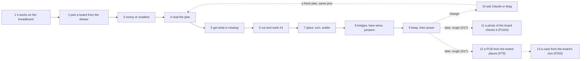
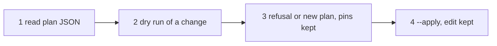
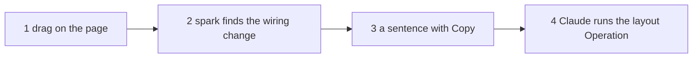

# Jobs and journeys
<!-- Tags as in the brief: E with a pointer, H with its source, D with who and when; an unknown is —. -->

## Who
<!-- One line per persona: who · evidence status (E pointer | H source). -->
- The maker with a tested breadboard who wants it permanent: the PO, n = 1. He asked for "A permanent build" after the clock and the bin ran on the breadboard · E docs/discovery/2026-11-23-p1039-rd-direction/brief.md:115 (D11, an account) · no evidence that he soldered a perfboard before (council/po-assistant.md PA-4) <!-- REQUIRED:who -->
- Claude in the person's conversation, which calls spark's CLI with `--json` and changes a plan for the person ("Spark plans, Claude changes") · E #311 note 1 (D-b), docs/guide/agents.md · H that Claude can change a layout: no layout JSON exists yet (council/user.md UL-5)
- The person who moves a part or a wire on the page (the drag editors, D2), the PO again · E his words on #1699, 2026-11-28 · H that the drag is used before the editors exist

## Jobs
<!-- One job story per line, each clause tagged. -->
- J1 · When my breadboard works and I want to keep the gadget [E P1039 D11], I want spark to plan where every part and join goes on a perfboard that I own [E #311 note 2, D-c], so I can solder it without a second design and keep the tested pins [E #311 note 1, D-b. H: "without a second design" is my reading] <!-- REQUIRED:jobs -->
- J2 · When I solder, board in hand [H council/user.md UL-4], I want one step at a time, each naming its holes and the face to work on [H UL-3, UL-6], so I do not solder the right column in the wrong row [H UL-4, geometry]
- J3 · When the soldering is done [H], I want spark to name the pads to beep and the pairs that must not beep [H UL-8], so I find a solder blob before I power it [E perfboarddesigner.com guide, "Leave a free hole between different connections", read 2026-11-28]
- J4 · When the plan is not what I want (too big, too many jumpers, another board) [E #1747 body: "options to go for the smallest size or to take up the whole perfobard"], I want Claude to change it through spark [E #311 note 1], so I do not edit a file by hand [E D-f: edits only in .spark/layout-edits.json]
- J5 · When I drag a part or a wire on the breadboard or the perfboard editor [E D2, #1699 comment], I want spark to write one sentence for Claude with Copy [E D2: "generate a prompt, or something, when the wiring changes, to copy and say to claude"], so Claude makes the change and the plan stays spark's [E D-b]
- J6 · When spark grows a second surface [E the request of 2026-11-28], I (the PO as the product's owner) want one shared code for holes, placement, routing, the check and the sheet [E the request, D-i], so a fix lands once and the code does not drift [H, his "we don't want to have multiple places in the codebase implementing almost the same"]

## Today they…
<!-- Per job: what they do instead today, tagged. -->
- J1 · nothing in spark. The breadboard sheet is the last layout step. A perfboard plan would be made by hand or in another tool, for example Perfboard Designer (open source, in the browser) · E README.md "What works today", council/tech-lead.md Found on the way <!-- REQUIRED:today -->
- J2 · the breadboard sheet's steps ("Holes: from j4 to f24"), whose words are rows and rails · E tests/golden-breadboard (the xiao sheet, line 25), council/user.md UL-6
- J3 · the breadboard's Points list ("its ends must be joined, and nothing else") · E the golden xiao sheet, line 70
- J4 · on the breadboard: P1199's `edit-layout` is designed, not built. Today a change means a new build · E P1199 D4, P1237 #1790 (in Idea)
- J5 · the page's Ask Claude sentence with Copy exists for the next step (P1290, merged 3b7e6d09, `spark/flow/next_words.py:33`, `flow_codes.py:364`). No drag exists on either surface · E the code, #1699 (Idea)
- J6 · one surface, so nothing is shared yet. Five near-duplicates live inside the breadboard and design areas today · E council/architecture.md section 3, D1 to D7

## Journeys
<!-- One ### per actor and scenario: the table, then a Mermaid flowchart of the same steps. -->
### The maker: from a tested breadboard to a soldered perfboard (the handheld game console on a board he picks, D9, D21) <!-- REQUIRED:journey -->
| step | what they do | evidence | friction or harm | today | open question |
| --- | --- | --- | --- | --- | --- |
| 1 | says the breadboard works and opens the perfboard step | E councils/past-breadboard/architect.md section 1 (the station opens after "it works") | — | not yet | Q3: what done is |
| 2 | picks a board from the drawer | E drawer/dfrobot-fit0193.json, dfrobot-dfr0481.json | the drawer holds no holes across, holes down or pitch, so no board can be planned on (UL-2) | not yet | P1238 calipers |
| 3 | chooses roomy or smallest | E D-f (roomy default), #311 note 2 (smallest that fits) | the two artboards disagree: the plan sets the board, or the board sets the plan (UL-1) | not yet | Q5 |
| 4 | reads the plan: parts, joins with kinds, cut | H UL-5, PA-6 | a bare wire's step names only two ends (UL-3) | not yet | — |
| 5 | gets what is missing: female headers, wire | E no header or socket in the drawer (grep, UL-7) | the plan waits for parts not in hand | not yet | Q4 |
| 6 | cuts the board and marks A1 | H UL-4, TL2-10 | a cut loses one row. Mounting holes cost pads (H) | not yet | Q9 account |
| 7 | places low parts, turns the board, solders | H TL2-10, TL2-19 | the mirror flips left to right only. A top-to-bottom turn puts each joint in the wrong row (UL-4) | not yet | Q9 account |
| 8 | lays bridges, bare wires, then insulated jumpers | E the guide (rails first, then short links) | a bare wire joins every pad it lies on (TL2-3) | not yet | — |
| 9 | beeps the pairs spark names, then powers it | H UL-8 | "Soldered: spark cannot see it" stays open, never a ✓ | not yet | — |
| 10 | asks Claude for a change, or drags a part | E D-b, D2 | Claude has no layout JSON to read (UL-5) | not yet | Q7 |

### Claude: changes a perfboard plan for the person
| step | what they do | evidence | friction or harm | today | open question |
| --- | --- | --- | --- | --- | --- |
| 1 | reads the plan as JSON | E docs/guide/agents/json.md:150-152 (the breadboard's JSON has no layout) | nothing to read: holes and joins live only in text and Wokwi px (UL-5) | not yet | — |
| 2 | asks for a change through an Operation, a dry run first | E the `--move-hold` pattern, json.md:244 | no layout Operation exists on any surface (MF4) | not yet | — |
| 3 | reads the refusal or the new plan, with `pins_kept` true | H UL-5, UL-10 | a change that needs a pin change must be refused and sent to the design area | not yet | — |
| 4 | applies with `--apply`. The edit is kept in .spark/layout-edits.json | E D-f | — | not yet | — |

### The person: drags a part on the editor (breadboard or perfboard), first slice
| step | what they do | evidence | friction or harm | today | open question |
| --- | --- | --- | --- | --- | --- |
| 1 | drags a part or a wire end to other holes on the page | E D2 | no drag exists. The page draws the sheet's SVG only | not yet | Q7 |
| 2 | spark compares the dragged layout with the plan and finds the wiring change | H the drag model, for the design | a move that changes no wiring needs no sentence (his "when the wiring changes") | not yet | — |
| 3 | sees one sentence for Claude with Copy | E P1290's Ask Claude and Copy (next_words.py:33, flow_codes.py:364) | — | partly: the Copy exists for the next step | — |
| 4 | pastes it in Claude Code. Claude runs the layout Operation | E D-b, D2 | Claude needs the Operation of step 2 of Claude's journey | not yet | — |

