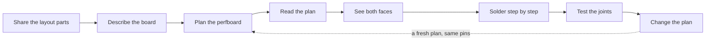

# Story map
<!-- Proposed, not applied: this map stays here until the decider confirms it; nothing changes the product's own
map file. -->
**Status:** proposed, not applied <!-- REQUIRED:map-status -->

## Backbone
<!-- The activities, left to right, as the user does them. -->
Share the layout parts → Describe the board → Plan the perfboard → Read the plan (text, JSON) → See both faces → Solder step by step → Test the joints → Change the plan (Claude, drag) <!-- REQUIRED:backbone -->

## Slices
<!-- Walking skeleton first: the thinnest slice that runs end to end. -->
| slice | activity | story | job | tag | proof |
| --- | --- | --- | --- | --- | --- |
| 0 walking skeleton <!-- REQUIRED:slices --> | Plan the perfboard | one CLI run on button-light writes the perfboard plan in text and JSON: each part's holes, each join with its kind and every hole, the cut in holes and mm, and the same-pins check passes over the joins | J1, J4 | H PA-6, UL-5 | the run's output and its `--json` on button-light |
| 0 | Describe the board | the drawer's FIT0193 gets holes across, holes down and pitch, with each fact's origin (assumed or measured) | J1 | E UL-2, D-f (D8 calipers) | the drawer entry after the Operation |
| 0 | Share the layout parts | the same-pins check reads joins as sets of holes (`ConnectedGroups`) | J1, J6 | E ★C15 | the 9 goldens byte for byte and a test with a bare wire over another net's pad |
| 0 | Share the layout parts | one `GridSearch` lifted from `TrackRouting`, with `TrackWeights` as a named Value (after P1350) | J6 | E ★C13, ★C14 | the router's tests and 9 of 9 goldens |
| 1 | Plan the perfboard | the join router chooses bridge, bare wire and insulated jumper in one search, with `JoinWeights` (spike P1239 first) | J1 | H TL2-16, TL2-17 | the spike's numbers on button-light and one bigger gadget |
| 1 | Read the plan | the step sheet: cut, mark A1, low parts first, one turn, the bare wire's holes at each turn | J2 | H UL-3, UL-4, UL-6 | perfboard.md for button-light, read by the PO |
| 1 | Test the joints | the beep list: every pair of next-door pads on different points, and 3V3 against GND first | J3 | H UL-8 | the list in perfboard.md |
| 2 | See both faces | the drawing of both faces from the breadboard's part pictures without pins (D-e), A1 mark and edge labels | J2 | E D-e | perfboard.svg, compared with the canvas in Chrome |
| 2 | Change the plan | `edit-layout` on the perfboard: a dry run, then `--apply`, kept in .spark/layout-edits.json | J4 | E D-f, the move-hold pattern | Claude changes button-light's plan through `--json` |
| 3 | Change the plan | drag on the page (both editors): after a drag that changes the wiring, one sentence for Claude with Copy, from one Operation | J5 | E D2 | the sentence on the page and the same from the CLI with `--json` |
| 3 | Solder step by step | the page's perfboard station with its step player | J2 | E the canvas artboard Perfboard | the page compared with the canvas in Chrome |

## Delta to the product's map <!-- REQUIRED:spark-process:map-delta -->
<!-- The rows to add or change in the repository's own story map file, in that file's table shape. -->
Proposed, not applied. A discovery adds no row to the product's journey (README "What works today" and `tools/journey.py`). When a step's status moves in a PR, that PR moves its row (AGENTS.md, "Keep the journey current"). When slice 0 is built, that PR gives the perfboard row the note "plan in text on the CLI". No other delta.
