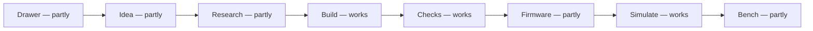

# The journey

spark takes a gadget from an idea in words to the parts and how to wire them on a breadboard, the pin map its firmware
imports, and a Wokwi simulation to run that firmware in; a board that builds and is checked, and its 3D model (`npx --no tsci export board.tsx -f glb`, not run
here), come on request. The chain starts from a [requirements file](../../GLOSSARY.md#the-requirements-file): yours, or the one
`parts.py --requirements` writes from your picks ([P97](https://github.com/xmejkal/spark/issues/18)). Each step reports
what it could not look at; [what never to assume](agents/never-assume.md) lists where that does not hold yet.

These pages walk each step on real runs: what was typed, what spark printed, what it wrote, and where the step stops
today. Each step has a page of its own. On Miro, [the journey frame](https://miro.com/app/board/uXjVEavQ4JQ=/?moveToWidget=3458764687016851094) shows the same eight steps.

What the three words mean:

- **works**: it ran end to end for these docs.
- **partly**: it stops before its goal, or part of it was not run here (agents, a conversation, or a paid simulation
  run). The step's page says which.
- **not yet**: nothing does it yet. The linked issue plans it.

## The eight steps

1. [Drawer](journey/drawer.md): your drawer says what you own.
2. [Idea](journey/idea.md): an idea becomes needs, matched against your drawer and spark's records first.
3. [Research](journey/research.md): research fills a real gap.
4. [Build](journey/build.md): a requirements file becomes a board that builds, with a breadboard sheet and a Wokwi
   diagram generated from it.
5. [Checks](journey/checks.md): the checks say what holds.
6. [Firmware](journey/firmware.md): the firmware imports the pin map.
7. [Simulate](journey/simulate.md): a simulation runs the firmware on the diagram.
8. [Bench](journey/bench.md): the bench proves it on hardware.

## Pages the steps share

- [A recorded run: a button and an LED](journey/recorded-run.md): the button-and-LED project from its needs to a board
  that builds, each script with its output.
- [Owed facts and gaps](journey/owed-facts.md): what a record can owe, and what follows a gap.
- [From draft to order](journey/from-draft-to-order.md): the steps before you order a board.
- [How these runs were made](journey/how-the-runs-were-made.md): when, where and how the runs on these pages ran, and
  the three example projects.
