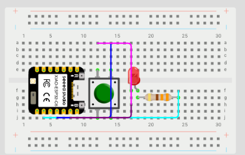
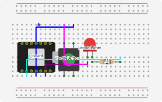
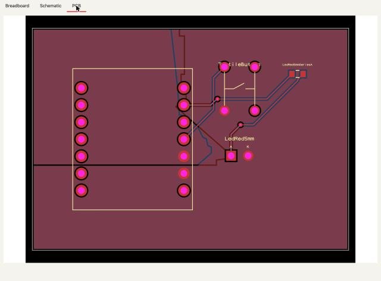

# The journey

spark takes a gadget from an idea in words to the parts and how to wire them on a breadboard, the pin map its firmware
imports, and a Wokwi simulation to run that firmware in; a board that builds and is checked, and its 3D model (`npx --no tsci export board.tsx -f glb`, not run
here), come on request. The chain starts from a [requirements file](../../GLOSSARY.md#the-requirements-file): yours, or the one
`parts.py --requirements` writes from your picks ([P97](https://github.com/xmejkal/spark/issues/18)). Each step reports
what it could not look at; [what never to assume](agents.md#what-never-to-assume) lists where that does not hold yet.

This page walks each step on real runs: what was typed, what spark printed, what it wrote, and where the step stops
today.


The same journey in words:

1. Your drawer says what you own.
2. An idea becomes needs, matched against your drawer and spark's records first.
3. Research fills a real gap.
4. A requirements file becomes a board that builds, with a breadboard sheet and a Wokwi diagram generated from it.
5. The checks say what holds.
6. The firmware imports the pin map.
7. A simulation runs the firmware on the diagram.
8. The bench proves it on hardware.

What the three words mean:

- **works**: it ran end to end for these docs.
- **partly**: it stops before its goal, or part of it was not run here (agents, a conversation, or a paid simulation
  run); the section says which.
- **not yet**: nothing does it yet; the linked issue plans it.

**How these runs were made.**

- When: [Drawer](#drawer), [Idea](#idea), the two `--need` lists in [Research](#research) and the library's list in
  [Build](#build) on 2026-10-08, with spark 0.7.0; the Idea section's build used tscircuit 0.0.2621, an existing
  install on the PATH. The rest on 2026-10-05, and the exports on 2026-10-06, with spark 0.6.0 and tscircuit 0.0.2600,
  the version spark pins; that tscircuit came from an existing install, linked into the project. The builds in
  [A recorded run](#a-recorded-run-a-button-and-an-led) and [Build](#build), and the breadboard sheet, on 2026-10-11 with
  spark 0.8.1 and tscircuit 0.0.2621. The [Simulate](#simulate) run on 2026-10-12 with spark 0.8.1 and wokwi-cli
  0.27.1. The note above each output names its run.
- Where: in scratch stores and fresh project folders. On 2026-10-08 one store held the drawer, `plant-alarm` and
  `button-light`, so the drawer filled in [Drawer](#drawer) is the one [Idea](#idea)'s matches and picks read. The
  `--audit` at the top of [owed facts and gaps](#owed-facts-and-gaps) ran in that store too, and each later example
  there ran in a store of its own.
- How: each command typed as shown. In Claude Code you type the `/spark:` command, and Claude runs these scripts for
  you. You, or another AI, can run them directly; [the guide for AI agents](agents.md) says how.
- Paths: `$CLAUDE_PLUGIN_ROOT` is where spark is installed. In outputs, `~/` is the home folder, `<temp>` a temporary
  one, the scratch store is shown as `<store>` (as `~/.local/share/spark` in the 2026-10-05 runs), and each project
  folder by its name.

There are three example projects:

- `plant-alarm` holds the drawer step and the idea's needs and matches. Its goal is the one `/spark:idea`'s own page
  uses.
- `button-light`, a button and an LED, goes on from its needs to a board that builds, and the tally:
  [a recorded run](#a-recorded-run-a-button-and-an-led).
- `my-gadget` holds the rest. It uses the requirements file that `/spark:build`'s page documents: a DFRobot
  FireBeetle 2 ESP32-S3, an L9110S motor driver, a power inlet and two buttons.

## Drawer

**Partly.** [`/spark:drawer`](../../commands/drawer.md) keeps what you own in your own store, never in a repository.

You say what you own in plain words. Claude writes the entries to a file and shows what would change:

```json
[
  {"label": "FireBeetle 2 ESP32-S3", "count": 1, "is": {"board": "firebeetle2-esp32s3"}},
  {"label": "red LEDs, pack of 10", "count": 10, "function": [{"does": "indicate", "what": "light"}]}
]
```

The conversation was not run for this page. These entries were written by hand; the commands below are real runs.

```sh
python3 "$CLAUDE_PLUGIN_ROOT/scripts/parts.py" --drawer-set ../drawer.json --dry-run
```

<!-- output: run 2026-10-08, spark 0.7.0 -->
```text
  would add firebeetle-2-esp32-s3: FireBeetle 2 ESP32-S3 × 1 — is board firebeetle2-esp32s3
  would add red-leds-pack-of-10: red LEDs, pack of 10 × 10
```

Without `--dry-run` it writes them. Then the drawer lists them:

```sh
python3 "$CLAUDE_PLUGIN_ROOT/scripts/parts.py" --drawer
```

<!-- output: run 2026-10-08, spark 0.7.0 -->
```text
  FireBeetle 2 ESP32-S3                             1  board firebeetle2-esp32s3
  red LEDs, pack of 10                             10  —
  2 entries
```

Your DFRobot order history can also come in from your logged-in browser, through Claude in Chrome:

- Claude drives your Chrome on dfrobot.com/account/order.
- spark's extractor reads each order page there and hands back only each line's SKU, name and count: no page text,
  address or price.
- Two things are rules Claude follows from the drawer's page, not something code enforces: it reads the order pages no
  other way (no page text, no accessibility tree, no screenshot), and it never types credentials or solves a challenge.
- The same page also lets Claude adapt the extractor when DFRobot changes its pages.

This path was not run here.

## Idea

**Partly.** [`/spark:idea`](../../commands/idea.md) turns a goal in your words into needs, then matches each need
against your drawer and spark's records. It marks each need: have, have-unknown, know or gap. Then a part is picked per
need (`parts.py --pick`), what you own is reserved, and the picks become a requirements file
(`parts.py --requirements`) ([P97](https://github.com/xmejkal/spark/issues/18)). Those steps ran for this page, in
[a recorded run](#a-recorded-run-a-button-and-an-led) below; the conversation did not.

In Claude Code, Claude asks at most three questions, one at a time, then writes the needs to a file:

- each need is a verb and a few words;
- no part numbers;
- a `condition` only when it decides a part.

For *"tell me when my plant is thirsty"*:

```json
[
  {"id": "soil", "does": "sense", "what": "soil-moisture", "condition": "indoor pot, short probe; low power"},
  {"id": "alarm", "does": "indicate", "what": "alarm"},
  {"id": "board", "does": "compute", "what": "microcontroller"}
]
```

The conversation was not run for this page. These needs were written by hand from `/spark:idea`'s own example; the
commands below are real runs.

```sh
python3 "$CLAUDE_PLUGIN_ROOT/scripts/parts.py" --needs-set . ../needs.json
```

<!-- output: run 2026-10-08, spark 0.7.0 -->
```text
  set soil: does null → "sense"; what null → "soil-moisture"; condition null → "indoor pot, short probe; low power"
  set alarm: does null → "indicate"; what null → "alarm"
  set board: does null → "compute"; what null → "microcontroller"
```

The same command with `--dry-run` first shows these lines as *would set*. `null →` means the field had no value
before. Every field of a new need shows it, as here. A write to a need that is already there shows only the fields it
changes, each with what it held: a mark given later reads `mark null → "know"`. The needs land in
`.spark/needs.json`.

```sh
python3 "$CLAUDE_PLUGIN_ROOT/scripts/parts.py" --match .
```

<!-- output: run 2026-10-08, spark 0.7.0 -->
```text
  soil — sense / soil-moisture  (indoor pot, short probe; low power)
                 vl6180x-breakout (library)                     distance [other words]
  alarm — indicate / alarm
      owned 10   red-leds-pack-of-10 (drawer)                   light [other words]  free 10
                 led-red-5mm (library)                          light [other words]
  board — compute / microcontroller
      owned 1    firebeetle2-esp32s3 (library)                  microcontroller  free 1
                 xiao-esp32-c6 (library)                        microcontroller  stops at the footprint stage (P121)
```

How to read the matches:

- Owned parts come first, from the drawer above, with how many are free.
- `owes` names facts a [record](../../GLOSSARY.md#record--and-the-four-places-one-lives) lacks
  ([owed facts and gaps](#owed-facts-and-gaps) shows one):
  - a pick owing a `footprint`, a `pin_order`, its `pin_order_proof` or a `simulation` stance is taken, but
    `parts.py --requirements` writes nothing until that is filled (it says which, and how);
  - one owing only an outline (`body_mm`) is written, and `/spark:build` draws a declared placeholder size, every stage
    still reading `[ok]` ([P115](https://github.com/xmejkal/spark/issues/49)).
- `[other words]` marks a looser match: the part does the same thing (*sense*, *indicate*) but names a different object
  (*distance*, *light*). Whether that fits is Claude's call, and Claude says so to you.
- A candidate with an `about` line shows it under its row. With `--json`, each candidate has a `score` from 0 to 1 and a
  `why`. `--matcher word-overlap` ranks by shared words, tags and descriptions, and `same-words` stays the default.
- `stops at the footprint stage (P121)` marks a board whose board file lacks a fact its footprint is drawn from, and the
  rest of the line names it (`its board file lacks physical.header`; with more, `lacks 3 fields (first: …)`; `--json`
  has the whole list as `stops_why`): the chain stops at its footprint stage ([P121](https://github.com/xmejkal/spark/issues/55)). Both library boards build today (the XIAO since
  [P278](https://github.com/xmejkal/spark/issues/314)); the lines above are a dated record from when it did not.

Here a distance sensor is offered for soil moisture. It senses distance, not moisture, so soil moisture is a real gap.
Research is for that; [owed facts and gaps](#owed-facts-and-gaps) says what a gap leaves off the board until then.

### A recorded run: a button and an LED

A smaller project, `button-light` — a button and a light on a board — went through every step `/spark:idea` walks,
with `/spark:build` before the tally. It ran on 2026-10-08 in the same scratch store as the runs above, so the drawer
holds the FireBeetle and the LED pack. The conversation was not run: the needs, the marks and the reason were written
to files by hand, and every command below is a real run.

These commands ran from a recording script, not through `/spark:idea` in Claude Code, so the session id that `--step`
records was set by hand: `CLAUDE_CODE_SESSION_ID=demo-session`. When Claude runs them in Claude Code, that variable is
already set.

**S — the needs.** Each step is marked when it starts, so the tally can count it:

```sh
CLAUDE_CODE_SESSION_ID=demo-session python3 "$CLAUDE_PLUGIN_ROOT/scripts/parts.py" --step . S
```

<!-- output: run 2026-10-08, spark 0.7.0 -->
```text
  started step S of button-light — a line in your history, with this Claude Code session's id
  listed button-light on your projects
```

M, C and L were marked the same way as each began, and printed the first line only. The needs, in
`../button-needs.json`:

```json
[
  {"id": "press", "does": "input", "what": "button"},
  {"id": "light", "does": "indicate", "what": "light"},
  {"id": "board", "does": "compute", "what": "microcontroller"}
]
```

```sh
python3 "$CLAUDE_PLUGIN_ROOT/scripts/parts.py" --needs-set . ../button-needs.json
```

<!-- output: run 2026-10-08, spark 0.7.0 -->
```text
  set press: does null → "input"; what null → "button"
  set light: does null → "indicate"; what null → "light"
  set board: does null → "compute"; what null → "microcontroller"
```

**M — the matches, then the marks.**

```sh
python3 "$CLAUDE_PLUGIN_ROOT/scripts/parts.py" --match .
```

<!-- output: run 2026-10-08, spark 0.7.0 -->
```text
  press — input / button
                 tactile-button (library)                       button
  light — indicate / light
      owned 10   red-leds-pack-of-10 (drawer)                   light  free 10
                 led-red-5mm (library)                          light
  board — compute / microcontroller
      owned 1    firebeetle2-esp32s3 (library)                  microcontroller  free 1
                 xiao-esp32-c6 (library)                        microcontroller  stops at the footprint stage (P121)
```

The LED pack is owned but has no record: picked as it is, spark reserves it and cannot place it on the board.
`/spark:idea`'s M step asks whether the pack is `led-red-5mm`. On the person's word, `--drawer-set` with
`[{"entry": "red-leds-pack-of-10", "is": {"part": "led-red-5mm"}}]` links it, after a dry run. `--match` then lists the
LED as `led-red-5mm (library)`, owned 10 and free 10, and the same pick below reserves the pack and places the LED; the
tally counts 2 owned. This run did not link it, so the library's LED is "to get" and the pack is passed over in C. The
button and that LED are known, not owned (`know`); the board is owned, with a record (`have`). The marks, in
`../marks.json`:

```json
[{"id": "press", "mark": "know"}, {"id": "light", "mark": "know"}, {"id": "board", "mark": "have"}]
```

```sh
python3 "$CLAUDE_PLUGIN_ROOT/scripts/parts.py" --needs-set . ../marks.json
```

<!-- output: run 2026-10-08, spark 0.7.0 -->
```text
  set press: mark null → "know"
  set light: mark null → "know"
  set board: mark null → "have"
```

**C — the picks.** The reason for passing over the LED pack, in `../passed.json`:

```json
[{"need": "light", "id": "red-leds-pack-of-10", "why": "no record for them, so spark cannot place them on the board", "by": "person"}]
```

```sh
python3 "$CLAUDE_PLUGIN_ROOT/scripts/parts.py" --pick . press=tactile-button light=led-red-5mm board=firebeetle2-esp32s3 --passed-over ../passed.json
```

<!-- output: run 2026-10-08, spark 0.7.0 -->
```text
  set firebeetle-2-esp32-s3: used_in null → {"button-light": 1}
  press: tactile-button
  light: led-red-5mm
  board: firebeetle2-esp32s3
  led-red-5mm: to get — known, not owned
  tactile-button: to get — known, not owned
  wrote to your history: 3 reused
  noted why you passed over red-leds-pack-of-10 (light)
```

With `--dry-run` first, the same lines read *would set*, *would write* and *would note*. The picks are in the
project's `.spark/needs.json`; the reason is in the history in your store, never in the project. The FireBeetle's
drawer entry is now held for `button-light`, so another project's pick of it is refused. From `plant-alarm`'s folder,
in the same store:

```sh
python3 "$CLAUDE_PLUGIN_ROOT/scripts/parts.py" --pick . board=firebeetle2-esp32s3 --dry-run
```

<!-- output: run 2026-10-11, spark 0.8.1 -->
```text
  refused, so nothing was written: firebeetle2-esp32s3 — 1 owned, held by button-light — 1 picked here
  fix for firebeetle2-esp32s3: free it — a file holding [{"entry": "firebeetle-2-esp32-s3", "used_in": …}] without button-light, given to --drawer-set <file> after a dry run — or pick another
```

**L — the requirements file.** First `/spark:init --board firebeetle2-esp32s3` in the project, as in
[Build](#build); it printed the same lines as there, with this project's name. Then:

```sh
python3 "$CLAUDE_PLUGIN_ROOT/scripts/parts.py" --requirements .
```

<!-- output: run 2026-10-08, spark 0.7.0 -->
```text
  wrote requirements.json: board firebeetle2-esp32s3; parts tactile-button, led-red-5mm
```

With `--dry-run` first it says *would write*. The file it wrote:

```json
{
  "board": "firebeetle2-esp32s3",
  "parts": [
    "tactile-button",
    "led-red-5mm"
  ]
}
```

**The build.** [`/spark:build`](../../commands/build.md) runs the chain on it, as in [Build](#build):

```sh
python3 "$CLAUDE_PLUGIN_ROOT/scripts/check_spine.py" requirements.json --keep .
```

The lines are a dated record. Since 2026-10-12 the button uses the board's internal pull-up
([P204](https://github.com/xmejkal/spark/issues/167)), so today's run writes 9 traces, routes 7 and wires 7.

<!-- output: run 2026-10-11, spark 0.8.1 -->
```text
wrote <temp>/FireBeetle2Esp32S3.tsx (32 pads, 1.00 mm holes)
  wrote FireBeetle2Esp32S3.tsx
  wrote board.tsx
  wrote dist — this is what every check reads
  wrote breadboard.md — the parts and how to wire them on a breadboard

  idea -> parts -> pin map -> schematic -> footprint -> build -> simulation

  [ok  ] board            DFRobot FireBeetle 2 ESP32-S3
  [ok  ] schematic        11 trace(s) written
  [ok  ] footprint        FireBeetle2Esp32S3.tsx
  [ok  ] build            9 trace(s), 0 errors, tsci 0.0.2621; the documents were measured on core 0.0.2600
  [ok  ] simulation       9 wire(s) in the diagram
           what it cannot show, from the records (2):
             LedRed5mm: Wokwi's LED: lights on current; its forward voltage and brightness are not this part's
             TactileButton: Wokwi's pushbutton: either side of a pair is the same contact; no bounce is modelled

  the chain runs end to end
```

This build used tscircuit 0.0.2621, an existing install on the PATH, not the 0.0.2600 spark pins: the build line says
so, and does not fail for it.

**The breadboard.** With `--keep`, the build also writes `breadboard.md` into the project
([P191](https://github.com/xmejkal/spark/issues/143)): the parts, the resistors the parts ask for, and every wire,
named by the board's printed labels and the parts' legs. It comes from the circuit that was built, so it is the board
the checks and the simulation saw. The FireBeetle reads *yours* because the drawer holds it for this project:

The lines are a dated record. Since 2026-10-12 the button uses the board's internal pull-up
([P204](https://github.com/xmejkal/spark/issues/167)): today's sheet has no 10kΩ resistor and no 3V3 line, the LED's
resistor is R1, and `pins.py` says `BUTTON_PULL = "up"`.

<!-- output: run 2026-10-11, spark 0.8.1 -->
```text
# Breadboard: button-light, on a DFRobot FireBeetle 2 ESP32-S3

## Parts

| qty | part | for | have |
| --- | --- | --- | --- |
| 1 | DFRobot FireBeetle 2 ESP32-S3 | the board | yours |
| 1 | 6x6 mm tactile push button | TactileButton | to get |
| 1 | Kingbright L-7113ID 5 mm red LED | LedRed5mm | to get |
| 1 | 10kΩ resistor, through-hole | R1 pull-up on TactileButton A | to get |
| 1 | 330Ω resistor, through-hole | R2 in series with LedRed5mm A | to get |
| | a breadboard and jumper wires | | to get |

*have*: yours = your drawer holds it for this project · in your drawer = you own it, not held here · to get = not in your drawer · blank = this project is not on your list (`/spark:init` puts it there)

## Wiring

Each line is one point: put its ends in one breadboard row, or join them with a wire. The board covers the
rows beside its own pins, so for a line that starts with a board pin, run a jumper from that pin to a free
row and put the line's other ends in that row.

1. board 3V3 · R1 (10kΩ pull-up on TactileButton A), end 2
2. board A5 · R2 (330Ω in series with LedRed5mm A), end 1
3. board D3 · R1 (10kΩ pull-up on TactileButton A), end 1 · TactileButton A (either leg of one joined pair; a meter on continuity shows which legs are joined)
4. board GND · LedRed5mm K (the cathode, the shorter leg, by the flat of the rim) · TactileButton B (either leg of the other pair)
5. LedRed5mm A (the anode, the longer leg) · R2 (330Ω in series with LedRed5mm A), end 2

## Before you power it

- 6x6 mm tactile push button: Decide the polarity against deep sleep, not convenience. MicroPython's esp32.wake_on_ext1(pins, level) takes ONE level for every pin in the mask, on every chip (ports/esp32/modesp32.c, v1.29.0), so a board with two wake sources must have them assert in the same direction. Both directions are an OR on the S3 and C6: WAKEUP_ALL_LOW is a true AND only on the original ESP32, and ESP-IDF aliases it to ANY_LOW on every later chip (components/esp_hw_support/include/esp_sleep.h, v5.5.2). Prefer wiring a wake button to 3V3 behind a pull-down and arming WAKEUP_ANY_HIGH: low-level wake has an open MicroPython bug, micropython#17334 ('stuck pin', reported on a C6, v1.25.0). Corrected 2026-10-01 (spark P63): this line used to say ALL_LOW is an AND here, which is false on these chips.
- 6x6 mm tactile push button: Debounce in firmware, not hardware, unless the button is also a wake source — a wake pin's first edge is the one that matters and it is not debounced by anything.
- Kingbright L-7113ID 5 mm red LED: A series resistor between the GPIO and the anode, always: without it the LED's current is set only by the pin's drive strength, and it either runs far past 30 mA or droops the pin's level.
- Kingbright L-7113ID 5 mm red LED: Keep it off the chip's strapping pins: an LED and resistor to ground load the pin while the chip samples its straps at reset, and can change how it boots. (Reasoned from the circuit, not from this datasheet.)
- Kingbright L-7113ID 5 mm red LED: On a breadboard: the LONG lead (anode) goes to the resistor; the short lead, on the side of the flat in the rim, goes to ground. Once the leads are trimmed equal, the flat is the mark that survives.

Each record whole, with what it asks of the board: `parts.py --show led-red-5mm`, `parts.py --show tactile-button`.
```

`python3 "$CLAUDE_PLUGIN_ROOT/scripts/breadboard.py" requirements.json` writes it again after a build.

Since 2026-10-16 the Wiring section has three parts ([P202](https://github.com/xmejkal/spark/issues/161)). The lines
above are now its last part, the points, a check list after the wiring. Before them come numbered steps, one
connection each, and a mermaid diagram whose numbered lines are those steps. The board and each part go in first,
each pin in its own row. Then each wire goes to its point's anchor, the row or rail where its ends meet: a part's pin row, else a resistor end's row, or a
rail when a point has more ends than a row holds. Today's steps for this project:

<!-- output: run 2026-10-16, spark 0.9.0 -->
```text
1. Put the board in the breadboard, each pin in its own row.
2. Put TactileButton in the breadboard, each pin in its own row.
3. Put LedRed5mm in the breadboard, each pin in its own row.
4. Put R1 (330Ω in series with LedRed5mm A), end 1, in a free row.
5. Run a jumper from board A5 to the row of R1 end 1.
6. Run a jumper from board D3 to the row of TactileButton A.
7. Run a jumper from board GND to the row of LedRed5mm K.
8. Run a jumper from the row of TactileButton B (either leg of the other pair) to the row of LedRed5mm K.
9. Put R1 (330Ω in series with LedRed5mm A), end 2, in the row of LedRed5mm A.
```

**The drawn breadboard.** Since 2026-10-16 the build also writes `breadboard.json` beside the sheet
([P267](https://github.com/xmejkal/spark/issues/300)). It is a Wokwi diagram of the same steps on a half breadboard:
each part's legs in holes, and each jumper in its step's color. The sheet names the colors under its steps. To see
it, open a new project on wokwi.com, paste the file into its `diagram.json`, and compare the picture with your own
breadboard. Since 2026-10-17 a part you move in the file stays where you put it at the next build
([P273](https://github.com/xmejkal/spark/issues/309)), even after you change the requirements, if it still fits. A
part that cannot stay is named on the screen, with why: for example `LedRed5mm: its pin A is not over a hole`, or
`LedRed5mm: it is not in the new circuit`. Its jumpers follow it, so the diagram stays wired. A resistor you move
stays if its joined leg is still in the row it joins, and a jumper you move stays, with its bends, if the new circuit
still joins the two rows it joins (since 2026-10-18, [P287](https://github.com/xmejkal/spark/issues/340)); otherwise
the screen names it, for example `jumper 6b.j-15t.a: …`. A build that fails leaves the file, with your moves, and says so.

**A rebuild says what to change.** Since 2026-10-18 ([P300](https://github.com/xmejkal/spark/issues/366)) a rebuild
tells you what to change on your breadboard, so you do not read the whole sheet again. Say you built the button and the
LED, wired them, and then add a second LED. The sheet gets this section before its steps, and the screen prints the same
lines:

<!-- output: run 2026-10-18, spark 0.9.0 -->
```text
### Changes since the last build

- Put LedGreen5mm in the breadboard.
- Put R2 end 1 (in series with LedGreen5mm A) in a free row.
- Run a jumper from board D9 to the row of R2 end 1 (in series with LedGreen5mm A).
- Run a gold jumper from the row of LedRed5mm K to the row of LedGreen5mm K.
- Put R2 end 2 (in series with LedGreen5mm A) in the row of LedGreen5mm A.
- Move the purple jumper from board GND: it now goes to the row of LedGreen5mm K (it went to the row of LedRed5mm K).
- Move the magenta jumper from the row of TactileButton B: it now goes to the row of LedGreen5mm K (it went to the row of LedRed5mm K).
```

A line names a jumper by its two ends. A jumper you move or take out has the color on your earlier sheet, so you can find
the wire you wired. A new jumper has the color it has on the new sheet, unless a jumper in the same list had that color
on your bench. Then it has no color, so no two wires in the list share one. A resistor is named by its job too, because
its tag can renumber. A line never names a hole, because you pick your own free rows. A resistor with a new value reads
`Swap R1, 330Ω, for a 1kΩ resistor in the same rows.` A resistor that goes is one line:
`Take out R1, 330Ω in series with LedRed5mm A.` When nothing changed, the section says
`- Nothing to change on the bench.` The first build has no section. Spark keeps what the last sheet said in
`wiring-record.json`, beside the sheet. Do not edit it.

Two boards are drawn, and only when no point needs a rail or a supply from off the board. The Seeed Studio XIAO ESP32-C6
is drawn from what spark measured in Wokwi (`data/wokwi-geometry.json`). The FireBeetle 2 ESP32-S3 is drawn from its own
record ([P412](https://github.com/xmejkal/spark/issues/538)) on a 63-column breadboard: `breadboard.svg` shows each
pad's label beside its pin, rings the two ground pads the record doubts, marks the USB-C end and says what is not
verified. Wokwi has no part with its pins, so for the FireBeetle the sheet says `No Wokwi diagram exists for this board,
by design`, and names the ground pad (GND2). A board whose record lacks a fact says which one.
The same project on the XIAO, as Wokwi shows its `breadboard.json`
([the measurement](../discovery/2026-10-16-p267-wokwi-holes/README.md)):



Since 2026-10-16 the sheet also shows the layout itself, so you need no website to see it
([P268](https://github.com/xmejkal/spark/issues/302)). The build writes `breadboard.svg` beside the sheet, and
`breadboard.md` shows it under the steps. Each part is a plain pictogram of its kind, and each jumper runs along the
holes in its step's color, with its step number at the corner. Pictures from online come later. The same project:



**The drawing is checked.** Since 2026-10-18 ([P279](https://github.com/xmejkal/spark/issues/317)) the build makes
sure that the drawing joins the same pins as the points in `circuit.json`. It follows each jumper and the button's two
sides of one contact. When they match, it says nothing. When an end differs, the screen prints one line for it, for
example `drawing differs: R1 end 1 is not joined to board D8 in the drawing`, and the sheet tells you to wire from
its steps. A jumper from GND to the 5V pad is named too, because no point names 5V. The drawing is still written.

Since 2026-10-16 the build also writes `page.html`, the same circuit in three tabs: the breadboard, the schematic
and the PCB ([P271](https://github.com/xmejkal/spark/issues/307)). Open it in a browser on your Mac and click a tab.
The schematic and the PCB are tscircuit's own pictures, from `tsci export` on the kept circuit. Since 2026-10-17 the page
also follows the Artifact page rules ([P272](https://github.com/xmejkal/spark/issues/308)): colors are tokens with a
dark mode that follows your system, the side gutter is 16 px, and the title is the first three words of the folder's name and "circuit". Claude can
publish the same file as a private Artifact when you say yes. The PCB tab of the
same project:



**T — the tally.**

```sh
python3 "$CLAUDE_PLUGIN_ROOT/scripts/parts.py" --tally .
```

<!-- output: run 2026-10-08, spark 0.7.0 -->
```text
  3 picks: 3 from the store (1 owned) — its cost was not counted
  3 of 3 needs picked
  from the store: known to spark before this project — its library, your store, your projects
  --tally reads the Claude Code transcripts of the sessions the steps ran in, for tool names and counts only
  no transcript of session demo-session here, so the cost of its steps is not known
```

All three picks were known to spark before this project, and one of them, the FireBeetle, is owned. The cost could
not be counted, and the tally exits 2, could-not-run: it looks for each step's session among the Claude Code
transcripts under the home folder (`~/.claude/projects`), and this run's home folder was the scratch store, which
holds none. A missing transcript is never counted as a cost of 0.

In Claude Code the line ends with the cost instead. A run by spark's author on 2026-10-08, in Claude Code and not
recorded for this page, printed `4 picks: 4 from the store (4 owned) — 2 requests, 1 document, 12 min`. Its words, as
spark's code defines them:

- **from the store**: known to spark before this project — its library, your store, your projects;
- **owned**: your drawer holds it;
- **requests**: tool calls that reach the network, every MCP call among them;
- **documents**: the PDFs and images read (`.pdf`, `.png`, `.jpg`, `.jpeg`, `.webp`, `.svg`), with the Read tool or
  `parts.py --read`, each counted once;
- **min**: wall-clock minutes of the session between the steps.

The run left nine lines in the store's history, `history.jsonl` ([your store](how-it-works.md#your-store)): a `step`
line for each of S, M, C and L, with the session id; a `reused` line for each pick; the reason for passing over the
LED pack; and a `built` line, written by the green build.

### Owed facts and gaps

A record **owes** a fact when one the chain reads is missing from it: `footprint`, `pin_order`, `pin_order_proof`,
`body_mm` (its outline) or `simulation`. `--match` shows what each candidate owes, and `parts.py --audit` lists every
record that owes one. Today spark's own library owes none:

```sh
python3 "$CLAUDE_PLUGIN_ROOT/scripts/parts.py" --audit
```

<!-- output: run 2026-10-08, spark 0.7.0 -->
```text
  library       10 current,   0 owe facts,   0 broken
  xiao-esp32-c6 (library) stops at the footprint stage (P121) — no header geometry in its board file
```

In a scratch store of its own, a catalog record was written by hand to `<store>/catalog/soil-probe.json`:

```json
{"schema": 1, "id": "soil-probe", "name": "A capacitive soil probe on a 3-pin cable", "kind": "sensor",
 "function": [{"does": "sense", "what": "soil-moisture"}],
 "needs": [{"signal": "SOIL_MOISTURE", "pin": "Signal", "direction": "out", "needs": ["adc"]}],
 "power": [{"pin": "VCC", "rail": "logic", "direction": "in"}, {"pin": "GND", "rail": "ground", "direction": "in"}],
 "unused_pins": [], "pin_order": ["GND", "VCC", "Signal"],
 "body_mm": {"width": 10, "height": 6, "verified": false, "source": "measured with a ruler", "why_it_matters": "where the socket sits"}}
```

That store's drawer held only the FireBeetle, and its project two needs, in `../needs.json`: the plant alarm's soil
need without its condition, and the board.

```json
[
  {"id": "soil", "does": "sense", "what": "soil-moisture"},
  {"id": "board", "does": "compute", "what": "microcontroller"}
]
```

`--match .` then offered the record, which owed three facts:

<!-- output: run 2026-10-08, spark 0.7.0 -->
```text
  soil — sense / soil-moisture
                 soil-probe (catalog)                           soil-moisture  owes footprint, pin_order_proof, simulation
                 vl6180x-breakout (library)                     distance [other words]
  board — compute / microcontroller
      owned 1    firebeetle2-esp32s3 (library)                  microcontroller  free 1
                 xiao-esp32-c6 (library)                        microcontroller  stops at the footprint stage (P121)
```

What happens today depends on what is owed. `--pick` takes the record either way; `--requirements` decides.

**A fact the circuit needs** — `footprint`, `pin_order`, `pin_order_proof` or `simulation` — stops the building list.
The soil probe was picked with the board (`--pick . soil=soil-probe board=firebeetle2-esp32s3`), and then:

```sh
python3 "$CLAUDE_PLUGIN_ROOT/scripts/parts.py" --requirements .
```

<!-- output: run 2026-10-08, spark 0.7.0 -->
```text
  refused, so nothing was written: soil-probe — owes footprint, pin_order_proof, simulation — fill it in its own home with --fact-set
```

It exits 1. **Only the outline** (`body_mm`) does not stop it. In another store, the same record carrying the three
facts of `../facts.json` (below) and no `body_mm`, picked the same way, goes into the file with a warning:

<!-- output: run 2026-10-08, spark 0.7.0 -->
```text
  wrote requirements.json: board firebeetle2-esp32s3; parts soil-probe
  onto the shelf, so every project builds with it: soil-probe
  placeholder outline — soil-probe owes body_mm, so the PCB step lays it out at a placeholder 16 x 12 mm: a dimension drawing (fetched after the person's yes) or a measurement fills it — fill it in its own home with --fact-set
```

**Filling one.** An owed fact is filled once, in the record's own home: here the catalog record in the store. In
Claude Code, `/spark:idea` does it with you: Claude writes the facts from the record's source as a JSON object to a
file, then runs `--fact-set`, first with `--dry-run`. A source not kept yet is fetched only after your yes. The soil
probe's three, in `../facts.json`:

```json
{"footprint": "jst_ph_3",
 "pin_order_proof": {"verified": false, "source": "read off the cable: GND, VCC, Signal"},
 "simulation": {"skip": "no Wokwi part for a soil probe"}}
```

```sh
python3 "$CLAUDE_PLUGIN_ROOT/scripts/parts.py" --fact-set soil-probe ../facts.json --project .
```

<!-- output: run 2026-10-08, spark 0.7.0 -->
```text
  set soil-probe (<store>/catalog/soil-probe.json): footprint null → "jst_ph_3"; pin_order_proof null → {"verified": false, "source": "read off the cable: GND, VCC, Signal"}; simulation null → {"skip": "no Wokwi part for a soil probe"}
```

Then `--requirements` wrote the file and put the record on the shelf:

<!-- output: run 2026-10-08, spark 0.7.0 -->
```text
  wrote requirements.json: board firebeetle2-esp32s3; parts soil-probe
  onto the shelf, so every project builds with it: soil-probe
```

`--fact-set` never changes spark's own library: a library record is changed in spark's repository.

**A bench result goes back the same way.** The probe's outline was a guess from a ruler. In a store where the record
carries the three facts of `../facts.json`, `--unverified` lists it beside the pin order, and says what to do next:

```sh
python3 "$CLAUDE_PLUGIN_ROOT/scripts/parts.py" --unverified soil-probe
```

<!-- output: run 2026-10-29, spark 0.9.0 -->
```text
  2 thing(s) nobody has checked:

  soil-probe.pin_order = ['GND', 'VCC', 'Signal']
      a pin order read wrong reverses a supply or swaps a signal
  soil-probe.body_mm = {'width': 10, 'height': 6}
      where the socket sits
  next: parts.py --fact-set soil-probe <file> — write a checked result back with its source
```

With `--json`, each row of `assumptions` also carries `write`, the key its result goes back to (`body_mm` here). After you
measure the probe with a caliper, the file holds the result with its source: who, when and how.

```json
{"body_mm": {"width": 10.4, "height": 6.1, "verified": true, "source": "bench, 2026-10-29, caliper on the owned probe, Petr Smejkal"}}
```

```sh
python3 "$CLAUDE_PLUGIN_ROOT/scripts/parts.py" --fact-set soil-probe ../bench.json --dry-run
```

<!-- output: run 2026-10-29, spark 0.9.0 -->
```text
  would set soil-probe (<store>/catalog/soil-probe.json): body_mm {"width": 10, "height": 6, "verified": false, "source": "measured with a ruler", "why_it_matters": "where the socket sits"} → {"width": 10.4, "height": 6.1, "verified": true, "source": "bench, 2026-10-29, caliper on the owned probe, Petr Smejkal"}
```

Without `--dry-run` it writes, and `--unverified` then lists the pin order only. A `facts` entry goes back the same way,
by name: `{"facts": {"runs_at_3v3": {"value": true, "verified": true, "source": "…"}}}` keeps the other entries. A write
replaces the whole block, so the file holds what the block should keep (`note`, `where`).

**What follows a gap.** A need marked `gap` has nothing in the store to pick. Left unpicked, it does not stop the
building list, and `--requirements` says so. In a store of its own, the plant alarm with soil marked `gap`, the
library's LED picked for the alarm and the FireBeetle for the board (`--pick . alarm=led-red-5mm board=firebeetle2-esp32s3`):

<!-- output: run 2026-10-08, spark 0.7.0 -->
```text
  wrote requirements.json: board firebeetle2-esp32s3; parts led-red-5mm
  not on the board: soil — marked a gap: nothing like it is in the store yet; research it before it can be built
```

The board, unlike the other needs, cannot be left unpicked: without it `--requirements` refuses, `board — pick one
board — none is picked`. The file keeps that note under `unserved`, and the build's verdict repeats it:
`the chain runs end to end — but not every need is on the board: soil (a gap)`. [Research](#research) comes next:
`/spark:research` writes a new record into the project's `parts/`. A new record can still owe facts;
`parts.py --audit --project .` names them, and `--fact-set` fills them as above. Then pick it for the need and run
`--requirements` again, and the note goes.

## Research

**Partly.** The library comes first:

```sh
python3 "$CLAUDE_PLUGIN_ROOT/scripts/parts.py" --need motor driver --project .
```

<!-- output: run 2026-10-08, spark 0.7.0 -->
```text
  l9110s-module                motor-driver   L9110S dual motor driver module
```

```sh
python3 "$CLAUDE_PLUGIN_ROOT/scripts/parts.py" --need soil moisture --project .
```

<!-- output: run 2026-10-08, spark 0.7.0 -->
```text
  nothing in the library matches 'soil moisture'.
  Research it: /spark:research "soil moisture"  — vendors in order: dfrobot, seeed; sellers: none named in the brief
```

*The brief* is the project's `.spark/project.json`.

A real gap goes to [`/spark:research`](../../commands/research.md), which works through agents:

- For a commodity part (an LED, a button, a connector: one datasheet describes it), `part-finder` finds the exact
  part on the maker's site.
- `datasheet-reader` then fills the record from the datasheet pages the decision needs.
- For a module, `parts-researcher` researches it from primary sources.

Either way the result is a record in the project's `parts/`, with every fact cited and every unconfirmed fact marked.
Another project finds it once `parts.py --promote <id> --project .` copies it into spark's library, or once a drawer
entry links it, which puts a copy on your shelf. That part runs as agents in a conversation and was not run for this
page.

A module you already own can start from a photo instead: [`/spark:identify`](../../commands/identify.md).

## Build

**Works.** Two commands come before the first build, in this order:

1. [`/spark:init`](../../commands/init.md) writes the project's files, guessing nothing, including the `package.json`
   that tscircuit installs into.
2. [`/spark:setup`](../../commands/setup.md) says which tools spark needs, and installs what is missing in one go once
   you have seen the commands and said yes.

```sh
python3 "$CLAUDE_PLUGIN_ROOT/scripts/init_project.py" --project . --board firebeetle2-esp32s3
```

<!-- output: run 2026-10-05, spark 0.6.0 -->
```text
spark init in my-gadget
  on your projects list as 'my-gadget'
  wrote rules.json
  wrote project.json
  wrote package.json
  wrote active.json
  no built design found, so the rails are empty — build, then re-run with --force

5 field(s) nobody has answered. Nothing here is guessed, and a check reading a null
reports it as unverifiable rather than passing it:

  rules.json  physics.i2c_hz
  rules.json  physics.i2c_bus_capacitance_pf
  project.json  goal
  project.json  prefer
  project.json  sellers
```

init's last sentence claims more than physics does today; see [what never to assume](agents.md#what-never-to-assume).

```sh
python3 "$CLAUDE_PLUGIN_ROOT/scripts/tools.py" --status --project .
```

<!-- output: run 2026-10-05, spark 0.6.0 -->
```text
  spark's tools — personal: ~/.local/share/spark/tools.json · project: .spark/tools.json

  [off ] bench             sigrok is off unless you turn it on — /spark:setup add sigrok
  [ok  ] board-engine      tscircuit — my-gadget/node_modules/.bin/tsci
  [ok  ] chip-docs         espressif-docs (MCP, spark's own)
  [ok  ] diagram-converter circuit-to-wokwi — $CLAUDE_PLUGIN_ROOT/tools/circuit-to-wokwi/dist/converter.mjs
  [????] firmware-image    firmware-image (micropython-esp32s3) is not installed — install: /spark:setup add micropython-esp32s3
  [ok  ] js-runtime        node — ~/.nvm/versions/node/v22.23.2/bin/node
  [ok  ] littlefs          littlefs-python — ~/.pyenv/versions/3.10.0/bin/python3
  [ok  ] parts-search      jlcpcb (MCP, spark's own)
  [ok  ] pdf-text          pdftotext — /opt/homebrew/bin/pdftotext
  [ok  ] simulator         wokwi-cli — ~/.local/bin/wokwi-cli
  [ok  ] ts-runtime        bun — /opt/homebrew/bin/bun
  [off ] wokwi-mcp         wokwi-mcp is off unless you turn it on — /spark:setup add wokwi-mcp

  1 to install: micropython-esp32s3
```

What this status shows:

- **tscircuit was linked in, not installed.** It was linked into the project from an existing install, so
  board-engine reads `[ok  ]`. In a fresh folder it reads `[????]` until `/spark:setup` installs it. On this Mac,
  before the link, the last line read `2 to install: tscircuit micropython-esp32s3`. Setup's install of tscircuit
  (`tools.py --install`) last ran on 2026-10-03, in P82's third cold run; the slash command's one yes last ran on
  2026-10-04, for the MicroPython build only
  ([P82 in the backlog's archive](../../scrum/PRODUCT_BACKLOG.md#p82--setting-up-spark-is-one-step-like-installing-a-package--slice-1-the-pos-request-of-2026-10-03--done-2026-10-03)).
- **Exit 2.** The status exits 2 while any tool is missing. Here only the MicroPython image is missing, and only a
  simulation run needs it ([Simulate](#simulate)).
- **An MCP row's `[ok  ]`** (chip-docs, parts-search) means only that spark declares the server and Node is on the
  PATH. Nothing checks that Claude Code has the server registered or that it answers
  ([P112](https://github.com/xmejkal/spark/issues/46)), or the Node version; espressif-docs needs Node 20 or newer
  ([docs/mcp.md](../mcp.md)).
- **No `[!   ]` simulator row here.** This shell had a Wokwi token set. Without `WOKWI_CLI_TOKEN`, the simulator gets a
  `[!   ]` row: a token only you can make, at wokwi.com/dashboard/ci.

The library's parts, whose ids a requirements file names:

<!-- runs: exit 0 -->
```sh
python3 "$CLAUDE_PLUGIN_ROOT/scripts/parts.py" --list
```

<!-- output: run 2026-10-08, spark 0.7.0 -->
```text
  dfr0534-module               audio          library   DFRobot DFR0534 voice module
  jst-ph-2-power-inlet         connector      library   JST PH 2-pin power inlet
  l9110s-module                motor-driver   library   L9110S dual motor driver module
  led-red-5mm                  indicator      library   Kingbright L-7113ID 5 mm red LED
  max98357a-dfr0954            audio-amplifier library   DFRobot DFR0954 MAX98357A I2S amplifier
  speaker-terminal             connector      library   2-pin speaker terminal (JST PH)
  tactile-button               button         library   6x6 mm tactile push button
  vl6180x-breakout             rangefinder    library   VL6180X time-of-flight rangefinder breakout
```

`parts.py --audit` names what each record still owes.

Save the requirements file as `requirements.json` in the project:

```json
{
  "board": "firebeetle2-esp32s3",
  "parts": [
    "l9110s-module",
    "jst-ph-2-power-inlet",
    { "part": "tactile-button", "name": "BtnOpen" },
    { "part": "tactile-button", "name": "BtnMode" }
  ]
}
```

What else a requirements file takes ([`/spark:build`'s page](../../commands/build.md#the-requirements-file)):

- each part as an id, or as `{part, name}` when the same part appears twice — names that differ only in capitals are
  one name, and the requirements stage refuses the file, naming both, before anything is emitted;
- a part's `rails`, which puts one of its power pins on a rail you name without copying its record;
- `signals`, entries of `{name, needs}`, which add a pin no part claims (an LED, a limit switch).

Then [`/spark:build`](../../commands/build.md) runs the whole chain on it:

```sh
python3 "$CLAUDE_PLUGIN_ROOT/scripts/check_spine.py" requirements.json --keep .
```

The lines are a dated record. Since 2026-10-12 the two buttons use the board's internal pull-up
([P204](https://github.com/xmejkal/spark/issues/167)), so today's run writes 18 traces, routes 15 and wires 13.

<!-- output: run 2026-10-11, spark 0.8.1 -->
```text
wrote <temp>/FireBeetle2Esp32S3.tsx (32 pads, 1.00 mm holes)
  wrote FireBeetle2Esp32S3.tsx
  wrote board.tsx
  wrote dist — this is what every check reads
  wrote breadboard.md — the parts and how to wire them on a breadboard

  idea -> parts -> pin map -> schematic -> footprint -> build -> simulation

  [ok  ] board            DFRobot FireBeetle 2 ESP32-S3
  [ok  ] schematic        22 trace(s) written
  [ok  ] footprint        FireBeetle2Esp32S3.tsx
  [ok  ] build            19 trace(s), 0 errors, tsci 0.0.2621; the documents were measured on core 0.0.2600
  [ok  ] simulation       17 wire(s) in the diagram, 1 chip(s): 0 compiled, 1 reused
           what it cannot show, from the records (3):
             BtnMode, BtnOpen: Wokwi's pushbutton: either side of a pair is the same contact; no bounce is modelled
             JstPh2PowerInlet: not simulated at all: a connector is wiring, not a part to simulate; the simulator powers the board itself
             L9110sModule: one channel: reads IA/IB and prints MOTOR: opening/closing/stopped; models no current, so a stall cannot be simulated

  the chain runs end to end
```

19 routed traces carry the 22 written connections: a group of N connected pins needs N−1 traces.

`--keep .` writes the board into the project: `board.tsx`, the board's footprint, `dist/`, where every check
looks, and `breadboard.md`, the parts and how to wire them ([an example](#a-recorded-run-a-button-and-an-led)). An existing `board.tsx` is left alone, edited or not, and `dist/` is then built from the requirements file, not
from your `board.tsx` ([P110](https://github.com/xmejkal/spark/issues/44)). It also writes `firmware/pins.py`, the pins
that the firmware imports ([P196](https://github.com/xmejkal/spark/issues/155)). Without `--keep`, the chain builds in a temporary
folder and deletes it.

The simulation stage generates the Wokwi diagram and stages the chips. `--keep .` keeps them in `sim/`, and `--sim-dir DIR`
keeps them in DIR ([P116](https://github.com/xmejkal/spark/issues/50)). It does not run a simulation; see [Simulate](#simulate).

## Checks

**One board per project.** Since 2026-10-19 ([P223](https://github.com/xmejkal/spark/issues/205)) a folder with two
built designs, such as `dist/car/` and `dist/remote/`, gets a reason instead of a silent stop: spark handles one board
per project today. The reason names the first design's absolute path for `--circuit`, or tells you to give each board
its own folder with its own `parts/` and to run init in it. Many boards in one project come with v0.13
([#94](https://github.com/xmejkal/spark/issues/94)).

**Works.** After a build, running init again with `--force` names the rails from the board. It lists the fields it
writes as `null`. Until a bug is fixed, it lists them even when `.spark/rules.json` already holds your answer
([P114](https://github.com/xmejkal/spark/issues/48)), so the values in that file are what count:

```sh
python3 "$CLAUDE_PLUGIN_ROOT/scripts/init_project.py" --project . --board firebeetle2-esp32s3 --force
```

<!-- output: run 2026-10-05, spark 0.6.0 -->
```text
spark init in my-gadget
  on your projects list as 'my-gadget'
  merged into rules.json — every answer already in it was kept
  wrote project.json
  package.json already exists, left alone
  wrote active.json
  named 3 rail(s) from circuit.json

17 field(s) nobody has answered. Nothing here is guessed, and a check reading a null
reports it as unverifiable rather than passing it:

  rules.json  physics.i2c_hz
  rules.json  physics.i2c_bus_capacitance_pf
  rules.json  physics.rails.GND.nominal_volts
  rules.json  physics.rails.GND.max_current_a
  rules.json  physics.rails.GND.capacitor_chemistry
  rules.json  physics.rails.GND.served_by_pour
  rules.json  physics.rails.MOTOR6V.nominal_volts
  rules.json  physics.rails.MOTOR6V.max_current_a
  rules.json  physics.rails.MOTOR6V.capacitor_chemistry
  rules.json  physics.rails.MOTOR6V.served_by_pour
  rules.json  physics.rails.V33.nominal_volts
  rules.json  physics.rails.V33.max_current_a
  rules.json  physics.rails.V33.capacitor_chemistry
  rules.json  physics.rails.V33.served_by_pour
  project.json  goal
  project.json  prefer
  project.json  sellers
```

Its last sentence overclaims here too, as above. The motor rail's net is named `MOTOR6V` whatever the motor's voltage
([P129](https://github.com/xmejkal/spark/issues/63)). A part's `rails` puts its pin on a rail you name instead.

```sh
python3 "$CLAUDE_PLUGIN_ROOT/scripts/check_all.py" --project .
```

The lines are a dated record, not today's output: the last line now ends in a count of the `?` lines, and the
four-resistor `!` line now names its cause (below).

<!-- output: run 2026-10-05, spark 0.6.0 -->
```text
  resolved from .:
    circuit      dist/board/circuit.json
    rules        .spark/rules.json
    package      not found (looked for *-gerbers.zip, fab/*.zip)
    boards       2 definition(s): firebeetle2-esp32s3, xiao-esp32-c6

  [ok  ] vendor-truth       the board definition matches the vendor's own pin header
  [ok  ] buildability       holes take their pins, packages hold their values
           ? JstPh2PowerInlet: pad 1.20 mm around a 0.75 mm hole leaves 0.225 mm of ring: over the 0.18 mm this process can make, under the 0.25 mm it recommends
  [--  ] the-order          the fab package orders the parts the schematic specifies
  [????] physics            the board obeys physics, not just itself
           ! MOTOR6V: draws at least 0 mA; not stated: L9110sModule.VCC: names no fact for its current; JstPh2PowerInlet.VCC: names no fact for its current
           ! 4 resistor(s): could not be assessed: BtnModePullupA, BtnOpenPullupA, L9110sModulePulldownAIA, L9110sModulePulldownAIB. A netlist records neither the current through a resistor nor the voltage across it, and both depend on topology the design does not state
           ? V33: draws 355 mA of 1.50 A, resting on figures nobody has verified: Mcu.3V3: regulator_3v3_a
           ? GND: no maximum current stated, so nothing here can be verified
           ? MOTOR6V: no maximum current stated, so nothing here can be verified; the part records leave it open: L9110sModule.VCC
  [ok  ] rules-vs-netlist   written rules hold in the design that was built

  1 check(s) could not look: physics
  1 not asked for: the-order
  nothing found by the 3 check(s) that completed, of 5
```

Every check ends in one of three outcomes, and `check_all` adds a fourth word, `skipped`
([the glossary](../../GLOSSARY.md#the-three-outcomes--ok-problems-could-not-run)).
[`check_all.py`](../../scripts/check_all.py) prints each as a tag:

- `[ok  ]` is ok: it looked and found nothing.
- `[FAIL]` is problems, each on a `-` line.
- `[????]` is could-not-run, and each `!` line says what it could not check.
- `[--  ]` is skipped: it was [never asked](../../GLOSSARY.md#skipped--the-fourth-word-and-only-check_all-has-it).

`!` lines can also appear under `[FAIL]`: a check that found a problem may also have failed to look at something, and
problems outranks could-not-run. A `?` line is an
[advisory, or a value that needs measuring](../../GLOSSARY.md#needs-measurement-and-advisory--findings-that-do-not-change-the-outcome).
It does not change the outcome. Today the last line ends `, resting on N ? line(s)` when N is above 0: how many `?`
lines the answer rests on.

**Here physics ends could-not-run, for two reasons:**

1. **What MOTOR6V draws.** The L9110S and power-inlet records name no current on their VCC pins
   ([P120](https://github.com/xmejkal/spark/issues/54)).
2. **The pull resistors.** The run above has four. Since P204 the buttons use the board's internal pull-up, so two
   remain, the L9110S's pull-downs. Nothing clears them, because MOTOR6V states no voltage: its `nominal_volts` is
   `null`. State `6.0` there and they clear (6² / 10k = 3.6 mW), with no current stated.

What clears each, and its shape, is in [what never to assume](agents.md#what-never-to-assume)
([P118](https://github.com/xmejkal/spark/issues/52)).

Of the 12 rail values init left null, three show: GND's and MOTOR6V's `max_current_a` as `?` lines, and MOTOR6V's
`nominal_volts` in the resistors' `!` line.

- V33's is taken from the part records' sum (355 mA), so it shows nothing of its own. V33's `?` line is about its
  supply, the dev board's unverified 1.50 A.
- The other eight print nothing. A null `served_by_pour` is read as false. `capacitor_chemistry` is read only for
  capacitors, and this board has none. V33's `nominal_volts` is not needed, because the FireBeetle's 3V3 pad states
  3.3 V, and GND's is 0 V by definition.

The run exits 2, could-not-run, because physics could not look. Once a rail's `max_current_a` is stated, delete
`board.tsx` and run `/spark:build` again, so the generator sizes that rail's traces.

**`[--  ]` the-order: no fab package yet.** That is the zip of Gerbers and bill of materials a board house takes. The
`spark-design` skill tells Claude to make no Gerbers while anything load-bearing is unverified; nothing in code stops
the export. [From draft to order](#from-draft-to-order) makes one, and the-order then reads it.

**check_all is not the whole answer.** For this board, `parts.py --show` names a CONFLICT on AIA and AIB that no check
reports ([P109](https://github.com/xmejkal/spark/issues/43)). The board's 10 kΩ pull-downs against the module's own
10 kΩ pull-ups hold both inputs HIGH at idle on a supply above 5 V. The facts it rests on are verified, so it answers
`problems`, exit 1 ([P124](https://github.com/xmejkal/spark/issues/58)):

<!-- runs: exit 1 -->
```sh
python3 "$CLAUDE_PLUGIN_ROOT/scripts/parts.py" --show l9110s-module --project .
```

<!-- output: run 2026-10-11, spark 0.8.1 -->
```text
L9110S dual motor driver module — motor-driver

  asks the host for:
    MOTOR_IA     -> module pin AIA
    MOTOR_IB     -> module pin AIB

  known:
    input_high_threshold_v       2.5        verified
    continuous_current_a         0.8        verified
    supply_range_v               [2.5, 12.0] verified
    has_enable_pin               False      verified
    onboard_input_pullups_ohms   10000      verified
    schematic_numbers_vcc_and_gnd_opposite_to_the_silkscreen True       verified

  the board must: Pull both inputs down in HARDWARE. The host's pins float for the ~300 ms between reset and firmware, and through any crash or reflash, and a floating CMOS input on an H-bridge can turn both halves on.

  the board must: If a current shunt sits in this module's ground return, the module judges its inputs against ITS OWN ground, which the shunt lifts. Effective input high becomes (host logic level - I x R_shunt), and the margin over 2.5 V is what decides whether the motor turns under load.

  CONFLICT: AIA: the board's 10000 ohm pull-down against the module's own 10000 ohm pull-up to its supply holds the pin at 0.5 of the supply (1.25 V to 6 V over its 2.5-12 V range), so it idles HIGH, not low, on any supply above 5 V (input-high threshold 2.5 V); the module's input-low threshold is not recorded, so below that the level is undefined

  CONFLICT: AIB: the board's 10000 ohm pull-down against the module's own 10000 ohm pull-up to its supply holds the pin at 0.5 of the supply (1.25 V to 6 V over its 2.5-12 V range), so it idles HIGH, not low, on any supply above 5 V (input-high threshold 2.5 V); the module's input-low threshold is not recorded, so below that the level is undefined
  fix for l9110s-module.AIA: record the module's input_low_threshold_v, the level it reads as low, then run --show again: held only under the input-high threshold, the level is undefined
  fix for l9110s-module.AIB: record the module's input_low_threshold_v, the level it reads as low, then run --show again: held only under the input-high threshold, the level is undefined
```

The next steps are the [firmware](#firmware), which imports `pins.py`, and the [simulation](#simulate). Before a board is
ordered, the `spark-review` skill runs `check_all`, then reviewer agents, then the fabrication gate. It was not run here; [is it ready?](agents.md#is-it-ready) says what each part covers.

## Firmware

**Partly.** spark does not write your firmware; you or Claude do. It gives the firmware its pins. The build writes
them to `firmware/pins.py`, and this command writes the same file on its own:

```sh
python3 "$CLAUDE_PLUGIN_ROOT/scripts/assign_pins.py" requirements.json --emit-pins firmware/pins.py
```

<!-- output: run 2026-10-05, spark 0.6.0 -->
```text
DFRobot FireBeetle 2 ESP32-S3 — 4 signal(s) placed

  MOTOR_IA        D3    GPIO38  needs nothing special; the cheapest pin left could still pwm, which is spent here  [not_wake_capable]
  MOTOR_IB        A5    GPIO11  needs nothing special; the cheapest pin left could still pwm and wake, which is spent here  [adc2_unusable_with_wifi]
  BTNOPEN_BUTTON  D12   GPIO12  needs nothing special; the cheapest pin left could still pwm and wake, which is spent here  [adc2_unusable_with_wifi]
  BTNMODE_BUTTON  D11   GPIO13  needs nothing special; the cheapest pin left could still pwm and wake, which is spent here  [adc2_unusable_with_wifi]

  still free:
  …
```

Each signal gets a pin with its pad and its reason. The rest of the output lists the pins still free, and the facts
about these parts nobody has verified, each with what depends on it. `firmware/pins.py` holds the same map as plain
integers. The firmware does `import pins`; it never types a GPIO number.

The firmware imports on a Mac before any hardware ([P59](https://github.com/xmejkal/spark/issues/7)).
`import_firmware.py` imports each file and each package in `firmware/`, except the boot files `main.py` and `boot.py`.
Each import is a process of its own. Every import uses spark's stand-ins for MicroPython's modules, unless the firmware ships its own `framebuf` or `micropython`. They live in `scripts/stand_in/`. `machine` has a
`Pin` that remembers its level, and a `PWM` that keeps its last frequency and duty but makes no signal
([P352](https://github.com/xmejkal/spark/issues/450)). It has an `ADC`, an `SPI` and `SoftSPI`, an `I2C` and `SoftI2C`,
and an `I2S` too ([P421](https://github.com/xmejkal/spark/issues/551)): each keeps its arguments and returns a fixed
value (an ADC reads 0, a bus read gives zero bytes). `micropython` has `const`, and `framebuf` has a `FrameBuffer` that
draws nothing, so a display driver imports. A test sets an input, calls the firmware and reads the output pin.

An `imported` proves that the names exist and the module-level calls ran. It does not prove that a pin, a wire, a rate
or a driver works, or that a device answers. A bus finds no device, so a module-level check such as
`assert 0x3C in i2c.scan()` fails the import: keep it in a function that `main.py` calls. Build a driver there too: one that calls
`time.sleep_ms` in its constructor fails when the module builds it at import, because CPython's `time` has no `sleep_ms`
and spark does not stand in for `time`.

The command leaves `main.py` unrun, because `main.py` starts the loop. Keep it to two lines that call a module. The
button-and-LED firmware does that (`import light`, then `light.run()`). You write your own, or Claude does. To try the
command first, copy spark's example from `tests/data/breadboard/button-light/firmware/` into your `firmware/`.

```sh
python3 "$CLAUDE_PLUGIN_ROOT/scripts/import_firmware.py"
```

<!-- output: run 2026-10-12, spark 0.8.1 -->
```text
imported  light
imported  pins
ok
```

Nothing to import is a problem, not a pass. When `firmware/` holds only `main.py`, `boot.py` and `pins.py`, the command
exits 1. That firmware cannot be imported without running `main.py`. Move its code out of `main.py` into a module that
`main.py` calls.

Not built yet: a check that every signal is driven and read ([P74](https://github.com/xmejkal/spark/issues/8)).

## Simulate

**Works.** The build's simulation stage generates the Wokwi diagram and stages the chips: hand-written models of
modules Wokwi has no part for, kept beside a part's record and compiled with `wokwi-cli` only when the binary is
missing or older than its source. `--keep .` keeps them in `sim/`
([P116](https://github.com/xmejkal/spark/issues/50)).

A run is a separate step:

1. **Build with the simulation kept:** `check_spine.py requirements.json --keep .`.
2. **Write a scenario** in `sim/scenarios/`, a folder you create. Claude writes its steps from your words. spark's
   example for this project is in `$CLAUDE_PLUGIN_ROOT/tests/data/breadboard/button-light/scenarios/`. The firmware
   must print `ready` once its setup is done, and a line for each change the scenario waits on: spark's example
   firmware does both.
3. **Run it** with a Wokwi account's CI token in `WOKWI_CLI_TOKEN` (wokwi.com/dashboard/ci). MicroPython for the
   board comes from `/spark:setup add micropython-esp32s3`, `micropython-esp32c6` for a C6 board, `micropython-xiao-esp32c6` for the XIAO, or `micropython-esp32` for the original ESP32, such as the T-Display.

```sh
python3 "$CLAUDE_PLUGIN_ROOT/scripts/run_scenario.py" sim/scenarios/the-button-lights-the-led.scenario.yaml
```

<!-- output: run 2026-10-12, spark 0.8.1 -->
```text
the-button-lights-the-led.scenario.yaml: passed
log: sim/runs/the-button-lights-the-led.log
```

The command puts MicroPython and `firmware/` into one flash image and waits for the firmware's `ready` line. Then it
runs the steps and writes the log with its date ([P130](https://github.com/xmejkal/spark/issues/64)). The diagram the
build writes wires the board's serial port to Wokwi's serial monitor, so a scenario's `wait-serial` hears the firmware
([P190](https://github.com/xmejkal/spark/issues/142)). The ready contract and the scenario's form are on
`/spark:build`'s page ([Simulate it](../../commands/build.md#simulate-it--for-real-with-the-values-set-in-the-test)).

A run spends Wokwi CI minutes. Watching it live in VS Code needs a Wokwi licence that includes VS Code, Hobby+ or above
per wokwi.com/pricing (read 2026-10-01).

## Bench

**Partly.** `look.py` reads the board on USB and compares it with its record, and has run on a real board (below). `deploy.py` puts the flash image that passed the simulation onto the board ([P192](https://github.com/xmejkal/spark/issues/144)). It looks at the board again and erases only after a yes: the person types it in their own terminal, or gave a deploy grant once ([P219](https://github.com/xmejkal/spark/issues/201)). With `--no-simulation` it also flashes an image of `firmware/` that no simulation tested, but only on a typed yes that starts with "no simulation tested this image" ([P337](https://github.com/xmejkal/spark/issues/431)). Its dry run prints the esptool commands and runs nothing. It ran on a real board on 2026-10-14 ([the first flash](#the-first-flash-a-blink-on-the-board-alone)). The steps are on `/spark:deploy`'s page ([`commands/deploy.md`](../../commands/deploy.md), P213). spark's own hardware step is
[P79](https://github.com/xmejkal/spark/issues/16). Its first walk is the button-and-LED project, flashed and wired from its
sheet ([v0.10](../../scrum/VISION.md#versions)).

### Look at the board

`look.py` reads the board on USB without changing it and compares it with the board in `requirements.json`
([P219](https://github.com/xmejkal/spark/issues/201)). The board restarts while it is read, and nothing is erased or
written. It prints each field as `same`, `differs` or `unknown`, the board's MAC, the last deploy that spark's store record names
for it (P401, after this run), and a token when a passed run names the image. This run was on a XIAO ESP32-C6 on USB, in a project that had no build yet, so it has no token. The MAC is
masked here.

<!-- output: run 2026-10-13, spark 0.9.0 -->
```text
$ look.py --project <project>
  the board restarts while it is read: a running program stops and starts again. Nothing is erased or written.
  port   /dev/cu.usbmodem101
  mac    8c:bf:ea:xx:xx:xx
  chip   same      esp32c6
  flash  same      4 MB
  all fields match the board record xiao-esp32-c6.
  no token: no sim/wokwi.toml in <project>: build with /spark:build --keep . first
```

The exit code was 2: the fields matched, but the look could not give a token. With a build and a passed scenario, the last
line is the token.

### The gate

`deploy.py --token` looks at the board again, then asks the person in their own terminal (or reads their deploy grant) before it erases
([P219](https://github.com/xmejkal/spark/issues/201)). On 2026-10-14 the same XIAO ran the button-and-LED project,
whose scenario passed in Wokwi. Its board record `xiao-esp32-c6-fresh` then held no flash size (it does now), so the look gave the flash
as `unknown` and a token. From Claude Code's shell, which has no terminal, deploy.py printed the look and the line to
run, and exited 2. The MAC and the token's board half are masked here.

<!-- output: run 2026-10-14, spark 0.9.0 -->
```text
$ deploy.py --project <project> --token xxxx-ae44
  the board restarts while it is read: a running program stops and starts again. Nothing is erased or written.
  port   /dev/cu.usbmodem101
  mac    8c:bf:ea:xx:xx:xx
  chip   same      esp32c6
  flash  unknown   4 MB
  1 field unknown (flash: the record does not hold it): deploy.py will ask you to accept it.
deploy.py: no terminal to ask you in. Run this line in your own terminal window (Claude Code's ! has none):
  <spark>/scripts/deploy.py --project <project> --token xxxx-ae44 --port /dev/cu.usbmodem101
```

The PO ran that line in his own terminal window, answered `no` at the question, and deploy.py said
`deploy.py: not flashed: you answered no.` Nothing was erased.

### The first flash: a blink on the board alone

On 2026-10-14 the PO flashed a project with no parts on the same XIAO
([P236](https://github.com/xmejkal/spark/issues/233)). Its `requirements.json` says `"board_only": true`, written by
hand then. Since [P387](https://github.com/xmejkal/spark/issues/497), `parts.py --requirements` writes it when no part is
listed and no need is left unserved, for example when every need picks the board. With the key, the build
skips the parts, schematic, footprint and build stages and simulates the board alone. `firmware/pins.py` names the
board's own LED, `ONBOARD_LED = 15`, from the board record. The firmware, written in the conversation, blinks that LED.
Since [P353](https://github.com/xmejkal/spark/issues/451), the XIAO's `pins.py` also names `ONBOARD_LED_ON = 0`, the
level that lights the LED, and `ONBOARD_BUTTON = 9`, the BOOT button. Since [P388](https://github.com/xmejkal/spark/issues/498),
it also names `ONBOARD_BUTTON_ON = 0`, the level the pressed button reads (the Seeed schematic, sheet 04). Each comes from
the board record with its source. Since [P389](https://github.com/xmejkal/spark/issues/504), `--match` also offers a board
for a need that its own LED, buttons or display serve, and `pins.py` names a display's pins and size when the record holds them.
The board's `power` block can also name its charger, its voltage regulator and its battery input, and `--match` offers the
board for a need of `power` / `charger`, `power` / `voltage regulator` or `connect` / `battery input`. A pin that reads the
battery is `ONBOARD_BATTERY_SENSE` in `pins.py`, with its divider, and `--match` offers it for `sense` / `battery level`.
Since [P397](https://github.com/xmejkal/spark/issues/513), `--match` prints under such a board what a passed run does not test of
that part, and `--pick` puts the same sentences in a note: the XIAO's BOOT button has no pin in its Wokwi definition, so a scenario
cannot press it. The note names the bench as the test, and a part you own that has a Wokwi model as the other choice.
A number typed in the board's console sets the period in milliseconds, and `steady`, `heartbeat` or `random` picks the
pattern. Its scenario passed in Wokwi. The PO ran deploy.py in his own terminal and typed yes. The esptool lines are cut
here.

<!-- output: run 2026-10-14, spark 0.9.0 -->
```text
$ deploy.py --project . --token xxxx-f34b
...
Hard resetting via RTS pin...
  facts file spark.json sha256: aab5fd6e5ddc3864c9d9ea22539132ad9bb4ff606e164cf1bf8c41f7dc1bb0d2
  ready seen: the firmware printed 'ready' and the board's 3 files match the run that passed
  board log: sim/runs/board/2026-10-14T14-12-17.log
  store record: <store>/boards/8c-bf-ea-xx-xx-xx.json
```

Then `python3 -m mpremote connect /dev/cu.usbmodem101 repl` talks to the running firmware: `200` and Enter make the LED
blink every 200 ms. Ctrl-C stops the firmware and gives MicroPython's `>>>` prompt, Ctrl-D starts it again, and Ctrl-X or Ctrl-]
leaves mpremote. If the board waits in its download mode after the flash, deploy.py prints `the board waits in download
mode: press the board's RESET (R, top left, beside the USB-C) once`. Press R once. deploy.py waits 60 s for the port to go and come back,
and then reads the board again ([P243](https://github.com/xmejkal/spark/issues/252),
[the bench log](../observations/2026-10-14-p243-bench.md)). The XIAO's R and B buttons are the small parts at the two top
corners, beside the USB plug.

### The button-and-LED firmware on the board

On 2026-10-15 the PO flashed the button-and-LED project on the same XIAO
([P215](https://github.com/xmejkal/spark/issues/196), [the bench log](../observations/2026-10-15-p215-bench-rerun.md)).
The first three runs flashed and booted, but ended in `ready unknown` with mpremote's "could not enter raw repl". The
firmware's loop never read the board's console, and the board ignored Ctrl-C, so mpremote did not stop it. The
conversation added three lines to the loop: it reads the console without waiting and drops what it reads, as the
blink does. The scenario passed again in Wokwi, the look gave a new token, and the fourth run printed `ready seen`.

<!-- output: run 2026-10-15, spark 0.9.0 -->
```text
$ deploy.py --token xxxx-08bc
...
Hard resetting via RTS pin...
  facts file spark.json sha256: cd926eeb3dd2081e8762341544d6e332dca7c92a1d63e57a92e933a479760756
  ready seen: the firmware printed 'ready' and the board's 3 files match the run that passed
  board log: sim/runs/board/2026-10-15T02-10-31.log
  store record: <store>/boards/8c-bf-ea-xx-xx-xx.json
```

This firmware drives an LED on pad D8 while a button on pad D10 is held. The board's own LED stays dark, so the bare
board shows nothing after a pass. Wire the breadboard from `breadboard.md` to see the LED.

### Let Claude try code on the board: the grant and the live try

A live try is a short line of code that Claude runs on your running board. Before Claude can run one, you give a grant
in your own terminal ([P253](https://github.com/xmejkal/spark/issues/265)). Claude gives you the line with the
paths written out, so it runs from any folder ([P283](https://github.com/xmejkal/spark/issues/329)). Paste the line
that Claude prints. The line below shows its form, and `<spark>` and `<project>` stand for the real folders:

```sh
<spark>/scripts/grant.py --minutes 30 --project <project>
```

It reads the board once with esptool, so the board restarts. Then it asks you to let Claude run code on that board
for 30 minutes from your yes (one day at most). Type `yes`. Your store keeps the grant in a file named by the MAC with
dashes, for example `grants/8c-bf-ea-cc-97-70.json`. To end it early, delete that file. `grant.py --check` tells Claude whether the board on USB has a grant now, without touching the board.
The grant works on a board with a built-in USB port, like the XIAO ESP32-C6's.

### Let Claude deploy: the deploy grant

By default every deploy waits for a yes that you type in your own terminal. If you want Claude to deploy to one board
without that yes each time, give a deploy grant ([P242](https://github.com/xmejkal/spark/issues/249)):

```sh
<spark>/scripts/grant.py --scope deploy --minutes 60 --project <project>
```

Its question says that it lets Claude erase ALL of that board's flash and write any passed image of any project,
for 60 minutes from your yes (one day at most). Type `yes`. The grant is a file in your store,
`grants/8c-bf-ea-cc-97-70-deploy.json`, beside the live grant's file, and the two never open each other. Delete it to end it.
While it lasts, Claude runs `deploy.py --token T` and deploy.py prints `yes: standing yes typed by ...` instead of asking. It still
looks at the board, checks the token and refuses an image that changed. It covers only a look that matched the board
record (no warning, no unknown field, no stop) and never `--ignore-older-runs` or `--no-simulation`: for those deploy.py asks in your
terminal. The store's record of the board says whose yes it was: `standing yes typed by <you> at <time>, until <time>`.
If the board then waits in its download mode, Claude tells you to press its RESET button once, and where it is.
If the grant cannot be used (it ended, the look showed a warning, or `--ignore-older-runs` or `--no-simulation` is set), Claude stops, tells you why,
and gives you the line to run in your own terminal. grant.py prints the file's full path and the `rm` line that ends the grant.

While the grant lasts, Claude runs a live try ([P247](https://github.com/xmejkal/spark/issues/267)):

```sh
live.py --code 'print(1)'
```

If the board does not answer `grant.py`'s read or `live.py`, the script says why: esptool's or mpremote's own error, whether
the port is listed, what the console said, and one step for your hands, such as pressing R
([P282](https://github.com/xmejkal/spark/issues/326)).

It checks the grant without touching the board, and it refuses code that writes a number of the board's USB or flash
pins. Then it runs the code with mpremote, which stops your firmware. At the end it restarts the chip with
`mpremote reset`, so the firmware starts again from boot. It prints the answer (`ran`, `raised`, `not_reached` or a
refusal), what the board printed, and the GPIO numbers that the code writes. A pin that the code set and your
firmware never sets can keep its value through the reset. If the board does not answer, it names the two causes: a
dead USB output, or firmware that does not read its console.

After that walk, a bench session that leaves a verdict a command can read is planned in a separate project's repository:
[sisuo-brain-transplant](https://github.com/xmejkal/sisuo-brain-transplant), a sensor trash can given a new ESP32
brain. That plan is [P73](https://github.com/xmejkal/sisuo-brain-transplant/issues/2), first used in the bin's
bring-up, [B14](https://github.com/xmejkal/sisuo-brain-transplant/issues/8).

The `spark-reverse-engineer` skill writes a bench protocol, but for a board reverse-engineered from photos, not for a
board spark generated.

Apart from the blink above, every green result in this guide is a build, a generated diagram, a check or a simulation
(button-and-LED passed in Wokwi on 2026-10-12, P130). The button-and-LED project is not yet wired and flashed.

## From draft to order

Ordering a board of modules is an optional step of the journey, after the firmware works: a later version
([VISION.md's *Versions*](../../scrum/VISION.md#versions)), not designed yet. The generated board is a draft, and the header of
`board.tsx` says so: its modules sit in a column that does not overlap, it has no mounting holes or connector keying,
and its traces are not sized for current until each rail's current is stated. What exists today, in order:

1. **Look at it** in tscircuit's viewer: [see it](../../commands/build.md#see-it).
2. **State each rail's current,** as `max_current_a` in `.spark/rules.json` or as figures in the part records. The
   generator sizes a rail's traces from it.
3. **Generate the board again.** Delete `board.tsx` and run `/spark:build`, because an existing `board.tsx` is never
   overwritten. If you have already laid it out, move it aside first and carry the new trace widths over by hand.
4. **Lay it out, then build your own `board.tsx`:** `npx --no tsci build board.tsx`. The `spark-design` skill's
   [layout notes](../../skills/spark-design/references/pcb-layout.md) name the routes; they were not run for these docs.
   Until [P110](https://github.com/xmejkal/spark/issues/44) lands, `/spark:build` rebuilds `dist/`, which every check
   reads, from the requirements file, not from your `board.tsx`.
5. **Run the `spark-review` skill:** its reviewer agents, then the fabrication gate
   ([is it ready?](agents.md#is-it-ready)).
   - The gate's `boards.py --validate --for-fab` refuses a dev-board definition that breaks its contract or names no
     footprint.
   - `parts.py --unverified` lists the unverified facts and pin orders of the parts you name
     ([its output on this example](commands.md#skills)).
   - Neither reads the generated board, or lists the dev board's own unverified figures
     ([P126](https://github.com/xmejkal/spark/issues/60)).
6. **A design-rule check, if you have KiCad.** No check here is one, and tscircuit's autorouter can emit shorts (the
   layout notes say so). The build stage stops on any error tscircuit writes into `circuit.json`, on a component that
   shares no net with the supplies, and on a board with no traces; buildability checks each hole against the process.
   Nothing here measures the spacing between nets. Export the board, then run `kicad-cli pcb drc board.kicad_pcb`. The
   export ran here; `kicad-cli` was not installed, so the check did not:

```sh
npx --no tsci export board.tsx -f kicad_pcb -o board.kicad_pcb
```

<!-- output: run 2026-10-06, spark 0.6.0 -->
```text
Exported to board.kicad_pcb!
```

7. **Have a person look at the layout.**
8. **The fab package:**

```sh
npx --no tsci export board.tsx -f gerbers -o board-gerbers.zip
```

<!-- output: run 2026-10-06, spark 0.6.0 -->
```text
Mcu: cannot verify jlcpcb pick-and-place rotation (missing_pin1_location); PCB rotation 0 is unverified.
L9110sModule: cannot verify jlcpcb pick-and-place rotation (missing_pin1_location); PCB rotation 0 is unverified.
JstPh2PowerInlet: cannot verify jlcpcb pick-and-place rotation (missing_supplier_pin1_location); PCB rotation 0 is unverified.
BtnOpen: cannot verify jlcpcb pick-and-place rotation (missing_supplier_pin1_location); PCB rotation 0 is unverified.
BtnMode: cannot verify jlcpcb pick-and-place rotation (missing_supplier_pin1_location); PCB rotation 0 is unverified.
Exported to board-gerbers.zip!
```

This export was made for these docs, on the draft, with five facts about its parts still unverified (the gate's
`parts.py --unverified` lists them: [its output](commands.md#skills)): the skill would not have made it, and nothing in
code stopped it. The five "cannot verify jlcpcb
pick-and-place rotation" lines are the five parts with no JLCPCB part number.

The bill of materials inside gives no part number for the dev board, the motor driver, the inlet or the buttons, and
no footprint for the dev board. Only the four 10 kΩ resistors carry a JLCPCB part number:

```sh
unzip -p board-gerbers.zip bom.csv
```

<!-- output: run 2026-10-06, spark 0.6.0 -->
```text
"Designator","Comment","Value","Footprint","JLCPCB Part #"
"Mcu","",""," ",
"L9110sModule","","","headermodule6",""
"JstPh2PowerInlet","","","jst_ph_2",""
"BtnOpen","","","pushbutton",""
"BtnMode","","","pushbutton",""
"L9110sModulePulldownAIA","10k","10k","res0603","C25804"
"L9110sModulePulldownAIB","10k","10k","res0603","C25804"
"BtnOpenPullupA","10k","10k","res0603","C25804"
"BtnModePullupA","10k","10k","res0603","C25804"
```

With the package in the project, `check_all` finds it and the-order answers `[ok  ]`:

```sh
python3 "$CLAUDE_PLUGIN_ROOT/scripts/check_all.py" --project .
```

A dated record again: today's last line also counts the `?` lines.

<!-- output: run 2026-10-06, spark 0.6.0 -->
```text
  resolved from .:
    circuit      dist/board/circuit.json
    rules        .spark/rules.json
    package      board-gerbers.zip
    boards       2 definition(s): firebeetle2-esp32s3, xiao-esp32-c6

  [ok  ] vendor-truth       the board definition matches the vendor's own pin header
  [ok  ] buildability       holes take their pins, packages hold their values
           ? JstPh2PowerInlet: pad 1.20 mm around a 0.75 mm hole leaves 0.225 mm of ring: over the 0.18 mm this process can make, under the 0.25 mm it recommends
  [ok  ] the-order          the fab package orders the parts the schematic specifies
  [????] physics            the board obeys physics, not just itself
           ! MOTOR6V: draws at least 0 mA; not stated: L9110sModule.VCC: names no fact for its current; JstPh2PowerInlet.VCC: names no fact for its current
           ! 4 resistor(s): could not be assessed: BtnModePullupA, BtnOpenPullupA, L9110sModulePulldownAIA, L9110sModulePulldownAIB. A netlist records neither the current through a resistor nor the voltage across it, and both depend on topology the design does not state
           ? V33: draws 355 mA of 1.50 A, resting on figures nobody has verified: Mcu.3V3: regulator_3v3_a
           ? GND: no maximum current stated, so nothing here can be verified
           ? MOTOR6V: no maximum current stated, so nothing here can be verified; the part records leave it open: L9110sModule.VCC
  [ok  ] rules-vs-netlist   written rules hold in the design that was built

  1 check(s) could not look: physics
  nothing found by the 4 check(s) that completed, of 5
```
