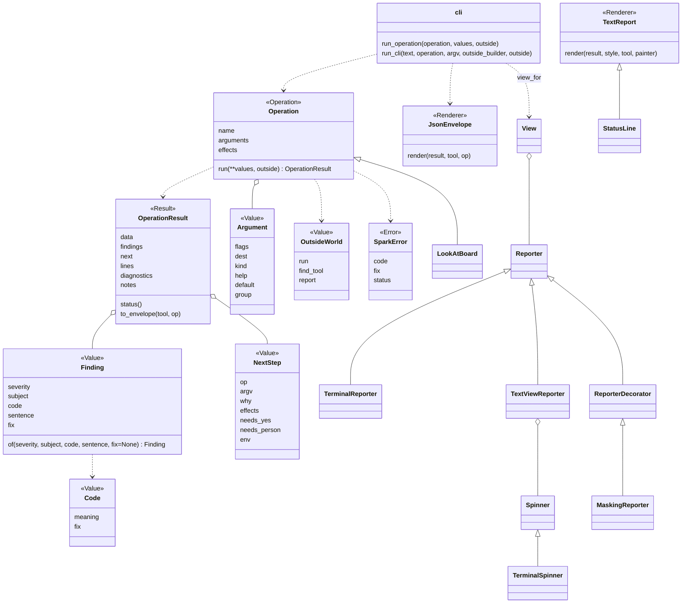

# Patterns and names in spark's core

New code in `scripts/` is small classes with one job each, in library modules, and `main()` only parses and prints
(AGENTS.md). Each class plays one of these roles, and its name or its docstring says which. The PO set this rule on
2026-10-14 ([P239](https://github.com/xmejkal/spark/issues/238), from the council's synthesis in
[PR #239](https://github.com/xmejkal/spark/pull/239)). The tests, the commit gate, the docs rules and the process are in [developing.md](developing.md).

Some words first. A base class defines what a family of classes can do, and each subclass is one member of the family
that fills it in. A docstring is the text in quotes at the top of a class or a function, which says what it does. A
namedtuple is a small record whose fields have names, so a caller writes `result.verdict` and not `result[0]`.

| Role | What it is | Its name | Example |
|---|---|---|---|
| Service | runs the steps of one flow over objects it was given | ends in `Service` | `LookService`, `DeployService`, `KnownBoardService` asks the board question before a touch reads a board (P892; "the gate" stays the deploy's token and yes); `PillLayout` places each jumper's *pill*, the label on its wire with its step's number and the two pads it joins (P953) |
| Strategy | a base class that a caller can swap for another | ends in `Strategy` when the noun alone does not say it does something | `ConsentStrategy` (a `ReplyStrategy` that answers a yes or no); `PartPictureMaker` (one way to make a part's picture: `uses()` says what it needs to run, `make()` gives a picture or a decline, P946); `BoardReader`, `Flasher` and `Reporter` stay plain, and their docstrings say Strategy |
| Adapter | wraps an outside program or stream behind spark's own interface | a plain noun; the docstring says Adapter | `BoardConnection` wraps mpremote, the tool that talks to MicroPython on a board; `Terminal` wraps the person's tty, the one class that reads it (P737); `ToolFinder(project).find` wraps the tools lists as `OutsideWorld.find_tool` (P725), `FlowPageStore` writes the project's `page.html` (P827) |
| Result | what a method returns, as a namedtuple | ends in `Result` | `ReadyResult`, `DeployResult`, `KnownBoardResult` (P892), `MadePictureResult` (the first picture a maker gave and the declines before it, P946) |
| Error | an exception | ends in `Error` (rule C1, under `scripts/`) | `GateClosedError`, `DeployError`, `PackageError`, `ToolMissingError` (a `ToolError`, P725), `BoardQuestionError` holds a stop of the board question (P892) |
| Check | one check of `check.py`, a subclass of `Check` (`image_evidence.CompileCheck` is another thing: it compiles firmware; so is `picture_check.PictureCheck`, a Service that gives a part picture's problems, P946) | ends in `Check` | `RulesCheck`, `PhysicsCheck`, `OrderCheck` |
| Value | facts with no actions. A method can calculate from the facts (`token()`, `to_dict()`; `token()` reads the image file), and a `why_` or `find_` method can answer a question about them, reading the project's files if it must. None changes anything | a plain noun; the docstring says Value | `Port`, `BoardReading`, `LookReport`, `RestrictedPins`, `ProjectImage`, `FlowPage`, `Picture` and `ShownPhase` (P827), `PageWiring`, `PageParts` and `KeptPicture` (P828), `KnownBoard` (P865), `Touch` (P892), `Code` (P853), `StageDefinition` and `StageEnding` (P852), `MeasuredFeatures` (P956) |
| Store | reads and writes one place, in the person's store or in the project, as JSON files | the noun of what it keeps, then `Store` | `GrantStore` keeps one grant file per board in `grants/`; `RepliesStore` keeps the project's replies file (P737); `KnownBoardStore` keeps the board each project's looks read (P865); `EntryOriginStore` keeps the rows of the entries spark wrote in `requirements.json` (P877) |
| Decorator | wraps an object of another class, has the same methods, and adds one behaviour around them | what it adds, then the whole name of what it wraps | `RetryingBoardConnection` cures the board once and runs the code again; `MadePartPictures` puts the makers' picture before spark's pictograms (P946); `ComparingBoardReader` stops after a read of a board that is not the kept one (P892) |
| Renderer | turns one value into lines of a sheet or the text of a file, and decides nothing again. The core's `JsonEnvelope`, `FlatJsonLine` and `JsonDocument` (FlatJsonLine's indented sibling, check_all's, P804) each have `render` and `render_bad_argument` (a line, or None for the usage) | what it draws, then its form | `NumberedList` and `MermaidDiagram` render the steps; `BeforePowerList` renders `BeforePower`; `WokwiBreadboardDiagram` and `SvgBreadboardDiagram` render a scene (`text(scene)`, P969) with a `FILE_NAME` and three messages, `FlowHtmlPage` with its `SECTIONS` (P1123), such as `PartsHtmlFold` |
| Platform | a Strategy that builds every board tool the bench uses, for one firmware language: each `make_` method builds one, and `find_tool` gives the doctor a tool. The bench CLIs and `DeployService` take a platform, and a test gives a Fake | the language, then `Platform`; the docstring starts with Strategy | `FirmwarePlatform` is the base, `MicroPythonPlatform` builds esptool's flasher and reader and mpremote's finder, connection and probe; `FakeFirmwarePlatform` and `FakeProbePlatform` stand in |
| Facade | one object over several module functions of one area, so a caller is given one collaborator (GoF) | the name says its job; the docstring starts `Facade:` | `BoardEmitter` over `read_inputs`, `board_file` and `design_notes` |
| Fake | stands in for a real part in the tests, in `tests/fakes.py` | `Fake`, then the whole name of the part | `FakeBoardConnection`, `FakeConsoleProbe`, `FakeOutsideWorld`, `FakeToolFinder` (P725), `FakeDeployRecordStore` (reads the last deploy and writes a deploy, P458), `FakeTicker` (ticks a `TerminalSpinner` by hand, P478) |
| Operation | one job, with one public method, `run()`: a class with `name`, `arguments` and `effects`, which a frontend runs through the core (see [The core contract](#the-core-contract)) | a verb, then its object | `LookAtBoard`, `WriteFlowPage` (op `write-flow-page`, `flow.py page`, P827) |

An `Argument` can be `required` or have `choices`. The effects are `reads`, `runs`, `board`, `deletes`, `writes`, `asks` (the person's yes) and `fetches` (a URL through the store's one door; `parts.py --describe` keeps its older word `network` for `--fetch` and `--sources`, whose Operations declare `fetches` since P726 PR 2). `json_renderer` is `JsonEnvelope` by default, or `FlatJsonLine` for a script's flat line (the bench scripts', P657, and the build's, P804), or `JsonDocument` for check_all's indented document (P804). The examples in this section are the deploy area's target names. P956 adds the Strategies `FeatureMeasurer` (one way to measure a board's features on the maker's top view) and `FeatureShape` (how one kind of feature is drawn), and the Service `feature_check.FeatureCheck`, which gives the measured features' problems and is no `check.py` Check. P952 adds the Strategy `VendorDocumentFinder` (one maker's way to find a board's top view and dimension drawing on its page; `DfrobotDocumentFinder` reads DFRobot's wiki), the Operation `FindDocuments` (op `find-documents`) and the Service `DocumentKeep`, which keeps what a finder found, all or nothing. P969 adds the Value `BoardMarks`, the board's printed letters, numbers, rail lines and signs with their boxes, made with no picture drawn in `board_marks` (which loads no `svg_diagram`, and holds `BoardPalette`); `BoardBackground` draws the holes and the gap band from the surface and these marks. P969 also moves the Value `WirePill`, the Service `PillLayout` and the Value `WireSizes` (the wire's sizes in px) into `wire_pills`, which loads no `svg_diagram`, so the picture and any other view read the pills' places one way. P969 adds `breadboard_scene`, which loads no `svg_diagram` either: the Service `BreadboardSceneMaker` makes the Value `BreadboardScene` (with the Values `ScenePart`, `SceneJumper` and `SceneGrid`, the scene's half-pitch grid) once, before any view, routing the jumpers and placing the pills and the captions (`PartCaption`, now a Service) through the Strategy `LabelMeasure`, the room a label takes as one view draws it (`PxLabelMeasure` is the SVG's). P969 PR 3b moves the pad labels into the scene too: the Strategy `PadLabelLayout` (`BesideLabels`, `IntoBodyLabels`) takes its gap and middle from the measure (`pad_label()`), and each `ScenePart` holds its Values `PadLabel`, its pad states (`PAD_USED`, `PAD_FREE`), its picture from the maker's `PartPictures` and its line of the note (`PartNotes`, now a Service). P969 PR 4 makes the scene once in the sheet (`sheet.SCENE_MAKER`, where the router is chosen), and every drawing Renderer draws it with `text(scene)`: the Renderer `SvgBreadboardDiagram` places no label and decides no state, and only frames its canvas round the scene with the note under it; `WokwiBreadboardDiagram` writes the scene's layout with the scene's colour words (`colors()`), which the sheet's colour line says too. P969 PR 4b gives the scene one extent box, bounded once before the scene (`extent_of`) and held by its grid, and each board's Value `UsbEnd`, and `BoardMarks` the gap band, the rail holes, the + rail and each mark's baseline through the Strategy `LabelMeasure`, now in `label_measure` (which `board_marks` and `breadboard_scene` both import): a *drop* is how far a baseline lies below the middle of its letters (`mark_drop(size)`, and `pad_label()` gives the gap and the drop), and a *baseline* is a y. The picture takes every size from the scene's marks and only the colours from its palette. `BreadboardSceneMaker` is a Service whose name ends in Maker, not Service, as the makers before it (`PartPictureMaker` makes a part's picture, P946). Its one method is `make()`, and Maker says what it gives back, a made value, where Service would only say that it runs steps.

### The package

`scripts/spark/` is a package, and `scripts/` is on the path in every test. Every entry script (one with a `__main__`
guard) puts its own folder on `sys.path` before its first sibling import (the one-liner
`sys.path.insert(0, str(Path(__file__).resolve().parent))`, or the same through a `SCRIPTS` constant), so it runs under `python3 -I` (which drops the script's folder and ignores PYTHONPATH). `tests/test_scripts_isolated.py`
names the rule. A library needs no such line. `scripts/spark/core/` holds the core contract (the next section), the
leaves `outcomes` (the exit codes and the three outcomes), `text_guards`, `zone_time` and `codes`, which import nothing
of spark but a leaf of `spark.core` (U1, P853), and `clock` (the one `SystemClock`) and `privacy` (the Privacy step).
`scripts/spark/bench/` is the first area package: one
module per Operation (`look_at_board`), and `OPERATIONS` and the area's `build_project_outside_world` in its `__init__.py`. An area whose `__init__.py` imports nothing (design, records, build, checks, breadboard, firmware) holds its table in `<area>_operations.py`, named as `<area>_codes.py` is (`design_operations`, P707), and an area with no Adapter takes the core's `build_bare_outside_world`. Since P679 it holds the bench's 18 libraries too (`board_look`, `deploy_gate`, `flasher` and the rest, imported as `from spark.bench import board_look`). Since P718 its leaf `board_codes` is there too, which only bench modules read. `scripts/spark/idea/` is the second, named for the idea stage: `drop_need` (`DropNeed`, P514), its `idea_codes.py` and its `OPERATIONS`. `scripts/spark/firmware/` is the third (P685): `image_builder`, `import_probe`, `scenario_run`, `scenario_steps`, `project_image`, `sim_project`, the leaf `firmware_codes`, `import_child.py` and the MicroPython `stand_in/`. Since P1060 it holds `project_secrets`: the Adapter `ProjectSecrets` reads the values of a project's secrets files with `ast` and never imports them, for the mask, and `is_secret_file` is the rule that names such a file. Its `__init__.py` imports nothing, and the CLIs `flash_image.py`, `import_firmware.py` and `run_scenario.py` stay in `scripts/`. `scripts/spark/breadboard/` is the fourth (P694): the sheet (`sheet`), its steps (`wiring_steps`), the drawing (`drawing`) and the rest, under the names of its page, with the leaf `breadboard_codes`. Its `__init__.py` imports nothing, and the CLI `breadboard.py` stays in `scripts/` and defines `main` only. `scripts/spark/checks/` is the fifth (P695): the runner (`check`), the five checks (`rules_check`, `physics_check`, `build_check`, `vendor_pins_check`, `order_check`) and the leaf `check_codes`. Its `__init__.py` imports nothing, and the six CLIs (`check_all.py`, `compare_design.py`, `check_physics.py`, `check_footprints.py`, `check_vendor_pins.py`, `check_bom.py`) stay in `scripts/` and define `main` only. Since P783 PR 3 `check.run_every_check` and `physics_check.run_on_files` give the dict `check_all.py` and `check_physics.py` print, and `check.render_every_check` check_all's text. Since P804 check_all is the Operation `check_design.CheckDesign` (op `check-design`, table `checks_operations`), and `run_every_check` takes plain values. `scripts/spark/design/` is the sixth (P702): the requirements file loaded once (`loader`), the pin assignment (`pin_assigner`), `restricted_pins`, `netlist`, `fab` and `copper`. Its `__init__.py` imports nothing, and the CLI `assign_pins.py` stays in `scripts/` and defines `main` only. The emitters and the needs moved in W6-D3b and W6-D3c. `scripts/spark/build/` is the seventh (P705): the run of the build (`build_service`, since P706 the Service `BuildService` over the Adapter `board_engine.TscircuitEngine` and design's `BoardEmitter`, a Facade the build calls in process), each stage's outcome (`stages`: the table `BUILD_STAGES`, P852, that `StageHelpTable` renders for `--help` and `StageMarkdownTable` for how-it-works.md, P936), the two tools (`board_engine`), what `--keep` writes (`kept_files`), the project's set-up (`project_setup`), `ai_files` and the leaf `build_codes`. Its `__init__.py` imports nothing, and the CLIs `check_spine.py` and `init_project.py` stay in `scripts/`. Since P783 PR 3 `requirements_build` holds `check_spine.py`'s whole run, the Service `RequirementsBuildService` (the requirements read, the work folder, `BuildService`'s stages, the history note) and its `RequirementsBuildResult`. Since P804 the build is the Operation `build_board.BuildBoard` (op `build-board`, table `build_operations`; its `stages` is `BUILD_STAGES` as data, P936): it keeps what `--keep` asks for (`kept_files.keep_all`) and removes the work folder, and `check_spine.main` hands it to `run_cli`, as every CLI on the core does. `scripts/spark/records/` is the eighth (P718): the store (`store`), the board records (`board_records`), `brief`, `deploy_record_store`, `provenance`, `board_pads`, `onboard_parts`, `missing_facts`, the leaf `records_codes`, since P719 the tool finder (`tool_finder`) and `versions`, since P720 the record contract (`record_kind`, whose `Answer.to_result` is the seam to the core since P726), since P724 the board's rules (`board_rules`), since P726 `answer_operation` (`AnswerOperation`, the base of a parts.py handler on the core, with the step `build_answer`), since P783 PR 3c `tool_choices` (what `tools.py --on`, `--off` and `--new` do with a choice: `choice_file`, `turn_on`, `turn_off`, `write_new_tool` and `is_mcp_server`), and since P1036 `storage`: two Stores so far (the deploy records and the registrations) keep their entity in a Storage, a Strategy that holds JSON objects by namespace and key. `FileStorage` (an Adapter) keeps them in the person's store, `MemoryStorage` in memory. LangGraph's `BaseStore` maps to spark's `Storage`. The records area's `__init__.py` imports nothing, and the CLIs `boards.py` (`main` and `_validate_all`) and `tools.py` (`main` and `print_status`) stay in `scripts/`. `footprint_stop` moved to design's `footprint_emitter`. `scripts/spark/sourcing/` is the ninth (P717, P720): the part rules with the pull-up band (`part_rules`), the part records read and checked (`part_records`), `matching`, the cost of a run (`run_cost`) and the leaf `sourcing_codes`. Its `__init__.py` imports nothing, and the CLIs `parts.py` (until W6-S3b) and `cost.py` (`main`) stay in `scripts/`. `scripts/spark/flow/` is the tenth (P825): the Operation `show_flow` (`ShowFlow`, op `show-flow`), the nine Strategies of `phase_readers` and the leaf `flow_codes`, with its table in `flow_operations`. Its CLI `flow.py` takes a verb, `show` or `page` (P827), and with no verb it shows. `flow_page` holds the Values `FlowPage` and `Picture` and the Renderer `FlowHtmlPage`. A *section of the page* is one entry of `FlowHtmlPage.SECTIONS`, in the order the page stands, so a new part of the page is one more entry (P1123), and `page_sections` holds them with the Value `ShownPhase` (P1128). Each is a small Renderer with the design-basis `KEYS` it shows, and its class ends in the element it writes (`Heading` an `h1`, `Line` a `p`, `Section` a `section`, `Fold` a `details`). A `<section>` is the HTML element, and `WiringHtmlSection` stays the wiring's `<section>` inside `WiringHtmlFold`. On the page (P1120) a *plane* is a filled background, of a state (`plane-amber`, `plane-red`) or of Now; a *frame* is a box with a hairline; an *edge* is a frame's or a button's border; the *ring* is the focus outline only; and the *halo* is the Now dot's ring. A *kind 1* button is teal: spark runs its step. A *kind 2* button is an outline. `write_flow_page` holds the Operation `WriteFlowPage`, the Adapter `FlowPageStore`, the pure `compose_page` (the FlowPage of a reading and its PageParts; it reads no file) and the function `write_kept_page`, which the build is handed. Its Error `SecretsUnreadableError` names a secrets file that cannot be read, so `write_page` writes nothing (P1060 D5). `flow_reading` holds the Value `FlowReading`, every fact of one read of the flow, which `show_flow.reading_of` makes once: `show` prints it and the page draws it (P1060). `published_page` holds the Store `PublishedPageStore` (`.spark/page.json`, the id of the Artifact the page is published as, P829). `guide` holds `guide_of`, the phase the person acts on now and the phases done and later (P977). `now_follow_up` holds `FlowFollowUp`, the follow-up that names the now steps after a write and writes an existing page.html again (P1035). `wired_board` holds the Value `WiredBoard`, `read_wired` and `with_wired` (P1044): a *witness* is one fact that says the person's breadboard can be wired, the kept sheet or a board log, and with one the parts phase says so and each pick's and build's effect opens with a fixed sentence. Spark never says that a board is wired. A *phase* is one step of a project from the idea to the deploy, and an *offer* is a step a phase lists for a person or Claude: a key, a label (the words of its button), its effect and `makes_stale`, the phases it can make out of date (P829). Its kind is a row of `flow_codes.OFFER_KINDS` (P1115), the Value `OfferKind`: its phase, label, `from_page` (the page sends it) and `tell`, one sentence for Claude that names a job, never the how. A *chat offer* is a kind with a tell (P1122): it names a job only Claude does, and an Operation such as `LookAtBoard` does it. `needs-drop` is asked in the chat but has no tell, so it is no chat offer. The guide's `now.chat_offer` names one by `flow_codes.CHAT_NOW`, and the NOW box shows its tell under "Ask Claude". The effect is plain words: short sentences a person reads, each write named by what it is and where it goes ("Uses 1 of your 3 red LEDs for the light."), and no sentence the real run did not show. The *fingerprint* (`fingerprint.fingerprint_of`) is the sha256 of the current offers and the three files a click changes. The phase words `not-started`, `partial` and `stale` stand beside the three outcomes in a phase's status, never in an envelope's. A *status word* is the words a page shows for a status (`ok`, `problems`, `could not run`, `not started`, `partly done`, `out of date`, or `not checked by spark` for no status). A *mark* is the glyph beside it, and the page hides it from a screen reader, so the word carries the meaning. The *text view* (P1032) is what a CLI prints on stdout without `--json`. Its first line, the *status line*, holds a *mark* too (`✓` ok, `✗` stop, `!` warning, `?` not checked, or the words `OK`, `STOP`, `WARN` and `?` on a stream that cannot encode them), the op, the status word and the *headline*'s sentence: the Value `Headline` (`sentence`, `mark`, `text_notes`) on `OperationResult.headline`, which no envelope holds. The *facts* follow, then the sections Problems, Not checked, *Note* (the one word for the notes) and Next. The Renderer `TextReport` (in `renderers.py` since P1032) lays it out, and the Strategies `PlainPainter` and `RichPainter` (rich's colour, imported only when the style has colour) paint it. The run's *style* is the Value `TextStyle` (`colour`, `motion`, `symbols`), which `replies.Terminal.text_style()` gives, read only for a result with a headline. The *developer fold* is the page's last section, always closed: the phases, each offer's key and effect, the marks and the record ids (P1062; it took the rail's place). `page_script.js` is the page's one script (P829 PR 3): the Strategy `RequestChannel` is how the page's request leaves and its answer comes back (`send`, `watch`, `withdraw`), and the Adapter `DbChannel` is its one implementation, on the Artifact database. The Controller `Requests` holds one request at a time, the View `PageView` makes its buttons, and `shownState` says a request and its answer in the words Python wrote (`flow_page.page_words`), and `lastRequest` the last request with its date and label (P1062). Since P1077 `scripts/spark/operation_catalogue.py` is a module above the areas, outside the core. Its `CATALOGUE`, the *Operation catalogue*, holds every table in one map, and its `NETWORK` lists the ops whose effects hold `fetches`. No module of the core or of an area imports it, and a frontend hands it to `DescribeOperations` through the constructor. Every entry builds with no argument: a dependency comes through `outside` or as a keyword with a harmless default, and `DescribeOperations` is the one exception. The part-record words `--catalog`, `catalog_records`, `CATALOG_KEYS` and `drawing_catalog` are another thing. The research Operation's table is `sourcing/research/research_operations`.
Since W6-S3b (P721), every script left flat in `scripts/` is a CLI with a `main`. A tool that lists the scripts
(`tools/inventory.py`, `tools/measure.py`, the tests that read every script) looks in the folders under `scripts/` too.
Most of them leave out `scripts/spark/firmware/stand_in/`, but `test_no_magic_strings` reads it too. `test_orphans`,
`test_self_confirmation` and the inventory leave out each `__init__.py` as a script to route, and `test_orphans` counts
the imports of a package's `__init__.py`. The children spark starts with `python3 -I` (`import_child.py`, and the `-c` compile
child of `image_evidence`) still never import `spark.core`: they add no path line, on purpose.

### The core contract

The core ([P442](https://github.com/xmejkal/spark/issues/587), wave 3 of the refactor) is what every area and every
frontend shares, so that a CLI, an agent or an MCP tool runs the same code. An Operation (`spark.core.operation`) is a
class with `name` (the `op` the envelope prints), `summary` (one sentence for a catalogue or an MCP tool, P726),
`details` (what `--help` prints after the arguments, before the CLI's own text, P481), `arguments` (its `Argument`s,
as argparse adds them; an Argument with `payload` names a JSON file the CLI adapter reads and hands in as a value, `cli.load_payloads`) and `effects`
(the effect words are listed under the table at the top), `input_schema()` and `output_schema()` (JSON Schemas of the values and the envelope, an MCP tool's `inputSchema` and `outputSchema`, P605), and one public method, `run(**values, outside)`, which returns an `OperationResult`
(`spark.core.result`): `data`, `findings` (a `Finding` per thing found, with its severity, subject, code, sentence and
fix), `next` (a `NextStep` per step an agent may take), `lines` (the report a person reads), `diagnostics` (lines for
the person beside the answer: the board doctor's, a crash's traceback) and `notes`. `status()` is `outcomes.status_of`
over the findings, so `ok` stays unreachable while anything is unchecked, and `to_envelope(tool, op)` is the envelope in
today's key order. An Operation reaches the outside only through `outside`, an `OutsideWorld` (`spark.core.outside`):
`run` runs a program, `find_tool` gives a tool by its name, `report(event)` tells the person what happens now (an `Event` of `spark.core.events`, to the frontend's `Reporter`), `clock` is the time and the waits, `make_consent(line)` asks the person for the yes (P655), and `replies(question)` is a `ReplyStrategy`'s `reply` (`spark.core.replies`, P737): the `Reply` to a `Question`, or None, so the question goes on `data.open`. `fetch(url)` gives one URL's bytes or raises the store's `StoreError`. `add_diagnostics(lines)`, which `run_operation` fills (P840) and an Operation hands its Service (P938), takes a line said before work that can still fail; a line built into the final result goes in the result's `diagnostics`.
A collaborator that a test swaps whole comes through the Operation's constructor, None for the real one, and `effects_of(values)` narrows the effects of one run. The child Python that `image_evidence.CompileCheck` starts goes
through `outside.run` (P458), the store the look reads through `LookAtBoard(records=)` as the deploy's does, and the project's
files are the `--project` folder, read direct (a sandbox is another folder); a `Project` Adapter over them is the open option, [P788](https://github.com/xmejkal/spark/issues/1094). `build_outside_world(effects, reporter, find_tool)` gives the real `run` only when the effects hold `runs`,
and a stub that raises `SparkError` with code `undeclared_effect` otherwise; an area's builder,
`spark.bench.build_project_outside_world(project, effects, reporter)`, adds `ToolFinder(project).find` (P725). A test
gives a `FakeOutsideWorld`. `SparkError` is the one error an Operation raises instead of crashing: a `ValueMessageError`
with `code`, `fix` and `status`. A `Code` (P853) holds its `meaning` and `fix`, which `Finding.of` and `SparkError` take
with `codes.fix_of`. A `%` fix is a template filled at its site; a fix that differs in kind is a variant, a Code of its
parent's word (or a core code's). `test_json_contracts.py` fails on a code off its table or a fix not its code's.

`spark.core.cli` holds the frontends. `run_operation(operation, values, outside, build_outside, options)` runs for any frontend (P605: `options` is a `RunOptions` of `privacy`, `trace`, `clock` and `follow_up`, the Strategy `FollowUp` of `spark.core.follow_up` that adds its steps after the Operation's own when the run is `ok`, its effects hold `writes` and `Operation.written_project(values)` names a project, P1035, and whose `refresh(project, result)` then writes again the file `refreshes` names when `cli.refreshes(result)` holds, a run that did not crash, at any status, story 0c (P1069). `PageFollowUp` refreshes and adds no step (`deploy.py`); the CLI takes it from `HelpText.follow_up`. It masks the result with the `Privacy` step, then calls `trace` once, and a trace that raises adds one diagnostics line), puts the lines of `add_diagnostics` first, before it masks, and turns a
`SparkError` into one Finding of its status, and any other exception into one unchecked Finding with code `crash`: the
sentence names the exception class only, because a message can carry a home path, and `diagnostics` gets the op and the
class, the fix, and the traceback, its last line through `printable`. `run_cli(text, operation, argv, *,
outside_builder, outside=None)` is the CLI: it parses the Operation's arguments with `outcomes.AnsweringParser` (a bad
flag is a `bad_argument` envelope under `--json`, the usage without), runs, renders with the run's View (below): the Operation's `json_renderer` under `--json`, else its `text_renderer` (Renderers, which decide nothing again), prints the diagnostics on stderr through `guard_lines` and returns `EXIT_FOR[status]`. Rule X2 names it by file and name as the function that prints in `scripts/spark/`, beside the Renderers, the terminal consent, `TerminalReporter`, which prints the text of a `LINE` (an `Event` holds `kind`, `code` and `text`), and `TextViewReporter` with its `TerminalSpinner`; `outcomes.AnsweringParser.exit_with_usage` prints the usage too and stands in the baseline. A script's `main` is one call of `run_cli`, and the look's takes `operation=None` (P481).

The *event view* (P478) is the events of a run as a person reads them without `--json`. `cli.view_for(operation, as_json, streams, environ, importer)` is the one place that decides `--json`, a pipe or a terminal: it returns the Value `View` (`style`, `painter`, `reporter`, `render`), made once per run, so the painter is chosen once. Under `--json` the events go to stderr through `TerminalReporter`, which prints no heading, and both streams keep their bytes. Without it the Strategy `TextViewReporter` prints each LINE as `TerminalReporter` does (`events.event_lines`, one form for both) and a *heading*, `[n/N] name`, when a BEGIN's code is the name of the nth of the Operation's N *stages* (the rows of `Operation.stages`: `BUILD_STAGES`, or deploy's `DEPLOY_STAGES` of `DeployStage(name, summary)`, whose summaries are the why lines). An Operation with no stages gets no heading. `Operation.text_renderer` is `TextReport` (the full layout) or `StatusLine`, a blank line and the status line alone (`TextReport.status_line`), for an Operation whose events said the rest, as deploy's do. `Reporter.finish()` says the run is over: a Reporter puts the terminal back as it was, and `run_cli` calls it once after every run. The Decorator `ReporterDecorator` is the base of a Reporter that wraps another and forwards `finish`, `echo_fd`, `mask` and `stream`; `MaskingReporter` is one. A WAIT (an Event of kind WAIT, P478 slice 2) says that spark waits on work whose children are captured until the next event: `TerminalReporter` prints nothing for it, and `TextViewReporter` prints its line as a LINE's and starts its *spinner*, which every next event and `finish` stop. The Strategy `Spinner` is that seam: `NO_SPINNER` is its Null Object, which draws nothing, and `TerminalSpinner` draws a frame and the seconds since the wait began over the Adapter `ThreadTicker`, a thread it always joins; `view_for` gives it only when the style has motion. The event piece of P793 adds END, the kind of a stage that ended.

### The rules test

`tests/test_architecture.py` reads `scripts/` and `tests/` with `ast` and holds each breach against `tests/architecture_baseline.json`. One test method checks one rule (R1, R2, R3, R6, T1, T2, T4, X2, U1, C1, C3, V1). Each rule is one sentence in `measure.RULES` in `tools/measure.py`, which the test's docstrings and its failure messages read; `python3 tools/measure.py --rules` lists every breach with its rule.

The baseline lists the breaches that exist today, one `"rule:file:name": value` per line and sorted, so two branches merge line by line. The value is the measured size, not only the name. The baseline only shrinks: a new breach fails, a value above its entry fails, and so does an entry the code no longer has. A value below its entry passes; write it
back with `python3 tools/measure.py --rules --accept`, which takes only values that fell and entries that are gone and
refuses a new or risen breach. `--accept-new` writes those too: use it only for a rule that enters, for a branch that
rebases on another one, or for a rename that moves a key at an equal value, and give the reason in the PR. A failure names the rule and its limit, the file, the name and
the value, and `python3 tools/measure.py --rules` shows every breach.

R6 and C1 list a class by its qualified name (`Outer.Inner`). V1 counts the raises of a `ValueMessageError` or a subclass
whose template is no string constant, per class (`V1:file:Class`); its baseline is empty since P451, see the next section. T1, T2, T4, X2 and C3 count the breaches of a file under
one key: they say how many, not where, so a new breach next to an old one shows only as a higher count. A baseline of
200 entries hides what it lists: each slice pays down the lines it touches.

### Messages that hold a value (V1)

An error that puts a path, a name or a record's field into its sentence inherits from `ValueMessageError`
(`scripts/spark/core/text_guards.py`, [P444](https://github.com/xmejkal/spark/issues/592)) and a raise passes the values
as arguments: `raise ToolError("%s is not JSON (%s)", path, broken)`, never `"..." % (path, broken)`. The class puts
each value on one line, keeps a number and a `%r` value as they are, and keeps the raw values on `.values`. Rule V1
counts the raises that build the text first. Its baseline is empty
([#606](https://github.com/xmejkal/spark/issues/606)): a new raw site is fixed, never baselined. A template kept as data
is filled with `%` (P852). `Class.of_lines([...])` raises several sentences, one per line, each flattened;
`Class.of_error(error)` does the same for the lines of another error, so a nested error keeps its line breaks.

What V1 does not see, so a reviewer looks for it: a class under another name (`import ToolError as SP`, `P = ToolError`),
the lines that `X.of_lines(...)` and `X.of_error(...)` take (safe by construction), and a message built before the raise
(a sentence a function returns, such as `tool_finder.off_sentence` and `tool_finder.entry_problem`, which
use `flat_line` by hand).

### One responsibility, one name

The PO agreed these rules on 2026-10-21 ([P381](https://github.com/xmejkal/spark/issues/488)): "let's try to stick
to the rules we set". New code follows them now. Today's names change in the names pass
([P382](https://github.com/xmejkal/spark/issues/489)) and the v0.13 area moves, so an old name is no example.

1. One word has one meaning in the code, the docs, the JSON and Miro. The P323 glossary holds the words, and
   [words.md](words.md) holds the tables of words for one area.
2. A name says what the thing is for, not which tool does it. Only the adapter that wraps a tool carries the tool's
   name: `BoardReader` is the role, and `EsptoolBoardReader` fills it with esptool.
3. Each level has one responsibility. You can say it in one sentence without "and".

   | Level | Its one responsibility | Its name | Example |
   |---|---|---|---|
   | CLI | one topic for a person and Claude, with one subcommand per job | a noun | `parts.py`, with `parts.py show` |
   | Operation | one job, with one public method, `run()` | a verb, then its object | `LookAtBoard`, `ShowPart` |
   | helper | one thing, with several methods about it | an `-er` noun or a plain noun | `BoardReader`, `PortFinder` |

4. An Operation's module, class and op name (printed as `op` in the JSON) use the same words: the module `show_part`,
   the class `ShowPart`, the op `"show-part"`. Its subcommand is the verb alone, because the CLI's topic noun gives
   the object: `parts.py show`. An `op` that a golden or a command page already pins keeps its spelling (decision 5 of
   the refactor plan, the PO on 2026-10-26); only a new Operation follows this rule. The op is the script's name, and a
   script with two modes names its mode: `issue-grant`, `check-grant` (`grant.py`, `grant.py --check`).
5. A class that only reads says so in its name: `Reader`, `Finder` or `Probe`. A class or a method that changes a
   board, a file or a port has a verb that names the change: `write`, `erase`, `cure`, `save`.
   A `Probe` asks the board or the port one question: an Adapter, or a Strategy when several answer it (`DoctorProbe`).

The role table above still applies. Its role words end a name, and `Fake` starts one. A Service, a Store or an
Adapter from that table is a helper with its role word, and an Operation calls it.

These rules name a class, a function or a constant:

- Name a thing for what it is to someone who has never seen spark.
- A name follows a known source where one has it: Box2D, Game Programming Patterns, Unity, Bevy, Godot, the Python
  and C conventions. The plan names the source (the PO, 2026-11-04: *"always try to stick to insdustry standards"*).
- A subclass is what varies, then the base's whole name: `TerminalConsentStrategy`, `EsptoolBoardReader`.
- A function starts with a verb. A function that returns a reason or None starts with `why_`. A function that raises
  in place of returning False says so: `require_open_gate`.
- A constant that holds a number carries its unit (`_S`, `_MB`). A constant that holds a sentence ends in `_HINT` or `_MESSAGE`.
- Code decides on a named constant, never on a sentence ([P260](https://github.com/xmejkal/spark/issues/282)). A
  message is the text a person reads, and a phrase is an outside tool's words. The code that writes a value and the
  code that reads it import the same name, for example `needs.WHY_NO_RECORD`. An outside tool's phrase lives in one
  constant next to the code that reads it, and its comment names the tool. A code is not a message, so it takes no
  `_MESSAGE` suffix. `tests/test_no_magic_strings.py` fails on a literal with a space in a comparison, a `match`
  case or a search such as `startswith` or `re.search`. It does not see a one-word literal, a sentence built at run
  time, a dictionary key or a split, so a reviewer checks those.
- An exception's name under `scripts/` ends in `Error`; rule C1 fails one that does not ([P709](https://github.com/xmejkal/spark/issues/956)).

Each docstring says these things:

- A class: its role word first, then its job in one sentence, the objects it is given, what a subclass must supply,
  and what it raises.
- A public function: what it returns (the shape of a tuple or a dict), what it raises, and what it never does, such as
  erase or write.
- A module: what it is a library for, and who calls it. A constant: its unit or its source.

A tiny value or a calculation with no state stays a plain function or a namedtuple. Make a class when something holds
state and offers several actions on it, or when a test or a caller must swap it.

A fake of a tool's output, such as mpremote's, stays in its test file, not in `tests/fakes.py` (the role table's `Fake`).

The bench area's Operations, the script that each one is behind and what each does are in [the map](map.md).

