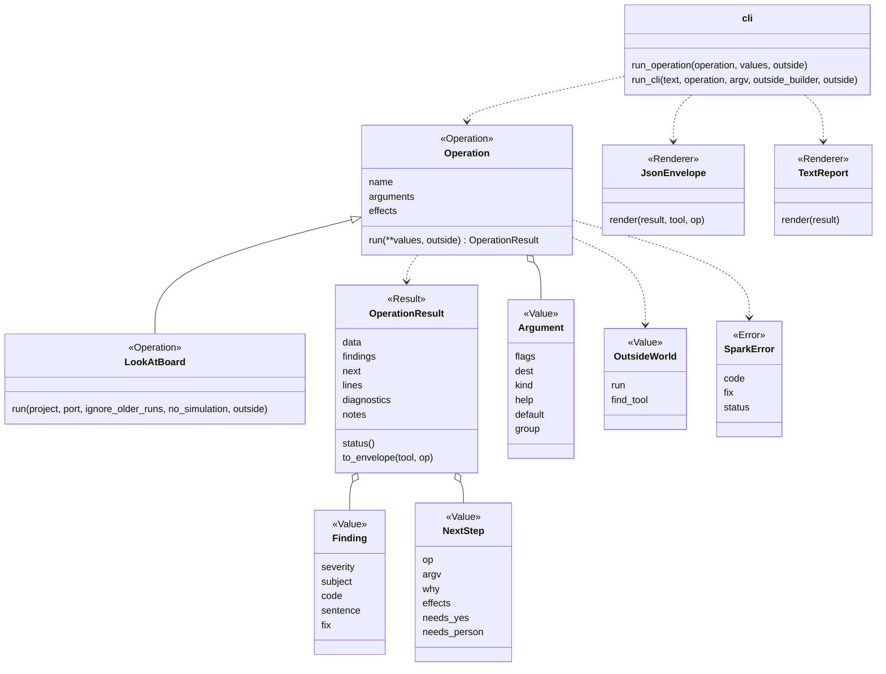

# Patterns and names in spark's core

New code in `scripts/` is small classes with one job each, in library modules, and `main()` only parses and prints
(AGENTS.md). Each class plays one of these roles, and its name or its docstring says which. The PO set this rule on
2026-10-14 ([P239](https://github.com/xmejkal/spark/issues/238), from the council's synthesis in
[PR #239](https://github.com/xmejkal/spark/pull/239)).

Some words first. A base class defines what a family of classes can do, and each subclass is one member of the family
that fills it in. A docstring is the text in quotes at the top of a class or a function, which says what it does. A
namedtuple is a small record whose fields have names, so a caller writes `result.verdict` and not `result[0]`.

| Role | What it is | Its name | Example |
|---|---|---|---|
| Service | runs the steps of one flow over objects it was given | ends in `Service` | `LookService`, `DeployService` |
| Strategy | a base class that a caller can swap for another | ends in `Strategy` when the noun alone does not say it does something | `ConsentStrategy`; `BoardReader` and `Flasher` stay plain, and their docstrings say Strategy |
| Adapter | wraps an outside program behind spark's own interface | a plain noun; the docstring says Adapter | `BoardConnection` wraps mpremote, the tool that talks to MicroPython on a board |
| Result | what a method returns, as a namedtuple | ends in `Result` | `ReadyResult`, `DeployResult` |
| Error | an exception | ends in `Error` (the deploy area only, for now) | `GateClosedError`, `DeployError` |
| Value | facts with no actions. A method can calculate from the facts (`token()`, `to_dict()`; `token()` reads the image file), and a `why_` or `find_` method can answer a question about them, reading the project's files if it must. None changes anything | a plain noun; the docstring says Value | `Port`, `BoardReading`, `LookReport`, `RestrictedPins`, `ProjectImage` |
| Store | reads and writes one place in the person's store, as JSON files | the noun of what it keeps, then `Store` | `GrantStore` keeps one grant file per board in `grants/` |
| Decorator | wraps an object of another class, has the same methods, and adds one behaviour around them | what it adds, then the whole name of what it wraps | `RetryingBoardConnection` cures the board once and runs the code again |
| Renderer | turns one value into lines of a sheet or the text of a file, and decides nothing again | what it draws, then its form | `NumberedList` and `MermaidDiagram` render the steps (`WIRING_VIEWS`); `WokwiBreadboardDiagram` and `SvgBreadboardDiagram` render the layout (`DRAWING_RENDERERS`), with `FILE_NAME`, `NOUN`, `PURPOSE_MESSAGE` and `SHEET_MESSAGE` |
| Platform | a Strategy that builds every board tool the bench uses, for one firmware language: each `make_` method builds one, and `find_tool` gives the doctor a tool. The bench CLIs and `DeployService` take a platform, and a test gives a Fake | the language, then `Platform`; the docstring starts with Strategy | `FirmwarePlatform` is the base, `MicroPythonPlatform` builds esptool's flasher and reader and mpremote's finder, connection and probe; `FakeFirmwarePlatform` and `FakeProbePlatform` stand in |
| Fake | stands in for a real part in the tests, in `tests/fakes.py` | `Fake`, then the whole name of the part | `FakeBoardConnection`, `FakeConsoleProbe`, `FakeOutsideWorld` |
| Operation | one job, with one public method, `run()`: a class with `name`, `arguments` and `effects`, which a frontend runs through the core (see [The core contract](#the-core-contract)) | a verb, then its object | `LookAtBoard` |

The examples in this section are the deploy area's target names. P239's PRs 3 to 8 give the code these names. PR 3
gave `ConsentStrategy`, `TerminalConsentStrategy`, `GateClosedError`, `require_open_gate` and the unit suffixes. PR 4
gave `ReadyResult`, `DeployPlan` and `BoardLog`. PR 5 gave `ProjectImage`, `DeployError`, `tools.command_for` and
`board_look.BOOT_HINT` (PR 7 moved it to the flasher, and P213 b2 made it `boot_hint`). PR 6 gave `LookReport` (with `to_dict()`), `LookService`,
`BoardReading` and `board_look.report_lines`. PR 7 gave `flasher.Flasher`, `flasher.EsptoolFlasher` (which holds `ERASE`, `WRITE`,
`IMAGE_OFFSET` and `BOOT_HINT_TEMPLATE`) and `flasher.build_esptool_prefix`. P213 b2 replaced the constant: `boot_hint` is the
sentence an `EsptoolFlasher` holds, `boot_hint_for(places)` builds it, and `boards.ButtonPlaces` (a Value) names the
buttons from the record's `physical.buttons`. `board_doctor.step_sentence` does the same for the doctor's steps.
PR 8 gave `deploy_service.DeployService` (`plan`, `look`, `deploy`, `verify`), `deploy_service.DeployResult` and
`firmware_platform.FirmwarePlatform`. P475 made that class the base of `MicroPythonPlatform`, gave it the board reader and the port finder, and made `board_console.SystemClock` the one clock (`now`, `monotonic`, `sleep`). `deploy.py` only parses, prints and maps the exit code.

### The package

`scripts/spark/` is a package, and `scripts/` is on the path in every test. Every entry script (one with a `__main__`
guard) puts its own folder on `sys.path` before its first sibling import (the one-liner
`sys.path.insert(0, str(Path(__file__).resolve().parent))`, or the same through a `SCRIPTS` constant), so it runs under `python3 -I` (which drops the script's folder and ignores PYTHONPATH). `tests/test_scripts_isolated.py`
names the rule. A library needs no such line. `scripts/spark/core/` holds the core contract (the next
section) and the leaf modules every script shares: `outcomes` (the exit codes and the three outcomes), `text_guards`,
`zone_time` and `codes`. The leaves import nothing of spark. A script writes `from spark.core import outcomes` and then
`outcomes.EXIT_OK`, or `from spark.core.outcomes import EXIT_OK`. `scripts/spark/bench/` is the first area package: one
module per Operation (`look_at_board`), and `OPERATIONS` and the area's `build_project_outside_world` in its `__init__.py`.
The other scripts stay flat in `scripts/` until their own card moves them. A tool that lists the scripts
(`tools/inventory.py`, `tools/measure.py`, the tests that read every script) looks in the folders under `scripts/` too.
Most of them leave out `scripts/stand_in/`, but `test_no_magic_strings` reads it too. `test_orphans`,
`test_self_confirmation` and the inventory leave out each `__init__.py` as a script to route, and `test_orphans` counts
the imports of a package's `__init__.py`. The children spark starts with `python3 -I` (`import_child.py`, and the `-c` compile
child of `image_evidence`) still never import `spark.core`: they add no path line, on purpose.

### The core contract

The core ([P442](https://github.com/xmejkal/spark/issues/587), wave 3 of the refactor) is what every area and every
frontend shares, so that a CLI, an agent or an MCP tool runs the same code. An Operation (`spark.core.operation`) is a
class with `name` (the `op` the envelope prints), `arguments` (its `Argument`s, as argparse adds them) and `effects`
(`reads`, `runs`, `board`), and one public method, `run(**values, outside)`, which returns an `OperationResult`
(`spark.core.result`): `data`, `findings` (a `Finding` per thing found, with its severity, subject, code, sentence and
fix), `next` (a `NextStep` per step an agent may take), `lines` (the report a person reads), `diagnostics` (lines for
the person beside the answer: the board doctor's, a crash's traceback) and `notes`. `status()` is `outcomes.status_of`
over the findings, so `ok` stays unreachable while anything is unchecked, and `to_envelope(tool, op)` is the envelope
in today's key order. An Operation runs a program and finds a tool only through `outside`, an `OutsideWorld`
(`spark.core.outside`): `run` runs a program and `find_tool` gives a tool by its name. The rest of the outside (the
project's files, the store, and the child Python that `image_evidence.CompileCheck` starts) still goes direct, and
moves behind the outside with its own card. `build_outside_world(effects,
find_tool)` gives the real `run` only when the effects hold `runs`, and a stub that raises `SparkError` with code
`undeclared_effect` otherwise; an area's builder, `spark.bench.build_project_outside_world(project, effects)`, adds the
project's tool finder. A test gives a `FakeOutsideWorld`. `SparkError` (`spark.core.errors`) is the one error an
Operation raises to answer instead of crashing: a `ValueMessageError` with `code`, `fix` and `status`.

`spark.core.cli` holds the frontends. `run_operation(operation, values, outside)` runs for any frontend and turns a
`SparkError` into one Finding of its status, and any other exception into one unchecked Finding with code `crash`: the
sentence names the exception class only, because a message can carry a home path, and `diagnostics` gets the op and
the class, the fix, and the traceback, its last line through `printable`. `run_cli(text, operation, argv, *, outside_builder, outside=None)` is the CLI: it parses the Operation's
arguments with `outcomes.AnsweringParser` (a bad flag is a `bad_argument` envelope under `--json`, the usage without),
runs, renders with `JsonEnvelope` or `TextReport` (the two Renderers, which decide nothing again), prints the diagnostics
on stderr through `guard_lines` and returns `EXIT_FOR[status]`. Rule X2 names it by file and name as the function that
prints in `scripts/spark/`, beside the Renderers and the terminal consent; `outcomes.AnsweringParser.exit_with_usage`
prints the usage too and stands in the baseline. A script's `main(argv=None, outside=None)` is one call
of `run_cli`; `scripts/look.py` is the first, over `LookAtBoard`. The core's own codes are in `spark.core.codes`.

### The rules test

`tests/test_architecture.py` reads `scripts/` and `tests/` with `ast` and holds each breach against
`tests/architecture_baseline.json`. One test method checks one rule (R1, R2, R3, R6, T1, T2, T4, X2, U1, C1, C3, V1). Each
rule is one sentence in `measure.RULES` in `tools/measure.py`, which the test's docstrings and its failure messages read;
`python3 tools/measure.py --rules` lists every breach with its rule.

The baseline lists the breaches that exist today, one `"rule:file:name": value` per line and sorted, so two branches
merge line by line. The value is the measured size, not only the name. The baseline only shrinks: a new breach fails,
a value above its entry fails, and so does an entry the code no longer has. A value below its entry passes; write it
back with `python3 tools/measure.py --rules --accept`, which takes only values that fell and entries that are gone and
refuses a new or risen breach. `--accept-new` writes those too: use it only for a rule that enters or for a branch that
rebases on another one, and give the reason in the PR. A failure names the rule and its limit, the file, the name and
the value, and `python3 tools/measure.py --rules` shows every breach.

R6 and C1 list a class by its qualified name (`Outer.Inner`). V1 counts the raises of a `ValueMessageError` or a subclass
whose template is no string constant, per class (`V1:file:Class`); its baseline is empty since P451, see the next section. T1, T2, T4, X2 and C3 count the breaches of a file under
one key: they say how many, not where, so a new breach next to an old one shows only as a higher count. A baseline of
200 entries hides what it lists: each slice pays down the lines it touches.

### Messages that hold a value (V1)

An error that puts a path, a name or a record's field into its sentence inherits from `ValueMessageError`
(`scripts/spark/core/text_guards.py`, [P444](https://github.com/xmejkal/spark/issues/592)) and a raise passes the values as
arguments: `raise ToolProblem("%s is not JSON (%s)", path, broken)`, never `"..." % (path, broken)`. The class puts each value on
one line, keeps a number and a `%r` value as they are, and keeps the raw values on `.values`. Rule V1 counts the raises that
build the text first. Its baseline has no entry (P451, [#606](https://github.com/xmejkal/spark/issues/606)), and
`tests/test_architecture.py` fails if one comes back, so a new raw site is fixed and never baselined.
`Class.of_lines([...])` raises several sentences, one per line, each flattened; `Class.of_error(error)` does the same for
the lines of another error, so a nested error keeps its line breaks.

What V1 does not see, so a reviewer looks for it: a class under another name (`import ToolProblem as SP`, `P = ToolProblem`),
the lines that `X.of_lines(...)` and `X.of_error(...)` take (safe by construction), and a message built before the raise
(a sentence a function returns, such as `tools.off_sentence` and `tools.entry_problem`, which
use `flat_line` by hand).

### One responsibility, one name

The PO agreed these rules on 2026-10-21 ([P381](https://github.com/xmejkal/spark/issues/488)): "let's try to stick
to the rules we set". New code follows them now. Today's names change in the names pass
([P382](https://github.com/xmejkal/spark/issues/489)) and the v0.13 area moves, so an old name is no example.

1. One word has one meaning in the code, the docs, the JSON and Miro. The P323 glossary holds the words.
2. A name says what the thing is for, not which tool does it. Only the adapter that wraps a tool carries the tool's
   name: `BoardReader` is the role, and `EsptoolBoardReader` fills it with esptool.
3. Each level has one responsibility. You can say it in one sentence without "and".

   | Level | Its one responsibility | Its name | Example |
   |---|---|---|---|
   | CLI | one topic for a person and Claude, with one subcommand per job | a noun | `parts.py`, with `parts.py show` |
   | Operation | one job, with one public method, `run()` | a verb, then its object | `LookAtBoard`, `ShowPart` |
   | helper | one thing, with several methods about it | an `-er` noun or a plain noun | `BoardReader`, `PortFinder` |

4. An Operation's module, class and op name (printed as `op` in the JSON) use the same words: the module `show_part`,
   the class `ShowPart`, the op `"show-part"`. Its subcommand is the verb alone, because the CLI's topic noun gives
   the object: `parts.py show`. An `op` that a golden or a command page already pins keeps its spelling (decision 5 of
   the refactor plan, the PO on 2026-10-26); only a new Operation follows this rule.
5. A class that only reads says so in its name: `Reader`, `Finder` or `Probe`. A class or a method that changes a
   board, a file or a port has a verb that names the change: `write`, `erase`, `cure`, `save`.

The role table above still applies. Its role words end a name, and `Fake` starts one. A Service, a Store or an
Adapter from that table is a helper with its role word, and an Operation calls it.

Words for a rules file (P454, #615): a *rule* is one `fabrication` entry of a project's `.spark/rules.json`.

| Word | Means | Where |
|---|---|---|
| `lowest` | the table of limits, one per process key | `data/fabrication.json`, `fab.DATA["lowest"]` |
| `above`, `at_least` | the two kinds of limit: the value must be greater, or may equal it | the entries of `lowest` |
| `TOO_LOW`, `NOT_A_NUMBER`, `NOT_AN_OBJECT` | the reason `fab.fabrication_problem` returns beside the field | `scripts/fab.py` |

These rules name a class, a function or a constant:

- Name a thing for what it is to someone who has never seen spark.
- A subclass is what varies, then the base's whole name: `TerminalConsentStrategy`, `EsptoolBoardReader`.
- A function starts with a verb. A function that returns a reason or None starts with `why_`. A function that raises
  in place of returning False says so: `require_open_gate`.
- A constant that holds a number carries its unit (`_S`, `_MB`). A constant that holds a sentence ends in `_HINT` or
  `_MESSAGE`.
- Code decides on a named constant, never on a sentence ([P260](https://github.com/xmejkal/spark/issues/282)). A
  message is the text a person reads, and a phrase is an outside tool's words. The code that writes a value and the
  code that reads it import the same name, for example `needs.WHY_NO_RECORD`. An outside tool's phrase lives in one
  constant next to the code that reads it, and its comment names the tool. A code is not a message, so it takes no
  `_MESSAGE` suffix. `tests/test_no_magic_strings.py` fails on a literal with a space in a comparison, a `match`
  case or a search such as `startswith` or `re.search`. It does not see a one-word literal, a sentence built at run
  time, a dictionary key or a split, so a reviewer checks those.
- Only the deploy area uses the `Error` suffix now. The rest of the repository changes in v0.13
  ([#94](https://github.com/xmejkal/spark/issues/94)).

Each docstring says these things:

- A class: its role word first, then its job in one sentence, the objects it is given, what a subclass must supply,
  and what it raises.
- A public function: what it returns (the shape of a tuple or a dict), what it raises, and what it never does, such as
  erase or write.
- A module: what it is a library for, and who calls it. A constant: its unit or its source.

A tiny value or a calculation with no state stays a plain function or a namedtuple. Make a class when something holds
state and offers several actions on it, or when a test or a caller must swap it.

The fake of a part that a caller can swap lives in `tests/fakes.py` and starts with `Fake`, for example
`FakeBoardConnection` and `FakeConsent`. A fake of a tool's output, such as mpremote's, stays in its test file.

The PO's bench tools for live work on a board sit beside the deploy area. `scripts/reach.py` runs one line on the
board on USB and cures it once when its USB output died at power-on (P251,
[#264](https://github.com/xmejkal/spark/issues/264)). Its flags are `--project`, `--port`, `--json` (one line for the
bench log) and `--cure-first` (the bench's cold arm). It is not in [the scripts guide for AI agents](agents/scripts.md) until P247 puts it behind
the PO's grant.

