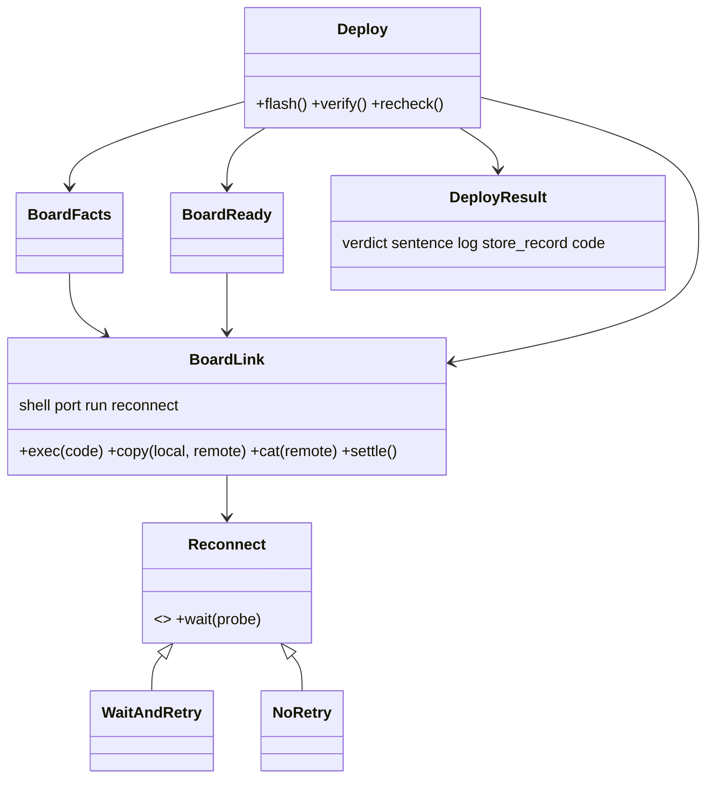

# P215 council, architecture lens: the deploy core (2026-10-14)

## Verdict on today's code

Good: `run` is injected everywhere, `Consent` is a strategy, `Look` is composed of small parts.

Weak, in order of cost:

1. `deploy.main` (about 70 lines) holds the look, gate, flash, facts, ready check, board log, store record and exit
   code. A future MCP or `--json` cannot call it without scraping prints. This breaks "main only parses and prints".
2. `BoardReady` and `BoardFacts` each build `shell + connect port` and each run mpremote. The reconnect rule (AT131)
   would be written twice, and the error text (AT132) is dropped twice (`except ... as cannot` prints only the exit).
3. `BoardReady` reads exit 1 as "the firmware stopped". mpremote also exits 1 when it cannot reach the board. This is
   the AT131 confusion: the two must not share one signal.

## Proposed shape

- `BoardLink` (new `scripts/board_link.py`): one mpremote session for one port. Builds the command once. `exec`,
  `copy`, `cat` return the text or raise `LinkError(stderr text, exit)`. A firmware that exits non-zero after the board
  answered is `FirmwareStopped`, a subclass kept apart, so BoardReady stops guessing from the exit code.
- `Reconnect` (same file): the swappable strategy. `WaitAndRetry(attempts, pause, sleep)` probes with
  `exec "print(1)"` and retries until the board answers, then the real call runs once. `NoRetry` is the test default
  and the dry run. Retry goes in `settle()`, called after esptool's reset, not around every call, so a real firmware
  error is never retried. The rule for the C6 is still unknown (AT133), so the strategy stays a plain wait-and-probe
  until the bench finds it.
- `BoardFacts(link)` and `BoardReady(link)`: lose their `shell`, `port`, `run` and command building. Same verdicts.
  Sentences carry mpremote's last stderr line (AT132); the board log keeps all of it.
- `Deploy` (new `scripts/board_deploy.py`): the flow after the gate. Steps: `flash()` (esptool), `verify()` (settle,
  facts, ready, board log, store record), `recheck()` (below). It returns a `DeployResult` (verdict, sentence, board
  log path, store record or why not, exit code from `outcomes`). No printing.
- `deploy.py main`: parse, plan, look, gate (all already classes), call `Deploy`, print the result, return its code.
  `--json` and an MCP wrap `DeployResult`.

## Re-check (AT134)

`Deploy.recheck()` is `verify()` without the flash and without writing the facts file. It reads `spark.json` back,
runs the ready check, and appends a store entry with `kind: "recheck"`, so the earlier `ready unknown` stays in the
history and the new verdict follows it. Records are facts, so nothing is rewritten. CLI: `deploy.py --recheck`
(no token and no erase, so no gate; it never writes the flash). `remember()` gets the `kind` field, default `"deploy"`.

## Order of refactors (suite green at each)

1. `BoardLink` with `NoRetry`; move `BoardFacts` and `BoardReady` onto it. Pure refactor; adapt their tests' fakes once.
2. `LinkError` keeps stderr; sentences and the board log show it (AT132). New tests.
3. `WaitAndRetry` and `settle()` in verify (AT131, AT133). Test with a fake `run` that fails N times, and a fake sleep.
4. Extract `Deploy` and `DeployResult` from `main`; main prints. Existing `main` tests must pass unchanged.
5. `recheck()`, `--recheck`, the store `kind` field (AT134). README table, `--help`, `agents.md` in the same PR.

## Do not build now

- No port-finding, USB-event or reset-by-pyserial layer: the cause is not proven (AT133).
- No pipeline framework or event bus: five steps need none.
- No `--json` or MCP yet.
- No merge of `Look` and `BoardLink`, no rewrite of other scripts: that is v2 #94.
- No retry around flashing or around firmware runs.
