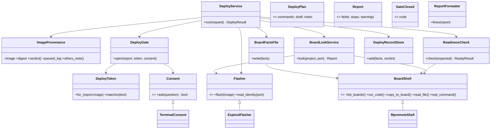

# P239 structure and patterns lens (deploy area)

Scope: the eight deploy scripts, 914 lines. Read against AGENTS.md: one core, small classes, `main()` parses and prints.

## What is there

| Unit | Job | Depends on | Pattern today / should be |
|---|---|---|---|
| `BoardConnection` | runs mpremote on one port | subprocess, run_scenario | Gateway. Should have a base (`BoardShell`) |
| `PortFinder` | lists USB boards via `mpremote devs` | image_check.runnable | Gateway, but a second mpremote caller with its own error handling |
| `BoardReader`/`EsptoolReader` | reads chip, flash, MAC | esptool | Strategy + Adapter. Also parses text: two jobs |
| `Look` | record + port + reading -> Report | finder, reader, image_check | Use case. OK |
| `Report` | compares, decides stops, verdict, status, **token** | outcomes | Value object doing 3 jobs |
| `Consent`/`TerminalConsent` | asks yes | stdin | Strategy. Base raises NotImplementedError |
| `gate_open()` | rules for opening the gate | Report, Consent | hidden Service |
| `Closed` | gate shut, with exit code | - | Domain error. Name does not say it |
| `ReadyCheck` | hashes + `import main`, verdict | BoardConnection | Service. Returns a 3-tuple |
| `FactsFile` | writes facts file, reads back | BoardConnection | Gateway/Repository for the board |
| `record_deploy()` | appends to store record | store | Repository, hidden in a function |
| `deploy.main` | plans, looks, gates, flashes, checks, logs, records | all | Use case written as a script |
| `image_check.*` | image path, run logs, "tested?" rules | run_scenario | hidden object (see below) |

## Findings

1. **Hidden object: the project's image and run logs.** `image_of`, `run_logs`, `untested`, `passed_log`, `tested_another` all take `(image, runs)`, and each re-hashes the image. `plan`, `Look.run` and `main` rebuild `project / "sim" / "runs"`. It is one class: `ImageProvenance(project)` with `.image`, `.digest`, `.verdict()`, `.passed_log`, `.others_note`. `runnable()`, `BOOT_HINT` and `DeployProblem` are not about images and sit there by accident.
2. **`deploy.main` holds a use case.** About 60 lines of flow, flashing (`run(command)`, `BOOT_HINT`), board log writing and store record. It should be `DeployService.run(...)` returning a `DeployResult`; `main` only parses, maps exceptions to exit codes and prints.
3. **Flashing is a bare command list.** `flash_commands` plus a loop in `main`. A `Flasher` base (`EsptoolFlasher`) would own erase+write, `BOOT_HINT`, and the chip/port arguments. `EsptoolReader` already refuses non-esptool: the same tool, two classes. Keep them as two roles of one adapter (`EsptoolFlasher.flash`, `.read_identity`) or two classes on a shared command builder.
4. **Tuples to name.** `plan()` -> `DeployPlan(commands, shell, notes)`. `ReadyCheck.check` -> `ReadyResult(verdict, sentence, board_log)`. `put_facts` -> facts plus line. `keep_board_log` takes 7 arguments, which is `BoardLog.write(result)`. `run_logs` rows -> `RunLog(path, verdict, image_sha256)`.
5. **`Report` is three jobs.** Field comparison, stop/warn rules, and the token. The token (MAC + image hash) belongs to the gate: `DeployToken.for_(report, image)` and `.matches(text)`. `gate_open` then stops reaching into `report.token()` and string-splitting.
6. **`look.lines()` is a presenter in a CLI file.** deploy imports `look` for it. `--json` or MCP would need it in a library: `ReportFormatter` (text) beside `ReportJson`.
7. **Two mpremote paths.** `PortFinder` and `BoardConnection` both build mpremote commands and map timeouts. `PortFinder` should use a `BoardShell.list_boards()` so one adapter owns mpremote's words.
8. **Interfaces that are a stub.** `Consent` raises NotImplementedError: use `abc.ABC`. Web or MCP consent becomes a third `Consent`. `Closed` is raised by the gate only: `GateClosed`.

## Target structure

Files: `image_provenance.py` (finding 1), `flasher.py` (Flasher, EsptoolFlasher), `board_shell.py` (rename of board_connection), `deploy_service.py`. Existing files keep their names until step 7 so imports churn once.

## Do NOT make a class

`newer_files`, `board_of`, `chip_of`, `rerun_line` (one-call helpers; move into DeployService or ImageProvenance). `compare`/`FIELDS` (a table, already extensible). `facts()` and `facts_text()` (pure functions). `looker()` (a factory function is right). `Reading` and `Port` namedtuples stay as they are. No plugin registry for flashers: two base classes, no loader. The `run=` injection stays; it is the test seam.

## Order of refactors (suite green after each)

1. `Consent` to `abc.ABC`; rename `Closed` to `GateClosed` (alias kept one step).
2. Named results: `DeployPlan`, `ReadyResult`, `RunLog` (namedtuples; callers unpack the same).
3. `ImageProvenance` from image_check; the old functions delegate, then go.
4. Move `runnable`, `BOOT_HINT` to tools / flasher; `DeployProblem` to deploy_service.
5. `DeployToken` out of `Report`; `DeployGate` class around `gate_open`.
6. `ReportFormatter` out of look.py into a library module.
7. `Flasher`/`EsptoolFlasher` (flash and read); `BoardShell`/`MpremoteShell` with `list_boards`; PortFinder dissolves.
8. `DeployService` takes the flow from `main`; `BoardLog`, `DeployRecordStore`.

Each step is one PR under 150 lines. Whole-repository tidy stays with v2 #94.
