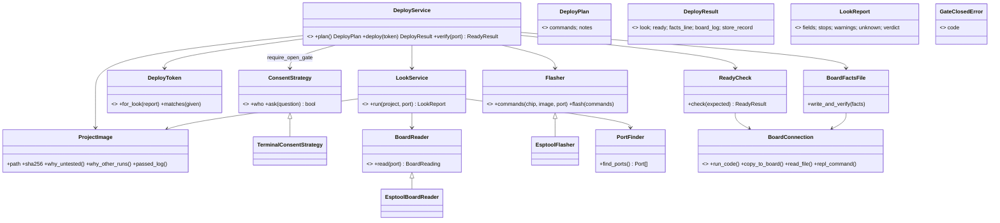

# P239 synthesis: the deploy area's objects, names and docstrings

From the structure, names and extension lenses and the refuter (refuter.md). The scope is the eight deploy-area scripts only.

## (a) The short version

1. The small classes are good seams, especially `Consent` and `BoardReader`. The weak part is `deploy.main`: it does the whole flow and prints as it goes, so `--json`, MCP (P213) and a re-check without a flash have no core to call.
2. Three objects are hidden: the project's image with its run logs (`ProjectImage`), the token (`DeployToken`) and the deploy flow (`DeployService`).
3. Role words go in a name only where they tell a newcomer something: `Service`, `Strategy` on a swap point that is not already a doer, `Result`, and `Error`. Every class docstring starts with its role.
4. There are eight small PRs, and the suite stays green after each one. Renames come first, so the reconnect fix (P238) lands on the final names.
5. Not now: a `BoardShell` base, a renaming of every `Problem` class across the repo (v2 #94), a plugin registry and a JSON formatter class.

## (b) The naming rule (for docs/guide/developing.md)

- Name a thing for what it is to someone who has never seen spark. A plain noun suits a value (`Port`, `BoardReading`, `LookReport`).
- `Service`: a class whose job is to run steps over objects it was given (`LookService`, `DeployService`).
- `Strategy`: the base class of a swap point, where the noun alone does not say it is a doer (`ConsentStrategy`). A base whose noun is already a doer stays plain (`BoardReader`, `Flasher`).
- Subclass = what varies, then the base's whole name (`TerminalConsentStrategy`, `EsptoolBoardReader`, `EsptoolFlasher`). An outside program wrapped behind spark's own interface is an Adapter: say so in its docstring, not in its name.
- `Result`: what a method returns, as a namedtuple (`ReadyResult`, `DeployResult`). `Error`: every exception (in this area now, the rest of the repo in v2).
- Functions start with a verb. A function that returns a reason or None starts with `why_`. A function that raises instead of returning a boolean says so (`require_open_gate`).
- Constants: a unit on every number (`_S`, `_MB`), and `_HINT` or `_MESSAGE` on a sentence.

## (c) The docstring standard

- Class: the first word is its role (Service, Strategy, Adapter, Result, Error or Value), then its job in one sentence, the objects it is given, what a subclass must supply, and what it raises.
- Public function: what it returns (the shape of a tuple or a dict), what it raises, and what it never does (erase, write).
- Module: what it is a library for, and who calls it. A constant: its unit or its source.

## (d) The target structure

These stay functions: `require_open_gate`, `report_lines` (moved into board_look.py), `record_deploy`, `compare_fields` and `build_look_service`. `Port` and `BoardReading` stay namedtuples. The `run=` injection stays as the test seam.

## (e) The refactor PRs, in order

Each PR changes behaviour, `--help` and exit codes not at all, and the suite stays green after it.

1. **The rule goes in.** The naming rule and the docstring standard go into docs/guide/developing.md, for the coach (P237). Docs only.
2. **Shared test fakes.** tests/fakes.py: `FakeBoardConnection` (with `read_file`), `FakeConsent` (moved from `Says`) and `FakeClock`. No production change. Every later PR gets cheaper.
3. **Renames in board_connection, ready_check and deploy_gate.** `BoardUnreachableError`, `BoardCodeError`, `ConsentStrategy`, `TerminalConsentStrategy` (both on `abc.ABC`), `GateClosedError`, `require_open_gate`, and units on `READY_WAIT_S` and `LIST_TIMEOUT_S`. This lands before the P238 fix, so the fix is written once, on the final names.
4. **Named results and honest consent.** `ReadyResult`, `DeployPlan`, `RunLog`. `ConsentStrategy.who` goes into `record_deploy`, so the record stops saying "typed in a terminal" whatever the yes was. `now` is injected into `facts` and into the board log.
5. **`ProjectImage`.** It takes over image_check's functions. `runnable` moves to `tools.command_for`, `BOOT_HINT` moves beside the flasher, and `DeployProblem` becomes `DeployError`.
6. **`DeployToken` and `LookReport`.** The token leaves the report. The gate and the AT116 check (deploy.py:191) call `matches`. `Look` becomes `LookService`, `EsptoolReader` becomes `EsptoolBoardReader`, `Reading` becomes `BoardReading`, and `lines` becomes `report_lines` in board_look.py.
7. **`Flasher` and `EsptoolFlasher`.** These take over `flash_commands` and the erase-and-write loop. They share an esptool command helper with the reader.
8. **`DeployService` and `DeployResult`.** `main` only parses, prints and maps the exit code. `verify(port)` is the post-flash stage, which can be called on its own (a re-check with no erase). This is the core that P213's `--json` needs.

The P238 fix comes after its spike, in `BoardConnection`. It needs an injected sleep, and it finds the port again by its serial number. It does not need a `BoardShell` base. P236's bench runs the CLI, and none of these PRs changes the CLI.

## (f) The PO's open choices

1. **Bench or refactor first.** Recommended: PRs 1 to 3 now (small, and they come before P238), the P236 bench next, then PRs 4 to 8.
2. **`Strategy` on every swap base** (`BoardReaderStrategy`, `FlasherStrategy`) or only where the noun is not a doer (recommended: only `ConsentStrategy`).
3. **The `Problem` → `Error` rename across the repo:** in v2 #94 (recommended), or its own card now.
