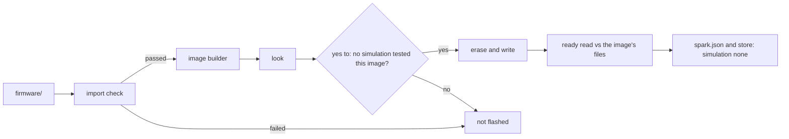

# P351 plan: fix what walk 1 found

> First slice: put an image on the board without Wokwi, honestly labelled. Then five small fixes follow: the PWM
> stand-in, the XIAO's button and LED level in pins.py, the console exit line, the board's own LED as a pick, and
> the ESP32 offset.

Walk 1 reached the board only by copying around spark, because `deploy.py` needs a passed Wokwi run. The first item
opens a second gate: the import check, the look, and the person's yes to "no simulation tested this image", and every
record says so. The other five items stop the next walk from hitting the same stops, smallest first.

## Names

- **firmware**: the project's .py files in `firmware/`.
- **interpreter**: the MicroPython binary (the code already says so). Never "build", which is `/spark:build`.
- **image**: the interpreter and the firmware in one flash file (`sim/flash-with-firmware.bin`).
- **evidence**: what tested an image before a deploy.

## The first slice

| # | Change | Files | Test | Refactor it names | Card | Size |
|---|---|---|---|---|---|---|
| 1 | Deploy an image no simulation tested. `deploy.py --no-simulation` runs the import check, builds the image (`flash_image`'s library), looks, and asks "no simulation tested this image: erase and write it?". A standing grant never answers it. spark.json and the store say `"simulation": "none"`, and no run log is written. The ready read checks the image's own files | `project_image.py`, `deploy_service.py`, `deploy.py`, `board_look.py`, `board_facts.py`, the docs | with the flag, a project with no run log deploys on a fake board, and no record says "passed". Without it, today's refusal | Move `why_untested` and `find_passed_log` into an `ImageEvidence` strategy. P308 #374 adds a third | P337 #431 (option 2, "We really just try the things on the board"). Needs the PO's OK first | L, two PRs: the strategy, then the image step |
| 2 | A `PWM` class in the stand-in `machine`: `freq`, `duty`, `duty_u16`, `deinit`. It keeps the last value and does no timing | `scripts/stand_in/machine.py`, `tests/test_import_firmware.py` | the walk's `effects.py` pattern imports. The "what the stand-in lacks" test uses I2C | none needed | new card: "the import check refuses PWM firmware → the stand-in has PWM" | S |
| 3 | The XIAO record gets `pin_roles.onboard_button` = [9] (wiki: "Boot GPIO9", plus the bench) and `active_level: 0` on `onboard_led` (bench, schematic not read). If the record holds them, `pins.py` writes `ONBOARD_BUTTON = 9` and `ONBOARD_LED_ON = 0`. If not, it writes today's note | `boards/xiao-esp32-c6.json`, `scripts/boards.py` (accept `active_level` 0 or 1), `scripts/assign_pins.py:416-422` | pins text for the XIAO holds both lines. The FireBeetle's holds neither. A level of 2 fails `validate` | one helper writes every onboard role line, so the LED and the button share code | new card: "pins.py cannot name the board's button or its LED level → the record's onboard roles carry them". Beside P332 #426 | S |
| 4 | Leave the console. The deploy's last line and the guide say "leave mpremote's console with Ctrl-X". A busy port says "another program holds the port, often a console" | `deploy_service.py`, the guides | a fake busy-port error gives the one line | none | new card: "a held console blocks the next deploy → spark says how to leave it". Evidence on P248 #270 | S |
| 5 | The board's own LED is a pick for an indicate need. If the record has `onboard_led`, `--match` offers it, and the build verdict counts the need as served | `scripts/parts.py` (match), `scripts/check_spine.py` (verdict) | the walk's goal on the XIAO: light gets the board LED, no "light (no pick)" | the match reads the board record as one more source of candidates, no per-part code | new card: "an indicate need sees only parts → the board's own LED is offered" | M |
| 6 | The original ESP32's interpreter: an `ESP32_GENERIC` entry in the tools list, and the image builder pads it to 0x1000 | `data/tools.json`, `scripts/flash_image.py` | the image for an ESP32 record holds the interpreter at 0x1000 | the offset is a fact per chip, not a constant in the flasher | P335 #429 (P330 plan item 4) | S |

Order: 1 is the only path to the board. 2 follows because 1 makes the import check the test. 3 and 4 hurt the next
walk most. 5 is trust. 6 is for the T-Display walk, P338 #432.

## Rows not in the slice

| Row | Where it goes |
|---|---|
| 1 boards line | new card, polish: "check_all lists the library as the project's boards → it names the active board first" |
| 4 drawer hold | closed |
| 6 serial monitor warning | new card, polish: find the XIAO part's TX and RX names |
| 7, 8 | closed by item 1 (the erase removes the old spark.json) |
| 9 raw repl failure | a note on P248 #270. If it repeats, a card |
| 12 build lookup | P349 #445, next slice |
| 14 console read | P248 #270 |
| gap C, the person's verdict | rejected until a stage reads it |

## Deploy without Wokwi

`ImageEvidence` is a strategy with `why_not_ready()`, `expected_files()` and `tested_by()`. `PassedRunEvidence` holds today's
logic. `NoSimulationEvidence` reads the import check and the image's own files. `DeployService` asks the strategy and
writes its `tested_by()` to spark.json and the store.

## Waits on the PO

- His OK for P337 option 2, and whether the flag is per run (`--no-simulation`) or a project setting.
- The order of the slice.
