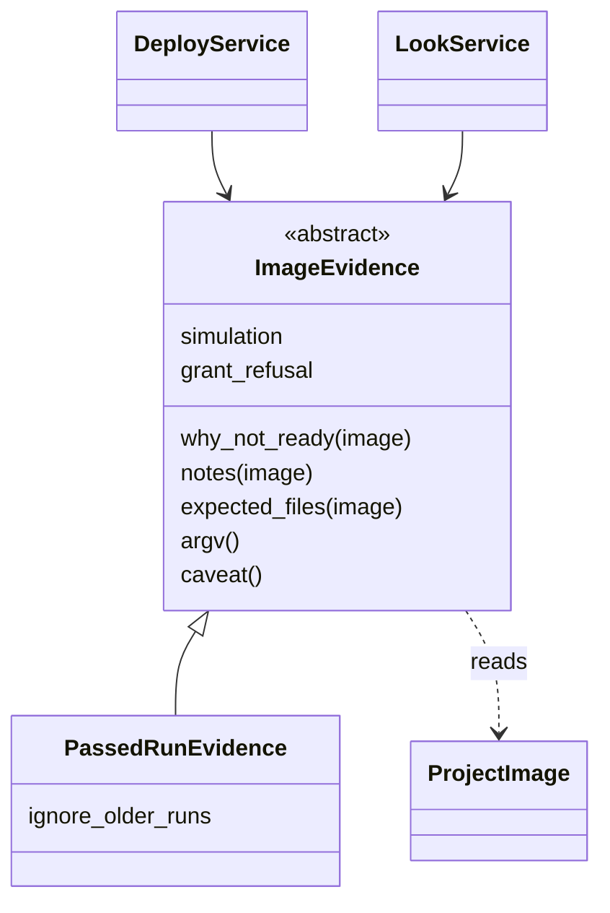
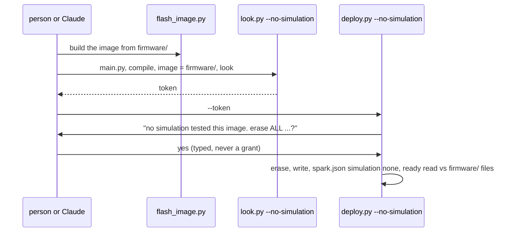

# P337 item 1: deploy an image that no simulation tested

> Two PRs. PR A moves today's "a passed run names this image" logic into an `ImageEvidence` strategy, with no change
> in behaviour. PR B adds `--no-simulation` to look.py and deploy.py. For it, firmware/ has a main.py and every
> file compiles, and the image holds firmware/ as it is now. The person types yes to "no simulation tested this
> image", and every record says `"simulation": "none"`.

## Council

One round: a refuter on Opus, as the course change of 2026-10-19 allows. It found 9 defects and rejected one claim.
All are fixed below.

- The import check does not gate this path. Its stand-in lacks PWM, `network` and `bluetooth`, so it would refuse the
  walks this path exists for (rows 13 and P327). It also ran 3 times per deploy, one subprocess per module each
  time. In its place, every `.py` file must compile, which runs in process and in milliseconds. The board is the test,
  as the PO said on P337: *"We really just try the things on the board"*.
- A missing firmware/ or main.py refuses, with the same rule as `run_scenario.py:142`.
- `standing_yes_allowed` (a bool) became `grant_refusal`, which is None or a WHY_ code. A bool could not name the
  code.
- The flag is in 8 places, not 4. One `evidence.argv()` now feeds every step builder, envelope and rerun line.
- 9 places that say "passed" are now listed in the plan.
- Errors from the new check become a sentence, not a traceback.
- "Tests pass unchanged" was false: 3 tests and 6 mutation files change. They are listed now.
- The build command in the refusal names `--project`.
- `caveat` now comes from `simulation`. It is no longer a separate field.

## Context

Walk 1 (P326 #418) reached the XIAO only around spark, because `deploy.py` flashes only an image that a passed Wokwi
run names. The P351 plan (PR #449) makes this item 1, the only path to a board. The PO said yes on 2026-10-20: *"Let's
first finish the deployment"*. Card: P337 #431, in Build. Worktree `.claude/worktrees/p337`, branch
`p337-no-simulation`.

## Names

- **evidence**: what tested an image before a deploy. One word, used in class names, the gate question and records.
- **image**: the interpreter and the firmware in one flash file, the one `sim/wokwi.toml` names (as today).
- **`simulation`**: the record key, `"passed"` or `"none"`.

## Claims checked in the code

| Claim | Where | Seen |
|---|---|---|
| The pass logic is `why_untested`, `why_other_runs`, `find_passed_log` | `project_image.py:57-90` | me and refuter |
| Its only callers in scripts/ are `DeployService.plan`, `DeployService.verify` and `LookService.run` | `deploy_service.py:90,156`, `board_look.py:269` | refuter |
| `flash_image.image(interpreter, files)` gives the same bytes twice | ran it | me and refuter |
| `run_scenario` builds the image the same way, with no config overrides | `run_scenario.py:149-151` | me |
| `file_hashes` keys are image paths like `/main.py`, as `files_under` writes | `run_scenario.py:193,228` | me |
| `consent_for_deploy` returns its own WHY_ code | `board_grant.py:243-260` | refuter |
| `ignore_older_runs` is read in `deploy.py:112,149,209`, `look.py:61`, `board_envelope.py:28-87` | grep | refuter |

## PR A: the strategy, no behaviour change

New module `scripts/image_evidence.py`:

- `ImageEvidence` (ABC). It holds settings, never an image. Each method takes a fresh `ProjectImage`.
  - `why_not_ready(image)` returns None or the sentence that refuses.
  - `notes(image)` returns sentences for the person.
  - `expected_files(image)` returns `{path in image: sha256}` for the ready read.
  - `argv()` returns the flags that select this evidence, for rerun lines and step builders.
  - `simulation` is `"passed"` or `"none"`. `caveat()` is None for passed, else the words before the gate question.
  - `grant_refusal` is None, or the WHY_ code that keeps a deploy grant from answering.
- `PassedRunEvidence(ignore_older_runs)` holds today's logic, moved from `DeployService.plan`, `DeployService.verify`
  and `LookService.run`. Its `why_not_ready` is `why_untested()`, then `why_other_runs() + OLDER_RUNS_WAY_OUT` unless
  ignored. Its `notes` are the `newer_files` note and the other-runs note. Its `expected_files` are
  `file_hashes(find_passed_log())`. Its `grant_refusal` is `WHY_IGNORE_OLDER_RUNS` when ignoring, else None. Its
  `argv()` is `["--ignore-older-runs"]` or `[]`.
- `DeployService(project, platform, evidence, ...)` replaces the `ignore_older_runs` argument.
  `LookService.run(project, port, evidence)` does the same. `OLDER_RUNS_WAY_OUT`, `newer_files` and the `file_hashes`
  import move to the new module.
- `board_grant.consent_for_deploy(report, evidence, fallback)` returns `evidence.grant_refusal` when it is set.
- `board_envelope`: `deploy_argv`, `look_argv`, `look_step`, `deploy_step` and `look_envelope` take the evidence and
  use `evidence.argv()`. `reached["ignore_older_runs"]` stays as a key, read from the evidence.
- deploy.py: `grant_hint` and `grant_argv` (`:112`, `:209`) are offered only when `evidence.grant_refusal is None`.
  deploy.py and look.py build `PassedRunEvidence(args.ignore_older_runs)`.
- Tests:
  - Constructor calls change in the deploy, look, grant and envelope tests.
  - `test_deploy_gate.py:485` patches `file_hashes` in its new module.
  - The `rerun_line` Namespace test (`:878`) passes the evidence.
  - Six mutation files that anchor on the moved lines are re-anchored, for example `p219-de2.json` and
    `p242-deploy-grant.json`.
  - New `tests/test_image_evidence.py` covers PassedRunEvidence's outcomes: passed, failed, none, other run, ignored.
- The refactor it names: one strategy replaces a flag that ran through 5 modules. P308 #374 adds a third evidence.

## PR B: `--no-simulation`

- `NoSimulationEvidence(project)`, in `image_evidence.py`:
  - `why_not_ready(image)` checks three things, cheapest first.
    1. `firmware/main.py` exists. If not, it uses run_scenario's sentence.
    2. Every `.py` under firmware/ compiles (`compile()`, in process). If one fails, the sentence names the file, the
       line and the error.
    3. The image bytes equal `flash_image.image(interpreter_path(None, project), files_under(firmware/))`. If not,
       the sentence names the command that builds it: `flash_image.py --project <abs> --files firmware -o <image>`.
  - It catches `ToolProblem`, `OSError`, `ValueError` and `ImportError` (a missing littlefs) and returns them as a
    sentence.
  - Its `expected_files` are the sha256 of each file in `files_under(firmware/)`. It has no `notes`.
  - `simulation` is `"none"`. `caveat()` is `"no simulation tested this image"`. `grant_refusal` is the new
    `WHY_NO_SIMULATION`, with its message. `argv()` is `["--no-simulation"]`.
- Gate: `require_open_gate(..., caveat=None)` puts the caveat first: *"no simulation tested this image. erase ALL of
  this board's flash and write sim/flash-with-firmware.bin?"*.
- Flags: `--no-simulation` on look.py and deploy.py. Together with `--ignore-older-runs` it is an argument error.
- Records: the `"simulation"` key goes into `board_facts.facts` (spark.json), `record_deploy`, the board log
  (`simulation: none`) and the `--json` envelope. No run log is written.
- Words that say "passed" become the evidence's words or neutral. They are in `ready_check.py:52,68,74`,
  `board_envelope.py:67`, `deploy.py:3,49,104`, `look.py:22`, `board_facts.py:5` and the `newer_files` note.
- The flow in `commands/deploy.md`:

- Tests, in `tests/test_image_evidence.py`, `test_deploy_service.py`, `test_deploy.py`, `test_look.py` and
  `test_board_grant.py`:
  - With the flag, a project with no run log deploys on the fake board. spark.json, the store record, the board log
    and the envelope say `"simulation": "none"`.
  - The gate question starts with the caveat. A valid grant is not used, with WHY_NO_SIMULATION. No grant hint is
    printed.
  - These refuse, each with its sentence: a firmware file changed after the image, a file with a SyntaxError, no
    main.py, no firmware/, and no interpreter in the tools list.
  - A firmware that uses PWM, as walk 1's did, is not refused.
  - Without the flag, today's refusal. With both flags, an argument error.
- Docs in the same PR: the `--help` text and EPILOG of deploy.py and look.py, `commands/deploy.md`,
  `docs/guide/agents.md`, the journey guide, the README's "What works today" deploy row, and `tools/journey.py`.

## Not in this plan

- deploy.py does not build the image. A look and a dry run write nothing, so the build is a step before them.
- A project without `sim/wokwi.toml` still stops at `ProjectImage`. `/spark:build --keep` writes it.
- The import check stays as its own command. P352 #450 gives its stand-in PWM.
- P308 #374, a third evidence.

## Verification

- `python3 -m pytest tests -q` after each PR, then the push hook.
- Per PR, one mutation run (the mutation-tester agent) on the changed logic and one refuter on Opus.
- End to end on a copy of the walk 1 project with the fake board: `flash_image.py`, `look.py --no-simulation --json`
  and `deploy.py --no-simulation --dry-run`. The real board waits for the PO's bench.
