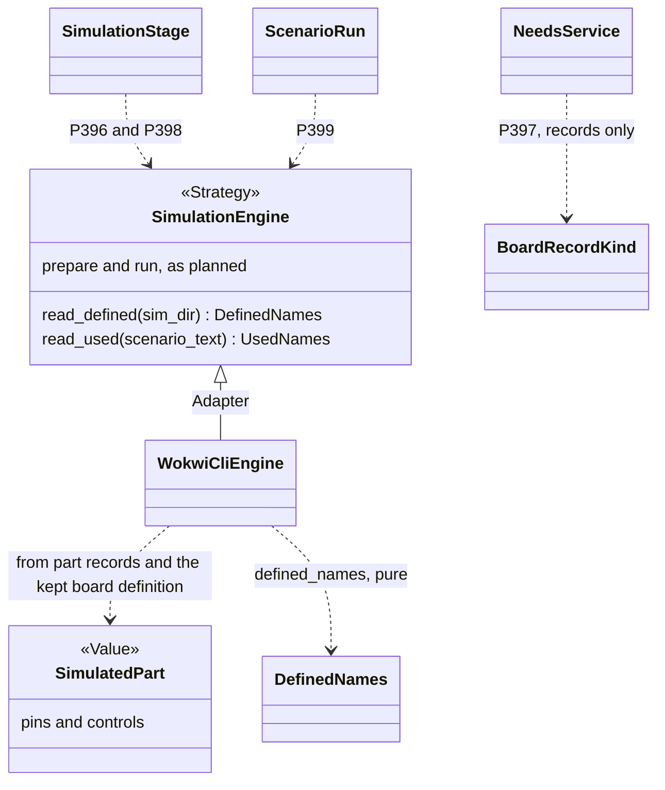

# P400 architecture lens: P396 to P399 against the refactor plans

> All four cards go with the plans. The plans do not model what a simulator offers of a board. The cards need that model: two methods on `SimulationEngine`, three Values and three pure functions.
> Three gaps matter most. No part record lists the controls of its Wokwi part. P397 waits on P389 and cannot import the engine. The word `reach` belongs to the bench.
> Order: P396, P398, P399. P397 waits for P389.

## Findings

| # | finding | evidence | card or plan | proposal | severity |
|---|---|---|---|---|---|
| 1 | The plans model how to run a simulator, not what it offers. The board record holds naming facts only. P297 plans a second engine, and its answers differ: the stand-in pressed GPIO9. | `areas/firmware.md:35-41`, `round3-extensions.md:18,50`, `boards/xiao-esp32-c6.json:11`, P297 `finding.md:40`, diary `:16` | P323 firmware page, P396, P398 | Add `read_defined(sim_dir)` and `read_used(scenario_text)` to `SimulationEngine`. Both read files and need no wokwi-cli. | high |
| 2 | No file lists the controls of a Wokwi part type. The kept XIAO definition has `pins` and `leds` and no `buttons` or `controls` key. Chips list theirs, built-in parts do not. | the kept `wokwi-xiao-esp32-c6.board.json`, `data/wokwi-geometry.json` (pins and positions, cites the part page at `:25`), grep `pressed` in `data/`, `parts/`, `scripts/` (prose only), `parts.py:606-618` (chips) | P398 | New card N1: `simulation.wokwi.controls` in part records, cited. No new catalog file. | high |
| 3 | P397 needs a simulator fact in the pick. The pick is in design, and design cannot import firmware (rule U1). The own parts of a board belong to P389, which P391 puts in stage 4, later. | `architecture/README.md:64`, `areas/design.md:18`, `p391 design.md:216-219,243`, `sim_project.py:4-5`, `records.md:98`, issue #504 | P397, P389 | The onboard entry of a board record carries `simulation.wokwi` as a part record does, with `skip` and a cited reason. The pick reads records only. Add this to the "Done when" of P389. | high |
| 4 | Inline code is the wrong home. `check_spine.run` is 192 lines. `board_alone` passes no limits, so a board-only build prints none. Round 3 lists `board_alone` among the touched code and gives it no fix. The limits channel exists. | `areas/build.md:105`, `check_spine.py:348`, `:542-558`, `round3-extensions.md:18`, `sim_project.py:75,118` | P396, P398, build page | One `SimulationStage` path for both cases. P396 adds one source to `limits_of`. It leaves the run log to P345, because the deploy gate reads its header (`run_scenario.py:206-229`). The cards do not pull the firmware move. | medium |
| 5 | The words claim too much. The claim that no scenario can press the button rests on a missing key in one JSON file. Nobody ran a scenario on `$gpio15`. | diary `:56-57`, issue #512 | P396, P397 | Three states: defined, undefined, run. The line says that the Wokwi definition has no button and no pin on GPIO9. | medium |
| 6 | One word names several things. See the names table. | `reach.py:2`, `sim_project.py:38-41`, `drawer.py:30`, `assign_pins.py:57` | all four | Use the names table. Add the glossary lines in the P396 PR. | medium |
| 7 | P399 reads scenario steps with no YAML library. The repo imports none, and `with_ready_wait` reads lines. A reader that guesses passes a wrong scenario. | grep `yaml` in `scripts/`, `tests/`, `tools/` found no hit, `run_scenario.py:66-84` | P399 | `read_used` reads the step shapes that spark writes. Any other shape gives "not checked", never ok. | medium |

## Structure

**Where the fact lives.** Of the three homes (board record, simulator strategy, catalog per simulator), the strategy is the one door. The facts stay in records and in the kept Wokwi definition, so spark needs no catalog file. Part records hold the controls of their Wokwi part, cited. The board record cites the kept definition and holds no copy. A second engine adds a `simulation.<engine>` block and one subclass. Only the pick, which cannot call the engine, reads `simulation.wokwi.skip` on the onboard entry of the board record.

`SimulatedPart`, `DefinedNames` and `UsedNames` are Values. `SimulatedPart` is what the simulator models of one Wokwi part type, a board included. The pure functions are `defined_names(diagram, parts)`, `undefined_names(used, defined)` and `undefined_gpios(pin_map, defined)`. They take dicts, so tests need no file, tool or mock.
`SimulationEngineContract` gains two cases (rule T3), and `FakeSimulationEngine` gives `ScenarioRun` fixed names. `SparkBenchEngine` returns its own table, and no caller changes. The role names follow `developing.md:252-264`, and the tool name sits only on the Adapter (`:284`). `read_` marks a method that only reads (`:297`).

## Names

| word in the cards | what it means in the code | proposal |
|---|---|---|
| `reach` | the bench tool `reach.py` runs one line on the board over USB | `defined`: a name that a Wokwi definition gives a part of the diagram. Not `usable`, which `assign_pins.py:57` uses for pins free for assignment. |
| `part id` | the id of a part record, such as `tactile-button` | `component id` for the id in the diagram, such as `tactilebutton` or `mcu`. The scenario key `part-id` is the Wokwi spelling. |
| `pin` | four things: label to GPIO in the board record, pin name on a Wokwi part, entry of `pins.py`, record pin to Wokwi pin | `GPIO` for the number, `label` for the silkscreen text, `pin name` for the key in a diagram, `pin map` for `pins.py` |
| `name` | three things: a constant in `pins.py`, the scenario key of a control (fixture `:8`), a pin label | `constant` for `ONBOARD_BUTTON`, `control` for `pressed`, `pin name` for `A`. `names` stays only in `defined names` and `used names`. |
| `control`, `definition` | `control` has one meaning, but `drawer.py:30` also uses it for control characters. `definition_path` in `sim_project.py` means a record file. | keep `control`. Say `Wokwi definition` for the kept JSON and `record` for spark files. |

## The four cards

- **P396: rewrite, first.** Today the code is `sim_project.limits_of` and `check_spine.board_alone`. The target owner is `SimulationStage` (build) over `sim_project` (firmware). It goes with the plan if the line joins `limits_of`. It needs only the kept definition and the pin map, so it is the smallest slice that works end to end.
  The change: the build reads the Wokwi definition that the board record cites. For each GPIO of the pin map, `undefined_gpios` checks whether a pin of the definition has it. Each miss becomes one "cannot show" line, also on the board-only path (`check_spine.py:558`).
  Done when: on the walk 2 project the build prints `ONBOARD_BUTTON (GPIO9): the Wokwi definition has no button and no pin on GPIO9` and writes it to `sim/WHAT-THIS-CANNOT-SHOW.md`. `ONBOARD_LED` (GPIO15) is defined through `$gpio15`. Tests read a copy of the kept XIAO definition. The firmware page, the build page and the glossary list the new names.
- **P397: rewrite, blocked by P389 and N1.** The owner is `NeedsService` (design) behind the `--match`, `--offer` and `--pick` handlers of `parts.py`. It goes with the plan only if it reads records. A call into the engine adds an upward edge and breaks rule U1.
  The change: an onboard part in a board record carries `simulation.wokwi` like a part record, with `skip` and a cited reason. `--match`, `--offer` and the `--pick` dry run print that reason. They name each part record whose `controls` list a press. A test keeps the record and the kept definition in step.
  Done when: for the walk 2 press need, `--match` and the `--pick` dry run print the cited reason for the XIAO BOOT button. They name `tactile-button` as a part that a scenario can press.
- **P398: rewrite, after N1.** The owner is `SimulationEngine.read_defined` (firmware), printed by `SimulationStage` (build). It goes with the plan. The JSON only gains a key (invariant 2 of the plan). The file beside the diagram follows the P37 file. P399 reads `diagram.json`, not the file.
  The change: `defined_names(diagram, parts)` turns the dict of `sim/diagram.json` and the `SimulatedPart` of each type into rows of component id, kind (pin or control), name and GPIO. The build prints the rows and writes `sim/WHAT-A-SCENARIO-CAN-USE.md`.
  Done when: for `button-light`, the rows list `tactilebutton` with control `pressed`, `ledred5mm` with pin `A`, and `mcu` with its pin names and GPIOs. The fixture has no `sim/` folder (listing of `tests/data/breadboard/button-light`), so the test adds a small `diagram.json`.
- **P399: keep, with the words changed.** The owner is `ScenarioRun.problem()` (`run_scenario.py:138,261`), which already refuses a run for free and exits 2. It goes with the plan. The step reader sits behind `SimulationEngine.read_used`, not in `ScenarioRun`.
  The change: after its present checks, `problem()` runs `undefined_names(used, defined)`. The dry run of G26 is the same call behind one flag, and it is a second small PR.
  Done when: as the card says, with "component id" for "part id". `FakeSimulationEngine` gives fixed names, and `tests/fake_wokwi_cli.py` shows that no run started.

## New cards

- **N1: P? — a part record does not list the controls of its Wokwi part → `simulation.wokwi.controls`, cited, for each part that spark simulates.** Need: P398 must print `pressed`, and P397 must know which parts a scenario can press. Done when: `tactile-button` lists `["pressed"]` and `led-red-5mm` lists `[]`. Each has a `documents` cite of the Wokwi part page with its read date, or a `null` with the reason. `parts.py --validate` refuses an id that Wokwi refuses (`parts.py:606-618`) and a list with no cite.
- **N2, later: P? — the build warns about a serial monitor that the XIAO C6 does not need → the build reads `serialInterface` from the Wokwi definition.** Need: G18 (diary `:81`, `check_spine.py:574`). The definition says `USB_SERIAL_JTAG`, and the warning names two causes that do not apply. Done when: the walk 2 build prints no serial warning, and a board whose definition lists no serial interface still gets it.

## Not checked

- Whether `board.json` lists every control of a Wokwi board part. Wokwi element code can hold controls that the JSON omits. I made no web lookup.
- The key of `set-control` in wokwi-cli: the fixture spells it `name` (`:8`), and the cards say control.
- That the diagram id equals `emit_board.component_name`, and that the converter keeps `mcu` on a build with parts. Only the board-only path writes `mcu` itself (`check_spine.py:555`).
- Whether a scenario can read the LED through `$gpio15`. P396 says nobody tried. I ran no Wokwi scenario.
- The code of `parts.py --match` and `--pick`, `records.md`, `sourcing.md` and `checks.md` beyond greps, and P297 beyond its target diagram. I did not render the diagram, because `mmdc` is absent.
