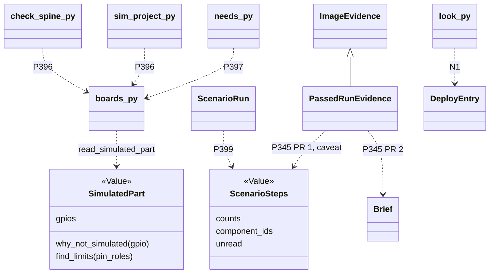

# P400 plan: walk 2's cards, replanned

> First slice: P396 alone. The build reads the XIAO's kept Wokwi definition and says that it has no pin on GPIO9. So spark knows no way for a scenario to press `ONBOARD_BUTTON`.
> Then P345 says what a passed run did, and N1 names what an erase replaces. N2 and N3 clear stalls S1 and S2, P399 checks component ids, and P397 follows P389.
> P398 merges into P399, and its controls half becomes a row. Three new cards. Every other finding is a row in `docs/observations/rows/p400-walk2-council.md`.

The PO asked for a spark that "finds the right pin itself from materials". The material is in the store already: Wokwi's definition of the XIAO, kept under the sha256 that the board record names. One reader turns it into a `SimulatedPart`, and the build, the pick and the run log say one limit from it. Synthesis on Opus 5.5. It uses no claim that the refuter rejected, and it reads each PARTLY as the refuter states it. All times are CEST.
## Names
- **Wokwi definition**: the kept JSON of a Wokwi part type, here `wokwi-xiao-esp32-c6.board.json`, a source of the board record. Never "part", which is a part record.
- **`SimulatedPart`**: a Value, what a simulator models of one part type, a board included: the GPIOs that its pins target. `read_simulated_part(board)` builds it, or returns None.
- **limit**: one thing that a simulation cannot show (P37). The code says `limits`, and the file is `sim/WHAT-THIS-CANNOT-SHOW.md`.
- **component id**: the id of a part in `sim/diagram.json`, such as `mcu`. A scenario names it as `part-id`. A **part id** stays the id of a part record, such as `tactile-button`.
- **`ScenarioSteps`**: a Value, the steps of one scenario file counted by kind (`set-control`, `expect-pin`, `wait-serial`), with the component ids that they name.
- **GPIO** is the number, **label** the silkscreen text (`D9`), **pin name** a key in a Wokwi definition (`$gpio15`), **pin map** `firmware/pins.py`, **constant** `ONBOARD_BUTTON`.
- **hold**: a drawer reservation (`used_in`) by its **holder**, a project. **last deploy**: the newest entry for a board's MAC in the store record, a `DeployEntry` Value.
- **passed**: wokwi-cli exited 0 (`scripts/run_scenario.py:103-104`), and nothing more. Never "tested". Not used: "reach", the bench tool (`scripts/reach.py:2`), "usable" (`scripts/assign_pins.py:57` says "unusable"), and "running", which claims what a board runs.

Checked against the role table (`docs/guide/developing.md:241`) and "One responsibility, one name" (`docs/guide/developing.md:277`). Each Value is a plain noun, each function starts with a verb, and `why_not_simulated` returns a reason or None. No name carries a tool's name, because no new class wraps a program. The P323 glossary has none of these words (my grep), so each PR adds its own.
## Decisions between the lenses
1. P398: merge into P399, because its "Done when" was rejected (refuter K15) and only the id list is left, which P399's message prints.
2. Order: P396 before P345, because it is the PO's ask and P345 carries its limit to the run log.
3. A must line that no scenario names is a note, not `unchecked`. `scripts/outcomes.py:46` makes any `unchecked` a `could-not-run`, and the bench test needs the deploy first.
4. P397's other choice: the bench first, then a pad button, because the PO's XIAO has no soldered pins (refuter K12).
5. The LED: no line, because the definition has a pin on GPIO15. Whether a scenario reads it stays a row, because nobody tried (K5).
6. P399's home: `ScenarioRun.problem()` and `tests/fake_wokwi_cli.py`, because they exist today, and no refactor plan names a `FakeSimulationEngine` (refuter R3, my grep).
7. G18: no card and no change to the warning, because its cause stays open (refuter A5).
## P396 (#512): rewrite, first
- Why: the need holds in the code (refuter K1 to K3). But "reach" names the bench tool (T9), and a test cannot read the person's store (K6). The kept file is not strict JSON (T4), and "no scenario can press" rests on the JSON alone (K4).
- New title: P396 — the build does not say that no scenario can press the XIAO's BOOT button → the build reads the board's kept Wokwi definition and names each onboard GPIO that it has no pin for
### Needed by
Walk 2, round A of P100 (#6), on 2026-10-22 and 2026-10-23. The project picked the XIAO ESP32-C6's own BOOT button for its press need, and `firmware/pins.py` named it `ONBOARD_BUTTON = 9`. The build's simulation stage then passed with the board alone. But Wokwi's definition of the XIAO has no button, and none of its pins targets GPIO9. So spark knows no way for a scenario to press the button. The must line "Pressing the button lights the LED" stayed untested until the bench. Spark keeps this Wokwi definition in its store, so the fact was already there. The walk's diary has it as gap G23, stall S3 and idea I1.

The PO, 2026-10-23 06:41 CEST, verbatim: "lets thin about what to do to improve this, so that it finds the right pin itself from materials, etc." Then: "yes please, go on, note it and we can create the cards after the run".
### The change
The build reads the board's Wokwi definition from the store, through the source entry that the board record names with its sha256 (`boards/xiao-esp32-c6.json:369-376`). `read_simulated_part(board)` in `boards.py` cuts the `/* */` comments, because the kept file is not strict JSON. If the store lacks the file or its hash differs, it returns None. Else it returns a `SimulatedPart`.

Each onboard GPIO of the record's `pin_roles` that no pin of the definition targets becomes one limit. `check_spine.board_alone` passes these limits to the stage, where it passes none today (`scripts/check_spine.py:558`). `sim_project.limits_of` adds them on a full build, and both paths write them to `sim/WHAT-THIS-CANNOT-SHOW.md`. With no definition, the stage prints one line: not checked. The stage stays ok, because a limit is said and never fails (P37). The LED gets no line, because the definition has a pin on GPIO15.

The reader lives in `boards.py` today, because the pick reads it too, and the design area imports no simulator code (rule U1). It moves next to `BoardRecordKind` with P391's stage 2, and into the records area with P323's stage 5.
### Done when
- On walk 2's project, `check_spine.py requirements.json --keep .` prints `ONBOARD_BUTTON (GPIO9): the Wokwi definition of xiao-esp32-c6 has no pin on GPIO9, so spark knows no way for a scenario to press it`. `sim/WHAT-THIS-CANNOT-SHOW.md` holds the same line, and the stage stays ok.
- A test keeps a small hand-made definition, with a `/* */` comment and a `$gpio15` pin, in the scratch store that tests set (`scripts/store.py:40-42`). It gets the GPIO9 line and no GPIO15 line. A missing file and a file with another sha256 each get `not checked`.
- No paid run and no board. The build page, `docs/guide/agents.md` and the P323 glossary name "Wokwi definition" and "limit".
## P397 (#513): rewrite, after P389 and P396
- Why: one sentence of "Needed by" is false (refuter K9). `--match` offers the XIAO for press only after P389 (K11). The PO's XIAO has no soldered pins (K12).
- New title: P397 — the pick of the board's own button does not say that no scenario can press it → the pick says so, names the bench as the test, and names a button on a header pad as the choice that a scenario can press
### Needed by
Walk 2, round A of P100 (#6), on 2026-10-22. At step C of `/spark:idea`, the person picked the XIAO's BOOT button for the press need. The idea page says to pick the board for a need that its own button serves. Nothing said that a simulation cannot press this button (walk 2 diary: G23 and idea I2). Claude said it first in chat at 01:14 CEST on 2026-10-23, before the paid Wokwi run at 01:15 CEST. This card uses the fact that P396 finds, and it builds on P389 (#504), which makes the idea step offer the board's own parts.

The PO, 2026-10-23 06:41 CEST, verbatim: "lets thin about what to do to improve this, so that it finds the right pin itself from materials, etc." Then: "yes please, go on, note it and we can create the cards after the run".
### The change
Take a pick that gives a button need to the board. If `read_simulated_part` finds no pin on the GPIO of the board's `onboard_button` role, `needs.plan_pick` adds one note. It sits beside the F12 footprint note (`scripts/needs.py:339-342`). It says that spark knows no way for a scenario to press the button, and to test it on the board. Then it names the first part that `--match` offers for the need, today `tactile-button`. After the person wires that part to a header pad, a scenario can press it. The PO's XIAO has no soldered pins, so the note names the bench first.

Once P389 offers the board for press, `--match` prints the same note under the board. The pick reads records and their kept sources only (rule U1). `needs.plan_pick` becomes part of `NeedsService` in P323's stage 5.
### Done when
- `parts.py --pick <project> press=xiao-esp32-c6 --dry-run` prints the note. It names the bench as the test, and `tactile-button` on a header pad as the other choice.
- After P389, `parts.py --match` prints the same note under the XIAO for the press need.
- `tests/test_needs.py` uses P396's fixture definition in the scratch store. A board whose definition has a pin on the button's GPIO gets no note.
## P398 (#514): merge into P399
Its "Done when" was rejected (refuter K15). `sim/diagram.json` lists the component ids and the wired pins already (K14), and no source in spark lists a Wokwi part's controls (technology 9). Where its content goes: P396's line answers the person's question about a wrong name. It names the GPIO of `ONBOARD_BUTTON` and says that the definition has no pin on it. The id list goes into P399's message. The controls and pins per type become row 70 of the rows file, reopened when a run fails on a name.
## P399 (#515): rewrite, two PRs
- Why: the free checks name no scenario word (K16), and the script has no dry run (K18). The cost claim is not checked (K17). `problem()` writes the image name into `sim/wokwi.toml` (`scripts/run_scenario.py:90-91`), so a dry run through it changes a file (refuter, blind spot 1).
- New title: P399 — run_scenario.py checks no name of a scenario before wokwi-cli starts, and it has no dry run → it refuses a component id that sim/diagram.json lacks, and its dry run changes nothing
### Needed by
Walk 2, round A of P100 (#6), on 2026-10-23. `run_scenario.py` makes every check that costs nothing before a paid Wokwi run. But it does not compare the scenario's component ids, controls and pins with `sim/diagram.json`. So a wrong name goes on to a paid Wokwi run. Nobody checked yet whether wokwi-cli refuses such a name before the run uses minutes. The script also has no dry run, although `--pick`, `--drawer-set` and deploy have one (walk 2 diary: idea I4 and gap G26).

The PO, 2026-10-23 06:41 CEST, verbatim: "lets thin about what to do to improve this, so that it finds the right pin itself from materials, etc." Then: "yes please, go on, note it and we can create the cards after the run".

P398 (#514) merged into this card on 2026-10-23. Its list of component ids goes into this card's message.
### The change
PR 1: `ScenarioSteps`, from P345's PR 1, also lists the component ids that the steps name. It reads lines, because the repo has no YAML library, and it reads only the step shapes that spark writes. Any other shape is `not checked`, never ok. `ScenarioRun.problem()` compares each component id with the ids of `sim/diagram.json`, and it refuses a missing one with exit 2. Pins and controls wait, because a board-alone diagram wires no pin.

PR 2: `--dry-run` makes the same free checks, needs no token, starts no run and writes nothing. The image name goes into `sim/wokwi.toml` on a real run only. `ScenarioSteps` moves to `firmware/scenario_run.py` in P323's stage 5.
### Done when
- A scenario with `part-id: tactilebuton` exits 2 before wokwi-cli starts. The message names the word and the ids `mcu, tactilebutton, ledred5mm`. `ProjectCase.setUp` then writes a diagram with these ids (`tests/test_run_scenario.py:100-104`), and the fake wokwi-cli leaves no seen-file.
- A step that `ScenarioSteps` cannot read prints `not checked` with its line, and the run goes on as today.
- `run_scenario.py --dry-run` on walk 2's project prints `set-control 0, expect-pin 0, wait-serial 1` and exits 0 without a token. `sim/wokwi.toml` and `sim/runs/` stay unchanged.
## P345 (#440): new text for the comment
Only `--json` said "simulation: passed" (refuter K20), and the card's title covers I5 while its body does not (K22). The new text:

> Walk 2 (round A of P100, #6) adds a case for this card, on 2026-10-23. Wokwi's definition of the XIAO has no button, so walk 2's scenario only waited for "ready" (walk 2 diary: gap G23). The run passed. `look.py --json` then said `"simulation": "passed"`, and the text look said nothing on it. deploy.py flashed the image as a tested one, and the board's store record says `"simulation": "passed"`. But no simulation pressed the button.
>
> Idea I5 from the walk: each scenario names the must line that it tests. The verdict then names each must line that no scenario tested. For walk 2, that line is "Pressing the button lights the LED". The PO on 2026-10-23, verbatim: "yes please, go on, note it and we can create the cards after the run". This comment puts I5 on this card, so the board holds no second card for it. The title covers I5, and the body does not yet. Related: P396 (#512), which names each onboard GPIO that the Wokwi definition has no pin for.
>
> The P400 council proposes two PRs (`docs/observations/2026-10-23-p400-walk2-council/plan.md`). PR 1: the run log header counts the steps by kind, copies `sim/WHAT-THIS-CANNOT-SHOW.md` and writes its time with the zone (G25). A passed run that set no control sets `PassedRunEvidence.caveat`: "the passed run set no control: it tested that the firmware starts". The text look prints the simulation line too. `agents.md` gets an eighth "never assume" item: a passed run tested what its scenario asserts, and nothing more. PR 2 (I5): a `Brief` Value reads the must lines. A must line that no scenario names becomes a note in the look and a line in the question, never an `unchecked` item. PR 2 plans how a scenario names its must line, because nobody checked whether wokwi-cli takes an unknown key.
## N1 (bug, parent P100 #6): P? — the yes before an erase does not name what the erase replaces → the look and the deploy question name the last deploy from the board's store record
From: AI 1, UX 8, product 16. Today a `DeployEntry` Value sits beside the store record code of `scripts/board_facts.py`, and it moves into P391's `DeployedStore`.
### Needed by
Walk 2, step 12, 06:52 to 06:55 on 2026-10-23 (G29). The question names what it writes, not what it replaces (`scripts/deploy_gate.py:100`). Claude said three times that the erase replaces reaction-game's firmware (O14, refuter A4). The store record lists 17 deploys to this board: 12 blink-c6, 4 button-light and 1 walk2, none from reaction-game (refuter A3). The last one before walk 2 was blink-c6, at 2026-10-19 09:24 +02:00 (refuter U4). So a yes to an erase that cannot be undone came after a wrong claim, and spark held the fact.
### Done when
- `look.py` prints `last deploy here: blink-c6, 2026-10-19 09:24 +02:00 (spark's store record, not read from the board)`, and `--json` adds `data.last_deploy`. The question before the erase says "spark last put blink-c6 on it".
- A board with no store record prints `no spark deploy recorded`. A stored time with no zone prints as stored, with `zone not stored`.
- The bench goldens are accepted with the reason (P323 invariant 1). The deploy page and `docs/guide/agents.md` show the line, and G27's two sentences on `--port` ride in this PR.
## N2 (story, parent P100 #6): P? — the goal in the brief never reaches idea → idea starts from the brief's goal and must lines, and asks only for a null one
From: product 1 and 10, AI 14. G4, G5 and G21 stay rows.
### Needed by
Walk 2, stall S1, 21:05 to 21:13 on 2026-10-22 (G6). The goal went into `.spark/project.json`, and the person expected idea to run from it. No script reads the goal, and the idea page does not name the brief. P100's body files each stall as a card (refuter P1), and the next walk meets S1 at its second step.
### Done when
- The idea page's first step reads `goal` and `must` from `.spark/project.json`, and asks only for a null one. The docs check passes.
- The next walk's idea step asks for no answer that the brief holds. Docs only: it can ride in P389's PR, which edits the same page.
## N3 (story, parent P100 #6): P? — `--match` shows a held board as "free 0" and names no holder → `--match` names the holder, and the `--pick` dry run says that one refusal stops every pick
From: product 11, UX 9. Today the change sits in the `--match` and `--pick` output of `parts.py`, which P323's stage 5 moves behind `DrawerService`.
### Needed by
Walk 2, stall S2, from 21:16 on 2026-10-22 (G10, G11). `--match` showed the XIAO as "free 0" and named no holder. Only the `--pick` dry run named reaction-game, and it marked the button's line "refused, not written", though only the XIAO was held. reaction-game holds the XIAO again since 21:30, and P325 (#417) plans more walks with the XIAO.
### Done when
- In a fixture where project A holds the XIAO, `parts.py --match` in project B prints `free 0, held by A`.
- The `--pick` dry run names the refused pick and says that one refusal stops every pick of the command. G12 rides along only if it is one line.
## The order

| # | card | what it adds | why here | size |
|---|---|---|---|---|
| 1 | P396 | the limit at the build | the PO's ask, with no new data and no paid run | S |
| 2 | P345, PR 1 | steps, limits and a zone in the run log, a caveat in the look and the question, `agents.md` item 8 | the harm of S3: a passed run reads as a tested press | S |
| 3 | N1 | the last deploy before an erase | a step that cannot be undone. It edits the same look and question, so it follows 2 | S |
| 4 | N2 | idea starts from the brief | the next walk meets S1 first. Docs only | XS |
| 5 | N3 | the holder at `--match` | the next walk with the XIAO meets S2 at the pick | S |
| 6 | P399 | the id check, then the dry run | free, and Claude writes the scenarios | S, two PRs |
| 7 | P397 | the note at the pick | waits on P389, in Ready, and on P396 | S |
| 8 | P345, PR 2 | I5: must lines that no scenario names | needs `Brief` and a way for a scenario to name its must line | M |

The first slice is P396 alone. On walk 2's project it prints the line and writes the file, with no paid run, no board and no new data. Ready holds 4 of 5 (refuter P6), so P396 takes the fifth place.
## The refactor plans
### P323, `docs/discovery/2026-10-19-p323-target-architecture/architecture/refactor-plan.md`
- The firmware port has `prepare` and `run` only (`docs/discovery/2026-10-19-p323-target-architecture/architecture/areas/firmware.md:39`, R1). It models how to run a simulator, not what the simulator models of a board. Change: the records area's new names add `SimulatedPart` and `read_simulated_part`, and the firmware page says that the engine takes them from records. No new port method until a second engine exists (refuter D3).
- Round 3 lists `check_spine.board_alone` for a second simulator and gives it no fix (`docs/discovery/2026-10-19-p323-target-architecture/council/round3-extensions.md:18`, R2). Walk 2 shows that this path drops the limits too. Change: "Into build" adds `board_alone` (`scripts/check_spine.py:542-558`) as the board-only path of the simulation stage, with the limits of a full build.
- Stage 5's firmware move adds `RunLog` and `status_of_run`, and nothing records what a run did, though `passed` is any exit 0 (A1). Change: the firmware row adds `ScenarioSteps`, which the run log carries.
- Invariant 1 names `tests/golden.py --accept OP`, and the repo has `tests/golden_bench.py` and `tests/golden/` (my `ls`). Change: name the real file. P345's PR 1 and N1 change the look's text, so each accepts the bench goldens with its reason.
- Decision 4's example says that a story with a deploy gap also lands S11. Walk 2 found three (G27 to G29). Change: the example keeps N1 a small fix and S11 its own slice. The decision stays the PO's.
- The glossary defines the image as "The flash image a passed simulation tested." (`docs/discovery/2026-10-19-p323-target-architecture/architecture/glossary.md:54`). Walk 2's run passed and pressed nothing. Change: "the flash image of a passed run", and the run log says what the run did (P345's PR 1).
### P391, `docs/discovery/2026-10-22-p391-boards-as-modules/design.md`
- Stage 4 brings P389's onboard parts "as facts with sources" (`docs/discovery/2026-10-22-p391-boards-as-modules/design.md:219-220`). One source is the Wokwi definition, and no command keeps it (refuter T5). Change: stage 4's board research keeps it under its sha256, as P229 did by hand, and its "Done when" names it.
- Question 2 renames the per-MAC place to `deployed/` as `DeployedStore`. N1 makes the look read it. Change: question 2 names the look among its readers.
### P297
No change: the core prints and Claude relays, and walk 2's wrong claim (O14) came where the core printed nothing.
## The proposed structure

## Waits on the PO
- The new bodies of P396, P397 and P399, the merge of P398 into P399 and the new comment on P345 (#440) went live on 2026-10-23. He confirms them, or GitHub's history brings the old text back.
- His OK for N1, N2 and N3, and for P396 as Ready's fifth card.
