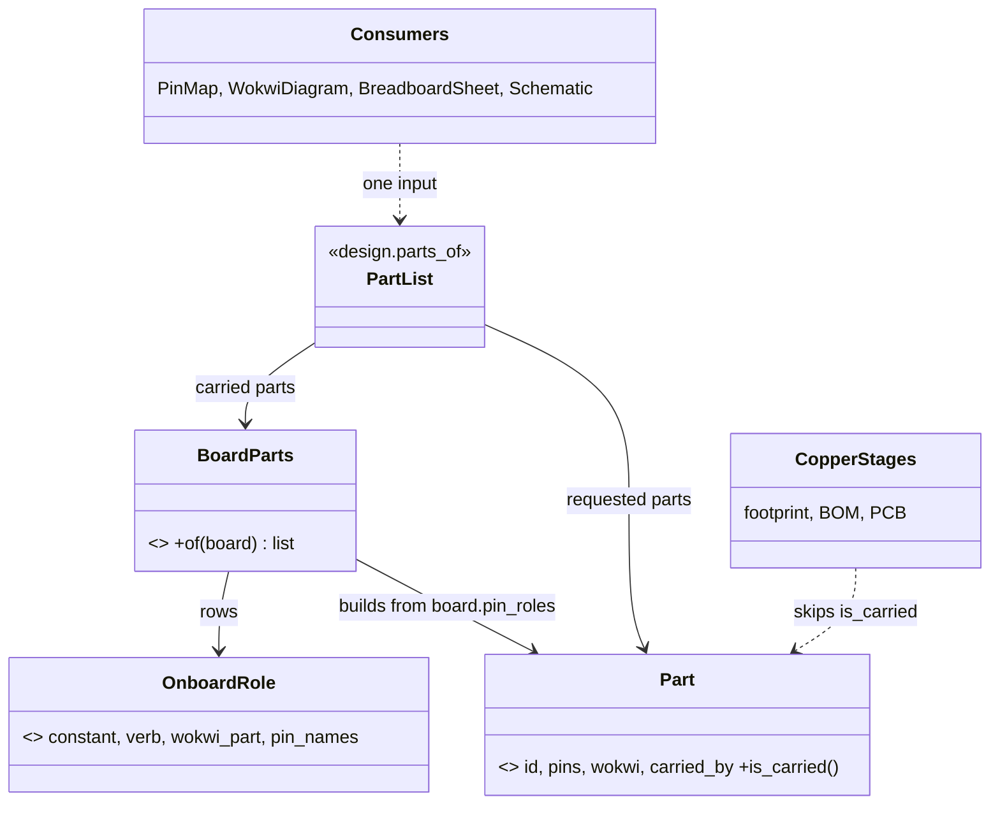

# P480 architecture lens: do C1 to C8 fit the plans, P391 and P479, and one design for a board's own parts (C2)

> C2 (a board's own part is a real part) fits best as one derived part instance with a `carried_by` link. One predicate
> then decides copper only. C7 (hand edits kept) needs a manifest of owned and kept regions. C3 to C5 touch seams that wave 4 moves.

Evidence base: `scripts/check_spine.py:386,571-590`, `scripts/boards.py:330-415`, `scripts/assign_pins.py:432`,
`scripts/design.py:287`, `tools/circuit-to-wokwi/lib/merge.ts:1-40`, P391 `design.md`, `wave4-plan.md`, #657 (event seam, W4-2).

## Findings

| # | finding | evidence | card or plan | proposal | severity |
|---|---|---|---|---|---|
| 1 | Board parts live in two places that never meet. The pin map reads them (`onboard_entries`). The chain cannot see them: `board_alone` writes a diagram with 1 part and `"connections": []`. | `assign_pins.py:427`, `check_spine.py:586-588` | C2, G26, G28 | Make the board's parts part instances in `design.parts_of`. Delete `board_alone`. | high |
| 2 | `board_only` is a special flag (`needs.BOARD_ONLY`) that forks the whole chain into skipped stages. A project with one added part gets the full chain. This is the PO's complaint in G20. | `check_spine.py:386-389`, `needs.py:757` | C2 | `board_only` becomes derived: no part lacks `carried_by`. One path, no fork. | high |
| 3 | `OnboardRole` already is the right Value. It holds the verb, `does` and `what`. It lacks the Wokwi part type and the pin names per role. | `boards.py:330-362` | C2, refactor-plan OC | Add `wokwi_part`, `pin_names` to the row. Do not add a second table (the plan already counts five tables for one concept). | medium |
| 4 | `host_parts` already means "passives that a part asks of its host" (`parts.py:313`). A new `host` word for "carried by" collides. | `parts.py:512`, `design.py:322` | C2 | Name the property `carried_by`. One word, one meaning (developing.md table). | medium |
| 5 | The Wokwi merge already keeps part positions and parts marked `handAdded`. `board_alone` and the stages around it skip that path, so the hand edit of G33 is lost only on the board-only path. Fixing C2 removes most of C7's loss. | `merge.ts:11-40`, `check_spine.py:589` | C7, G33 | Do C2 first. C7 then shrinks to a page plus one manifest. | high |
| 6 | W4-2 builds `OutsideWorld.report(event)`. The build chain prints through `render(stages)` and `simulation_detail`, which carry the "no serial wired" and limits text. | `wave4-plan.md:86`, #657, `check_spine.py:635` | C4, C5, C6 | Cards that add messages (C4 dry run lines, C5 status, C6 verdict) must emit Event values, not new `print` calls. Order them after W4-2, or write the sentence as a Value that the Renderer prints. | medium |

## The C2 design: one property, one reader, one predicate

The PO's words (I1, 08:05): a board's own part is a real part, "on a board" is only a property, a link to the board or
module that carries it. Code and schematic treat it like any other part. Only the copper differs.

1. **The record property.** `carried_by: "<board or module id>"` on a part instance. It is not stored in a new record.
   The board record keeps `pin_roles.onboard_led` as the one source of facts (GPIO, active level, note, origin).
   A new reader `BoardParts` (in `records/board_records.py`, beside `onboard_entries`) turns each entry into a part
   dict: `id`, `kind`, `pins` (from `labels`/`gpio`), `wokwi.part` (from the `OnboardRole` row), `carried_by`. No fact is copied, so none can drift.
   A module that carries parts (P391 stage 4+) uses the same property and the same reader.
2. **Who reads it.** `design.parts_of` appends the carried parts of the board for each need the project serves, after the
   requested parts. The need pick (`parts.py --pick`, P397) already names the role, so `requirements.json` gains
   `{"id": "led", "carried_by": "firebeetle2-esp32s3", "role": "onboard_led"}` in `parts`. `board_only` is dropped.
3. **One predicate.** `is_carried(part)` is true when `carried_by` is set. Copper stages ask it and nothing else asks it:
   footprint, BOM, PCB placement and trace routing skip a carried part. Every other stage treats it like any part.
4. **What changes downstream.**

| output | change | where |
|---|---|---|
| pin map `pins.py` | `onboard_lines` stays for constants. The signal comes from the same part, so a project with parts and one without produce the same lines. | `assign_pins.py:432` |
| Wokwi diagram | the converter adds `wokwi-led` and `wokwi-pushbutton` wired to the GPIOs, with the serial wires (P190), for any board. A stand-in board needs no GPIO check: the part is wired by pin. Closes G13, G26, G28, G29. | `check_spine.py` simulation stage, `sim_project.mapping_for` |
| breadboard sheet | a carried part gets a step line "already on the board: GPIO21". No hole, no jumper. | `breadboard_steps.py` (`StepPoint`) |
| schematic | the part is drawn, marked "on the board", with no footprint. | `emit_board.component_lines` |
| limits | `onboard_limits` shrinks: "not checked" stays only for a role with no Wokwi part (display, battery). | `boards.py:541` |

Size: about 60 new lines (`BoardParts`, `is_carried`), about 80 deleted (`board_alone`, the `board_only` fork, the
`SKIPPED` word for build stages). It is a net cut. Risk: `vouches_for_a_build` uses `SKIPPED` to refuse `built`. With one path,
`built` is written for a board-only project too, which closes G27. Slice it: (a) `BoardParts` plus pin map and diagram,
(b) sheet and schematic, (c) drop `board_only`. Each ships alone.

## Cards C1 to C8

- **C1 spike (Wokwi use and own emulator): keep.** It is a spike with sources, not code. It waits behind C2 because C2 fixes the board-model half of its question 3. Link P294 and P295.
- **C2 (board's own part): rewrite.** The change: add `BoardParts` and `is_carried`, drive the pin map, diagram, sheet and schematic from one part list, delete `board_alone` and `board_only`. Done when: a board-only walk-3 project builds a diagram with the LED on GPIO21, the button on GPIO47 and the serial wires, a sheet line and a schematic symbol for each, and a scenario can press the button and read the LED.
- **C3 (project name or folder, remove a project): keep, split.** Parse "name or folder" is a small class in `init_project`/`parts` (`ProjectRef`); the removal is another Operation. It touches no seam of W4. Done when the name resolves, a missing folder is refused, and the list entry goes.
- **C4 (every store write says so, has a dry run): rewrite.** Add one `StoreWrite` declaration to each Operation (what it writes, in a Value) that `--help`, the page and the dry run all print. Do not hand-write each help text. Emit it as an Event after W4-2. Done when a test lists every Operation that calls `store.write*` and fails if one has no declaration.
- **C5 (which board is on USB before init): keep, order after W4-3.** `look` is the one Operation on the core, and W4-3 moves grant, live and reach. Make the board-read a `BoardSight` reader that init and look both call (G4 loop). Done when init without `requirements.json` names the board and the store record by MAC.
- **C6 (bench result and passed-run honesty): keep, split.** The verdict wording (G32) is small and goes first. The bench record is a store write: it needs C4's declaration and a `bench` event type. Done when a passed run with no `set-control` says "start only", and a bench yes is stored per must line.
- **C7 (hand edits a build keeps): rewrite.** See the next section. Done when each generated file names its owned regions in a manifest, and a build prints one line per kept or replaced edit.
- **C8 (Mac firmware tests): keep, order last.** It extends `scripts/stand_in/` and does not touch the chain. Done when one command presses a pin and reads a PWM duty with a moving clock.

## What C7 needs from the architecture

1. A manifest: each generated file lists what spark owns (parts by id, nets) and what the person owns (positions, `handAdded` parts, routes). `merge.ts` is the model.
2. One `Merge` strategy per file kind (`merge(generated, existing) -> merged, summary`). The summary is an Event, so the build says "kept 3, replaced 1" through the W4-2 seam.
3. No second path: C2 removes `board_alone`, the only writer that overwrites a diagram whole.
4. A hand part on a pin that spark now uses is named, never silently dropped.

## Refactors these fixes make possible

C2 retires `board_only`, `board_alone` and the `SKIPPED` branch of `vouches_for_a_build`. C4's declaration gives `--help`, the page and the Renderer one source. C7's `Merge` strategy lets `breadboard_keep.py` and the diagram merge share one summary Value.

## Gaps the plans miss

- No plan names where a derived part (not a stored record) lives. P391 has only stored kinds. Add a `Derived` note to the records area (`areas/records.md`).
- Wave 4 plans have no step that adds a message through the event seam for cards filed during the waves (C4, C5, C6). Add a rule: new messages are Events.
- The pin map and the diagram read the board in different shapes. Neither plan names one `PartList` as the shared input.
- Nothing orders C2 against W4-2 and P479. C2 changes `check_spine` stages that W4-2 does not touch, so they run in parallel worktrees.

## Not checked

The converter's handling of a pushbutton type (no run). Whether the library has a Wokwi button part for the S3 stand-in. The size of `breadboard_steps.py` changes. The module case beyond P391 stage 4.
