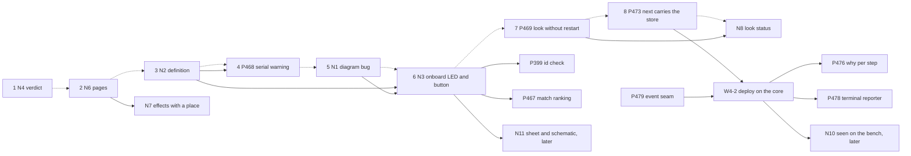

# P480 plan: walk 3's cards, replanned (final)

> First the honest pass and the wrong pages (N4, N6), then the simulation back on: the FireBeetle's stand-in definition (N2),
> the false serial warning (P468 rewritten), the diagram bug (N1, reproduced) and the board's own LED and button in the diagram (N3).
> Then the look without a restart (P469) and the store in `next` (P473). Ten new cards and one spike, three of them later. N9 joins P466.
> G27 is a decision (AT151), not a bug: one question for the PO. The filing text is in `cards.md`.

Walk 3 reached a lit LED on the PO's board, so the basic journey works. Its gaps now sit in three places: a pass that
says too little, a simulation that cannot see the board's own parts, and pages that told Claude wrong things. The plan
fixes those first, keeps the PO's emulator spike after the MVP, and lets every new message use names that exist today.

## Second round

Two reports ran after the synthesis: `walks-compared.md` (walks 1 to 3 side by side) and `between-cards.md` (one agent in
four roles on Sonnet 5.5). A final check on Opus 5.5 reproduced each load-bearing claim in the code and the cards. Rows 55 to 72.

Taken:

- **P476 (#652) and P478 (#656) wait for W4-2** (deploy on the core). P478's body says "Needs: W4-2 merged". P476's why
  belongs on the event that P478 records as decided (#94 comment), and its own proof keeps `--json` bytes. Rejected reason:
  "34 mutation rows retargeted twice". W4-2 retargets them for its own code move (`wave4-plan.md:110`). P476 only adds rows.
- **N9 joins P466 (#634) as slice 2.** Both read a board with no project and name its unit. One card fewer.
- **P468 moves above N1, after N2.** Four walks raised it, and it is XS. It reads the definition N2 keeps.
- **P469 (#637) enters the top at rank 7.** The PO's open pain (#643). P473 (#647) is rank 8: its store field rides
  `NextStep` (`spark/core/result.py:18`) before W4-2 builds deploy's `next` on it (`wave4-plan.md:101-102`).
- **Edits to open cards:** P406 (#531) gets the doubled `does` words (G12). P118 (#52) gets the "not asked for" line (G6, two
  walks). P399 (#515) and P467 (#635) follow N3. P409 (#535) takes C1's question 3, the same question (row 53).

Rejected:

- **N8 into P469.** P469's Done-when needs the bench. N8 is code only (`board_look.py:470-474`, `board_envelope.py:38`).
  N8 stays its own S card, right after P469, and its `board_read` names which of P469's two looks read the board.
- **"P468 needs the FireBeetle record's `usb` fact."** The record lacks it (true), but `pin_roles.usb` names the reserved
  USB pins (`boards/xiao-esp32-c6.json:181`). The XIAO and the FireBeetle both heard `ready` with no wires. The fact is
  the Wokwi definition's `serialInterface` (P400 rows 18, 65, 68, and the kept XIAO definition sets `USB_SERIAL_JTAG`).
- **"P399 is needed by N3."** N3 works without an id check. P399's PR 1 waits on pins "because a board-alone diagram wires
  no pin", so N3 serves P399, not the reverse.
- **"The core's effects are `READS RUNS BOARD DELETES WRITES` (`operation.py:17`)."** That line defines three. Deletes and
  writes enter with W4-2 (`wave4-plan.md:92`).
- **"`OnboardParts` lives in `records/board_records.py` beside `onboard_entries`."** No `scripts/records/` exists.
  `onboard_entries` is `boards.py:373`. That module is the target in `refactor-plan.md:354`. N3 writes into `boards.py`.
- **G19 into P465 (#633), P118 at rank 2, N7 above N8.** G19 keeps one home, N8 (the look's `next`). P118 is a story on
  `!` lines, not XS words. N7 is M and N8 follows P469 on the same file.

## Names

| thing | chosen | why |
|---|---|---|
| a part that sits on a board or module | field `onboard`, the id of the record that carries it | The PO's word ("just onboard", 07:27, "these onboard things", 08:05) and the code's (`onboard_entries`, `OnboardRole`, `ONBOARD_LED`, `boards.py:122,330,373`). `carried` is nowhere. `host` is taken (`host_parts`, `parts.py:313`). |
| the class that turns `pin_roles` rows into parts | `OnboardPartReader` | Rule 5 of `developing.md`: a class that only reads ends in Reader, Finder or Probe. "Board parts" reads as the board in the bill of parts. |
| N5's resolver | `ProjectFinder` | Rule 5 and the helper row (`PortFinder`). It wraps `store.find_listed_name` (`store.py:266`). |
| N10's outcome | "seen on the bench", key `seen_on_bench` beside `unnamed_must` | "Bench result" already means a part fact that `--fact-set` writes (P374, `parts.py:1574`, `agents.md:298`). "Record" means a store file. "Seen" matches deploy's "ready seen" (`ready_check.py:36`). |
| N7's place of a write | `effects` stays, each write adds `place` and `path` | The store's word is `place` (`store.place`, `store.PLACES`, `store.py:85-91`). `where` means a record's layer (`drawer.Link`, `drawer.py:36`). `place` is a `PLACES` key or `project`. |

`board_read`, `NO_REQUIREMENTS` and "verdict" stay. The look with no project never takes the flag `board_only` (`needs.py:514`).

## The repro: every build overwrites a hand-edited `sim/diagram.json`

Confirmed. A copy of `tests/data/breadboard/led-only-xiao` (board `xiao-esp32-c6`), an empty scratch store, no Wokwi
run. (1) `check_spine.py requirements.json --keep <proj>`: exit 0, `ledred5mm` at top 0, left 182.4. (2) Moved it, and
added a part `probe` with `"handAdded": "true"`. (3) The same build: the move undone, `probe` gone, `diff -q` silent.
The converter writes into a new `mkdtemp` (`check_spine.py:705`), `cli.ts:85` finds no old diagram, and `copytree`
(`:985`) copies over the project's file.

## Settled conflicts

1. **C6a, one verdict line, goes now.** `wave4-plan.md` names no `run_scenario.py` (refuter 18). It is not urgent as a
   false green, because deploy lists unnamed must lines (`board_look.py:57-58`). C6b, now N10, waits for W4-2.
2. **`effects` is the one name for what an operation touches** (`parts.py:1599`, `board_envelope.py:59,98`, `NextStep`).
   N7 adds `place` and `path` to each write. No `writes`, `store_writes` or `StoreWrite` (refuter 20).
3. **`NO_REQUIREMENTS` for a missing file**, `NO_BOARD_NAMED` for a file with no `board` key (`board_look.py:470-474`).
   "Not built" reuses `NO_SIM_TOML`.
4. **G27 is by design.** `vouches_for_a_build` refuses `built` when a stage is skipped (`check_spine.py:621-624`, AT151).
   N6 fixes `commands/build.md:147` and the tally hint `parts.py:2282`. The PO answers the question in `cards.md`.

## C1 to C8

- **C1, Wokwi and own-emulator spike: keep, after the MVP.** Questions 1, 2, 4 stay. Question 3 points to P409 (#535).
- **C2, a board's own part: split.** N2 (definition), N3 (parts with `onboard` in the diagram), N11 later (sheet,
  schematic, no `board_only` fork). The P396 GPIO check stays (refuter 27). P332 (#426) keeps the assigner side.
- **C3, a project by name or folder: keep as N5.** It changes §8 S rule 5 (`needs.py:114`). The unlist command (G10) is a row.
- **C4, every store write said: split.** N6 fixes the pages now. N7 adds `place` and a build dry run.
- **C5, which board is on USB: split.** N8 (status and `next`), P469 (G34, the P472 finding), P466 (G15, and G1, G4, G7 as slice 2).
- **C6, bench result: split.** N4 now. N10 after W4-2. "A name is not a test" stays a row (`agents.md:939`).
- **C7, hand edits: drop.** Its gap is the bug N1. I3 (every generated file merges) stays a row.
- **C8, free tests on the Mac: split.** G30 rides N6. G21, G24, G31, I2 wait for C1 (P295 option B).

## New cards (filing text in `cards.md`)

- **N1** bug, S: every `/spark:build` overwrites `sim/diagram.json` → the converter merges into the kept diagram.
- **N2** task, XS: the FireBeetle names no Wokwi definition → the record cites the S3 devkit's `board.json`, the store keeps it.
- **N3** story, M, two PRs: a board-only diagram holds the board alone → `OnboardPartReader` gives parts with `onboard`,
  and the converter wires them. Files `scripts/boards.py`, `scripts/design.py`, `scripts/check_spine.py`. After N1, N2.
- **N4** story, XS: a pass that tested no must line says "passed" → the verdict says what it tested.
- **N5** bug, S: `parts.py <op> walk3` made `walk3/walk3` → `ProjectFinder` takes a listed name or a folder, makes nothing.
- **N6** chore, XS: six pages told Claude wrong or nothing → each says what its command writes and does.
- **N7** story, M: no `--help` names the store place a command writes → each write names its `place`, the build has a dry run.
- **N8** story, S: one status for "read" and "not read", `--port` in `next` → `board_read`, `NO_REQUIREMENTS`, a full `next`.
- **N10** story, later: no place for a must line seen on the bench → `seen_on_bench`, written only on the person's typed yes.
- **N11** story, later: carried parts reach the diagram only → the sheet, the schematic and the page show them.
- **C1** spike, later: the best use of Wokwi's free tools, and an own emulator on free software.

## The order for the top of Ready

| rank | card | reason against P100 #6, a basic project to a breadboard with working firmware |
|---|---|---|
| 1 | N4, the verdict names what it tested | XS. Every free run then says what it proved: "know what's actually working". |
| 2 | N6, six page fixes | XS docs. Claude told the person wrong things from these pages in walk 3. |
| 3 | N2, the stand-in's definition | XS data. P468 and N3 read it, and so does every board-only limit. |
| 4 | P468 (#636) rewritten, the false serial warning | XS. Four walks. It sends Claude after wires a run does not need. |
| 5 | N1, the diagram bug | S. A build destroys the person's edits, and N3 sends board-only builds through it. |
| 6 | N3, the board's own LED and button | M. The PO's "reenable simulation": a scenario can then press and read them. |
| 7 | P469 (#637), the look without a restart | Two button presses per walk (G34), three walks. Needs its plan and the PO's bench. |
| 8 | P473 (#647), `next` carries the store | XS. Any caller that follows `next` in a fresh shell, before W4-2 reshapes `next`. |

After rank 8, in this order: N8 (after P469), P399 (#515, after N3), P467 (#635, after N3), P118 (#52, with G6), P413
(#539), N5, N7, P314 (#388) with P390 (#505), P466 (#634, with ex-N9). Behind W4-2: P476 (#652), P478 (#656), N10.
After the MVP: C1, N11. P349 (#445), open for three walks, goes to the next between-cards council.

## Waits on the PO

The OK to file the cards in `cards.md` (N1 to N8, N10, N11, C1) and its edits to open cards, the Ready order above,
and one answer on G27 (AT151), asked in `cards.md`.
