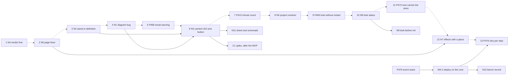

# P480 plan: walk 3's cards, replanned

> First the honest pass and the wrong pages (N4, N6), then the simulation back on: the FireBeetle's stand-in definition (N2),
> the diagram bug fixed (N1, reproduced), the false serial warning (P468 rewritten) and the board's own LED and button in the diagram (N3).
> C7 becomes the bug N1. G27 is a decision (AT151), not a bug. Eleven new cards, three of them later. Every row has a home.

Walk 3 reached a lit LED on the PO's board, so the basic journey works. Its gaps now sit in three places: a pass that
says too little, a simulation that cannot see the board's own parts, and pages that told Claude wrong things. The plan
fixes those first, keeps the PO's emulator spike after the MVP, and lets every new message use names that exist today.

## The repro: every build overwrites a hand-edited `sim/diagram.json`

Confirmed. A copy of `tests/data/breadboard/led-only-xiao` (board set to `xiao-esp32-c6`), an empty scratch store, no
Wokwi run, deploy or grant. (1) `check_spine.py requirements.json --keep <proj>`: exit 0, `ledred5mm` at top 0, left 182.4.
(2) Moved it to top 250, left 400, and added a part `probe` with `"handAdded": "true"`. (3) The same build: exit 0, the
move undone, `probe` gone, and `diff -q` against the first build prints nothing. The converter writes into a new
`mkdtemp` (`check_spine.py:705`), `cli.ts:85` finds no old diagram, and `copytree` (`:985`) copies over the project's file.

## Settled conflicts

1. **C6 first (product) against "messages wait for the event seam P479 #657" (architecture).** Neither wins whole. C6a,
   one verdict line in `run_scenario.py`, goes now: `wave4-plan.md` names no `run_scenario.py`, `check_spine.py` or
   `parts.py` (refuter 18). It is not rank 1, because deploy does not take an untested pass as tested (refuter 6,
   `board_look.py:57-58`). C6b, the bench record, writes through deploy's gate, so it waits for W4-2 (deploy on the core).
2. **One name for the list of writes: `effects`,** declared per operation (`parts.py:1599`) and in envelopes (`board_envelope.py:59,98`).
   N7 adds a place (store or project) and a file to each. No `writes`, `store_writes` or `StoreWrite` (refuter 20).
3. **`NO_REQUIREMENTS`: yes, with two changes.** A missing file and a file with no `board` key are two causes
   (`board_look.py:470-474`), as `NO_SIM_TOML` is its own code. "Not built" reuses `NO_SIM_TOML`, so no `NOT_BUILT`.
   The look with no project gets a flag apart from `board_only` (`needs.py:514`), named at N9's refinement.
4. **G27 is by design.** `vouches_for_a_build` refuses `built` when a stage is skipped (`check_spine.py:621-624`,
   commit `183b6a93`, row AT151). The false lines are `commands/build.md:147` and the tally hint `parts.py:2282`. N6
   fixes them. Whether a board-only build starts to write `built` is the PO's question, asked on N3.

## C1 to C8

- **C1, spike on Wokwi tools and an own emulator: keep, after the MVP.** The PO's words. Its finding links the P295
  own-simulator finding (G23). Question 3 overlaps the open spike P409 (#535). The refuter did not check P409, so the
  PO decides the merge at filing. "Simulation back on now" merges into P413 (#539, minute count) and P399 (#515, id
  check), which the refuter confirmed (refuter 17). P410 (#536, one setting) stays for refinement with the PO.
- **C2, a board's own part is a real part: split.** N2 (the stand-in's definition), N3 (carried parts in the diagram),
  N11 later (sheet, schematic, page, and the end of the `board_only` fork). The P396 GPIO check stays (refuter 27).
  G27 leaves the card. P467 (#635) and P332 (#426) stay open beside it.
- **C3, a project by name or folder: keep as N5.** It names the rule it changes, §8 S rule 5 (`needs.py:114`). The
  unlist command (G10) leaves: the PO's cleanup is done, and row 7 of the diary has the cause.
- **C4, every store write said: rewrite and split.** N6 fixes the pages now, docs only. N7 extends `effects` and adds a
  build dry run. The diary's claim that a board-only build writes `built` is false (refuter 4).
- **C5, which board is on USB: split.** N8 is the look's status and `next` (G3, G18, G19, G36). G34 goes to P469
  (#637) with the P472 finding (refuter 11, 12). G15 goes to P466 (#634, refuter 16). G1, G4, G7 go to N9, later.
- **C6, bench result: split.** N4 now (the verdict line). N10 after W4-2 (the bench record). The AI lens's "a name is
  not a test" stays a row: it is documented (`agents.md:939`) and walk 3 named no step (refuter 5).
- **C7, hand edits: drop as a card.** Its real gap is the bug N1, whose PR corrects the converter's `ARCHITECTURE.md:89-91`.
  I3 (every generated file merges) stays a row, as the PO said "get into it later".
- **C8, free tests on the Mac: split.** The console lines (G30) ride N6. The press-and-read command, the moving clock
  and the stubs (G21, G24, G31, I2) are P295's option B, so they wait for C1.

## New cards

**N1: P? — every `/spark:build` overwrites the person's `sim/diagram.json` → the converter merges into the kept diagram.** Bug.
Serves "one changes the schema manually ... collect notes now" (08:17) and the base for N3. The change: copy the
project's `sim/diagram.json` into the temp `sim/` before the converter runs, on both paths. Print the merge summary in
the build's verdict. Done when: a test builds twice with a moved part and a `handAdded` part, and both stay. Files:
`scripts/check_spine.py`, a test, `tools/circuit-to-wokwi/ARCHITECTURE.md`. Size S.

**N2: P? — the FireBeetle's record names no Wokwi definition, so no limit says which GPIOs a scenario reaches → the record cites the S3 devkit's `board.json` by URL and sha256, and the store keeps it.**
Serves "some basic simulations and schemas should work" (07:41). Closes G13, G29. The change: one `documents` entry,
as the XIAO record has. Spark commits no Wokwi file. Done when: `--match` no longer says "names no Wokwi definition",
and the P396 check lists GPIO 21 and 47 as reachable. Files: `boards/firebeetle2-esp32s3.json`, a test. Size XS.

**N3: P? — a board-only diagram holds the board alone → the board's own LED and button are parts with `carried_by`, wired by the converter.**
Serves "really do show up in the schema as parts, they just know they are on the board" (08:05). Closes G20 in part,
G26, G28. The change: a reader `BoardParts` turns `pin_roles` rows into parts with `carried_by`. `design.parts_of`
appends them. `board_alone`'s hand-written diagram goes. Done when: walk 3's requirements build a diagram with an LED
on GPIO21 and a button on GPIO47, and P399's id check accepts a scenario that presses one and reads the other. No paid
run. Files: `scripts/records/board_records.py`, `scripts/design.py`, `scripts/check_spine.py`, tests. Size M. After N1, N2.

**N4: P? — a passed run that tested no must line says only "passed" → the verdict says "passed: the firmware starts, no must line tested".**
Serves "know what's actually working and what not" (07:41). G32. The change: the verdict line reads the step counts
the log already has. Done when: a test with zero `expect-pin` and `set-control` steps gets the new line in the
verdict and the JSON. Files: `scripts/run_scenario.py`, a test. Size XS.

**N5: P? — `parts.py <op> walk3` made `walk3/walk3` → one resolver takes a listed name or an existing folder, says which, and makes nothing else.**
Serves "noted and debugged how it happened" (07:19). G9, G17. Done when: `--step walk3` from inside `walk3` uses the
listed project and says so, and a name nobody listed gives `could-not-run` with no folder made. Files: `scripts/store.py`,
`scripts/parts.py`, `scripts/needs.py`, tests. Size S.

**N6: P? — six pages told Claude wrong or nothing → each page says what its command writes and does.** Docs only.
Serves "good point to note down and analyze and fix later" (07:59). The init page names `projects.json` (G5). The
idea page says `--step` writes history and shows its dry run first (G8, G17), and fixes the other-choice note (G14,
`needs.py:377`). The build page and tally hint say a board-only build writes no `built` (G27). The deploy page says
what to do when the host refuses the run (G35). The firmware step shows the console-reading lines (G30). Done when:
each sentence is in its page, and the hint test pins the tally line. Size XS.

**N7: P? — no `--help` names the store a command writes → each effect names its place and file, and the build has a dry run.**
Serves the same words. G25. Done when: `--describe --json` and `--help` read one declaration, and a test fails for an
operation that writes the store without it. Files: `scripts/parts.py`, `scripts/check_spine.py`, `docs/guide/agents.md`. Size M.

**N8: P? — the look says "could-not-run" for "read, no token yet" and for "not read", with an empty `next` → a `board_read` field, a `NO_REQUIREMENTS` code and a full `next`.**
Serves the stalls S1, S4, S6. G3, G18, G19, G36. Done when: a look with no `requirements.json` gives `NO_REQUIREMENTS`
and the next command, a look that read every field gives `board_read: true`, and `next` drops `--port` for one board.
Files: `scripts/board_look.py`, `scripts/board_codes.py`, `scripts/board_envelope.py`, tests. Size S.

Later, one sentence each. **N9**: the look reads any board on USB before init, done when an empty folder's look names the
chip, the MAC and the store record (G1, G4, G7). **N10**: a bench result for a must line, written only by the person's typed
yes, done when the next look shows it beside `unnamed_must` (G37, after W4-2). **N11**: carried parts in the sheet, the
schematic and the page, and no `board_only` fork, done when walk 3 gets a breadboard sheet (G20, after N3).

**P468 (#636), rewrite:** the "no serial monitor" warning fires for boards that print over USB → it reads a board fact. Walk 3
heard "ready" with no wires (log line 40), and the repro's XIAO build warned too. Done when: walk 3's build has no serial warning, and a board without a USB console keeps it. XS.

## The order for the top of Ready

| rank | card | reason against P100 #6, a basic project to a breadboard with working firmware |
|---|---|---|
| 1 | N4, the verdict names no must line tested | XS. Every run on the free minutes then says what it proved. |
| 2 | N6, six page fixes | XS docs. Claude told the person wrong things in walk 3 from these pages. |
| 3 | N2, the stand-in's definition | XS data. N3's GPIO check and every board-only limit need it. |
| 4 | N1, the diagram bug | S. It destroys the person's edits, and N3 sends board-only builds through the same path. |
| 5 | P468 rewritten, the false serial warning | XS. The warning sends Claude after wires that a run does not need. |
| 6 | N3, the board's own LED and button | M. The PO's "reenable simulation": a scenario then tests both must lines. |
| 7 | P413 (#539), the minute count | Guards the 50 free CI minutes the PO accepted, once runs test something. |
| 8 | N5, a project by name or folder | S. A store entry made by mistake. N6's page fix lowers the risk first. |
| 9 | P469 (#637), the look without a restart | Two button presses per walk (G34), with the P472 finding as its way. |
| 10 | N8, the look's status and `next` | S. The first minutes of a new project, after the person names the board. |
| 11 | P473 (#647), `next` carries the store | The AI path in a fresh shell. Walk 3 set the store inline, so it did not stall. |
| 12 | N7, `effects` names the place | M. The lasting form of N6, for every interface. |
| 13 | P476 (#652), a why for each deploy step | Teaching. It changes deploy's lines, which W4-2 keeps byte-equal (`wave4-plan.md:88`). |
| after the MVP | C1 spike, N9, N10, N11 | The PO's words for C1. N10 after W4-2. N11 after N3. |

## Waits on the PO

The OK for N1 to N8 and the P468 rewrite, the Ready order, and one answer: does a board-only build write `built` once N3
makes it a full chain (G27, AT151)?
