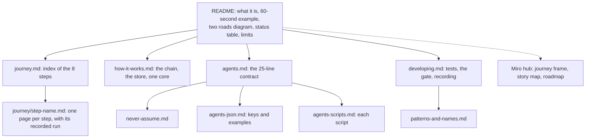
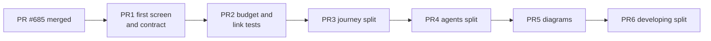

# P498 documentation council, 2026-11-01

Card: [P498 #682](https://github.com/xmejkal/spark/issues/682). Rows: [p498-docs-council.md](../rows/p498-docs-council.md).

**Short version.** Four lenses read the README and the six guides (3,905 lines, 3 mermaid blocks, 1 Miro link to the
board root). They agree on one cause: each story added its detail where a reader looks first. So the first screen has
no example and no diagram, table cells are paragraphs (the Bench cell is 4,348 characters), and six claims are false.
The plan is six small PRs. PR1 fixes the first screen and the false claims. PR2 adds the tests that guard a split.
PR3 to PR6 split the long pages and add one diagram per concept.

The PO's words: "always keep the miro and the backlog and the documentation up to date, the README should be
controlled by a documentation council, once in a while, make sure everything is up to date, its well described, with
examples, a lot of diagrams and miro boards, from simple to more complex, from high level to details sub pages and
sections".

## The council

Four lenses on the everyday model, then this synthesis. Each finding was checked in the code or the docs before it was
accepted. "Confirmed" means the synthesis saw it. The rows file holds each one with its evidence.

### New person

- MUST, confirmed: no "what do I type" example on the first screen (README:3-25).
- MUST, confirmed: a history paragraph from 2026-10-08 in the intro (README:32-37).
- MUST, confirmed: "What it shows on the example" is a list of 12 issue links (README:45-72).
- MUST, confirmed: table cells are paragraphs (README:82-91). The Bench cell is 4,348 characters.
- SHOULD, confirmed: the order. What it is, a 60-second example, install, two roads, what works, commands, limits.
- SHOULD, confirmed: no diagram in the README or commands.md. No Miro link at the top of how-it-works.md or commands.md.
- SHOULD, confirmed: detail inline that belongs on a linked page (the Two roads tally, the Update paragraph).
  journey.md has no index.
- SHOULD, confirmed: jargon before its definition. "not run" is in the README 12 times, 7 of them "not run here".
- Rejected: "the footer says v0.9.0" as stale. `.claude-plugin/plugin.json` ships 0.9.0, and
  `tools/check_docs.py` `version_mismatch` fails the suite when the README says another version.

### AI reader

- MUST, confirmed: agents.md:444 (the `check_spine.py` row) is one table cell of 2,299 characters.
- MUST, confirmed: no JSON example of `check_spine.py --json`. The `check_all.py` sample is dated 2026-10-05 and
  agents.md:333 says it is older than P319.
- MUST, confirmed: no short contract first. An agent reads 400 lines before the exit words, the rule that `skipped`,
  `null` and `unknown` are not a pass, "relay a passed-but answer whole", `parts.py --describe --json` first, and
  `--keep` for `missing_facts`.
- SHOULD, confirmed: sub-pages for the scripts (agents.md:108-318) and the JSON keys (agents.md:319-550).
- SHOULD, confirmed: a warning under the exit table that a crash exits 1 (README:202 says it, agents.md:671 does not).
- SHOULD: one sentence on how a rebuild merges the Wokwi diagram. SHOULD: "Is it ready?" ends without the next action.

### Tech writer

- MUST, confirmed: the table cells and the run-date line (see the false claims below).
- MUST, corrected: journey.md is 1,478 lines. Its Idea section is 274 lines (114-387). The 598 lines from Idea to the
  end of "Before you power it" (114-711) are the block a reader scrolls past. The split into an index and one page per
  step stands.
- SHOULD, confirmed: one home per fact. The exit codes live at README:202, agents.md:554 and agents.md:671.
- SHOULD, confirmed: developing.md mixes five jobs (tests, the commit gate, recording outputs, patterns and names,
  planning). Its last part (developing.md:600-643, rows, plans, where work is planned) belongs to `scrum/`.
- SHOULD, confirmed: plain English. Semicolons: agents 91, journey 89, developing 50, how-it-works 43, README 29.
- SHOULD, corrected: "a length budget test and an anchor check first". The anchor check exists:
  `check_docs.broken_links` fails a relative link or a heading anchor that is not there. It reads only
  `docs/guide/*.md`, so a sub-folder page is outside it. PR2 widens it and adds the length budget.

### Diagrams

- MUST, confirmed: 3 mermaid blocks in all the guides (journey.md:12, how-it-works.md:19, developing.md:372), none in
  the README, one Miro link to the board root (README:7).
- MUST, confirmed: a two-roads flowchart in the README, and Miro links with frame anchors in the README, journey.md,
  how-it-works.md and developing.md.
- SHOULD, corrected: "check the build-chain flowchart against `check_spine.py stages`". That subcommand does not
  exist: `check_spine.py stages` reads `stages` as a requirements path and answers that the chain was not exercised.
  The flowchart at how-it-works.md:19 agrees with the stage table under it, and its text says why parts and the pin map
  are not nodes. So the flowchart stays. A status state diagram is still owed (PR5).
- SHOULD: a store diagram, a one-core context diagram, a simulation and bench sequence, a "which command next"
  flowchart for agents, a records diagram, and a sub-diagram per step.

## The confirmed false claims

| # | where | the claim | the truth | evidence |
|---|---|---|---|---|
| F1 | README:237, Honest limits | nothing here was validated on hardware by its author | `deploy.py --no-simulation` ran on a FireBeetle 2 ESP32-S3 on 2026-10-31 and 2026-11-01, and the PO pressed D14 to light D13. The XIAO ran blink and button-and-LED on 2026-10-14 and 2026-10-15 | README:91 itself, P461 #629, P462 #630 |
| F2 | agents.md:681-683 | a mistyped `--project` answers ok, exit 0 | `CheckedFolder.at` raises at check_all.py:334 and `main` returns exit 2 (check_all.py:530-537). P117 #51 stays open for the other paths | the code |
| F3 | README:77 | the runs stop at 2026-10-18 | `journey.runs_up_to(README)` gives 2026-11-01 | ran it |
| F4 | README:65, 70, 245 | P109 #43, P120 #54 and P128 #62 are named as plans | all three are closed as not planned | `gh issue view` |
| F5 | journey.md:252 | `parts.py --match` prints the XIAO as "stops at the footprint stage (P121)" | the output is from 2026-10-08. Since P278 (2026-10-18) the XIAO builds button + LED | the output note at journey.md:245 |
| F6 | commands.md:53 | init writes `CLAUDE.local.md` | only when the store holds `rules.md`. Otherwise init writes no link and says why | ai_files.py:93-95 |

One more is raised, not confirmed: the Bench cell says "The button-and-LED project's breadboard is not wired yet",
and on 2026-11-01 the D14 button lit D13. PR1 checks it against the P462 comment.

## The synthesis

The docs grew by story: each PR added its sentence to the cell or page a reader sees first. Nothing took the detail
out again. That is why the first screen is long and why the false claims stayed: no one reads a 4,000-character cell
to the end. The fix has two parts. A rule says who changes the README. Tests guard the shape so that a split does not
break links and a page does not grow back.

**The rule, for docs/guide/developing.md** ("The docs name only what is there"), added in PR1: *The README changes only
through the documentation council or a story's own status line in "What works today". A status line is one sentence.
Its detail goes to the step's page in the journey guide.* The council runs at the end of each epic and when the PO
asks.

The page map after PR6 (from high level to detail):

## The staged plan

Each PR is docs only unless it says tests, keeps the suite green, and lands after the one before it. PR1 waits for
[PR #685](https://github.com/xmejkal/spark/pull/685) (P484), which edits the README.

**PR1, the README first screen and table, and agents.md's contract.** About 250 lines changed, most of them moved.

- A 60-second example on the first screen: the commands to type and the answer they give.
- One mermaid flowchart of the two roads (from what you own, from a requirements file you write).
- Each table cell is one sentence. Its detail moves to the step's section in journey.md. `tools/journey.py` and
  `tests/test_journey.py` keep reading the status word.
- F1 to F6 fixed, and the raised Bench claim checked.
- Miro links with `?moveToWidget=` anchors: the overview story map (3458764687094797318), the roadmap
  (3458764688467218869) and the code architecture frame (3458764687681319899). The "spark journey" frame id is not in
  the team's notes, so PR1 reads it from the board.
- The "not run" items gathered in one list under Honest limits, in place of 12 inline mentions.
- At the top of agents.md, a contract of 25 lines or fewer: the exit words, what is not a pass, relay a passed-but
  answer whole, `parts.py --describe --json` first, `--keep` for `missing_facts`. Under it, a dated JSON example of
  `check_spine.py requirements.json --keep build --json` (`--keep` takes a folder).
- The README rule above, in developing.md.
- Done when: the first screen (the first 40 lines) holds the example and the diagram, no table cell is over one
  sentence, F1 to F6 are gone, `check_docs.py` and `test_journey.py` pass, and the JSON example is the output of a
  run with its date note.

**PR2, the length budget and the link check as tests.** About 60 lines of test and data.

- A test that fails a page over its line budget (README 150, an index page 60, a step page 200, agents.md 150) and a
  table cell over 300 characters.
- `check_docs.doc_files` reads `docs/guide/**/*.md`, so links and anchors in sub-pages are checked.
- Done when: each test fails on a planted long page and a planted broken anchor in a sub-folder, and passes on main.
  Pages over budget today are listed in the test as known, each with the PR that removes it.

**PR3, journey.md into an index and one page per step.** About 1,500 lines moved, 80 new.

- journey.md becomes an index of 60 lines or fewer: the journey diagram, the eight steps, one line and a link each.
- `docs/guide/journey/<step>.md` per step (drawer, idea, parts, wiring, before-you-power-it, research, build, checks,
  firmware, simulate, bench, draft-to-order), each with its recorded run.
- Every inbound link (README, commands, skills, scripts) points to the new page.
- Done when: PR2's tests pass with journey.md off the known list, and `check_docs.py` finds no broken link.

**PR4, agents.md split and one home per fact.** About 700 lines moved, 60 new.

- `never-assume.md`, `agents-json.md` (agents.md:319-550), `agents-scripts.md` (agents.md:108-318). agents.md keeps
  the contract and the index.
- One home per repeated fact: the exit codes live in agents-json.md, and README:202 and agents.md link to it.
- Done when: agents.md is under its budget, a grep for the exit-code table finds one copy, and the links pass.

**PR5, one diagram per concept.** About 150 lines of mermaid and captions.

- The store (how-it-works.md): the plugin, the store, a project, and what an update replaces.
- One core in context (developing.md, above the class diagram at :372): the CLI, the agents and MCP calling one library.
- The simulation and bench sequence (journey/simulate.md and journey/bench.md): build, simulate, look, yes, flash,
  read back.
- The status state diagram: `ok`, `problems`, `could-not-run`, `skipped`, and what each lets an agent say.
- Done when: each diagram renders on GitHub, each names only scripts that exist (`check_docs.py` passes), and the
  matching Miro frame links back to it.

**PR6, developing.md split.** About 250 lines moved.

- `patterns-and-names.md` takes developing.md:288-565. developing.md:600-643 (rows, plans, where work is planned)
  moves to `scrum/`.
- Done when: developing.md is under its budget, nothing it held is lost (a diff of moved lines), and the links pass.

## What waits

The PO's OK on this plan and its order. Then PR1 starts after PR #685 merges.
