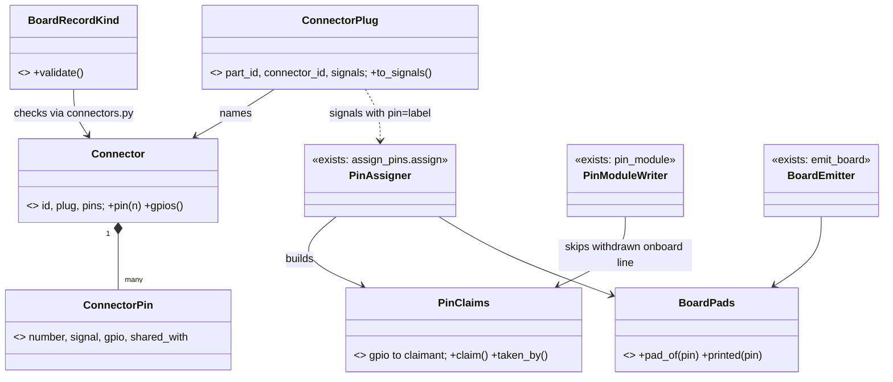

# P510 architecture lens: walk 4's cards against the refactor plans

> One small Value per gap, no new tool: `BoardPads` (C1, a SPI pad-name defect), `Connector` and `ConnectorPlug` (C2, a module on a fixed connector), `FlashLayout` (C8, a third-party image).
> C3 (remove a part) is mostly C2 in disguise: the pin map names the onboard LED while a connector now claims its GPIO. C6 (the automatic deploy) clashes with plan decision 6 and with W4-2 (deploy on the core).
> Verified at `8595309b` by reading code. Nothing was run, no web lookup was made.

## Findings

| # | finding | evidence | card or plan | proposal | sev |
|---|---|---|---|---|---|
| A1 | The pad-name lookup `pad_aliases.get(pin, pin)` is written 4 times and the emitter has none. The emitter traces `.Mcu > .MOSI` while the footprint pad is `MO`. | `emit_board.py:812`, `assign_pins.py:418`, `breadboard.py:150,315`, `boards.py:694`. Board alias map `{MISO: MI, MOSI: MO, SS: A4}` | C1 (SPI build defect) | One Value `BoardPads` with `pad_of(pin)` and `printed(pin)`. It reads `physical.pad_aliases` once. All 4 sites call it. This is the fix and the refactor in one PR | high |
| A2 | The assigner already honours a signal that names its pin (`signal["pin"]`, placed first). It only knows labels in `board["pins"]`, and the GDI GPIOs are no header labels. So C2 needs no new assigner. | `assign_pins.py:228-247`, `board["pins"]` has 25 header labels | C2 (fixed connector) | `ConnectorPlug` builds signals with `pin=<connector label>`. Connector pins join `candidates()` as labels. `assign()` stays as it is | high |
| A3 | A GPIO has 3 owners today and no one list: signals (`taken_gpio`), onboard roles (`onboard_lines`, written for every role the record names) and restricted roles. A connector would be a 4th, so GPIO21 (GDI backlight and onboard LED) is invisible. | `assign_pins.py:297-319,432-488`, `restricted_pins.py:43`, board `pin_roles.onboard_led.gpio=[21]` | C2, C3 (remove a part) | One Value `PinClaims`: GPIO to claimant (signal, onboard role, connector). Built once by `assign()`. `pin_module` skips a withdrawn onboard line and says why. `import_firmware.py` then names old firmware that imports it | high |
| A4 | G31 (`pins.py` still names `ONBOARD_LED` after the light left) is not a bug alone. The LED is on the board. The defect exists only when a connector claims its GPIO. | `assign_pins.py:427` (all onboard roles are written, by design for projects with no parts, P236) | C3 | Drop the "mark unused" half of C3. Keep one operation that removes a need | medium |
| A5 | Holds are not stored by a hold command. They are recomputed from the picks on each plan, so a removed pick frees its hold. Removal needs no hold code. | `needs.py:430-453` (`used_in` rebuilt per project name), `_merge_parts` `needs.py:595` | C3 | `DropNeed` Operation in the design area: `plan_set` gains a delete, `plan_pick` re-runs, the dry run prints the `used_in` change. Not checked: why `--pick . light=` is refused | medium |
| A6 | The flash size is a constant of 4 MB and the file system a fixed 2 MB at 0x200000. The board record already holds `flash_mb`. That is the root of G42 (refusal of s3lcd's own `vfs`). | `flash_image.py:37-38,82,117-130`, board record key `flash_mb` | C8 (own MicroPython build) | Value `FlashLayout` (size from `flash_mb`, file system from the image's own `vfs` entry, else today's 2 MB). `PartitionTable.with_filesystem` returns it. No new strategy | high |
| A7 | A third-party image is already modelled: a tools-list entry with `micropython_port`, `meets`, `flash_offset`, and `tools.py --new` writes it. C8 adds facts to that entry, not a new record kind. | `flash_image.py:194-243` (`offset_of`, `build_entry`, `OWN_BUILD_HINT`) | C8, P463 | Entry gains `source_url`, `license`, `provides` (`psram`), `usb_serial` (`fixed`). The SKU choice sits in the board record as `builds: {sku: port}`, read by `board_build` | medium |
| A8 | What runs on the board has one home: the facts file `spark.json`. It holds the image sha256 and no interpreter. G39 and G46 end there. | `board_facts.py:23-27` (`facts`) | C8 | Add `interpreter {build, sha256}` to `facts()` and to `LastDeploy`. A flash outside spark shows as a sha256 mismatch on the next look. Not checked: the look's read path | medium |
| A9 | C6 clashes with plan decision 6: a relayed yes makes a live grant only, and every erase needs a typed yes in the person's own terminal. A standing yes for N minutes over deploys is a change to that gate. | `architecture/README.md` "Your answers" 6, `wave4-plan.md:130` (W4-4) | C6 (automatic deploy) | The PO decides. The safe shape is a typed `StandingGrant` Value (project, board, expiry), written only by `grant.py` in his terminal, read by the gate. Claude never writes it | high |
| A10 | C6 edits `deploy.py` and `download_mode.py`, which W4-2 moves into the bench area. Two PRs on one file conflict. The entry into download mode is one thing that varies. | `wave4-plan.md:86`, `download_mode.py:1-25` (button words) | C6, W4-2 | Land C6 after W4-2. Add `DownloadEntryStrategy` with `PressButtonsEntry` (today) and `BootloaderCallEntry` (P472). The Platform builds the choice | medium |
| A11 | E1 (look probe) and E2a (two deploy goldens) do not touch any C card. The Reporter is not in code yet. The C6 "watch" step (G35) needs a line stream. | `scripts/spark/core` has no `events.py`. `event-seam-plan.md:224-225` | E1 P507, E2a P508, C6 | C6's watch step sends `Event` lines through `outside.report`. It adds no log path of its own. So C6 waits for E1 | medium |
| A12 | G43 needs no new design. A module file in `scripts/stand_in/` is already importable, because the import child puts that folder on `sys.path`. | `import_firmware.py:52,61`, `stand_in/` holds `machine.py`, `fallback/framebuf.py` | C9 (free tests on the Mac) | A chore: add `stand_in/s3lcd.py`, move `framebuf` beside `machine`, list the folder in `agents.md`. Not checked: the import child's path order | low |
| A13 | P391 (boards as modules) moves board validation into `BoardRecordKind`. A connectors check inside `boards.validate` (718, about 80 lines) moves twice. | `boards.py:718`, `P391 design.md` section 3 | C2, P391 | Put connector validation in its own module `connectors.py`. `boards.validate` calls it once. P391 then moves one call | medium |

## The design for C2: a module on a fixed connector

A board provides a connector. A part consumes it. This is P391's rule: a board provides pins, a part consumes them. The board record gains `connectors` (facts with a source). The part record gains `plugs_into`.

Today the code lives in `assign_pins.py` (assigner, writer), `boards.py` (record rules) and `emit_board.py`. Target homes follow the area map: `design/connector.py` (Connector, ConnectorPin, ConnectorPlug), `design/pin_claims.py`, `design/board_pads.py`, `design/pin_assigner.py`. Validation sits in `records/connectors.py`. Steps, each its own small PR:
1. C1: `BoardPads`. 2. `Connector` and its validator, plus the FireBeetle 2's GDI P2 and camera P1 as record facts. 3. `PinClaims` with the shared-GPIO warning. 4. `ConnectorPlug` and the part's `plugs_into`. 5. The breadboard sheet draws one cable per plug (`breadboard.py`, not checked). `requirements.json` needs no pin field: the plug is the pin map.
The need's condition `plugs into GDI` (G19) is read by `serving_roles` in `needs.py:185` against `plugs_into`, so `--match` stops ignoring it.

## The cards

- **C1 (SPI build defect): keep, first.** Rewrite its change as A1: `BoardPads` is the one lookup. Done when `dfr0664-tft-2in` builds end to end and `BoardPads` is the only reader of `pad_aliases` (a test greps the other 4 sites).
- **C2 (fixed connector): merge into P460 (#628, GDI spike), then rewrite P460 as a story.** Change: the 5 steps above. Done when a project with the GDI display builds with the pins from the connector, the breadboard names the plug, and the pick warns that GPIO21 is shared with the LED.
- **C3 (remove a part): split.** Keep `DropNeed` with a dry run (A5). Move "mark unused" into C2's `PinClaims` (A3, A4). Done when `--needs-drop light` frees its hold and `pins.py` loses a line only when a connector claims it.
- **C4 (walk presets and holds): merge into P466 (#634).** Presets are test setup, not product. Hold by MAC needs `used_in` to name a board, a record change, so split that from G6 and G7 (print keys, offer to raise the count), which are small.
- **C5 (first steps for a new user): keep, with P488 (#667, no `--help` names the store place).** Reuse P488's `effects.place`. Next-step text goes in the Operation's `next`, not in prose.
- **C6 (automatic deploy): split.** (a) Download entry by `BootloaderCallEntry` (A10) merges into P469 (#637). (b) The standing yes is a new card that waits for the PO's word (A9). (c) The watch step waits for E1 (A11). Done for (a): the look and deploy enter download mode with no hands on the board.
- **C7 (one honest word about a run): merge into P490 (#669) and P409 (#535).** One `RunScope` Value (what a run tests, what it skips), read by `--match`, `--pick`, the build and the look. G17 and G33 add rows to it.
- **C8 (own MicroPython build): keep, rewrite.** Change: A6, A7, A8, in that order. Merge the SKU part into P349 (#445) and the driver rung into P336 (#430). Done when the s3lcd image is carried and the look prints the interpreter's sha256.
- **C9 (free firmware tests on the Mac): merge into P492 (#671) and P399 (#515).** A12 is a chore. The press and read command is the `Pin` stand-in plus one CLI, small.
- **C10 (BOOT as second button): keep, XS.** One more row in `ONBOARD_ROLES` (`boards.py:330`), no new class. Done when `ONBOARD_BUTTON_BOOT` is in `pins.py`.
- **C11 (the C driver spike, outside spark): not replanned.** Its findings feed A6 and A7: the `vfs` size and the fixed USB serial are two facts of a build entry.

## New cards

- **P? — spark carries one pad name per pin → every reader asks `BoardPads`.** Need: 4 copies of one lookup, 1 of them missing. Done when only `BoardPads` reads `pad_aliases`. (This is C1's refactor half, file inside C1.)
- **P? — a GPIO has 4 owners and no list → one `PinClaims`.** Need: A3. Done when the assigner, the pin writer and the import test read one claim table.
- **P? — flash size is 4 MB in code → `FlashLayout` from the record.** Need: A6. Done when a 16 MB board gets a 16 MB image.

## Not checked

The breadboard sheet's drawing of a cable. The look's read path for the interpreter. Why `--pick . light=` is refused. The Wokwi diagram generator's use of pin names. Whether `flash_mb` is set on every board record. The import child's path order. All tests and goldens: nothing was run.
