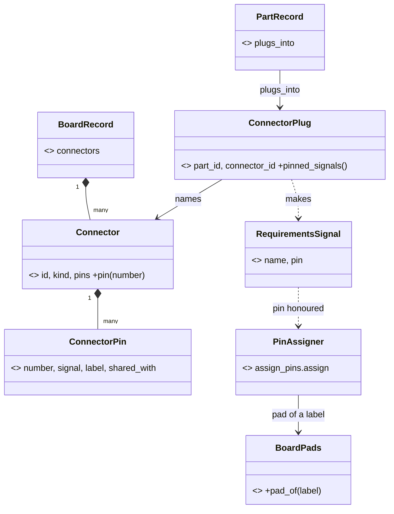

# P510 plan: walk 4's cards, replanned (final)

Filed on 2026-11-02 in auto mode: N1 is P512 (#708), N2 is P513 (#709), N3 is P514 (#710), N4 is P515 (#711), N5a is P516 (#712), N5b is P517 (#713), N6a is P518 (#714), N6b is P519 (#715), N7 is P520 (#716), N8 is P521 (#717), N9 is P522 (#718), N10 is P523 (#719), N11 is P524 (#720), N12 is P525 (#721).

> First N1: no SPI or I2C part builds on the FireBeetle 2 or the XIAO C6 today. Then E1 (P507), E2a (P508), N2 (pin a
> part's signal) and N6a (offer the deploy grant once, a page only). Fourteen new cards, N5 and N6 split. N6b and N7
> wait for W4-2 and W4-3, which move deploy and the grant. Four PO questions on consent and rules. Filing text: `cards.md`.

Walk 4 reached both goals. The plan fixes the build first, lets a project pin a part's signal, and keeps every new yes
in the person's own terminal. Sources: the lens reports, `refuter.md` and `between-cards.md` beside this file (the
refuter wins), and the rows file `docs/observations/rows/p510-walk4-council.md`, rows 47 to 94. N1 to N12 are walk 4's
codes. Walk 3's council also had N1 to N11, so a row writes "walk 4 N3".

## Where C1 to C10 go

- **C1, the pad-name build defect: keep as N1.** The XIAO C6 breaks on SPI, I2C and A0 too, since P278 (refuter R2).
- **C2, a module on a fixed connector: split.** N2 now: a requirements signal with a part's signal name sets that
  signal's pin (refuter R11, refusal at `design.py:376-382`). The rest goes to the spike P460 (#628). Its finding tests
  the class diagram below. The build card for `connectors` is filed after that finding.
- **C3, remove a part: keep as N3, smaller.** `parts.py --needs-drop` with a dry run. Leaving `ONBOARD_LED` out of
  `pins.py` goes to the connector card after P460, because the line is by design until a connector claims GPIO21 (row 68).
- **C4, presets and holds: split.** G4 goes to P466 (#634). G3, G6 and G7 are N4. The preset (I1) is one comment on P365 (#467).
- **C5, first steps: split.** N5a is the idea page (G1, G9). N5b is the build's next step (G11). G2 goes to P488 (#667).
- **C6, the automatic mode: split.** The no-hands entry goes to P469 (#637) as slice 2, after W4-2. N6a makes the deploy
  page offer the existing grant once. N6b names the project and a count, after W4-3. N7 is deploy's end (G40, G35,
  G16), after W4-2. Cut: "start with `--after watchdog-reset`", done at `flasher.py:51` (row 54).
- **C7, one word about a run: split.** G18 and G17 go to P490 (#669). G25 goes to P409 (#535). G10, G28 and G33 are N8.
- **C8, the own MicroPython build: split.** G37 goes to P349 (#445). G42 is N9. G38, G39 and G46 are N10. G44 and G45
  go to P336 (#430) and wait for P511 (#706).
- **C9, free tests on the Mac: split.** G12 goes to P399 (#515) PR 2. G13 is decision 4. G14, G32 and G43 are N11.
- **C10, BOOT as a second button: keep as N12, record only** (refuter R13, not P467).
- **C11 is P511 (#706), the PO's spike, right after P510.** Not replanned. It returns facts: to N9 a self-built image's
  table, to N10 the build's name and sha256, to P336 the build entry and its USB console and serial (G44, G45, row 53).

## New cards

| card | title | label, size |
|---|---|---|
| N1 | the board emitter traces the pin name, not the pad → one `BoardPads` reader, and the verdict names the trace | bug, S |
| N2 | `requirements.json` cannot pin a part's signal → a requirements signal with the part's signal name sets its pin | story, S |
| N3 | spark cannot drop a need from a project → `parts.py --needs-drop` with a dry run drops it and frees its hold | story, S |
| N4 | a refused pick hides the third fix and the drawer key → the refusal puts every fix in `next` | story, XS |
| N5a | the idea page reads a brief that does not exist yet → step S runs `/spark:init` first | story, XS |
| N5b | the build ends with no next step → its verdict names the firmware step in `next` | story, XS |
| N6a | Claude offers the deploy grant only when asked → the deploy page offers it once, at the first stop for a yes | story, XS |
| N6b | the deploy grant names no project and no count → it names both, and `--check --scope deploy` reads it | story, S |
| N7 | deploy ends at a late port and keeps no later line → it waits for the port and reports later console lines | story, S |
| N8 | the chain's stages say different things about what a run tests → one sentence, and the pick names a skip | story, S |
| N9 | the file system is a fixed 2 MB at 0x200000 → the layout comes from the image's own table | story, S |
| N10 | spark does not say which MicroPython runs on the board → the image, the look and the facts file name the build | story, S |
| N11 | the stand-ins sit in two folders and know no C module → one documented folder, and a project adds its own | chore, XS |
| N12 | the BOOT button has no name in `pins.py` → the record names it with its download-mode caveat | task, XS |

## The order for the top of Ready

| rank | card | reason against P100 #6, a basic project to a breadboard with working firmware |
|---|---|---|
| 1 | N1, the pad-name build defect | Every display and many sensors fail the build on both owned boards. The person: "we definitelly should fix this". |
| 2 | P507 (#702), E1 the event seam probe | The PO's order: E1 "runs as its own PR right after P480". |
| 3 | P508 (#703), E2a deploy goldens | XS. It pins deploy's lines before W4-2, N6b and N7 change them. |
| 4 | N2, pin a part's signal | After N1. The GDI display then builds through spark with the cable's pins (the PO's A1). |
| 5 | N6a, offer the grant once | XS, a page only. The PO's I3. It helps only images a simulation tested, until decision 1. |
| 6 | N5a, step S runs init first | XS, a page only. A new person loses the goal at step S. |
| 7 | P473 (#647), `next` carries the store | XS. Before N4 and N5b, which add commands to `next`. |
| 8 | N5b, the build names firmware next | After N1 (same verdict, `check_spine.py:496`) and P473. |
| 9 | N3, drop a need | The "swap a part" journey has no step. N4's steps name its command. |
| 10 | N4, the refusal's fixes | XS. After N3 and P473. |
| 11 | N8, one word about a run | Words only. Claude merged three stage messages by hand (UX 12). |
| 12 | N9, the flash layout | After P511 returns the self-built image's table. |
| 13 | after W4-2: N7, P469 slice 2, N10. After W4-3: N6b | Deploy and grant move to the core there (`wave4-plan.md`). N6b also after decisions 1 and 3. |
| - | N11 and N12, ride-along | Each enters Ready only with a card that touches `import_firmware.py` or a board record. |

Ready today: P473, P503, P506, P507, P508 (row 62), limit 5. Ready at the start: N1, P507, P508, N2, N6a. P473 leaves.
P506 (#700, its Done when is the PO's decision) and P503 (#692, no journey stage) go to Idea. P469 (#637) stays in Build.

## Decisions for the PO

Taken in auto mode on 2026-11-02 at about 00:20 CET. The PO wrote "lets enter fully automatic mode, no approving
necessary", so each decision takes its recommendation, the safer default. The PO can change any of them, and the card
that carries it (N6b, P469, P118, P390) changes with it.

1. **Does a deploy grant cover an image that no simulation tested?** Today it never does (`board_grant.py:107`,
   `image_evidence.py:353`), and walk 4 ran `--no-simulation` from step 20, so the grant did not help there (row 52).
   Recommended: "never" stays the default. N6b adds one opt-in line to the grant's question, "also images that no
   simulation tested", kept in the grant and printed at each use.
2. **Does your yes for P469 (#637) cover `machine.bootloader()`?** It runs code on the board and restarts it into
   download mode (row 57). Recommended: no for the look, which reads through mpremote (slice 1). Deploy runs it only
   after the person's yes or a grant, and the deploy question names it: "starts download mode with no button" (slice 2).
3. **Does `/spark:init` write a deny rule for the store's `grants/` folder into the project's Claude Code settings?**
   Today any program that writes the store can write a grant (`grant.py` epilog). Not checked: whether Claude Code
   honours a deny rule for a path outside the project. Recommended: yes, as N6b's last slice, after a test shows that
   the rule holds. Until then the grant question says that Claude can write the file.
4. **G5, G8 and G13 are in three walks. A card in Ready or "won't fix"?** Recommended: G8 rides P118 (#52), cut to the
   one line. G5 gets one line in P390 (#505). G13 stays with P492 (#671), "won't fix before the MVP", as you said 11-01.

## Second round

`between-cards.md` (one agent, four roles, Sonnet 5.5) ran after the synthesis. A final check on Opus 5.5 reproduced
each load-bearing claim in the code and the cards. Rows 71 to 94.

Taken:

- **N7 waits for W4-2, not P507.** Deploy passes a `show_line` lambda (`deploy.py:248,270`, `deploy_service.py:93`) and
  has no `outside`. Deploy reports through the seam only in E2, inside W4-2 (`event-seam-plan.md:226`). #702 is the look only.
- **N6 splits.** N6b changes `grant.py` and the grant file, which W4-3 moves (`wave4-plan.md`, W4-3 files `grant.py:68-128`,
  19 grant mutation rows). N6a, a page only, ships the PO's I3 now. Row 69's "N6 is a `--json` key" no longer holds.
- **No new key for "what to do next".** N4 puts its commands in `next` as `NextStep`s (`scripts/spark/core/result.py:18`). An
  item's `fix` stays text or null (`json.md:234`). N5b adds `next` to `check_spine --json` and updates `json.md:140`.
- **N4's count step is the person's.** The drawer page writes a count only from the person's answer (`commands/drawer.md:27-29`).
  The step carries the existing `needs_yes: true`, not a new mark.
- **N1's grep test:** the validator `boards.py:694` reads `pad_aliases` too, so no file outside `boards.py` reads it.
  **N2's cite** is `design.py:376-382`, P163's guard (`tests/mutations/p163-case-names.json`), kept for an entry with no `pin`.
- **N12 keeps `gpio: [47]`.** Labels write only `<NAME>_<LABEL>` (`assign_pins.py:452-456`), so `ONBOARD_BUTTON` goes
  and `ONBOARD_BUTTON_ON` stays (`:460-464`). No record uses `labels` today.
- **P469's edit has two slices**, and N5 splits (N5a the page, N5b the verdict after N1). N7's sentence says "the board
  is ready", not "read it again". One word each: `drop` a need, `free` a hold, `connector` for P460's "plug".

Rejected:

- **"N9 takes the size by `--flash-mb`" and round 1's "from the look".** The build's simulation stage makes the tested
  image with no board on USB, so no caller knows the size. The image's own table gives it, and the look already
  refuses an image larger than the measured flash (`board_look.py:280`). N9 needs no argument and no W4-2.
- **"N6 adds a `grant_command` key."** Deploy's envelope already puts a `grant` step in `next` with `needs_yes`
  (`board_envelope.py:95-98`). The deploy page offers it only when the person asks (`commands/deploy.md:53-57`).
  So **"P473 comes before N6a"** is rejected too: N6a changes a page only.
- **"N8 and P399 read one fact twice."** N8 reads whether a board definition gives a part a pin a scenario reaches
  (`needs.py:202-208`). P399 reads the ids that a scenario file names (#515, PR 1). Two facts.

## C2's connector design, the proposal P460 tests

Every GDI GPIO is already a header label (BL 21 = D13, DC 3 = D2, row 60), and the assigner honours a named label
(`assign_pins.py:228-247`). So a plug only turns a part's signal names into pinned requirements signals, N2's path.

Names: a **connector** is the board's socket (GDI P2, camera P1). A part **plugs into** one. `kind` replaces P460's
"plug type". `shared_with` carries GDI BL with the LED on GPIO21 and GDI with the camera on IO1, IO2 and IO7. The
validator has its own module (architecture A13). The TypeScript alias copies stay out of scope (refuter R3).
