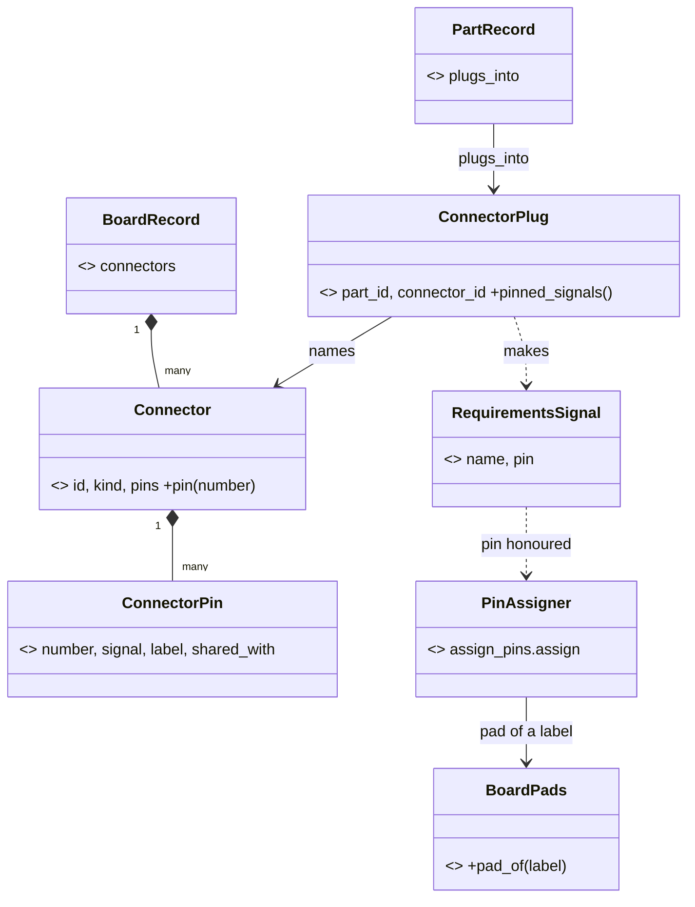

# P510 plan: walk 4's cards, replanned (synthesis, round 1)

> First the build defect N1: no SPI or I2C part builds on the FireBeetle 2 or the XIAO C6 today. Then the PO's own order,
> E1 (P507) and E2a (P508), then the first steps N5 and the offered deploy grant N6. Twelve new cards (N1 to N12), no new spike.
> C2's connector design goes to P460 (#628) as the proposal its finding tests, and N2 lets a project pin a part's signal now.
> Four questions for the PO, all about consent or rules. The filing text is in `cards.md`.

Walk 4 reached both goals, so the basic journey works, and a module on the GDI cable went around spark at four points.
The refuter widened the top defect to two boards and three buses, rejected the clash of C6 with plan decision 6, and
found that a deploy grant can never cover walk 4's last image. So the plan fixes the build first, offers the grant that
exists, and keeps every new yes in the person's own terminal.

Sources: the four lens reports and `refuter.md` beside this file (the refuter wins), the rows file
`docs/observations/rows/p510-walk4-council.md` (rows 47 to 70 hold the claims below), and `gh issue view` of each card.

## Where C1 to C10 go

- **C1, the pad-name build defect: keep as N1.** Wider than the walk saw: the XIAO C6 breaks on SPI, I2C and A0 since
  P278 (refuter R2). One `BoardPads` Value is the only Python reader of `pad_aliases`. The verdict names the trace (G30).
- **C2, a module on a fixed connector: split.** N2 now: a requirements signal with a part's signal name sets that
  signal's pin (refuter R11, `design.py:128-150`). The rest merges into the spike P460 (#628): its finding cites the
  pinouts and tests the class diagram below. The build card for `connectors` is filed after that finding, not now.
- **C3, remove a part: keep as N3, smaller.** `parts.py --needs-drop` with a dry run. The "mark unused" half goes to the
  connector card after P460, because `ONBOARD_LED` in `pins.py` is by design until a connector claims GPIO21 (row 68).
- **C4, presets and holds: split.** G4 goes to P466 (#634). G3, G6 and G7 are N4. The preset (I1) is a walk setup step:
  one comment on P365 (#467), no card.
- **C5, first steps: keep as N5 (G1, G9, G11).** G2 goes to P488 (#667), which names each write's place and path.
- **C6, the automatic mode: split in three.** The no-hands entry goes to P469 (#637, in Build) as one Done-when line. N6
  offers, names and caps the deploy grant that exists since P242 (UX 1, refuter R4). N7 is deploy's end: the late port
  (G40), later console lines (G35) and the 2 s silence (G16). N7 waits for E1. Cut: "start with `--after
  watchdog-reset`", done at `flasher.py:51` (row 54).
- **C7, one word about a run: split.** G18 and G17 go to P490 (#669). G25 goes to P409 (#535). G10, G28 and G33 are N8.
- **C8, the own MicroPython build: split.** G37 goes to P349 (#445). G42 is N9 (a flash layout defect, refuter R9).
  G38, G39 and G46 are N10. G44 and G45 go to P336 (#430) and wait for P511 (#706).
- **C9, free tests on the Mac: split.** G12 goes to P399 (#515) PR 2. G13 is the PO's call (decision 4). G14, G32 and G43
  are the chore N11.
- **C10, BOOT as a second button: keep as N12, record only** (refuter R13, not P467).
- **C11 is P511 (#706), the PO's spike, right after P510.** Not replanned. It returns facts, not code: to N9 the
  partition table and `vfs` size of a self-built image, to N10 the build's name and sha256, and to P336 the build
  entry (source URL, license, sha256) and whether its USB console stays alive (G45). If the USB serial stays fixed
  (G44), a grant cannot name that board (row 53), and N6's words say so.

## New cards

| card | title | label, size |
|---|---|---|
| N1 | the board emitter traces the pin name, not the pad → one `BoardPads` reader, and the verdict names the trace | bug, S |
| N2 | `requirements.json` cannot pin a part's signal → a requirements signal with the part's signal name sets its pin | story, S |
| N3 | spark cannot drop a need from a project → `parts.py --needs-drop` with a dry run frees its pick and hold | story, S |
| N4 | a refused pick hides the third fix and the drawer key → the refusal lists every fix as a command | story, XS |
| N5 | the goal never reaches the brief, and the build ends with no next step → step S keeps the goal, the build names firmware next | story, XS |
| N6 | the deploy grant is offered once and names no project → deploy offers it, and it names the project and a count | story, S |
| N7 | deploy ends at a late port and keeps no later line → it waits for the port and reports later console lines | story, S |
| N8 | the stages say different things about what a run tests → one sentence, and the pick names a part's skip | story, S |
| N9 | the file system is a fixed 2 MB at 0x200000 → the layout comes from the image's own table and the measured flash | bug, S |
| N10 | spark does not say which MicroPython runs on the board → the image, the look and the facts file name the build | story, S |
| N11 | the stand-ins sit in two folders and know no C module → one documented folder, and a project adds its own | chore, XS |
| N12 | the BOOT button has no name in `pins.py` → the record names it with its download-mode caveat | task, XS |

## The order for the top of Ready

Ready holds P473, P503, P506, P507 and P508 today (`gh project item-list 2`, row 62). Its limit is 5.

| rank | card | reason against P100 #6, a basic project to a breadboard with working firmware |
|---|---|---|
| 1 | N1, the pad-name build defect | Every display and many sensors fail the build on both owned boards. The person: "we definitelly should fix this". |
| 2 | P507 (#702), E1 the event seam probe | The PO's order: E1 "runs as its own PR right after P480". N7 and W4-2 report through it. |
| 3 | P508 (#703), E2a deploy goldens | XS. It pins deploy's lines before N6, N7 and W4-2 change them. |
| 4 | N5, the first steps | XS. A new person loses the goal at step S and does not know that firmware comes next. |
| 5 | N6, the offered deploy grant | Ten typed yeses in walk 4, the PO's I3. Ready only after decisions 1 and 3. Until then N2 holds rank 5. |
| 6 | N2, pin a part's signal | The GDI display then builds through spark with the cable's pins. Small, after N1. |
| 7 | P473 (#647), `next` carries the store | XS. It rides `NextStep` before W4-2. No walk 4 gap needs it sooner. |
| 8 | N3, drop a need | The "swap a part" journey has no step. N4's fixes name its command. |
| 9 | N4, the refusal's fixes | XS. After N3. |
| 10 | N7, deploy's end | After P507. Three walks met the silent console (G16). |
| 11 | N8, one word about a run | Words only. Claude merged three stage messages by hand (UX 12). |
| 12 | N12, the BOOT button | XS record fact. Few projects need a second button. |
| 13 | N9, the flash layout | After P511 returns the self-built image's table. |
| 14 | N10, the interpreter named | After P511 returns the build's name. |
| 15 | N11, the stand-ins | Chore. The walk worked around G43 inside a function. |

Back to Idea once N1 and N5 enter: **P506 (#700)**, because its Done when is the PO's decision and it changes no stage,
and **P503 (#692)**, diagrams, which serve no stage of the journey. P473 leaves Ready when N6 or N2 enters. P469 (#637)
stays in Build, its plan held for the PO.

## Decisions for the PO

1. **Does a deploy grant cover an image that no simulation tested?** Today it never does (`board_grant.py:107`,
   `image_evidence.py:353`), and walk 4 ran `--no-simulation` from step 20, so the grant did not help there (row 52).
   Recommended: keep "never" as the default. The grant's own terminal question gets one opt-in line, "also images that
   no simulation tested", kept in the grant and printed at each use.
2. **Does your yes for P469 (#637) cover `machine.bootloader()`?** It runs code on the board and restarts it into
   download mode (row 57). Recommended: no for the look, which reads through mpremote. Deploy runs it only after the
   person's yes or a grant, and the deploy question names it: "starts download mode with no button".
3. **May `/spark:init` write a deny rule for the store's `grants/` folder into the project's Claude Code settings?**
   Today any program that writes the store can write a grant (`grant.py` epilog). Not checked: whether Claude Code
   honours a deny rule for a path outside the project. Recommended: yes, as N6's last slice, after a test shows that
   the rule holds. Until then the grant question says that Claude can write the file.
4. **G5, G8 and G13 are in three walks. A card in Ready or "won't fix"?** Recommended: G8 rides P118 (#52), cut to the
   one line, ranked with N5. G5 gets one line in P390 (#505). G13 stays with P492 (#671) after the MVP, as you said on
   11-01, so "won't fix before the MVP".

## C2's connector design, the proposal P460 tests

The refuter checked the board's pins: every GDI GPIO is already a header label (BL 21 = D13, DC 3 = D2, row 60), and the
assigner honours a signal that names its label (`assign_pins.py:228-247`). So the assigner does not change. A plug only
turns a part's signal names into pinned requirements signals, the path N2 opens.

Names: a **connector** is the board's socket (GDI P2, camera P1). A part **plugs into** one. `kind` replaces P460's
"plug type", so "plug" names the part's side only. `shared_with` carries GDI BL with the onboard LED on GPIO21 and GDI
with the camera on IO1, IO2 and IO7, so the pick can warn. The validator lives in its own module, so P391 moves one call
(architecture A13). The TypeScript converter's own alias copies stay out of scope (refuter R3).
