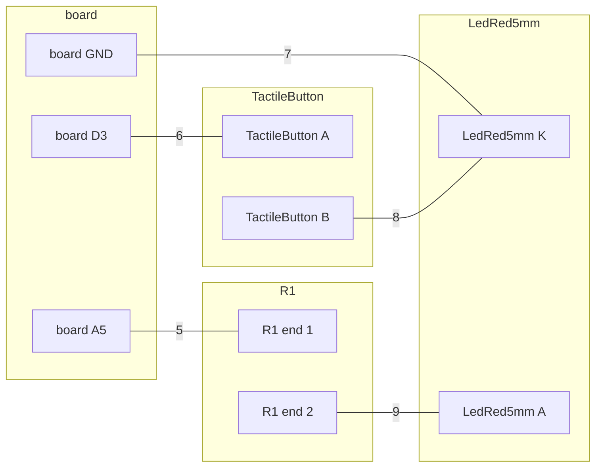

# Breadboard: button-light, on a DFRobot FireBeetle 2 ESP32-S3

## Parts

| qty | part | for | have |
| --- | --- | --- | --- |
| 1 | DFRobot FireBeetle 2 ESP32-S3 | the board |  |
| 1 | 6x6 mm tactile push button | TactileButton |  |
| 1 | Kingbright L-7113ID 5 mm red LED | LedRed5mm |  |
| 1 | 330Ω resistor, through-hole | R1 in series with LedRed5mm A |  |
| | a breadboard and jumper wires | |  |

*have*: yours = your drawer holds it for this project · in your drawer = you own it, not held here · to get = not in your drawer · blank = this project is not on your list (`/spark:init` puts it there)

## Wiring

### Steps

One connection per step. The board's pins take the rows beside them, so a board pin always gets a jumper.

1. Put the board in the breadboard, each pin in its own row.
2. Put TactileButton in the breadboard, each pin in its own row.
3. Put LedRed5mm in the breadboard, each pin in its own row.
4. Put R1 (330Ω in series with LedRed5mm A), end 1, in a free row.
5. Run a jumper from board A5 to the row of R1 end 1.
6. Run a jumper from board D3 to the row of TactileButton A.
7. Run a jumper from board GND to the row of LedRed5mm K.
8. Run a jumper from the row of TactileButton B (either leg of the other pair) to the row of LedRed5mm K.
9. Put R1 (330Ω in series with LedRed5mm A), end 2, in the row of LedRed5mm A.

### Diagram

Each line is one step, with its number.

 Each jumper has its step's color: 5 cyan, 6 blue, 7 purple, 8 magenta.

There is no Wokwi diagram for this board. Use the picture.

On the board, GND is the pad GND2. The pads GND1 and GND3 are not used (the record says they may have no net).

Hold your board to the picture. If the pins sit on the other side, tell spark.

### Points

After the steps, each line is one point: its ends must be joined, and nothing else.

1. board A5 · R1 (330Ω in series with LedRed5mm A), end 1
2. board D3 · TactileButton A (either leg of one joined pair; a meter on continuity shows which legs are joined)
3. board GND · LedRed5mm K (the cathode, the shorter leg, by the flat of the rim) · TactileButton B (either leg of the other pair)
4. LedRed5mm A (the anode, the longer leg) · R1 (330Ω in series with LedRed5mm A), end 2

## Before you power it

- TactileButton A has no resistor: the firmware must pull it up with Pin.PULL_UP, as `pins.py` says (P204)
- 6x6 mm tactile push button: Decide the polarity against deep sleep, not convenience. MicroPython's esp32.wake_on_ext1(pins, level) takes ONE level for every pin in the mask, on every chip (ports/esp32/modesp32.c, v1.29.0), so a board with two wake sources must have them assert in the same direction. Both directions are an OR on the S3 and C6: WAKEUP_ALL_LOW is a true AND only on the original ESP32, and ESP-IDF aliases it to ANY_LOW on every later chip (components/esp_hw_support/include/esp_sleep.h, v5.5.2). Prefer wiring a wake button to 3V3 behind a pull-down and arming WAKEUP_ANY_HIGH: low-level wake has an open MicroPython bug, micropython#17334 ('stuck pin', reported on a C6, v1.25.0). Corrected 2026-10-01 (spark P63): this line used to say ALL_LOW is an AND here, which is false on these chips.
- 6x6 mm tactile push button: Debounce in firmware, not hardware, unless the button is also a wake source — a wake pin's first edge is the one that matters and it is not debounced by anything.
- Kingbright L-7113ID 5 mm red LED: A series resistor between the GPIO and the anode, always: without it the LED's current is set only by the pin's drive strength, and it either runs far past 30 mA or droops the pin's level.
- Kingbright L-7113ID 5 mm red LED: Keep it off the chip's strapping pins: an LED and resistor to ground load the pin while the chip samples its straps at reset, and can change how it boots. (Reasoned from the circuit, not from this datasheet.)
- Kingbright L-7113ID 5 mm red LED: On a breadboard: the LONG lead (anode) goes to the resistor; the short lead, on the side of the flat in the rim, goes to ground. Once the leads are trimmed equal, the flat is the mark that survives.

Each record whole, with what it asks of the board: `parts.py --show led-red-5mm`, `parts.py --show tactile-button`.
