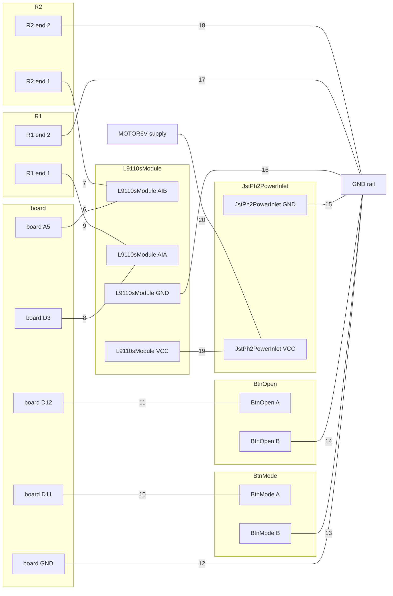

# Breadboard: motor, on a DFRobot FireBeetle 2 ESP32-S3

## Parts

| qty | part | for | have |
| --- | --- | --- | --- |
| 1 | DFRobot FireBeetle 2 ESP32-S3 | the board |  |
| 1 | L9110S dual motor driver module | L9110sModule |  |
| 1 | JST PH 2-pin power inlet | JstPh2PowerInlet |  |
| 2 | 6x6 mm tactile push button | BtnMode, BtnOpen |  |
| 2 | 10kΩ resistor, through-hole | R1 pull-down on L9110sModule AIA; R2 pull-down on L9110sModule AIB |  |
| | what feeds MOTOR6V: a supply from off the board, not part of this list | JstPh2PowerInlet, L9110sModule | |
| | a breadboard and jumper wires | |  |

*have*: yours = your drawer holds it for this project · in your drawer = you own it, not held here · to get = not in your drawer · blank = this project is not on your list (`/spark:init` puts it there)

## Wiring

### Steps

One connection per step. The board's pins take the rows beside them, so a board pin always gets a jumper.

1. Put the board in the breadboard, each pin in its own row.
2. Put L9110sModule in the breadboard, each pin in its own row.
3. Put JstPh2PowerInlet in the breadboard, each pin in its own row.
4. Put BtnOpen in the breadboard, each pin in its own row.
5. Put BtnMode in the breadboard, each pin in its own row.
6. Run a jumper from board A5 to the row of L9110sModule AIB.
7. Put R2 (10kΩ pull-down on L9110sModule AIB), end 1, in the row of L9110sModule AIB.
8. Run a jumper from board D3 to the row of L9110sModule AIA.
9. Put R1 (10kΩ pull-down on L9110sModule AIA), end 1, in the row of L9110sModule AIA.
10. Run a jumper from board D11 to the row of BtnMode A.
11. Run a jumper from board D12 to the row of BtnOpen A.
12. Run a jumper from board GND to a free rail. Mark it GND.
13. Run a jumper from the row of BtnMode B (either leg of the other pair) to the GND rail.
14. Run a jumper from the row of BtnOpen B (either leg of the other pair) to the GND rail.
15. Run a jumper from the row of JstPh2PowerInlet GND to the GND rail.
16. Run a jumper from the row of L9110sModule GND to the GND rail.
17. Put R1 (10kΩ pull-down on L9110sModule AIA), end 2, in the GND rail.
18. Put R2 (10kΩ pull-down on L9110sModule AIB), end 2, in the GND rail.
19. Run a jumper from the row of L9110sModule VCC to the row of JstPh2PowerInlet VCC.
20. Connect the MOTOR6V supply, from off the board, to the row of JstPh2PowerInlet VCC. Check its voltage first (Before you power it).

### Diagram

Each line is one step, with its number.

breadboard.json and breadboard.svg not written: nothing says how to draw L9110sModule in Wokwi.

### Points

After the steps, each line is one point: its ends must be joined, and nothing else.

1. board A5 · L9110sModule AIB · R2 (10kΩ pull-down on L9110sModule AIB), end 1
2. board D3 · L9110sModule AIA · R1 (10kΩ pull-down on L9110sModule AIA), end 1
3. board D11 · BtnMode A (either leg of one joined pair; a meter on continuity shows which legs are joined)
4. board D12 · BtnOpen A (either leg of one joined pair; a meter on continuity shows which legs are joined)
5. board GND · BtnMode B (either leg of the other pair) · BtnOpen B (either leg of the other pair) · JstPh2PowerInlet GND · L9110sModule GND · R1 (10kΩ pull-down on L9110sModule AIA), end 2 · R2 (10kΩ pull-down on L9110sModule AIB), end 2 — more ends than one breadboard row holds: join board GND to a rail and put the others on that rail
6. JstPh2PowerInlet VCC · L9110sModule VCC · the MOTOR6V supply, from off the board, not part of the parts list

## Before you power it

- MOTOR6V comes from off the board, and this sheet does not say its voltage: check it against the supply range of JstPh2PowerInlet, L9110sModule (`parts.py --show`) before you connect it
- **CONFLICT** on L9110sModule: AIA: the board's 10000 ohm pull-down against the module's own 10000 ohm pull-up to its supply holds the pin at 0.5 of the supply (1.25 V to 6 V over its 2.5-12 V range), so it idles HIGH, not low, on any supply above 5 V (input-high threshold 2.5 V); the module's input-low threshold is not recorded, so below that the level is undefined
- **CONFLICT** on L9110sModule: AIB: the board's 10000 ohm pull-down against the module's own 10000 ohm pull-up to its supply holds the pin at 0.5 of the supply (1.25 V to 6 V over its 2.5-12 V range), so it idles HIGH, not low, on any supply above 5 V (input-high threshold 2.5 V); the module's input-low threshold is not recorded, so below that the level is undefined
- L9110sModule BIA: channel B is unused in a one-motor design and must not float — tie it to the driver's own ground
- L9110sModule BIB: as BIA
- L9110S dual motor driver module: Pull both inputs down in HARDWARE. The host's pins float for the ~300 ms between reset and firmware, and through any crash or reflash, and a floating CMOS input on an H-bridge can turn both halves on.
- L9110S dual motor driver module: If a current shunt sits in this module's ground return, the module judges its inputs against ITS OWN ground, which the shunt lifts. Effective input high becomes (host logic level - I x R_shunt), and the margin over 2.5 V is what decides whether the motor turns under load.
- JST PH 2-pin power inlet: Size the inlet for the STALL current, not the running current. A lid motor stalls every time something blocks it, and JST PH is rated 2 A per contact.
- JST PH 2-pin power inlet: This connector and any other 2-pin connector on the board can be cross-plugged unless one of them is keyed or a different series. Swapping a motor supply into an audio output destroys the amplifier.
- JST PH 2-pin power inlet: Fuse or current-limit upstream. Nothing on the board protects this rail.
- JST PH 2-pin power inlet: Check the CRIMP order of a hand-made harness before first power: JST PH housings are keyed, so the mate cannot be reversed, but the crimps can — and 6 V into a motor driver's ground is not recoverable. Mark pin 1 on the silkscreen.
- BtnOpen A has no resistor: the firmware must pull it up with Pin.PULL_UP, as `pins.py` says (P204)
- 6x6 mm tactile push button: Decide the polarity against deep sleep, not convenience. MicroPython's esp32.wake_on_ext1(pins, level) takes ONE level for every pin in the mask, on every chip (ports/esp32/modesp32.c, v1.29.0), so a board with two wake sources must have them assert in the same direction. Both directions are an OR on the S3 and C6: WAKEUP_ALL_LOW is a true AND only on the original ESP32, and ESP-IDF aliases it to ANY_LOW on every later chip (components/esp_hw_support/include/esp_sleep.h, v5.5.2). Prefer wiring a wake button to 3V3 behind a pull-down and arming WAKEUP_ANY_HIGH: low-level wake has an open MicroPython bug, micropython#17334 ('stuck pin', reported on a C6, v1.25.0). Corrected 2026-10-01 (spark P63): this line used to say ALL_LOW is an AND here, which is false on these chips.
- 6x6 mm tactile push button: Debounce in firmware, not hardware, unless the button is also a wake source — a wake pin's first edge is the one that matters and it is not debounced by anything.
- BtnMode A has no resistor: the firmware must pull it up with Pin.PULL_UP, as `pins.py` says (P204)

Each record whole, with what it asks of the board: `parts.py --show jst-ph-2-power-inlet`, `parts.py --show l9110s-module`, `parts.py --show tactile-button`.
